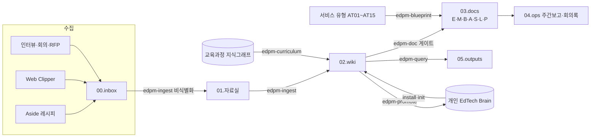

# Agent Driven EdPM

> 에듀테크 PM을 위한 에이전트 기반 프레임워크 · v1.0.0

**에듀테크 PM을 위한 범용 에이전트 프레임워크.** 이러닝 마켓플레이스부터 기업교육 LMS, 부트캠프, 라이브 클래스, K-12 코스웨어, 학원 서비스, 학습앱, 고등교육, 시험대비, AI 튜터까지 — 어떤 에듀테크 회사에서든 내려받아 Claude Code로 바로 쓸 수 있습니다.

**신사업으로 새 서비스를 만드는 PM**과 **운영 중인 서비스에서 기능을 개선하는 PM** 모두를 위한 흐름이 따로 있습니다. 일할수록 지식이 쌓이는 LLM 위키, 업무 모드·서비스 유형별로 켜지는 산출물 84종, 반복 업무를 맡는 스킬 33종, 규칙을 장치로 지키는 점검기·훅, 문제를 직접 만들어 검증하는 프로토타입·MVP 흐름, GitHub로 공유하는 WBS, 국가 교육과정 지식그래프를 한 묶음으로 제공합니다.

---

## 1. 3분 시작

```bash
git clone https://github.com/rey-hailey/agent-driven-edpm.git && cd agent-driven-edpm
./install.sh                         # 몇 가지(회사 이름, 신사업/운영 개선, 개발팀/직접 구현, 서비스 유형)를 묻고 워크스페이스를 만듭니다
cd ~/Work/우리회사-edpm && claude     # 세션이 열리면 상황판이 "지금 단계"와 다음 할 일을 알려줍니다
```

워크스페이스에서 처음이면 **`/edpm-start`** 한 번이면 됩니다. 순서는 하나입니다.

```
/edpm-init (회사·제품) → /edpm-prd (만들 제품 전체 = 원점) → 착수·근거 → 상세 요구사항 → 스펙 → 프로토타입(PRD의 정수)·구현 → 출시
```

| 원칙 | 뜻 |
|------|----|
| **PRD가 원점** | 모든 산출물·프로토타입·코드는 루트 `PRD.md`에서 출발합니다. PRD에는 만들 제품 전체를 적고, 단계는 릴리스 계획으로 나눕니다 |
| **프로토타입은 PRD의 정수** | 축소판 PRD가 아니라, PRD가 정의한 제품의 핵심 경험과 가장 위험한 가정을 먼저 보여줍니다 |
| **코드는 스펙 승인 후** | 개발팀이 있으면 PM은 스펙까지 만들어 넘기고, 개발자 없이 직접 만드는 프로젝트(바이브코딩)면 스펙의 작업 단위로 구현합니다. 훅이 순서를 지킵니다 |

이 프레임워크 폴더를 Claude Code로 열고 "처음인데 어떻게 시작해?"라고 물어도 같은 안내를 받습니다.

필요한 것: [Claude Code](https://claude.com/claude-code), git, python3 3.9 이상. 선택: [Obsidian](https://obsidian.md)(위키 보기), Aside CLI(웹 수집), Anthropic API 키(AI 평가 실행). `./install.sh --check`로 먼저 점검하세요.

**스킬**: EdPM 스킬 33종(`/edpm-*`)은 설치 때 워크스페이스의 `.claude/skills/`(숨김 폴더)에 자동으로 들어가며, 그 폴더에서 Claude Code를 열 때 보입니다. Word·PDF 출력은 워크스페이스의 `automation/scripts/edpm_export.py`가 스킬 없이 만듭니다(표지·목차·쪽 번호, PDF는 Chrome, Word는 pandoc). 화면설계서 와이어프레임(PPTX·Figma) 스킬 `sb-lowfi-pptx`·`sb-lowfi-figma`는 워크스페이스를 설치할 때 공개 저장소 [rey-hailey/sb-lowfi](https://github.com/rey-hailey/sb-lowfi)에서 함께 설치되고(`~/.claude/skills`), `docx`·`pptx`·`xlsx`·`pdf`·`webapp-testing`은 원하면 Anthropic 공식 플러그인으로 설치합니다.

**처음이라면 [guide/14.AtoZ사용가이드.md](guide/14.AtoZ사용가이드.md)부터** — 설치부터 1일차 온보딩, 매일 루틴, 운영 개선 과제 하나와 신사업 단계 심사까지 가상 회사로 따라가는 실전 가이드. 설치 옵션·외부 스킬 상세는 [guide/00.시작하기.md](guide/00.시작하기.md). "이걸로 영업·개발·디자이너·대표와 어떻게 일하나요?"는 [guide/15.협업가이드.md](guide/15.협업가이드.md).

## 1.1 프레임워크가 주는 것은 출발점입니다

EdPM이 만드는 산출물과 함께 주는 SQL·지식·정책 초안은 **템플릿에서 출발한 초안**입니다. 템플릿의 예시 행(매스핏·리딩버디·캠퍼스온 등)은 가상입니다. 회사 사실처럼 그대로 쓰지 말고, 회사 기준에 맞춰 쓰거나 옮겨서 씁니다. 어느 경우든 EdPM 산출물의 frontmatter와 게이트가 보는 항목은 남겨 두어야 진행표·게이트가 계속 동작합니다.

| 프레임워크가 주는 것 | 왜 출발점인가 | 회사에 맞추는 법 |
|----------------------|---------------|------------------|
| 산출물 템플릿 (`PRD.md`, `03.docs/` 84종) | 에듀테크 PM에게 필요한 항목을 빠뜨리지 않게 하는 기본 절 구성. 예시 행(매스핏 등)은 가상 | 회사 문서 양식이 있으면 md로 구조화해 넣고 그 구조로 쓰거나(방식 A), EdPM 산출물을 회사 양식으로 옮겨 냄(방식 B) — `/edpm-template`, `templates/회사양식/` |
| 지표 SQL (`automation/sql/`) | 기본 스키마(`learners`·`enrollments`·`learning_events`)를 가정한 예시 쿼리 | 회사 DB 테이블에 맞는 뷰를 만들거나 쿼리를 고치고 매핑을 기록 — `/edpm-metrics connect` |
| 위키 도메인 지식 (`02.wiki/domain/`) | 공개 자료로 만든 일반 지식, 확인 날짜(`verified`) 기준 | 회사 사례·자료로 보완, `[확인 필요]`는 담당자 확인, 180일마다 재확인 — `/edpm-ingest`, `/edpm-lint` |
| 정책 템플릿 (P01~P09) | 법령·약관 확인 목록과 계산 예시 | 회사 약관·법무 검토로 확정. 법률 자문이 아님 — `/edpm-policy legal-check` |
| 게이트·단계·서비스 유형 | 에듀테크 일반의 순서와 관문 | 해당 없는 산출물은 `n/a`와 사유, 넘어가야 하면 `gate_skip` 사유, 규칙 자체를 바꾸려면 `AGENTS.md`를 사람이 수정 |
| WBS·이슈 템플릿, 보고서 형식 | GitHub 기본, 일반적 보고 구조 | 회사 일정 도구로 내보내기, 회사 보고 양식은 방식 B — `/edpm-wbs export`, `/edpm-template apply` |
| 프로토타입 시작 파일·기본 스택 | 빠른 검증용 기본값 | 회사 스택이 있으면 그것 (`AGENTS.md` 2절 프로토타입 스택) |

## 2. 어떤 일을 하고 있나 — 업무 모드

| 모드 | 이런 PM | 흐름 | 스킬 |
|------|---------|------|------|
| N 신사업 (0→1) | 새 서비스·새 사업을 맡았다 | N01 사업기회 → N02 타당성·투자심의 → N03 MVP·PMF 검증 → N04 단계 심사(확장·전환·중단) + 최소 범위 E 체인 | `/edpm-venture` |
| F 운영 개선 (1→n) | 운영 중인 OO 서비스의 PM이다 | F00 현황 진단 → 요청 접수·백로그·우선순위 → 과제마다 F01 문제 정의 → F02 기능 기획(영향 점검) → F03 실험·출시 → F04 효과 리뷰 | `/edpm-feature` |

두 모드 모두 프로젝트 관리(M), 정책(P), AI(A), 교육과정 지식그래프를 함께 씁니다. 상세: [guide/09.업무모드.md](guide/09.업무모드.md).

## 3. 우리 서비스는 어떤 유형인가

| 유형 | 이런 서비스 | 특히 강한 부분 |
|------|-------------|----------------|
| AT01 이러닝 마켓플레이스 | 성인 직무·취미 VOD, 강사 입점 | 과정 구조, 제작 파이프라인, 가격, 강사 정산, 환불, 부정 수강 방지 |
| AT02 기업교육 LMS | 임직원 교육, 법정 의무교육, 환급 과정, B2B 좌석 | 관리자 LMS IA, 진도·수료 규칙, SCORM·xAPI, 보고서, 수료증 |
| AT03 부트캠프·직무교육 | 코딩·데이터 부트캠프, 라이브 + 실습 + 프로젝트 | 코딩 IDE, 과제·평가, 라이브 클래스, 성과 측정 |
| AT04 라이브 클래스·튜터링 | 실시간 그룹 수업, 1:1 과외 매칭 | 라이브 화면, 출석, 튜터 운영, 환불, 미성년 안전 |
| AT05 K-12 코스웨어 | 학교 수업용 디지털 학습 | 학습 성과 설계, 교육과정 지식그래프, 아동 개인정보, 조달 |
| AT06 학원·사교육 서비스 | 학원 관리·학습 앱, 학부모 소통 | 성취기준 매핑, 학부모 리포트, 원장 영업 |
| AT07 소비자 학습앱 | 어학·수학·독서 구독 앱 | 동기 설계, 구독 수익, 이탈 예측 |
| AT08 고등·평생교육 | 대학 LMS, 공개강좌 | 표준 연동, 크레덴셜, 학습 데이터 |
| AT09 자격증·시험대비 | 문제은행, 모의고사 | 평가 설계, 문항 자동 생성, 합격·이탈 예측 |
| AT10 AI 튜터·학습 에이전트 | AI 튜터 제품, 기존 서비스의 AI 기능 | AI 기회 맵, 튜터 설계, RAG·메모리, 평가 실행기 |
| AT11 온라인학위·원격교육 위탁운영(OPM) | 대학·사이버대·평생교육원 온라인 과정 위탁운영 | 모집·학생지원, 등록금 수익배분, 품질인증, LMS 운영 |
| AT12 평가·원격감독 벤더 | 온라인 시험·원격감독·역량검사 제공 | 출제·시행·채점, 원격감독, 부정방지, 타당도·신뢰도 |
| AT13 LXP·스킬 인텔리전스 | 기업 학습경험플랫폼, 재직자 스킬 개발 | 콘텐츠 추천, 스킬 택소노미·그래프, 개인화 학습경로, HRIS 연동 |
| AT14 특수교육·학습지원 | 장애·느린학습자 개별화 학습지원 | IEP, 보조공학, 접근성, 개별 목표 달성 |
| AT15 영유아 교육 플랫폼 | 만 0~7세 놀이중심 학습·기관 운영 | 놀이중심 설계, 아동 안전·개인정보, 학부모 소통, 가정연계 |

혼합형도 됩니다 (예: AT01+AT02, AT05+AT10). 상세: [archetypes/](archetypes/).

| 서비스 형태 예 | 유형 조합 | 특화 지식 |
|----------------|-----------|-----------|
| AI 영어 스피킹 앱 (Speak형) | AT07 + AT10 | 음성AI스피킹학습 |
| 수학 문제 풀이·필기 앱 (오르조형) | AT07 + AT09 | 디지털문제집과풀이앱 |
| 수학 학원 프랜차이즈 (매쓰홀릭형) | AT06 | 학원프랜차이즈운영 |
| 대학 LMS | AT08 | 대학LMS운영 |
| 유초등 영어 리딩 (리딩게이트·리딩앤형) | AT07 + AT06 | 레벨드리딩과영어독서, 유아초등학습UX |
| 초등 구독·전용 기기 (엘리하이형) | AT07 + AT05 | 전용기기학습서비스 |

서비스명은 형태를 설명하는 범주 표시이며 해당 회사의 내부 사정을 뜻하지 않습니다.

## 4. 무엇을 다루나

| 영역 | 산출물 | 주요 스킬 |
|------|--------|-----------|
| 비즈니스 로직 | L01 과정·콘텐츠 구조, L02 제작 파이프라인, L03 진도·수료 규칙, L04 과제·평가, L05 SCORM·xAPI·LTI 연동, L06 수료증·크레덴셜, S03 가격, S06 수익 모델, S07 강사 정산 | `/edpm-doc`, `/edpm-blueprint` |
| 정보구조·화면 | E10 + 역할별 IA 패턴 4종(학습자 앱·강사 대시보드·기업 관리자 LMS·콘텐츠 CMS), 화면 패턴 5종(강의 플레이어·코딩 IDE·퀴즈·대시보드·라이브) | `/edpm-doc E10`, 와이어프레임 스킬 |
| 정책·운영 | P01 이용·환불, P02 콘텐츠 권리·강사 계약, P03 부정 이용 방지, P04 품질 관리, P05 고객지원, P06 강사·튜터 운영, E13 개인정보·아동 안전·접근성 | `/edpm-policy` |
| 학습 설계·검증 | E00~E20: 교육 문제 → 학습 성과 → PRD·지표 → 학습 경험·기능·콘텐츠·데이터 → 파일럿 → 학습 효과 → 회고 | `/edpm-doc`, `/edpm-review` |
| AI | A00 기회 맵, E14 AI 학습 기능, **A10 방식 선택(규칙·고전 NLP·검색·RAG·소형 모델·로컬 LLM·클라우드 LLM)**, A11 모델 선택·라우팅, A12 토큰·GPU 비용과 과금, A13 MLOps·LLMOps, A14 가드레일, A01~A06 튜터 설계·평가, A07 자막·번역, A08 문항 생성, A09 이탈 예측, P07~P09 AI 윤리·품질·운영 정책, AI 서비스 IA·화면 패턴 | `/edpm-ai-design`, `/edpm-eval`(클라우드·로컬·자체 시스템 비교), `ai_cost.py` |
| 교육과정 | 2022 개정 초·중·고 성취기준·선수 관계·전환기 격차 지식그래프, 매핑·커버리지 | `/edpm-curriculum` |
| 신사업 | N01 사업기회, N02 타당성·투자심의, N03 MVP·PMF 검증, N04 단계 심사 | `/edpm-venture` |
| 운영 개선 | F00 현황 진단, 개선 백로그, 과제별 F01 문제 정의·F02 기능 기획·F03 실험·출시·F04 효과 리뷰 | `/edpm-feature` |
| 프로토타입·MVP | V01 계획(검증 질문·충실도 P0~P4·성공·중단 기준) → 빌드(클릭 프로토타입·오즈의 마법사·노코드·코드 MVP) V02 → 사용자 테스트 → V03 결정·개발 이관 | `/edpm-proto` |
| 프로젝트 관리 | M01 착수, M02 WBS(GitHub 이슈·마일스톤·Projects 동기화, 스프레드시트·Notion·Jira·Linear 내보내기), M03 위험·이슈, M04 중간, M05 완료, 주간보고 | `/edpm-report`, `/edpm-wbs`, `/edpm-weekly` |
| 직군 협업 | 같은 근거를 개발(스토리·인수조건·이슈)·디자인(문제·맥락·연령 규칙)·영업(말할 수 있는 것·없는 것)·경영진(결정 요청 한 장)·CS·콘텐츠·법무의 언어로, 피드백은 다시 백로그·WBS·ADR로 | `/edpm-handoff` |
| 매일의 PM 업무 | 상황판·오늘 할 일, 회의 준비·회의록(결정·액션·근거 분리), 의사결정 기록·예측·채점·사전 부검 | `/edpm-brief`, `/edpm-meeting`, `/edpm-decide` |
| 지표·수치 | E07 지표 정의 → SQL 템플릿(진도율·수료율·리텐션·활성화·과제 제출률) → 계산·효과크기·기준선 비교 | `/edpm-metrics`, `metrics.py`, `automation/sql/` |
| 구현 협업 | B01~B07 시스템·API·DB·인프라·디자인시스템·테스트 | `/edpm-doc`, `/edpm-qa` |
| 수주·영업 | S01 RFP 분석, S02 제안서, S04 세일즈 플레이북, S05 마케팅 | `/edpm-proposal`, `/edpm-content` |
| 자료·지식 | 자료실(9분류), LLM 위키, 개인 EdTech Brain, 웹 수집 레시피 | `/edpm-ingest`, `/edpm-query`, `/edpm-lint`, `/edpm-library`, `/edpm-collect`, `/edpm-promote` |
| 연구 이관 | 연구·교과 조직의 PoC·학습 알고리즘 → 제품 기능·프로세스·데이터 구조 (D01) | `/edpm-doc D01` |
| 일한 기록 → 포트폴리오 | 한 사이클의 문제 정의·결정과 이유·개발이 참조한 산출물·AI 결과 검증·결과 지표를 한 장으로 (기밀 점검 후 HTML) | `/edpm-portfolio` |

주제별로 어디를 보면 되는지는 [guide/08.에듀테크PM커버리지맵.md](guide/08.에듀테크PM커버리지맵.md)에 있습니다.

## 5. 어떻게 일하나



| 층 | 폴더 | 규칙 |
|----|------|------|
| 수집함 | `00.inbox/` | 임시, git 제외 |
| 자료실 | `01.자료실/` | 비식별화된 근거 원본, 수정 금지 |
| 위키 | `02.wiki/` | LLM이 쓰고 사람이 판단, 모든 주장에 출처 |
| 산출물 | `03.docs/` | frontmatter `status`가 진행 상태의 기준 |
| 운영·결과 | `04.ops/`, `05.outputs/` | 주간보고·회의록, 분석·평가·출력물 |
| 스키마 | `AGENTS.md` | 에이전트 규칙 (사람이 관리) |

## 6. 범용 PM 프레임워크와 다른 점

| 범용 | EdPM |
|------|------|
| 고객 = 사용자 | 학습자·교사·보호자·기관·기업 HR·강사가 사용자·구매자·결제자로 나뉨 (E02) |
| 기능에서 시작 | 학습 성과에서 시작 (E05 → E09, G-LEARN) |
| 지표 = 활성·매출 | 학습 효과가 북극성, 참여·매출은 보조, 안전·과몰입은 가드레일 (E07) |
| 결제·환불은 개발 사항 | 환불·정산·진도·수료 규칙을 계산 가능한 정책으로 (P01, S07, L03, G-POLICY) |
| 출시 = 개발 완료 | 학사일정·기업 예산·소비자 성수기 시즌에 맞춤 (G-CAL), 실제 파일럿 증거 (G-EVIDENCE) |
| AI = 클라우드 LLM 붙이기 | 기능마다 가장 단순한 방식부터 고름: 정답이 있으면 규칙·SQL, 분류는 고전 NLP, 근거가 필요하면 RAG, 학생 데이터는 로컬 LLM (A10). 같은 평가셋으로 방식을 비교하고, 가드레일·비용·운영을 설계해 출시 판정 (A06, A12, A14, G-AI) |
| 성취기준 = 기억·PDF | 교육과정 지식그래프 조회, 공식 관계와 권장 순서 구분 (G-CURRIC) |
| 자료 = 공유 폴더 | 자료실 → LLM 위키 → 산출물, 원본까지 추적 |
| 규칙은 문서에만 | 세션 시작 상황판, 자료실 원본 보호, 게이트 미충족 done 차단, 식별 정보 저장 차단을 훅으로. 린트·주간보고의 결정적 항목은 스크립트가 판정 (가이드 13) |
| 결정은 회의록에 묻힘 | ADR에 예측과 재검토일을 적고 지나면 채점. 판단 적중률을 봄 |
| 기획서로 끝 | 가장 위험한 가정을 가장 낮은 충실도(클릭 → 오즈의 마법사 → 코드 MVP)로 만들어 결과 전에 정한 기준으로 판정, 프로토타입 코드는 검토 없이 운영에 넣지 않음 (V01~V03, G-PROTO) |
| 기능 개선 = 요청받은 대로 | 요청을 문제로 재정의, 영향 점검(환불·정산·진도·개인정보·AI), 출시 후 같은 지표로 효과 리뷰 (G-IMPACT, G-MEASURE) |
| 신사업 = 계획서 한 번 | 가설·중단 기준, 학습 효과를 포함한 PMF 기준, 단계 심사 후 확장 (G-STAGE) |
| 프로젝트마다 처음부터 | 개인 EdTech Brain을 회사가 바뀌어도 가져감 (공개 지식만) |

## 7. 폴더 구성

| 경로 | 내용 |
|------|------|
| [install.sh](install.sh) | 워크스페이스 설치 |
| [archetypes/](archetypes/) | 서비스 유형 15종 (비즈니스 로직, 역할, IA, 트랙별 필수·권장, 지표, 규제, 시즌, 시작 순서) |
| [guide/](guide/) | 00 시작하기(설치·사용법) · 01 설계 원칙 · 02 산출물 체인과 게이트 · 03 LLM 위키 운영 · 04 자동화 선택 · 05 회사 온보딩 · 06 기존 자료 가져오기 · 07 교육과정 지식그래프 · 08 커버리지 맵 · 09 업무 모드 · 10 AI 방식 선택 · 11 프로토타입과 MVP · 12 일정 관리 도구 연동 · 13 하네스와 점검 · **14 A to Z 사용 가이드** · **15 협업 가이드** |
| [workspace-template/](workspace-template/) | 워크스페이스 원본 (산출물 템플릿 84종(PRD 포함), 스킬 33종, 점검기·훅·지표 계산·WBS 동기화 스크립트, 자동화·평가·비용·지식그래프 도구) |
| [extras/](extras/) | 함께 쓰는 스킬 안내: [sb-lowfi](https://github.com/rey-hailey/sb-lowfi)(low-fi 와이어프레임 PPTX·Figma, 설치 때 자동), 공식 문서 스킬(선택) |
| [brain-seed/](brain-seed/) | 개인 EdTech Brain 초기 지식팩 (학습과학, 측정, 규제·표준, 이러닝 비즈니스 로직, IA·화면 패턴, 서비스 정책, AI 활용, AI 서비스 로직·IA·화면·정책, 서비스 형태별 지식, 교육과정, 용어집 — 87페이지) |
| [tests/](tests/) | 점검기·훅·WBS 동기화·지표 계산 회귀 테스트 (`python3 -m unittest discover -s tests`) |
| [CHANGELOG.md](CHANGELOG.md) | 변경 이력 |

## 8. 설계 원칙

1. **학습 성과가 먼저다.** 기능은 학습 성과를 달성하는 수단이다.
2. **업무 모드와 서비스 유형이 범위를 정한다.** 모든 산출물을 쓰지 않는다. 신사업인지 운영 개선인지, 어떤 서비스인지에 맞는 것만 켠다.
3. **모든 주장에는 출처가 있다.** 산출물 → 위키 → 자료실 원본까지 추적된다. 없으면 `[가정]`.
4. **규칙은 계산 가능해야 한다.** 진도율·수료·환불·정산·지표·효과크기는 공식과 스크립트로.
5. **학습자의 데이터는 밖으로 나가지 않는다.** 비식별화 전 자료를 외부 AI로 보내지 않는다. 미성년은 더 엄격하게.
6. **시즌이 곧 로드맵 제약이다.** 학사일정, 기업 교육 예산, 소비자 성수기.
7. **효과는 과장하지 않는다.** 제안서·마케팅의 효과 주장은 측정 결과와 증거 수준만.
8. **도구에 묶이지 않는다.** 위키는 일반 마크다운, 레시피는 자연어 명세.

## 9. 기본 도구

| 역할 | 기본값 | 대체 가능 |
|------|--------|-----------|
| 에이전트 | Claude Code (`.claude/skills/edpm-*`) | AGENTS.md를 읽는 다른 코딩 에이전트 |
| 지식 저장소 | Obsidian 볼트 + git | 일반 마크다운 폴더 |
| 웹 수집·화면 점검 | Aside CLI / MCP | Claude in Chrome, Playwright, 수동 |
| AI 평가 | `automation/scripts/ai_eval.py` — Claude API, OpenAI 호환 로컬 서버(Ollama·vLLM·llama.cpp), 자체 규칙·NLP 시스템을 같은 평가셋으로 비교 | 다른 평가 도구 (CSV 형식 유지) |
| AI 비용 | `automation/scripts/ai_cost.py` + `model_prices.json` (토큰·캐시·라우팅·로컬 GPU) | 스프레드시트 |
| 교육과정 데이터 | 교육과정 지식그래프 (공개 온톨로지 3종, MIT) | 회사 자체 교육과정 DB |
| 일정 실행 | Aside Routines, launchd·cron, GitHub Actions | n8n (회사 운영 시) |
| 일정 관리·공유 | GitHub Issues·Milestones·Projects (`wbs_sync.py`, `gh` CLI) | 스프레드시트, Notion, Jira, Linear (`/edpm-wbs export`) |
| 프로토타입 | 클릭 프로토타입 HTML(빌드 도구 없음) → 코드 MVP: Next.js + Tailwind + Supabase + Vercel | 회사 스택, Figma, 노코드 도구 |
| 문서 출력 | docx·pdf·pptx·와이어프레임 스킬 | 회사 템플릿 |

## 10. 주의

- 법령·세금·조달 관련 내용은 정리 시점 기준이며 법률 자문이 아닙니다. `[확인 필요]` 표시를 확인하고 최종본은 법무 검토를 받으세요.
- 교육과정 지식그래프는 공개 데이터(MIT)로, 교육부·국가교육위원회·NCIC의 공식 자료가 아닙니다. 사용 시 출처 고지를 남기세요.
- 템플릿의 예시 행(매스핏: 중학생 수학 앱, 스킬업: 성인 직무교육 플랫폼, 리딩버디: 유아 영어 신사업, 캠퍼스온: 대학 LMS 기능 개선)은 가상 예시입니다.

## 11. 라이선스

[MIT License](LICENSE) — 자유롭게 쓰고 고치고 배포할 수 있습니다. 저작권 표시와 라이선스 문구는 남겨 주세요.

함께 쓰는 외부 자료는 각자의 라이선스를 따릅니다. 이 저장소에 포함하지 않고 설치 때 받거나 안내만 합니다.

| 외부 자료 | 라이선스 | 받는 방법 |
|-----------|----------|-----------|
| 교육과정 지식그래프 원천 데이터 | 각 원천 저장소의 MIT (출처 고지 필요) | `install.sh --with-kg` 또는 `/edpm-curriculum setup` |
| `sb-lowfi` 스킬 | 해당 저장소 라이선스 | `install.sh`가 함께 설치 |
| Anthropic 공식 문서 스킬, n8n 스킬 | 각 배포처 라이선스 | 직접 설치 (`extras/README.md`) |
