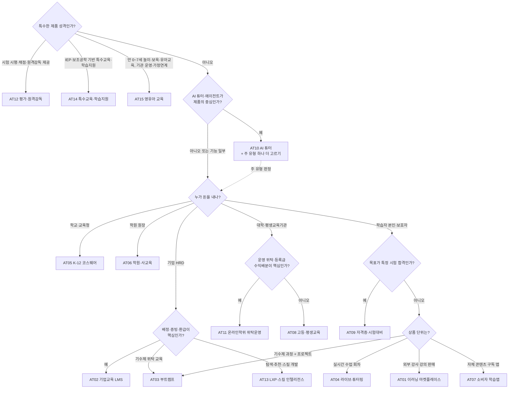
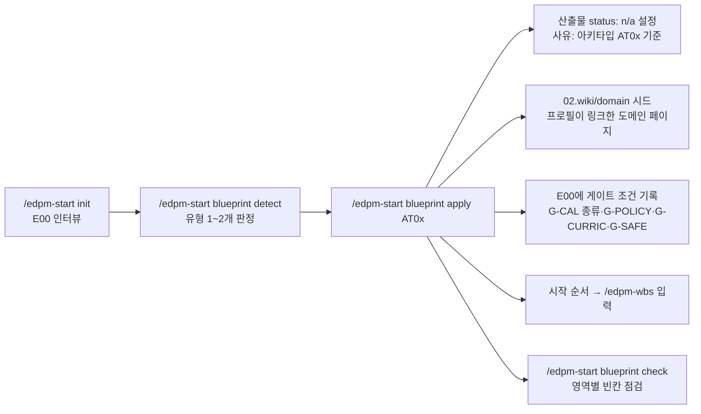

# 서비스 유형(아키타입) 프로필

에듀테크는 이러닝 마켓플레이스부터 K-12 코스웨어, AI 튜터까지 범주가 넓어서 같은 산출물 체인을 모두 켜면 일이 과해지고, 반대로 유형 특유의 핵심 로직(정산, 환급 과정, 교육과정 정렬 등)은 빠지기 쉽습니다. 이 폴더는 서비스 유형 15종마다 **무엇을 꼭 쓰고, 무엇을 n/a로 둬도 되는지**와 그 유형의 비즈니스 로직·IA·지표·규제·시즌을 한 장에 정리한 것입니다.

- 사업 유형(구매 구조: K-12·학원·B2C·고등·기업)은 모듈 필수 여부를 정하고 (가이드 02 3절 표), 서비스 유형은 **L·P·S·A 트랙과 플레이북**을 정합니다. 둘을 함께 봅니다.
- 각 프로필은 같은 11개 절로 되어 있습니다: 정의와 예 / 이해관계자와 구매 구조 / 핵심 비즈니스 로직 / 대표 IA·화면 / 활성 트랙·산출물 / 핵심 지표 / 규제·리스크 / 시즌 캘린더 / 자주 하는 실수 / 시작 순서 / 관련 페이지.
- 범주 예시로 든 공개 서비스 이름은 형태를 설명하기 위한 것이며, 그 서비스의 내부 구조나 수치를 주장하지 않습니다.
- 법령·제도 수치는 `[확인 필요]`로 두었습니다. 산출물에 쓰기 전에 공식 원문으로 확인합니다.

## 1. 프로필 목록

| ID | 유형 | 한 줄 정의 | 주 사업 유형 |
|----|------|------------|--------------|
| [AT01](AT01_이러닝마켓플레이스.md) | 이러닝 마켓플레이스 | 강사 입점 VOD 판매·구독, 정산이 핵심 | B2C |
| [AT02](AT02_기업교육LMS.md) | 기업교육 LMS | 임직원 교육 배정·증빙, 환급 과정, 좌석 | B2B HRD |
| [AT03](AT03_부트캠프직무교육.md) | 부트캠프·직무교육 | 기수제 라이브 + 실습 + 프로젝트 + 취업 연계 | B2C·정부 지원 |
| [AT04](AT04_라이브클래스튜터링.md) | 라이브 클래스·튜터링 | 실시간 수업 매칭·예약·회차 정산 | B2C·B2B2C |
| [AT05](AT05_K12코스웨어.md) | K-12 코스웨어 | 학교 수업용 디지털 학습, 교사 대시보드 | B2G·B2S |
| [AT06](AT06_학원사교육서비스.md) | 학원·사교육 서비스 | 학원용 콘텐츠·관리, 원장·강사·학부모 | B2B2C |
| [AT07](AT07_소비자학습앱.md) | 소비자 학습앱 | 자기주도 구독 앱, 동기·습관 설계 | B2C |
| [AT08](AT08_고등평생교육.md) | 고등교육·평생교육 | 대학 LMS, 공개 강좌, 학점·이수 연계 | 고등교육 |
| [AT09](AT09_자격증시험대비.md) | 자격증·시험대비 | 문제은행·모의고사·합격 예측, 시험일 중심 | B2C |
| [AT10](AT10_AI튜터학습에이전트.md) | AI 튜터·학습 에이전트 | LLM 튜터·버디·교사 보조, 단독 또는 조합 | 전 세그먼트 |
| [AT11](AT11_온라인학위위탁운영.md) | 온라인학위·원격교육 위탁운영(OPM) | 대학 과정의 모집·제작·LMS·학생지원 위탁, 등록금 수익배분 | 고등교육·평생교육 (B2B2C) |
| [AT12](AT12_평가원격감독.md) | 평가·원격감독 벤더 | 온라인 시험 출제·시행·채점·원격감독, 역량·인적성 평가 | 기관·기업·대학 B2B |
| [AT13](AT13_LXP스킬인텔리전스.md) | LXP·스킬 인텔리전스 | 콘텐츠 탐색·추천, 스킬 기반 개인화 학습·커리어 개발 | B2B HRD |
| [AT14](AT14_특수교육학습지원.md) | 특수교육·학습지원 | 개별 목표·IEP·보조공학·접근성 중심 학습지원 | B2G·B2B2C |
| [AT15](AT15_영유아교육.md) | 영유아 교육 플랫폼 | 만 0~7세 놀이중심 콘텐츠·기관 운영·학부모 소통·가정연계 | B2C·B2B2C·B2G |

## 2. 유형 고르기

판정이 애매하면 `/edpm-start blueprint detect`가 질문 10개로 1~2개를 제안합니다. 판정 근거는 E00 "서비스 유형" 절에 남깁니다.

## 3. 조합 가이드

실제 서비스는 혼합형이 흔합니다. **주 유형 1개 + 보조 유형 1개**까지를 권장하고, 셋 이상이면 제품을 나누어 워크스페이스를 따로 두는 것을 검토합니다.

| 조합 | 흔한 모습 | 합칠 때 주의 |
|------|-----------|--------------|
| AT05 + AT10 | 코스웨어에 AI 튜터·교사 보조 추가 | 학생 평가 AI는 고영향(G-AI + E13 d8·d9), 교사 승인 흐름, G-CURRIC와 A01 지식 소스를 같은 KG 코드로 |
| AT01 + AT02 | B2C 마켓 + 기업 좌석 플랜 | 강사 정산(S07)에 B2B 매출 배분 규칙 추가, 기업 관리자 IA, L05 연동, 환불(P01) 기업 예외 |
| AT06 + AT04 | 학원의 온라인 수업·관리반 | 학원법 교습비 반환과 회차 차감 규칙 정합, 미성년 화상 안전 |
| AT07 + AT10 | 학습앱의 AI 대화 연습·학습 버디 | 학습자상태(A04)의 보호자 열람·삭제, 사용량 비용과 구독 가격 |
| AT09 + AT01 | 인강 + 문제은행 패키지 | 문항 저작권과 강사 계약(P02) 분리, 합격 환급형 상품 P01 |
| AT03 + AT02 | 기업 위탁 부트캠프, 재직자 환급 훈련 | 환급 요건이 출결·평가 로직(L03·L04)을 지배, G-CAL에 정부 공고 일정 |
| AT08 + AT01 | 대학 공개 강좌의 유료 이수증 | 교수 강의 권리(P02), LTI 연동과 결제 흐름 분리 |

규칙: 두 프로필의 트랙 표를 겹쳐 **더 강한 요구를 택합니다** (필수 > 권장 > 해당없음). 지표 북극성은 주 유형 것을 쓰고, 보조 유형의 북극성은 M-1x 학습 효과 지표로 내립니다. 시즌 캘린더는 둘 다 G-CAL 입력으로 둡니다.

## 3.1 서비스 형태별 예

실제 시장의 서비스 형태가 어떤 유형 조합과 지식 페이지로 연결되는지 보여주는 예입니다. 서비스명은 형태를 설명하기 위한 범주 표시이며, 해당 회사의 내부 사정을 나타내지 않습니다.

| 서비스 형태 | 유형 조합 | 특화 지식 (brain-seed/domain) | 특히 중요한 산출물 |
|-------------|-----------|-------------------------------|--------------------|
| AI 영어 스피킹 앱 (Speak형) | AT07 + AT10 | 음성AI스피킹학습, AI튜터설계, 학습데이터프라이버시 | E08, E14, A03, A04, A06, S06, A09 |
| 수학 문제 풀이·필기 앱 (오르조형) | AT07 + AT09 | 디지털문제집과풀이앱, 문항자동생성, 교육저작권, 교육과정지식그래프 | L01, L04, P02, E11 매핑, S06 |
| 수학 학원 프랜차이즈·학습관리 (매쓰홀릭형) | AT06 (+ AT05 콘텐츠) | 학원프랜차이즈운영, 교사대시보드IA, 교육과정지식그래프 | E02, E10, E13, S04, P05, P06 |
| 대학 LMS | AT08 | 대학LMS운영, 상호운용표준, SCORM과xAPI, 접근성 | L03, L05, L06, E13, B01 |
| 유초등 영어 리딩 (리딩게이트·리딩앤형) | AT07 + AT06 | 레벨드리딩과영어독서, 유아초등학습UX, 아동개인정보보호 | E05, E08, E11, E13, P01, S04 |
| 초등 전과목 구독·전용 기기 (엘리하이형) | AT07 + AT05 | 전용기기학습서비스, 유아초등학습UX, 교육과정지식그래프 | E07, E13, P01, P05, S06, A09 |
| 성인 직무 VOD 마켓플레이스 | AT01 (+ AT02) | 강사정산모델, 환불정책, 부정수강방지 | L01~L03, P01~P03, S07 |
| 기업 법정의무교육·환급 과정 | AT02 | 학습진도관리, 기업관리자LMSIA, 부정수강방지 | L03, L05, L06, P03 |

같은 형태라도 업무 모드에 따라 쓰는 문서가 다릅니다: 새로 만드는 중이면 N 트랙(`/edpm-doc venture`), 운영 중인 서비스의 개선이면 F 트랙(`/edpm-doc feature`). 예시는 `guide/09.업무모드.md` 3절.

## 4. 마스터 매트릭스

필수 = 필수, 권장 = 조건부·권장, - = 기본 n/a. 세부 ID는 각 프로필 5절이 기준입니다.

| 유형 | L 학습운영 | P 정책운영 | S06 / S07 | CONTENT | DATA | SAFE | 교육과정 KG | AI-TECH | GTM | 핵심 게이트 |
|------|-----------|-----------|-----------|---------|------|------|-------------|---------|-----|-------------|
| AT01 | 필수 L01·L02·L03·L06 | 필수 P01~P06 | 필수 / 필수 | 필수 | 필수 | 필수 | - | A07 필수, A00·A01~A03·A06 권장 | 필수 | G-POLICY, G-CAL(소비자 성수기·정산일) |
| AT02 | 필수 L01·L03~L06 | 필수 P01·P03·P05 | 필수 / 권장 | 콘텐츠 제공 시 | 필수 (HRIS·LMS) | 필수 | - | 권장 A00·A07·A09 | 필수 | G-CAL(예산·환급 심사), G-POLICY |
| AT03 | 필수 L01~L04·L06 | 필수 P01~P06 | 필수 / 권장 | 필수 | 필수 | 필수 | - (NCS 자체 매핑) | A00 필수, A05·A09 권장 | 필수 | G-EVIDENCE(기수 파일럿), G-POLICY |
| AT04 | 필수 L01·L03·L04 | 필수 P01·P03·P05·P06 | 필수 / 필수 | 교재 제공 시 | 필수 | 필수 (미성년 강화) | K-12 교과면 예 | 권장 A00·A05·A07·A09 | 필수 | G-POLICY, G-SAFE |
| AT05 | 권장 L01·L05 | 필수 P05 | 권장 / - | 필수 | 필수 (표준 연동) | 필수 | 예 | 권장 A00·A01~A03·A05·A06·A08 | 필수 (조달) | G-CURRIC, G-SAFE, G-AI, G-CAL(학사), G-EVIDENCE |
| AT06 | 권장 L03·L04 | 필수 P01·P05 | 권장 / - | 필수 | 필수 | 필수 | 예 | 권장 A00·A05·A08·A09 | 필수 (원장 영업) | G-CURRIC, G-SAFE, G-CAL(시험 기간) |
| AT07 | - (L01 권장) | 필수 P01·P05 | 필수 / - | 대부분 필수 | 필수 | 미성년이면 필수 | 교과 앱이면 예 | A09 필수, A00·A04·A08 권장 | 필수 (시즌 마케팅) | G-POLICY, G-CAL(신년·방학), G-SAFE(아동) |
| AT08 | 필수 L01·L03~L06 | 필수 P02·P03·P05 | 권장 / - | 선택 | 필수 (학사 연동) | 필수 | - | 권장 A00·A07·A09 | 필수 (입찰) | G-CAL(개강·성적 처리), G-EVIDENCE |
| AT09 | 필수 L04 (인강 시 L01·L03) | 필수 P01·P04·P05 | 필수 / 권장 | 필수 (문항 은행) | 필수 | 필수 | 입시면 예 | A08·A09 필수 | 필수 (회차 마케팅) | G-AI(A08 검수), G-POLICY, G-CAL(시험일) |
| AT10 | 주 유형을 따름 | 필수 P05 | 필수 / - | 지식 소스 제작 시 | 필수 | 필수 | K-12 교과면 예 | 필수 A00·A02·A03·A06·A10·A14 + 구성 요소별 A01·A04·A05, 유료·대량 시 A12 | 필수 | G-AI, G-SAFE |
| AT11 | 필수 L01~L06 | 필수 P01~P05, P06 조건부 | 필수 / 필수 | 필수 | 필수 | 필수 | - | 권장 A00·A07·A09·A01~A03·A06, AI 채택 시 A10·A14 | 필수 | G-POLICY, G-SAFE, G-CAL(모집·개강·성적·정산), G-EVIDENCE |
| AT12 | 필수 L01·L04·L05 | 필수 P01~P05 | 필수 / 수익배분 시 권장 | 필수 | 필수 | 필수 | 교육과정 기반이면 예 | AI 시 A00·A06·A10·A11·A13·A14 필수, 문항 생성 시 A08·유료 대량 시 A12 | 필수 | G-CAL(시험·채용), G-POLICY, G-EVIDENCE, G-AI(AI 시), G-SAFE |
| AT13 | 필수 L01·L03·L05 | 필수 P01·P02·P05, AI 시 P07~P09 | 필수 / 수익배분 시 필수 | 자체 콘텐츠 시 | 필수 (HRIS·LMS·스킬) | 필수 | - | AI 시 A00·A06·A10~A14 필수 | 필수 | G-AI(AI 시), G-POLICY, G-CAL(예산·갱신) |
| AT14 | 필수 L01·L02·L04 | 필수 P04·P05, 조건부 P01 | 필수 / - | 필수 | 필수 | 필수 | 국가 교육과정 기반이면 예 | AI 시 A00·A06·A10·A14 필수 | 필수 (조달·기관) | G-SAFE, G-EVIDENCE, G-CAL(학사·IEP), 조건부 G-CURRIC·G-POLICY·G-AI |
| AT15 | 필수 L01·L02, 연동 시 L05 권장 | 필수 P01·P02·P04·P05 | 필수 / - | 필수 | 필수 | 필수 | 누리과정 연계 시 검토 | AI 시 관련 A 트랙·A10·A14, 평가 A06, 유료·대량 시 A12 | 필수 | G-SAFE, G-POLICY, G-CAL(기관 운영), G-EVIDENCE, 연계 시 G-CURRIC |

모든 유형에서 Core(E00~E10, E15~E17, E19, E20), M01~M05, G-LEARN, G-PII는 항상 적용됩니다. B 트랙은 회사 개발 문서가 없을 때 켭니다.

## 5. 스킬이 이 파일을 쓰는 방법

| 스킬 | 이 폴더에서 읽는 것 | 하는 일 |
|------|---------------------|---------|
| `/edpm-start init` | 사업 유형 인터뷰 결과 → 해당 프로필 2절(이해관계자) | E00 작성 시 사용자·구매자·결제자·의사결정자 질문을 유형에 맞춤. 끝나면 `/edpm-start blueprint`를 안내 |
| `/edpm-start blueprint detect` | 1절 정의, 2절 구매 구조, 이 README 2절 결정 트리 | 유형 1~2개 제안, E00 "서비스 유형" 절에 근거 기록 |
| `/edpm-start blueprint apply` | 5절 트랙 표 | 해당없음 산출물을 `status: n/a`로 (이미 draft 이상인 것은 보고만), 조합이면 더 강한 요구 채택, AGENTS.md 2절 "활성 모듈" 변경안 제안 |
| | 3·4·7절의 `[[domain/...]]` 링크 | 위키에 없는 도메인 페이지를 개인 Brain 또는 `brain-seed/domain/`에서 복사 |
| | 6절 지표, 8절 시즌 캘린더 | E07 초안의 북극성·지표 대역 후보, G-CAL 캘린더 종류를 E00에 기록 |
| | 10절 시작 순서 | `/edpm-wbs create`의 초기 작업 패키지 순서 |
| `/edpm-start blueprint check` | 3·4절 영역 | 비즈니스 로직·IA·화면·정책·AI 영역별 빈칸과 다음 행동 |
| `/edpm-start blueprint map` | 전 절 요약 | 한 장 청사진 (신규 PM·경영진 공유용) |

프로필은 프레임워크 파일이라 워크스페이스에 복사하지 않습니다. 스킬은 `AGENTS.md` 2절 "프레임워크 경로"로 이 폴더를 찾습니다. 회사 고유의 변형(예: 우리 회사만의 정산 규칙)은 프로필이 아니라 `02.wiki/company/`와 해당 산출물에 적습니다.

## 6. 프로필 갱신 규칙

- 새 유형이 필요하면 AT16부터 같은 11개 절 형식으로 추가하고, 가이드 02 3절 표와 이 README의 목록·결정 트리·매트릭스를 함께 고칩니다.
- 트랙 표를 바꾸면 매트릭스(4절)도 같이 바꿉니다. 둘이 다르면 각 프로필 5절이 기준입니다.
- 규제 항목은 확인하면 `[확인 필요]`를 지우고 근거를 도메인 페이지(`verified` 날짜 포함)에 둡니다. 프로필에는 링크만 둡니다.
