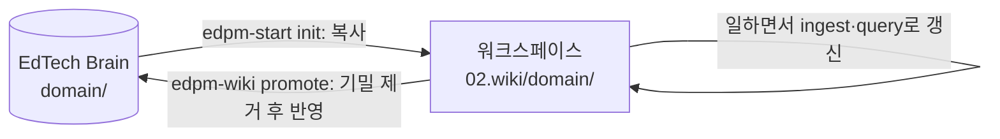

# EdTech Brain (brain-seed)

회사가 바뀌어도 가져가는 **개인 에듀테크 도메인 지식팩**입니다. Obsidian에서 열 수 있는 일반 마크다운 위키이며, Agent Driven EdPM 워크스페이스의 `02.wiki/domain/`과 같은 형식을 씁니다.

## 1. 무엇이 들어 있나

| 경로 | 내용 |
|------|------|
| `domain/` | 학습과학, 측정, 규제·표준, 이러닝 비즈니스 로직, IA·화면 패턴, 서비스 정책, AI 활용·AI 서비스, 서비스 형태별 지식, 교육과정 페이지 87개 |
| `index.md` | 전체 페이지 목록과 한 줄 요약. 질의할 때 가장 먼저 읽음 |
| `log.md` | 추가만 하는 작업 기록 (`## [YYYY-MM-DD] 동작 \| 대상`) |
| `glossary.md` | 에듀테크 용어집 (약 45개) |

페이지 형식(frontmatter, 출처, `[확인 필요]`·`[가정]` 표시, `상충하는 근거` 섹션)은 워크스페이스 `AGENTS.md` 4장을 따릅니다.

## 2. 절대 규칙: 공개·일반 지식만

- Brain에는 **공개 자료로 확인할 수 있는 일반 지식**만 둡니다 (논문, 법령, 표준 문서, 공개 보도, 일반화된 실무 원칙).
- **회사 기밀은 절대 넣지 않습니다**: 매출·계약 단가·고객사 이름·미공개 로드맵·내부 지표 수치·내부 문서 링크·학생 데이터.
- 현장 인사이트는 회사·학교·개인을 식별할 수 없게 일반화한 경우에만 둡니다 (예: "중학교 교사는 수업 전 계정 문제로 시간을 잃는다" 수준).
- 확신이 없으면 넣지 않습니다. 퇴사 후에도 공개적으로 말할 수 있는 내용인지가 기준입니다.

## 3. 워크스페이스와 오가는 방법



- **`/edpm-start init`**: 새 워크스페이스를 만들 때 Brain의 `domain/` 페이지를 워크스페이스 `02.wiki/domain/`으로 복사하고, `index.md`의 domain 항목을 워크스페이스 `02.wiki/index.md`에 합칩니다. 링크가 `[[domain/페이지명]]` 형식이라 양쪽에서 그대로 동작합니다.
- **`/edpm-wiki promote`**: 프로젝트 종료·퇴사 전에 워크스페이스 `02.wiki/domain/`(필요하면 일반화한 `learners/`, `research/`, 공개 정보만 있는 `market/`)에서 새로 생기거나 고친 내용을 골라 기밀 점검 후 Brain에 반영하고, Brain `log.md`에 `promote` 기록을 남깁니다.
- 승격 전 점검: 회사명·제품명·고객사·수치·내부 링크·개인정보가 없는지, 모든 주장에 공개 출처가 있는지, `verified` 날짜가 최신인지.

## 4. 유지 관리

- 규제·표준·일정 페이지는 `verified` 날짜 기준 180일이 지나면 다시 확인합니다 (`/edpm-wiki lint`가 `stale` 표시).
- `[확인 필요]` 표시는 확인되면 지우고 출처 URL과 `verified` 날짜를 갱신합니다.
- 출처끼리 충돌하면 지우지 말고 `## 상충하는 근거`에 둘 다 남깁니다.
- 이 지식팩은 법률 자문이 아닙니다. 규제 페이지는 법무 검토의 출발점으로만 씁니다.

## 5. Obsidian 설정 (선택)

Brain은 일반 마크다운이라 플러그인 없이도 쓸 수 있습니다. 아래는 권장 사항입니다.

| 플러그인 | 용도 |
|----------|------|
| Dataview | frontmatter로 `verified`가 오래된 페이지, `confidence: low` 페이지 목록 만들기 |
| Templater | 새 domain 페이지를 AGENTS.md 형식 템플릿으로 생성 |
| Web Clipper (Obsidian 공식 브라우저 확장) | 논문·법령·보도 페이지를 inbox로 수집 |
| Obsidian Git | Brain 저장소 자동 커밋·백업 |
| Marp | 위키 내용을 슬라이드로 바로 만들기 |

Dataview 예시:

````markdown
```dataview
TABLE verified, confidence FROM "domain"
WHERE type = "regulation" OR type = "standard"
SORT verified ASC
```
````

## 6. 시작하기

```bash
cp -R agent-driven-edpm/brain-seed ~/EdTech-Brain   # install.sh 가 없으면 자동으로 만들어 줌
cd ~/EdTech-Brain && git init && git add . && git commit -m "[brain] 초기 지식팩"
```

개인 저장소로 관리합니다. 회사 저장소나 회사 계정 클라우드에 두지 않습니다.
