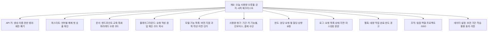

# AI API 개발자 콘솔 IA (에듀테크 AI API를 파는 경우)

## 핵심 요약

- 에듀테크 AI 기능(문항 생성, 서술형 채점, 발음 평가, 수식 인식)을 출판사·학원·다른 에듀테크에 **API로 판매**하면, 고객 화면은 학습 앱이 아니라 **개발자 콘솔**이다. 고객은 개발자·운영 담당·결제 담당으로 나뉜다.
- 콘솔 IA 골격: **시작하기(키·퀵스타트) → 문서·플레이그라운드 → 모델·기능 목록 → 사용량·청구 → 한도 → 로그 → 웹훅 → 조직·팀·역할 → 데이터 보관 설정** [가정].
- 에듀테크 API의 차별점은 **학생 데이터가 고객을 거쳐 들어온다**는 것이다. 고객이 처리자이고 우리가 수탁자(또는 그 반대)인 구조를 콘솔의 데이터 설정·계약 화면에 반영해야 한다 ([[domain/학습데이터프라이버시]]).
- 한도·장애 시 동작(429 응답, 재시도 권장, 상태 페이지)은 콘솔에 보이고 P09 정책과 같아야 한다.

## 상세

### IA 트리

### 주요 화면·컴포넌트

| 화면 | 핵심 컴포넌트 | 설계 포인트 |
|------|---------------|-------------|
| 개요 | 시작 체크리스트(키 발급·첫 호출·결제 등록), 사용량 미니 차트, 상태 배너 | 첫 호출 성공까지의 시간이 활성화 지표 [가정] |
| API 키 | 키 목록(이름·생성일·마지막 사용·권한 범위), 생성 시 1회만 전체 표시, 폐기 | 테스트·운영 키 구분. 키를 클라이언트 앱에 넣지 말라는 경고 |
| 퀵스타트 | 언어 탭(cURL·Python·JS), 내 키가 들어간 예제, "호출 확인됨" 표시 | 교육 예제(중2 수학 문항 생성)로 도메인을 보여 준다 |
| 문서 | 엔드포인트, 교육 파라미터(성취기준 코드·학년·난이도), 오류 코드, 변경 이력 | 성취기준 코드 체계 명시 ([[domain/교육과정지식그래프]]) |
| 플레이그라운드 | 파라미터 폼 + 원문 JSON 토글, 응답·지연·사용량 표시, 코드 내보내기 | 플레이그라운드 호출도 과금 여부 표시 |
| 모델·기능 목록 | 기능별 버전, 지원 범위, 평균 지연, 단가, 지원 종료 예정일 | 버전 고정·지원 종료 일정 공지 (A13) |
| 사용량·청구 | 기간·키·기능·프로젝트 필터, 요청 수·단위 사용량·금액, 인보이스, 예산 알림 | 개발자와 결제 담당이 같은 숫자를 봐야 한다 ([[domain/사용량대시보드설계]]) |
| 한도 | 현재 등급, 분당·일간·월간 한도, 사용률, 상향 요청 폼 | 한도 초과 시 응답 코드와 재시도 권장을 문서와 일치 |
| 로그 | 요청 ID·시각·엔드포인트·상태·지연, 본문은 기본 마스킹 | 학생 텍스트가 들어오므로 본문 열람은 역할 제한 [가정] |
| 웹훅 | 엔드포인트 등록, 이벤트 선택, 서명 검증 안내, 전송 기록·재전송 | 대량 생성·채점 완료 이벤트 |
| 조직·역할 | 소유자·관리자·개발자·청구 담당·읽기 전용, 프로젝트별 키 | 퇴사자 키 회수 |
| 데이터 설정 | 요청 본문 보관 기간(0일·30일 등), 모델 개선 활용 여부(기본 끔), 처리 리전 | 국외 이전 여부 표시 (제28조의8). 계약서(DPA) 다운로드 |

## 에듀테크 맥락

- 고객 유형: 출판사(디지털 교재에 문항 생성 탑재), 학원 관리 솔루션(서술형 채점), 다른 에듀테크(발음 평가). 최종 사용자가 학생이라는 점이 일반 AI API와 다르다.
- 미성년 데이터: 고객이 학생 동의를 받았는지 확인하는 조항과, 우리 쪽 보관·학습 활용 기본값을 콘솔에서 보이게 한다 ([[domain/아동개인정보보호]]).
- 교사 승인: API 응답에 "검토 권장" 플래그(근거 없음·정답 불확실)를 넣어, 고객 앱이 교사 승인 단계를 만들 수 있게 한다 [가정].
- 관리자(고객사): 비용 예산·한도·팀 권한이 주 관심사. 학기초 사용량 급증 대비 한도 상향 경로 ([[domain/학사일정]]).

## 상태·예외

| 상황 | 콘솔 처리 |
|------|-----------|
| 신규 조직(빈 상태) | 시작 체크리스트, 테스트 크레딧 안내 [가정] |
| 응답 지연 | 로그에 지연 분포(p50·p95), 상태 페이지 링크 |
| 실패 응답 급증 | 개요에 오류율 경고, 오류 코드별 해결 안내 |
| 거절(안전 정책) | 응답 코드와 사유 카테고리 문서화, 로그에 사유 표시 |
| 근거 없음·검토 권장 | 응답 필드로 제공, 문서에 처리 권장안 |
| 한도 초과 | 한도 화면 경고, 이메일·웹훅 알림, 상향 요청 버튼 (P09) |
| 모델 장애 | 상태 배너, 대체 버전 자동 전환 여부 문서화 (A11) |
| 결제 실패 | 유예 기간·서비스 중단 예정일 표시 [가정] |
| 키 유출 의심 | 비정상 사용 탐지 알림, 즉시 폐기 버튼 |
| 신고(부적절 생성물) | 요청 ID로 신고하는 양식, 처리 결과 회신 (P08) |

## 에듀테크 PM 적용

- [ ] 고객 역할(개발자·운영·청구)별 첫 화면과 권한이 정의되었는가 (E10, B02)
- [ ] 교육 파라미터(성취기준·학년·난이도)와 오류 코드가 문서·플레이그라운드에 같은 이름으로 있는가
- [ ] 사용량 단위·단가·예산 알림이 A12와 같은가
- [ ] Rate limit 단위(키·조직)와 초과 응답이 P09와 같은가
- [ ] 데이터 보관 기본값·모델 개선 활용 기본값·처리 리전이 P07과 계약서에 같게 적혔는가
- [ ] 거절·검토 권장 플래그가 A14 정책과 일치하는가
- [ ] 와이어프레임 P0: 개요, API 키, 플레이그라운드, 사용량·청구, 로그, 데이터 설정

## 흔한 오해

- "개발자 콘솔은 문서 사이트면 된다" — 키·사용량·한도·로그가 없으면 고객 운영이 막힌다.
- "로그는 전부 보여 주는 게 친절하다" — 학생 텍스트가 담긴다. 마스킹과 역할 제한이 기본이다.
- "모델 버전은 우리가 알아서 바꾼다" — 고객 앱의 결과가 바뀐다. 버전 고정과 지원 종료 공지가 필요하다 (A13).

## 관련 페이지

- [[domain/AI서비스IA특수성]] · [[domain/사용량대시보드설계]] · [[domain/모델설정화면설계]] · [[domain/관리자백오피스BO_IA]]
- [[domain/학습데이터프라이버시]] · [[domain/아동개인정보보호]] · [[domain/에듀테크수익모델]] · [[domain/교육과정지식그래프]]

## 출처

- 개인정보 보호법 제26조·제28조의8: [[domain/학습데이터프라이버시]] 참조
- 콘솔 구성 요소와 기본값은 일반화된 B2B API 서비스 실무 원칙이다 [가정].
