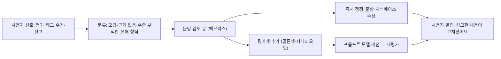

# AI 생성 결과 피드백 UI

## 핵심 요약

- 피드백 UI는 사용자 불만 수집 창구가 아니라 **AI 품질 개선 파이프라인의 입구**다. 수집 → 분류 → 평가셋·정정 반영 → 사용자에게 결과 알림까지 닫혀야 의미가 있다 [가정].
- 피드백 신호는 4종: **명시적 평가**(좋아요·별로예요), **이유 태그**, **암묵 신호**(수정·재생성·복사·무시), **신고**(유해·오답). 에듀테크에서 가장 값진 신호는 **교사의 정정**이다 [가정].
- 결과 옆 **"근거 확인"** 행동은 피드백이자 학습 행동이다. 근거를 열어 본 비율은 투명성 지표로도 쓴다.
- 피드백 피로를 피한다: 매 답변마다 묻지 않고, 2버튼 + 선택 태그로 가볍게, 의미 있는 순간(세션 끝, 교사 승인 시)에만 추가 질문.

## 상세

### 피드백 루프

### 컴포넌트

| 컴포넌트 | 설계 포인트 |
|----------|-------------|
| 2버튼 평가 | "도움됐어요/헷갈려요"(학생), "쓸 만해요/고쳐야 해요"(교사). 아이콘 + 텍스트 |
| 이유 태그 | 부정 평가 시에만 펼침. 3~5개: 틀렸어요, 너무 어려워요, 너무 쉬워요, 근거가 없어요, 기타 |
| 인라인 편집 신호 | 교사가 생성물을 고치면 원본·수정본 diff 저장. 별도 버튼 없이 신호 수집 |
| 재생성·무시 | 재생성 횟수·버린 결과를 암묵 부정 신호로 [가정] |
| 근거 확인 | 문장별 근거 링크, "근거와 다름" 신고 버튼이 근거 패널 안에 |
| 신고 | 유형(틀린 내용·유해·개인정보·저작권·기타), 해당 메시지 자동 첨부, 접수 확인 |
| 교사 정정 | 정답·해설 수정 → "이 수정을 반영 요청" 체크 → 운영 검토 → 평가셋 |
| 결과 알림 | "신고하신 3번 문항 해설이 수정되었어요" 알림, 변경 전후 보기 |
| 세션 끝 질문 | 5회 이상 대화 후 1회, 1문항 [가정] |

### 신호별 활용

| 신호 | 신뢰도 | 활용 |
|------|--------|------|
| 교사 정정 | 높음 [가정] | 평가셋 정답 갱신, 문항·해설 즉시 수정 |
| 신고(유해·오답) | 높음, 검증 필요 | 모더레이션 큐, 가드레일 규칙 보완 (A14) |
| 이유 태그 | 중간 | 실패 유형 분포, 프롬프트 개선 우선순위 |
| 2버튼 | 낮음~중간 | 추세 지표, 버전 비교 |
| 재생성·무시 | 낮음 | 보조 지표, 단독 판단 금지 |

## 에듀테크 맥락

- 학생: "헷갈려요"는 AI 품질 신호이자 학습 신호다. 같은 개념에서 반복되면 교사 대시보드에 막힌 개념으로 집계할 수 있다 [가정].
- 학생 피드백의 한계: 쉬운 답·정답 제공에 높은 평가를 줄 수 있다. 학생 만족도를 품질 기준으로 단독 사용하지 않는다 ([[domain/AI튜터설계]]).
- 교사: 정정 결과가 반영되는 것을 볼 때 피드백을 계속한다. 회신 없는 신고는 곧 멈춘다 [가정].
- 보호자: 신고 경로(유해 내용)를 보호자 앱에도 둔다.
- 관리자: 기관별 신고·정정 현황을 리포트로.

## 상태·예외

| 상황 | 처리 |
|------|------|
| 피드백 전송 실패 | 로컬 보관 후 재전송, 사용자에게는 "받았어요" 처리 [가정] |
| AI 응답 지연·실패 중 | 피드백 버튼 숨김(완료된 답에만 노출) |
| 거절 응답 | "거절이 부당해요" 피드백 선택지(오탐 신호, A14) |
| 근거 없음 라벨 | "근거 찾아 주기" 요청 → 교사·운영 큐 |
| 신고 접수 후 | 해당 답변 흐림·숨김 선택, 처리 상태(접수·검토 중·완료) |
| 위기·유해 신고 | 최우선 큐, 신고자에게 도움 안내 (P08) |
| 중복 신고 | 같은 항목 묶음, 신고자 모두에게 결과 알림 |
| 한도 초과·모델 장애 | 피드백·신고는 계속 가능 |
| 악의적 대량 신고 | 속도 제한, 운영 검토 [가정] |

## 에듀테크 PM 적용

- [ ] 피드백 신호 4종의 수집 위치·저장 항목이 정의되었는가 (E12 이벤트)
- [ ] 신고 유형·처리 기준·회신 SLA가 P08에 있는가
- [ ] 교사 정정이 평가셋으로 들어가는 경로가 A06·A13에 있는가
- [ ] 거절 오탐 피드백이 A14 임계값 조정에 쓰이는가
- [ ] 학생 만족도를 단독 품질 기준으로 쓰지 않는다는 원칙이 E07 지표에 있는가
- [ ] 피드백 요청 빈도 상한이 정해졌는가
- [ ] 와이어프레임 P0: 답변 피드백(태그 펼침), 신고 폼, 근거 패널, 교사 정정, 처리 결과 알림

## 흔한 오해

- "좋아요 비율이 품질이다" — 학습에서는 쉬운 답이 높은 평가를 받기 쉽다. 교사 정정·평가셋 점수와 같이 본다.
- "피드백은 많이 받을수록 좋다" — 매번 물으면 무시하거나 대충 누른다. 가볍게, 드물게.
- "신고는 접수만 하면 된다" — 결과를 알리지 않으면 신고 채널이 죽는다.

## 관련 페이지

- [[domain/AI화면설계5원칙]] · [[domain/관리자백오피스BO_IA]] · [[domain/생성형AI서비스IA]] · [[domain/대화형AI인터페이스설계]]
- [[domain/AI튜터설계]] · [[domain/형성평가와피드백]] · [[domain/콘텐츠품질관리]] · [[domain/학습분석지표]]

## 출처

- Amershi et al. (2019), G13 Learn from user behavior, G15 Encourage granular feedback: https://www.microsoft.com/en-us/research/publication/guidelines-for-human-ai-interaction/
- Google PAIR, People + AI Guidebook (Feedback + Control): https://pair.withgoogle.com/guidebook/chapters
- 신호별 신뢰도와 요청 빈도는 일반화된 실무 원칙이다 [가정].
