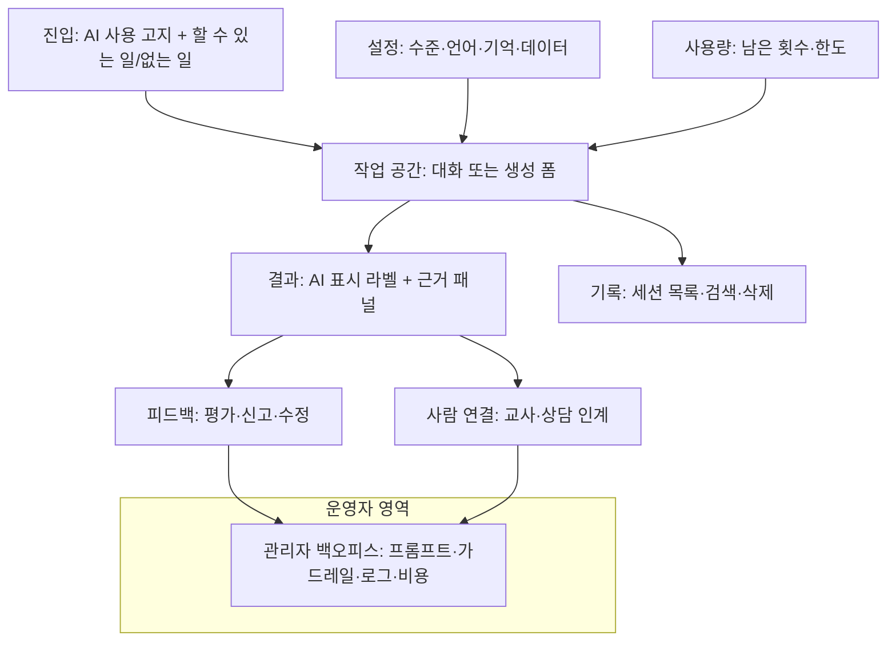

# AI 서비스 IA의 특수성 (일반 앱 IA와 무엇이 다른가)

## 핵심 요약

- 일반 앱 IA는 "어떤 화면이 어디에 있는가"를 정한다. AI 서비스 IA는 여기에 **같은 입력에도 결과가 달라지는 화면**, **대화가 곧 내비게이션인 구조**, **AI 사용 사실과 근거를 보여 주는 층**을 더해야 한다.
- AI 서비스 IA에 추가되는 8개 영역: (1) 비결정적 결과의 상태 설계, (2) 대화형 내비게이션, (3) 기록·세션, (4) AI 사용 투명성, (5) 피드백 루프, (6) 사람 연결(교사·상담), (7) 설정·통제, (8) 사용량 한도. 이 8개가 IA 트리에서 빠지면 나중에 화면이 땜질로 붙는다 [가정].
- 에듀테크에서는 같은 AI 기능도 **학생·교사·보호자·관리자**가 보는 면이 다르다. 학생에게는 AI 결과가, 교사에게는 승인·검토 큐가, 보호자에게는 가시성·동의가, 관리자에게는 정책·비용이 보인다.
- 고영향·생성형 AI 서비스는 AI 기반임을 사전 고지하고 생성물을 표시해야 한다 (AI 기본법 제31조, [[domain/아동개인정보보호]]). 고지는 약관 한 줄이 아니라 IA 안의 고정 위치(진입 화면, 결과 라벨, 설정)로 설계한다.

## 상세

### 일반 IA vs AI 서비스 IA

| 영역 | 일반 앱 IA | AI 서비스 IA에서 추가로 정할 것 |
|------|------------|--------------------------------|
| 결과 화면 | 데이터가 같으면 같은 화면 | 결과가 매번 다름. 생성 중·부분 결과·재생성·거절·근거 없음 상태가 필요 |
| 내비게이션 | 메뉴·탭·링크 | 대화 안에서 기능 호출("문제 하나 더", "선생님께 물어볼래"). 대화에서 메뉴로 돌아오는 출구 |
| 기록 | 활동 내역 | 대화·생성 기록이 학습 자료가 됨. 세션 단위, 보관 기간, 삭제, 교사·보호자 열람 범위 |
| 투명성 | 해당 없음 | AI 사용 고지, 생성물 표시, 근거·출처 패널, 한계 안내 |
| 피드백 | 리뷰·문의 | 결과별 평가·신고·수정이 품질 개선 데이터로 흘러감 (A06·A13) |
| 사람 연결 | 고객센터 | AI가 답하면 안 되는 상황에서 교사·상담 인계, 인계 후 상태 표시 |
| 설정 | 알림·계정 | 설명 수준·언어·톤, 기억 켜기/끄기, 기관 단위 AI 기능 켜기/끄기 |
| 한도 | 결제 상태 | 일·월 사용 한도, 남은 횟수, 초과 시 대체 동작 (A12·P09) |

### AI 서비스 공통 IA 골격

### 8개 영역별 IA 결정 사항

| 영역 | IA에서 정할 것 | 관련 산출물 |
|------|----------------|-------------|
| 비결정적 결과 | 결과 상태 목록(생성 중·완료·부분·거절·근거 없음·실패), 재생성 시 이전 결과 보존 여부 | E10 3절, A03 |
| 대화형 내비게이션 | 대화에서 호출 가능한 기능 목록, 대화 밖으로 나가는 고정 출구(홈·과제) | A03, A05 |
| 기록·세션 | 세션 단위(과제별·과목별·날짜별), 보관 기간, 삭제, 열람 권한 | A04, E12, P07 |
| 투명성 | 고지 위치, 생성물 라벨, 근거 표시 방식 | P07, A02 |
| 피드백 루프 | 피드백 진입점, 수집 데이터, 반영 경로, 반영 결과 알림 | A06, A13, P08 |
| 사람 연결 | 인계 조건(위기 신호·반복 실패·요청), 인계 대상, 대기 상태 | A14, P08, P05 |
| 설정·통제 | 사용자 설정과 관리자 설정 분리, 미성년 기본값 | A11, P07 |
| 사용량 한도 | 한도 단위(학생·반·기관), 표시 위치, 초과 시 동작 | A12, P09 |

## 에듀테크 맥락

| 역할 | AI 서비스에서 보는 면 | IA 원칙 |
|------|----------------------|---------|
| 학생 | 튜터 대화, 힌트, 피드백, 남은 횟수 | 학습 행동이 먼저. AI는 학습 흐름 안의 도구로 배치하고 독립 탭은 신중히 [가정] |
| 교사 | AI 생성 자료 승인 큐, 학생 AI 사용 요약, 인계 요청함, 반별 AI 켜기/끄기 | 학생에게 나가는 생성물은 교사 승인을 거치는 경로를 기본값으로 ([[domain/교사참여설계]]) |
| 보호자 | AI 사용 고지, 동의·철회, 자녀 AI 사용 요약 | 대화 원문 전체 열람은 학생 신뢰를 해칠 수 있어 요약·위험 신호 중심 [가정] |
| 기관 관리자 | AI 기능 정책, 데이터 보관, 사용량·비용 | 기관 단위 끄기 스위치와 감사 로그 |
| 운영자(우리 회사) | 프롬프트·모델·가드레일·로그·평가 | 별도 백오피스 ([[domain/관리자백오피스BO_IA]]) |

- 만 14세 미만은 보호자 동의 전 AI 기능 잠금 ([[domain/아동개인정보보호]]). 미성년 기본값은 "기억 끄기, 외부 링크 없음, 교사 가시성 켜기" [가정].
- 학생 평가(채점·성취 판정)에 쓰이면 고영향 AI 검토 대상이다. 평가 결과 화면에는 근거와 이의 제기 경로를 둔다 ([[domain/AI적용기회맵]]).

## 상태·예외

| 상황 | IA·화면 처리 |
|------|--------------|
| AI 응답 지연 | 생성 중 표시, 일정 시간(예: 10초) 초과 시 "조금 더 걸려요" + 취소 [가정: 시간은 A03] |
| 생성 실패 | 사용자 탓 없는 문구 + 다시 시도 + 비AI 대안(교재 해설·FAQ) |
| 거절(정책상 답하지 않음) | 왜 못 하는지 한 문장 + 할 수 있는 대안 + 필요 시 교사 연결 (A14) |
| 근거 없음 | "자료에서 찾지 못했어요" 표시, 추측 답변 금지, 교사에게 질문 넘기기 |
| 한도 초과 | 남은 시간·초기화 시점, 비AI 학습으로 안내. 학습 자체를 막지 않음 (P09) |
| 모델 장애 | 대체 모델로 전환(A11) 또는 정적 힌트·FAQ로 축소 운영, 상태 배너 |
| 콘텐츠 신고 | 결과 단위 신고 → 운영자 검토 큐, 신고자에게 처리 결과 알림 (P08) |
| 동의 없음·철회 | AI 기능 잠금, 기존 대화 보관·삭제 정책 안내 |

## 에듀테크 PM 적용

- [ ] E10 1절 IA 트리에 8개 영역(결과 상태·대화 출구·기록·투명성·피드백·사람 연결·설정·한도)이 모두 들어갔는가
- [ ] AI 사용 고지와 생성물 표시 위치가 P07과 같은가
- [ ] 거절·근거 없음·인계 조건이 A14 가드레일과 A03 대화 설계에 같은 문구로 있는가
- [ ] 장애·한도 초과 시 대체 동작이 P09에 정의되고 E10 상태표에 반영되었는가
- [ ] 신고·피드백 처리 기준이 P08에 있는가
- [ ] 역할별(학생·교사·보호자·관리자) AI 화면이 E10 2절 SCR 목록에 분리되어 있는가
- [ ] 와이어프레임 P0: AI 진입(고지) 화면, AI 결과 화면(라벨·근거·피드백), 교사 승인 큐, 사용량·한도 안내를 `sb-lowfi-pptx` 또는 `sb-lowfi-figma`로

## 흔한 오해

- "AI 기능은 화면 하나 추가하면 된다" — 기록·피드백·설정·한도·운영 백오피스까지 IA가 넓어진다.
- "고지는 약관에 넣으면 된다" — 사용 시점에 보이는 고지와 결과 라벨이 필요하다 (AI 기본법 제31조).
- "대화형이면 메뉴가 필요 없다" — 대화에서 빠져나와 과제·기록으로 가는 고정 출구가 없으면 길을 잃는다 [가정].
- "실패는 드물다" — 생성형 AI의 지연·거절·근거 없음은 일상적 상태다. 정상 흐름의 일부로 설계한다.

## 관련 페이지

- [[domain/대화형AI서비스IA]] · [[domain/생성형AI서비스IA]] · [[domain/AI에이전트서비스IA]] · [[domain/AI_API개발자콘솔IA]] · [[domain/관리자백오피스BO_IA]]
- [[domain/AI화면설계5원칙]] · [[domain/AI튜터설계]] · [[domain/AI적용기회맵]] · [[domain/교사참여설계]] · [[domain/아동개인정보보호]] · [[domain/학습자앱IA]]

## 출처

- Amershi, S. et al. (2019). Guidelines for Human-AI Interaction. CHI 2019: https://www.microsoft.com/en-us/research/publication/guidelines-for-human-ai-interaction/ (18개 가이드라인, 상호작용 단계 4구분: 처음·상호작용 중·틀렸을 때·시간이 지나며)
- Microsoft HAX Toolkit, Design Library: https://www.microsoft.com/en-us/haxtoolkit/library/
- Google PAIR, People + AI Guidebook: https://pair.withgoogle.com/guidebook/chapters
- AI 기본법 제31조: https://casenote.kr/법령/인공지능_발전과_신뢰_기반_조성_등에_관한_기본법/제31조
- 8개 영역 구분과 역할별 배치는 일반화된 실무 원칙이다 [가정].
