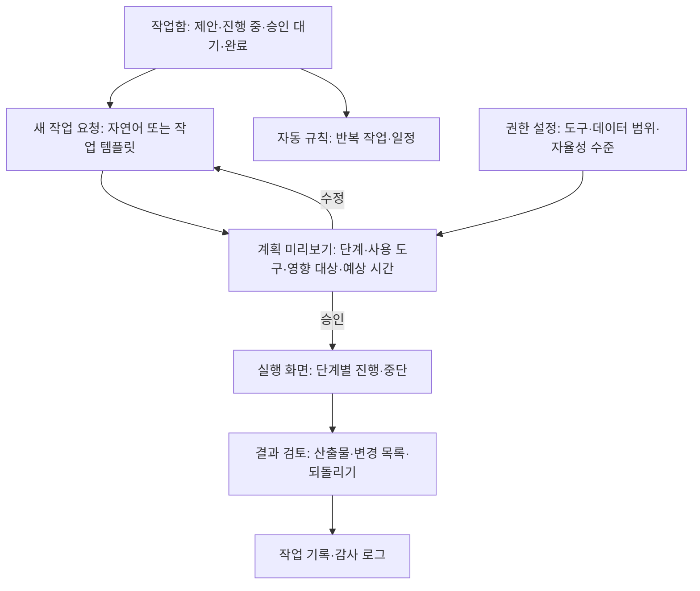

# AI 에이전트 서비스 IA (과제를 맡기는 AI의 구조)

## 핵심 요약

- AI 에이전트는 대화로 답하는 데서 그치지 않고 **도구를 써서 일을 대신한다**(채점 초안, 일정 등록, 보호자 알림 발송, 리포트 작성). 그래서 IA의 중심은 대화창이 아니라 **작업함(task inbox) → 계획 미리보기·승인 → 실행 진행·기록 → 결과 검토**다 [가정].
- 에이전트 IA는 **자율성 수준**을 먼저 정한다. 같은 기능도 "제안만"과 "자동 실행"은 화면 구조가 다르다. 에듀테크에서 학생·보호자에게 영향이 가는 행동(성적 반영, 외부 발송)은 기본값을 승인형으로 둔다.
- 필수 장치 4가지: **도구 권한**(무엇에 접근·실행할 수 있는가), **진행·감사 로그**, **중단·되돌리기**, **결과 검토**. 이 중 하나라도 없으면 교사가 맡기지 않는다 [가정].
- 학생 평가 결과에 반영되는 자동 처리는 고영향 AI·자동화된 결정 규정 검토 대상이다 (개인정보 보호법 제37조의2, [[domain/AI적용기회맵]]).

## 상세

### 자율성 수준 (기능마다 하나를 고른다)

| 수준 | 이름 | 에이전트가 하는 일 | 사람이 하는 일 | 교사 보조 예 |
|------|------|-------------------|----------------|--------------|
| L0 | 제안 | 할 일을 제안 | 직접 실행 | "미제출 학생 5명에게 알림을 보낼까요?" |
| L1 | 초안 | 결과물 초안 작성 | 검토 후 실행 | 서술형 채점 초안·코멘트 초안 |
| L2 | 승인 후 실행 | 계획 제시 → 승인 시 실행 | 계획 승인 | 보충 과제 배정 계획 승인 후 일괄 배정 |
| L3 | 실행 후 보고 | 범위 안에서 자동 실행, 사후 보고 | 사후 검토·되돌리기 | 출결 집계, 주간 리포트 생성(발송은 L2) |
| L4 | 완전 자동 | 사람 개입 없음 | 예외만 처리 | 에듀테크에서는 학생 영향 행동에 쓰지 않음 [가정] |

### IA 트리 (교사 보조 에이전트 기준)

### 주요 화면·컴포넌트

| 화면 | 핵심 컴포넌트 | 설계 포인트 |
|------|---------------|-------------|
| 작업함 | 상태별 탭(제안·승인 대기·진행 중·완료·실패), 우선순위, 마감 | 교사 대시보드 "오늘 할 일"과 합칠 수 있다 ([[domain/교사대시보드IA]]) |
| 새 작업 요청 | 자연어 입력 + 작업 템플릿(채점 초안, 보충 과제 배정, 주간 리포트) | 템플릿이 범위와 도구를 고정해 실수를 줄인다 |
| 계획 미리보기 | 단계 목록, 각 단계의 도구, 영향 받는 학생 수·대상, 되돌릴 수 있는지 표시 | "보호자 32명에게 문자 발송"처럼 영향 범위를 숫자로 [가정] |
| 실행 화면 | 단계별 진행 표시, 현재 단계, 중단 버튼, 일시정지 | 중단 시 이미 실행된 단계와 남은 단계를 구분 표시 |
| 결과 검토 | 산출물 미리보기, 변경 목록(diff), 일부 채택·전체 되돌리기 | 채점 초안은 학생별 점수·근거를 나란히 |
| 감사 로그 | 시각·요청자·승인자·도구·대상·결과 | 기관 관리자도 열람 가능, 삭제 불가 |
| 권한 설정 | 도구별 허용(읽기·쓰기·발송), 데이터 범위(담당 반만), 자율성 수준 | 관리자가 상한을 정하고 교사는 그 안에서 선택 |
| 자동 규칙 | 트리거(매주 금요일·마감 직후), 작업, 수준 | 규칙 실행 결과도 작업함에 남긴다 |

### 도구 권한 표 (예시)

| 도구 | 읽기 | 쓰기 | 외부 발송 | 기본 수준 |
|------|------|------|-----------|-----------|
| 성적부 | 허용 | 초안만(확정은 교사) | 해당 없음 | L1 |
| 과제 배정 | 허용 | 승인 후 | 해당 없음 | L2 |
| 일정·캘린더 | 허용 | 승인 후 | 해당 없음 | L2 |
| 보호자 알림 | 해당 없음 | 해당 없음 | 승인 후, 발송 전 미리보기 | L2 |
| 리포트 생성 | 허용 | 자동 | 발송은 별도 승인 | L3 |

## 에듀테크 맥락

- 교사: 업무를 덜어 주지만 책임은 교사에게 남는다. 승인·검토 동선이 짧아야 실제로 쓴다 ([[domain/교사참여설계]]).
- 학생: 에이전트가 만든 채점·코멘트는 교사 확인 후 공개. 이의 제기 경로 ([[domain/과제와평가설계]]).
- 보호자: 에이전트가 보낸 알림에도 발신 주체(교사 이름 + AI 작성 보조 여부)를 표시 [가정: 문구는 P07].
- 관리자: 자율성 상한, 도구 권한, 감사 로그 열람.

## 상태·예외

| 상황 | 처리 |
|------|------|
| 계획 생성 지연 | 진행 표시, 오래 걸리면 백그라운드로 넘기고 작업함에 알림 |
| 단계 실패 | 실패 단계·사유 표시, 재시도·건너뛰기·전체 중단 선택. 앞 단계 결과 보존 |
| 거절 | 권한 밖 요청(다른 반 성적 수정 등)은 이유와 필요한 권한 안내 |
| 근거 없음 | 채점 초안의 루브릭 근거를 찾지 못하면 해당 학생은 "직접 채점 필요"로 분리 |
| 중단 | 실행된 단계 목록 + 되돌리기 가능 항목 표시 |
| 되돌리기 불가 행동 | 발송·외부 연동은 계획 단계에서 "되돌릴 수 없음" 경고 |
| 한도 초과 | 남은 작업량, 대기열로 이동 (P09) |
| 모델 장애 | 진행 중 작업 일시정지·상태 보존, 재개 버튼. 자동 규칙은 다음 주기로 연기 |
| 이상 행동 탐지 | 짧은 시간 대량 변경 시 자동 정지·관리자 알림 [가정] |

## 에듀테크 PM 적용

- [ ] 에이전트 기능마다 자율성 수준(L0~L3)과 그 근거가 A05에 있는가
- [ ] 학생 영향 행동(성적·배정·발송)이 승인형인지 확인했는가 (A14, P08)
- [ ] 도구 권한 표와 데이터 범위가 E09 권한 매트릭스와 일치하는가
- [ ] 감사 로그 항목과 보관 기간이 정의되었는가 (P07, E12)
- [ ] 중단·되돌리기 불가 항목이 계획 미리보기에 표시되는가
- [ ] 장애 시 진행 작업 처리가 P09에 있는가
- [ ] 와이어프레임 P0: 작업함, 계획 미리보기, 실행 진행, 결과 검토(diff), 권한 설정

## 흔한 오해

- "에이전트는 알아서 해 주는 게 가치다" — 교사는 무엇을 했는지 볼 수 없으면 맡기지 않는다. 투명한 계획과 기록이 가치다.
- "승인 단계가 많으면 불편하다" — 영향이 큰 행동만 승인형으로, 나머지는 사후 보고(L3)로 나눈다.
- "되돌리기는 개발이 알아서" — 되돌릴 수 없는 행동 목록은 기획이 정한다.

## 관련 페이지

- [[domain/AI서비스IA특수성]] · [[domain/관리자백오피스BO_IA]] · [[domain/AI화면설계5원칙]] · [[domain/교사대시보드IA]]
- [[domain/교사참여설계]] · [[domain/과제와평가설계]] · [[domain/AI적용기회맵]] · [[domain/학습데이터프라이버시]]

## 출처

- Amershi et al. (2019), G8 Support efficient dismissal, G9 Support efficient correction, G16 Convey the consequences of user actions, G17 Provide global controls: https://www.microsoft.com/en-us/research/publication/guidelines-for-human-ai-interaction/
- Google PAIR, People + AI Guidebook (Feedback + Control; Errors + Graceful Failure): https://pair.withgoogle.com/guidebook/chapters
- 개인정보 보호법 제37조의2(자동화된 결정): [[domain/학습데이터프라이버시]] 참조
- 자율성 수준 L0~L4 구분과 도구 권한 기본값은 이 페이지에서 정한 실무 기준이다 [가정].
