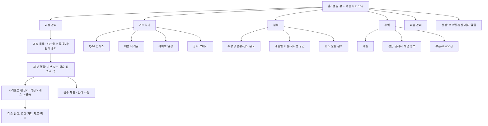

# 강사 대시보드 IA (과정 제작부터 정산까지)

## 핵심 요약

- 강사 대시보드는 세 가지 일을 지원한다: **만들기**(과정·커리큘럼 편집, 업로드), **가르치기**(Q&A·채점·라이브), **사업하기**(수강생 분석, 매출·정산, 리뷰, 쿠폰).
- 첫 화면은 "지금 처리할 일" 큐다: 미답변 질문, 채점 대기, 업로드 실패, 검수 반려. 매출 그래프를 첫 화면 주인공으로 두면 학습자 대응이 밀린다 [가정].
- 업로드는 비동기다. 업로드 → 인코딩 → 자막 생성 → 검수 → 공개의 상태를 레슨마다 보여 줘야 강사 문의가 줄어든다 [가정].
- 학습자 분석의 핵심은 "레슨별 이탈 지점"이다. 강사가 콘텐츠를 고칠 수 있는 단위로 보여 준다.

## 상세

### IA 트리

### 주요 화면과 컴포넌트

| 화면 | 핵심 컴포넌트 | 설계 포인트 |
|------|---------------|-------------|
| 홈 | 할 일 카드(미답변 n, 채점 대기 n, 업로드 실패 n), 이번 주 수강생·매출 요약 | 카드 클릭 시 필터가 적용된 큐로 바로 이동 |
| 커리큘럼 편집기 | 섹션·레슨 트리, 드래그 정렬, 레슨 유형 선택(영상·문서·퀴즈·과제·실습·라이브), 미리보기 | 드래그 정렬에 버튼 이동(위/아래) 대안 ([[domain/접근성]] 2.5.7). 자동 저장과 "저장됨" 표시 |
| 레슨 편집 | 영상 업로드, 처리 상태, 자막 편집기, 첨부 자료, 공개 범위(미리보기 허용) | 자막은 자동 생성 후 강사 검수 단계를 둔다 |
| 업로드·처리 상태 | 레슨별 상태 배지, 진행률, 실패 사유, 재시도 | 상태: 업로드 중 → 처리 중 → 자막 생성 중 → 검수 대기 → 공개 / 실패 |
| Q&A 인박스 | 미답변·내 답변·고정 필터, 레슨·타임스탬프 링크, 답변 템플릿 | 답변 SLA 표시 (P06). 질문에서 바로 해당 영상 구간 재생 |
| 채점 대기열 | 과제별 제출 목록, 루브릭 채점 패널, 일괄 피드백, 지각 표시 | 루브릭 기준은 L04에서. 다음 제출물로 이동 단축키 |
| 레슨별 이탈 분석 | 레슨 완료율 막대, 영상 구간별 이탈·재시청 곡선 | "이 레슨 7분 지점에서 이탈이 많다" 수준으로. 원시 개인 데이터는 노출 최소화 |
| 문항 분석 | 정답률, 선택지 분포, 변별도(가능하면) | 오답 선택지 집중 문항 = 오개념 후보 ([[domain/형성평가와피드백]]) |
| 매출·정산 | 기간별 매출, 쿠폰 차감, 환불 차감, 수수료, 정산 예정일, 명세서 다운로드 | 정산 계산식을 화면에 공개 (P02·P06 계약 조건과 일치) |
| 리뷰 | 평점 분포, 리뷰 목록, 답글, 신고 | 리뷰 삭제 권한은 강사에게 주지 않는 경우가 일반적 (P04) [가정] |
| 쿠폰·프로모션 | 쿠폰 생성(할인율·기간·수량·대상), 사용 현황 | 플랫폼 정책 상한(최저가·기간) 검증 메시지 |
| 라이브 일정 | 캘린더, 세션 생성, 정원, 알림, 녹화 설정 | [[domain/라이브클래스화면]] 참조 |

### 검수 워크플로 상태

초안 → 검수 요청 → (반려: 사유 + 레슨 단위 코멘트) → 승인 → 공개 예약 → 공개 → (개정: 공개본 유지 + 수정 초안) → 재검수. 공개 중인 과정을 고칠 때 수강 중인 학습자의 진도가 깨지지 않게 버전을 분리한다 (L01 버전 관리, [[domain/콘텐츠CMSIA]]).

## 서비스 유형별 차이

| 유형 | 차이 |
|------|------|
| AT01 마켓플레이스 | 매출·정산·쿠폰·리뷰 비중이 크다. 강사 = 외부 사업자. 정산 명세서·세금 정보가 필수 |
| AT02 기업교육 LMS | 강사 대신 사내 교육 담당자가 과정을 등록. 매출 영역 없음, 수료 현황 중심 |
| AT03 부트캠프 | 채점 대기열·프로젝트 리뷰·코호트 관리가 중심. 멘토·조교 역할 분리 |
| AT04 라이브·튜터링 | 일정·예약·출석·수업 노트가 중심. 콘텐츠 편집기는 가볍다 |
| AT05·AT06 K-12·학원 | "강사" = 교사. 반 대시보드·과제 배정이 중심이며 매출 영역은 원장용 관리자 화면으로 ([[domain/교사참여설계]]) |
| AT09 시험대비 | 문항 등록·문항 분석·해설 편집 비중이 크다 |

## 상태·예외

| 상황 | 처리 |
|------|------|
| 첫 과정 없음(빈 상태) | "첫 과정 만들기" 가이드 3단계 + 제작 가이드 링크 |
| 업로드 중 이탈 | 브라우저 이탈 경고, 이어 올리기(재개 가능 업로드) 지원 여부 명시 |
| 인코딩 실패 | 실패 사유(코덱·해상도·길이 제한)와 허용 사양 안내, 재업로드 |
| 검수 반려 | 반려 사유를 레슨 단위로, 수정 후 재제출 버튼 |
| 데이터 지연 | 분석·매출에 "기준 시각" 표시. 실시간이 아님을 명시 |
| 권한 없음 | 공동 강사·조교는 정산 화면 접근 차단, 채점·Q&A만 |
| 정산 보류 | 보류 사유(세금 정보 미입력, 환불 분쟁) 표시와 해결 경로 |
| 판매 중지·계약 종료 | 신규 판매 중단, 기존 수강생 수강 기간 보장 여부 표시 (P02) |

## 에듀테크 PM 적용

- [ ] 강사 첫 화면이 할 일 큐인가, 각 카드가 필터 적용 목록으로 이동하는가 (E10)
- [ ] 업로드·처리 상태값과 실패 사유 목록이 정의되었는가 (L02 파이프라인과 일치)
- [ ] 커리큘럼 구조(섹션 > 레슨 > 활동)가 L01과 같은 용어인가
- [ ] 이탈 분석 단위가 강사가 고칠 수 있는 단위(레슨·구간)인가, 개인 식별 노출이 최소인가 (E13)
- [ ] 정산 계산식·명세서 항목이 계약 조건(P02·P06)과 일치하는가
- [ ] Q&A 답변 기한과 채점 기한이 화면에 표시되는가 (P06, L04)
- [ ] 와이어프레임: 홈, 커리큘럼 편집기, 채점 대기열, 정산 명세서를 P0로 (저작도구는 PC 시나리오)

## 흔한 오해

- "강사는 매출만 본다" — 학습자 응대 큐가 늦으면 리뷰와 환불로 돌아온다 [가정].
- "업로드 완료 = 공개" — 인코딩·자막·검수 단계를 숨기면 문의가 늘어난다.
- "이탈 곡선 = 콘텐츠 품질" — 영상 길이, 레슨 순서, 학습자 목적(필요 구간만 시청)도 원인이다 ([[domain/학습분석지표]]).

## 관련 페이지

- [[domain/콘텐츠CMSIA]] · [[domain/학습자앱IA]] · [[domain/퀴즈과제UI]] · [[domain/라이브클래스화면]]
- [[domain/학습분석지표]] · [[domain/형성평가와피드백]] · [[domain/교육저작권]] · [[domain/접근성]]

## 출처

- W3C, WebVTT: The Web Video Text Tracks Format: https://www.w3.org/TR/webvtt1/ (자막 파일 형식)
- W3C, WCAG 2.2 2.5.7 Dragging Movements: https://www.w3.org/TR/WCAG22/
- IA 구성과 상태 정의는 일반화된 실무 원칙이다 [가정].
