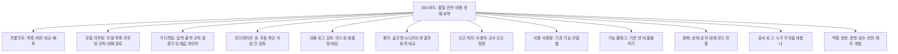
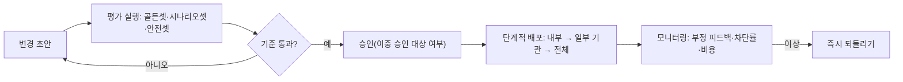

# AI 서비스 관리자 백오피스 IA

## 핵심 요약

- AI 서비스는 사용자 화면만큼 **운영자 화면**이 중요하다. 프롬프트·모델·가드레일을 바꾸는 순간 학생이 받는 답이 바뀐다. 백오피스는 그 변경을 **버전·승인·평가·감사**로 통제하는 곳이다 [가정].
- 백오피스 IA 12개 영역: 프롬프트·버전, 모델·라우팅, 가드레일 규칙, 모더레이션 큐, 대화 로그 검토(개인정보 마스킹), 평가 대시보드, 신고·문제 콘텐츠, 기관별 비용·사용량, 기능 플래그, 장애 상태, 감사 로그, 역할 기반 접근.
- 원칙: **운영 변경은 평가를 통과해야 배포**된다(프롬프트·모델 변경 → 골든셋·시나리오셋 실행 → 기준 통과 → 승인 → 단계적 배포). 이 흐름은 A13 운영 설계와 같아야 한다.
- 로그 검토는 학생 데이터를 다룬다. 기본은 마스킹, 원문 열람은 사유 기록과 권한 제한 (P07, [[domain/학습데이터프라이버시]]).

## 상세

### IA 트리

### 영역별 화면·컴포넌트

| 영역 | 핵심 컴포넌트 | 설계 포인트 |
|------|---------------|-------------|
| 프롬프트·버전 | 프롬프트 목록(기능·대상 연령), 버전 이력, diff, 변수 목록, 상태(초안·평가 중·승인·배포) | 배포 전 평가 결과 첨부 필수. 즉시 되돌리기 버튼 (A03, A13) |
| 모델·라우팅 | 모델 목록(버전·단가·지연), 라우팅 규칙(난이도·민감도·기관), 대체 경로 | 규칙 변경 시 예상 비용·품질 영향 표시 (A11) |
| 가드레일 규칙 | 입력 규칙(개인정보 마스킹·주제 제한), 출력 규칙(정답 직접 제공 금지·유해성), 분류기 임계값 | 임계값 변경은 오탐·미탐 샘플을 보여 준 뒤 저장 (A14) |
| 모더레이션 큐 | 자동 차단 건, 의심 건, 우선순위(위기 신호 최상위), 처리(허용·차단·인계) | 위기 신호 건은 SLA와 담당자 지정 (P08) [가정: 시간은 P08] |
| 대화 로그 검토 | 마스킹된 대화, 필터(기능·기관·연령대·피드백 부정), 태그(오류 유형), 평가셋으로 보내기 | 원문 열람은 사유 입력 + 감사 기록. 가명 처리 ([[domain/학습데이터프라이버시]]) |
| 평가 대시보드 | 평가셋별 합격률, 실패 유형, 버전 비교, 지연·비용 | `/edpm-ai eval` 결과와 같은 지표 (A06) |
| 신고·문제 콘텐츠 | 신고 목록(학생·교사·보호자), 유형(오답·유해·편향·저작권), 처리 상태, 신고자 회신 | 정정 내용이 생성물·문항 은행에 반영되었는지 추적 |
| 비용·사용량 | 기관·기능·모델·기간별 사용량·원가, 예산 대비, 이상 급증 | [[domain/사용량대시보드설계]] |
| 기능 플래그 | 기능별 켜기 범위(기관·반·비율), 예약 변경, 시험 기간 일괄 끄기 | 기관이 직접 끈 설정과 충돌 규칙 ([[domain/모델설정화면설계]]) |
| 장애 상태 | 모델·검색·외부 API 상태, 대체 모드 전환, 사용자 공지 작성 | 대체 모드 정의는 P09와 같게 |
| 감사 로그 | 변경 시각·사람·대상·이전/이후 값·사유 | 삭제·수정 불가, 내보내기 |
| 역할 기반 접근 | 역할별 메뉴·데이터 범위, 이중 승인 대상 | 프롬프트 배포·가드레일 완화는 이중 승인 [가정] |

### 변경 배포 흐름

## 에듀테크 맥락

- 운영자는 학생·교사·보호자·기관을 모두 대신해 품질을 지키는 사람이다. 연령대별 프롬프트·가드레일이 분리되어야 한다 (초등·중등·성인).
- 교사 신고는 품질 신호 중 가장 신뢰도가 높다 [가정]. 신고 처리 결과를 교사에게 회신해 신고 행동을 유지한다 ([[domain/AI생성결과피드백UI]]).
- 학교·교육청 고객은 감사 로그와 데이터 열람 기록을 요구할 수 있다 [가정]. 기관별 감사 보고서 내보내기를 둔다.
- 학기초·시험기 트래픽 급증 시 비용·장애 화면이 같이 움직인다 ([[domain/학사일정]]).

## 상태·예외

| 상황 | 백오피스 처리 |
|------|---------------|
| AI 응답 지연 증가 | 대시보드 경고, 라우팅을 빠른 모델로 전환하는 버튼 |
| 실패율 급증 | 장애 화면 자동 생성, 원인 후보(모델·검색·가드레일) 표시 |
| 거절률 급증 | 최근 가드레일 변경과 연결해 표시, 오탐 샘플 검토 |
| 근거 없음 비율 상승 | 지식베이스 갱신 필요 알림 (A01) |
| 한도·예산 초과(기관) | 기관 관리자 알림, 정책에 따라 축소 운영 또는 차단 (P09) |
| 모델 장애 | 대체 모델·정적 모드 전환, 사용자 공지 게시, 복구 후 사후 보고 |
| 콘텐츠 신고 | 큐 등록, 유형별 담당자, 심각 건은 해당 응답 패턴 임시 차단 |
| 위기 신호 | 최우선 큐, 지정 담당자 호출, 처리 기록 (P08) |
| 권한 없는 원문 열람 시도 | 차단 + 감사 기록 |

## 에듀테크 PM 적용

- [ ] 프롬프트·모델·가드레일 변경이 평가 통과 → 승인 → 단계적 배포를 거치는가 (A13)
- [ ] 라우팅·대체 경로 화면이 A11과 같은 규칙을 다루는가
- [ ] 가드레일 규칙과 모더레이션 기준이 A14·P08과 같은가
- [ ] 로그 마스킹·원문 열람 권한·보관 기간이 P07과 같은가
- [ ] 비용 한도와 장애 대체 모드가 P09와 같은가
- [ ] 역할별 접근과 이중 승인 대상이 정의되었는가
- [ ] 와이어프레임 P0: 대시보드, 프롬프트 버전 비교·배포, 모더레이션 큐, 로그 검토, 신고 처리, 장애 상태

## 흔한 오해

- "백오피스는 내부용이라 대충 만들어도 된다" — 프롬프트 한 줄 실수가 전체 학생에게 나간다. 승인과 되돌리기가 핵심 기능이다.
- "로그를 많이 볼수록 품질이 오른다" — 무작정 열람은 개인정보 위험만 키운다. 샘플링·마스킹·태깅으로 본다.
- "가드레일은 세게 할수록 좋다" — 과도한 거절은 학습을 막는다. 오탐률도 지표로 본다.

## 관련 페이지

- [[domain/AI서비스IA특수성]] · [[domain/모델설정화면설계]] · [[domain/사용량대시보드설계]] · [[domain/AI생성결과피드백UI]]
- [[domain/AI튜터설계]] · [[domain/학습데이터프라이버시]] · [[domain/콘텐츠품질관리]] · [[domain/AI_API개발자콘솔IA]]

## 출처

- AI 기본법 제31조: https://casenote.kr/법령/인공지능_발전과_신뢰_기반_조성_등에_관한_기본법/제31조
- 개인정보 보호법 제28조의2(가명정보): [[domain/학습데이터프라이버시]] 참조
- 12개 영역 구성, 이중 승인 대상, 배포 흐름은 일반화된 운영 실무 원칙이다 [가정].
