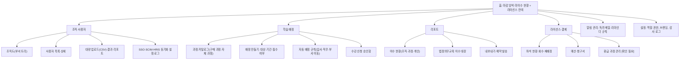

# 기업 관리자 LMS IA (조직·배정·이수·라이선스)

## 핵심 요약

- 기업 관리자(HRD 담당자)의 일은 "누구에게 무엇을 언제까지 이수시키고, 그 결과를 증빙하는가"다. IA는 **사람 → 배정 → 진행 → 증빙** 순서로 짠다.
- 사용자 관리는 수작업이 아니라 동기화가 기본이다: CSV 대량 업로드 → SSO(SAML 2.0·OIDC) → 자동 프로비저닝(SCIM 2.0) 또는 HRIS 연동 순서로 성숙한다 (L05).
- 법정의무교육·환급 과정은 "증빙 가능한 이수 기록"이 핵심 산출물이다. 리포트 내보내기 형식과 보존 기간을 기획 단계에서 정한다.
- 역할·권한은 범위(전사·본부·팀)와 기능(조회·배정·승인·결제)의 2축으로 설계한다.

## 상세

### IA 트리

### 주요 화면과 컴포넌트

| 화면 | 핵심 컴포넌트 | 설계 포인트 |
|------|---------------|-------------|
| 홈 | 마감 D-7 미이수자 수, 필수 교육 이수율, 좌석 잔여, 동기화 오류 | 각 숫자가 필터 적용 목록으로 연결. "독려 메일 보내기"를 같은 화면에 |
| 조직도 | 부서 트리, 겸직·파견 표시, 부서장 지정 | 조직 개편 시 이력 보존(과거 리포트의 부서 기준) |
| 대량 업로드 | 템플릿 다운로드, 미리보기, 행별 오류(중복 사번·이메일 형식), 부분 반영 여부 | "검증 → 미리보기 → 반영" 3단계. 실패 행만 다시 받기 |
| 동기화 설정 | SSO 메타데이터, SCIM 토큰, 매핑(사번·부서·직급), 마지막 동기화 결과 | 퇴사자 자동 비활성화와 학습 기록 보존 규칙 분리 |
| 배정 만들기 | 대상 선택(부서·직무·개인·조건), 과정, 시작·마감일, 필수/선택, 알림 일정 | 미리보기에 대상 인원 수와 좌석 차감 수 표시 |
| 자동 배정 규칙 | 트리거(입사, 부서 이동, 직무 변경, 매년 반복), 대상 조건, 마감 기준(배정일+30일) | 반복 법정교육은 "매년 1월 1일 재배정"처럼 주기 규칙 |
| 승인함 | 신청자, 과정, 비용, 예산 잔액, 승인·반려(사유) | 다단계 승인(팀장 → HRD) 여부 |
| 이수 리포트 | 필터(조직·과정·기간·상태), 표·차트, 개인 드릴다운 | 진도율·이수 정의는 L03과 같은 값. 기준 시각 표시 |
| 법정의무교육 대장 | 교육 항목별 대상자·이수자·미이수자·이수일·증빙 | 감사 대응용 내보내기(XLSX·PDF), 보존 기간 [확인 필요] |
| 라이선스 | 구매 좌석, 사용 중, 회수 가능(장기 미접속), 만료일 | 회수 시 학습 기록 유지 여부 명시 |
| 역할·권한 | 역할 템플릿(전사 관리자, 부서 관리자, 리포트 열람자, 결제 담당), 범위 지정 | 최소 권한 원칙. 개인 학습 기록 열람은 범위로 제한 |

### 한국 맥락 [확인 필요]

- 법정의무교육으로 흔히 묶이는 항목: 직장 내 성희롱 예방교육, 개인정보보호 교육, 직장 내 장애인 인식개선 교육, 산업안전보건교육, 퇴직연금 교육. 항목별 근거 법령·대상·주기·온라인 인정 범위는 법령 원문으로 확인한다 [확인 필요: 조문과 주기].
- 사업주 직업능력개발훈련(이른바 환급 과정)은 고용노동부 제도로, 훈련 인정·진도·평가·모니터링 기준이 있다. 수료 기준(진도율·평가 점수)과 부정 훈련 방지 요건은 고시 원문으로 확인한다 [확인 필요: 현행 고시명, 수료 기준 수치].
- 환급 과정은 L03 수료 규칙과 P03 부정 이용 방지(대리 수강, 동시 접속) 화면 요구를 함께 만든다.

## 서비스 유형별 차이

| 유형 | 차이 |
|------|------|
| AT02 기업교육 LMS | 이 페이지의 기본형. 배정·리포트·좌석이 핵심 |
| AT01 마켓플레이스 B2B 플랜 | 좌석 구매 + 큐레이션 카탈로그 + 간단 리포트. 자동 배정·HRIS는 상위 요금제에만 있는 경우가 많다 [가정] |
| AT03 부트캠프(기업 위탁) | 코호트 단위 리포트, 출석·과제·프로젝트 평가 공유 |
| AT08 고등·평생교육 | 기관 관리자 = 학사 담당. 학적·성적 연동(LTI·OneRoster)이 중심 ([[domain/상호운용표준]]) |
| AT05 K-12 | 학교·교육청 관리자. 계정 일괄 생성은 학급 명부 기반, 보호자 동의 관리가 추가된다 |

## 상태·예외

| 상황 | 처리 |
|------|------|
| 사용자 0명(빈 상태) | "사용자 추가" 3가지 경로(CSV, SSO, 초대 링크) 카드 |
| 대량 업로드 부분 실패 | 성공·실패 건수, 실패 행 다운로드, 재업로드 |
| 동기화 오류 | 마지막 성공 시각, 오류 건, 영향(신규 입사자 미배정) 표시 |
| 좌석 부족 | 배정 미리보기에서 차단 + 추가 구매·회수 제안 |
| 마감 경과 | 미이수 상태 유지 + 연장 배정 버튼. 법정교육은 미이수 이력 보존 |
| 퇴사·휴직 | 배정 일시 중지, 리포트 대상 제외 규칙, 기록 보존 |
| 권한 없음 | 부서 관리자는 소속 범위 외 사용자 미노출 (존재 자체를 숨김) |
| 과정 판매 종료·계약 만료 | 진행 중 배정에 경고, 대체 과정 제안, 이수 기록은 유지 |

## 에듀테크 PM 적용

- [ ] 관리자 홈이 "마감 임박 미이수" 중심인가, 독려 행동이 같은 화면에 있는가 (E10)
- [ ] 사용자 공급 경로(CSV/SSO/SCIM/HRIS)와 매핑 필드가 L05에 정의되었는가
- [ ] 자동 배정 규칙의 트리거·주기·마감 기준이 정의되었는가
- [ ] 이수 판정이 L03 규칙과 같은 값으로 리포트에 나오는가, 내보내기 형식이 고객 감사 요구를 충족하는가
- [ ] 환급 과정이면 진도·평가·본인 확인 요건이 L03·P03에 반영되었는가 [확인 필요]
- [ ] 역할 × 범위 권한 매트릭스가 E09와 일치하는가, 개인 학습 기록 열람 범위가 E13 검토를 거쳤는가
- [ ] 와이어프레임: 홈, 배정 만들기, 이수 리포트, 대량 업로드를 P0로 (PC 시나리오)

## 흔한 오해

- "관리자는 리포트만 본다" — 실제로는 사용자 정리와 독려에 시간이 많이 든다 [가정].
- "SSO를 붙이면 사용자 관리 끝" — SSO는 로그인만 해결한다. 부서·퇴사 반영은 프로비저닝(SCIM·HRIS)이 필요하다.
- "이수율 100% = 교육 효과" — 이수는 증빙 지표다. 학습 효과는 별도로 측정한다 ([[domain/학습분석지표]]).

## 관련 페이지

- [[domain/세그먼트별의사결정구조]] · [[domain/상호운용표준]] · [[domain/학습자앱IA]] · [[domain/콘텐츠CMSIA]]
- [[domain/수강생대시보드]] · [[domain/학습분석지표]] · [[domain/아동개인정보보호]]

## 출처

- IETF RFC 7643, SCIM: Core Schema: https://www.rfc-editor.org/rfc/rfc7643
- IETF RFC 7644, SCIM: Protocol: https://www.rfc-editor.org/rfc/rfc7644
- OASIS, SAML 2.0: https://docs.oasis-open.org/security/saml/v2.0/
- OpenID Connect Core 1.0: https://openid.net/specs/openid-connect-core-1_0.html
- 법정의무교육·사업주 직업능력개발훈련: 국가법령정보센터 https://www.law.go.kr , HRD-Net https://www.hrd.go.kr [확인 필요: 해당 조문·고시]
