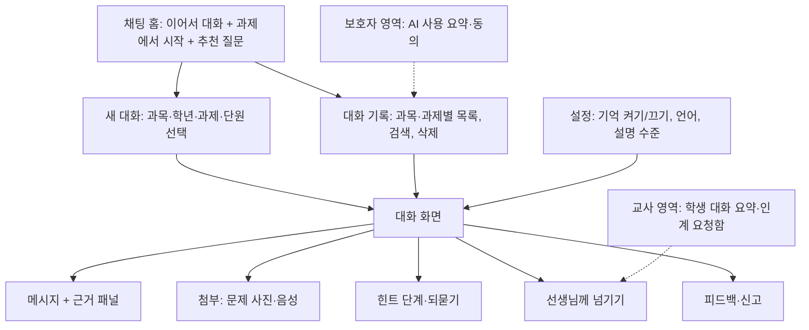

# 대화형 AI 서비스 IA (AI 튜터·학습 도우미 챗 구조)

## 핵심 요약

- 대화형 AI 서비스의 IA는 **채팅 홈 → 맥락 있는 새 대화 → 대화 화면(근거·첨부·사람 연결) → 대화 기록** 4층이다. 핵심은 대화를 "빈 입력창"이 아니라 **과목·학년·과제 맥락을 가진 세션**으로 시작하게 하는 것이다 [가정].
- 학습용 대화는 정답 제공기가 아니다. 대화 화면 구조에 힌트 사다리·되묻기·교사 연결이 들어가야 한다 ([[domain/AI튜터설계]]).
- 미성년 대상이면 **누가 대화를 볼 수 있는가**(교사·보호자 가시성)와 **무엇을 기억하는가**(세션 메모리)를 IA 단계에서 정하고, 학생에게 미리 알려야 한다.
- 대화 기록은 학습 자료이자 개인정보다. 보관 기간·삭제·내보내기가 IA에 있어야 한다 (A04, P07).

## 상세

### IA 트리

### 주요 화면·컴포넌트

| 화면 | 핵심 컴포넌트 | 설계 포인트 |
|------|---------------|-------------|
| 채팅 홈 | 이어서 대화 카드, "오늘 과제로 질문하기", 추천 질문 3~4개, AI 고지 배너 | 빈 입력창만 있으면 학생은 "숙제 답 알려줘"로 시작한다. 과제 기반 진입을 위에 [가정] |
| 새 대화(맥락 선택) | 과목·학년(프로필에서 자동), 과제·단원 선택, 목적(개념 이해·문제 풀이·복습) | 맥락이 프롬프트 변수와 근거 범위(A02)를 정한다. 3단계 이내 선택 |
| 대화 화면 | 메시지 목록, 입력창, 첨부 버튼, 근거 패널, 정지·재생성, 힌트 단계 표시 | 화면 설계는 [[domain/대화형AI인터페이스설계]] |
| 추천 질문 | 맥락별 질문 칩("이 개념 예시 하나만", "내 풀이 어디가 틀렸어?") | 학습 행동을 유도하는 문장으로. 정답 요청형 칩 금지 |
| 첨부 | 문제 사진(OCR·수식 인식), 음성 질문 | 사진에 얼굴·이름이 찍히면 경고 ([[domain/프롬프트입력UX]]) |
| 근거 패널 | 교재 쪽수·영상 시점·성취기준 링크 | 근거 없는 답은 "자료에서 찾지 못함" 라벨 |
| 선생님께 넘기기 | 질문 요약 자동 작성, 학생 확인 후 전송, 답변 대기 상태 | 교사 측은 [[domain/교사대시보드IA]]의 질문함으로 |
| 대화 기록 | 과목·과제별 그룹, 검색, 제목 자동 생성, 삭제 | 삭제 시 교사 열람본 처리 규칙을 명시 |
| 기억 설정 | 세션 간 기억 켜기/끄기, 기억된 내용 보기·지우기 | 미성년 기본값은 끄기 또는 학습 수준만 기억 [가정] (A04) |

### 가시성 규칙 (미성년 대상, E10·P07에 옮겨 적기)

| 열람자 | 볼 수 있는 것 | 볼 수 없는 것 | 근거·주의 |
|--------|---------------|---------------|-----------|
| 학생 본인 | 전체 대화, 기억 내용 | 운영자 메모 | 처음 진입 시 "선생님이 볼 수 있어요" 고지 |
| 담당 교사 | 반 단위 AI 사용 요약, 인계된 대화, 위험 신호 알림 | 인계되지 않은 대화 원문(기본값) [가정] | 학교 정책에 따라 원문 열람 허용 가능. 그 경우 학생에게 사전 고지 |
| 보호자 | 사용 시간·횟수·주제 요약, 위험 신호 알림 | 대화 원문(기본값) [가정] | 만 14세 미만은 보호자 동의가 전제 (제22조의2) |
| 기관 관리자 | 사용량·정책 위반 통계 | 개별 대화 원문 | 감사 목적 열람은 사유 기록 |
| 운영자 | 마스킹된 로그 | 실명·연락처 | [[domain/관리자백오피스BO_IA]] |

## 에듀테크 맥락

- 학생: 과제 맥락에서 바로 질문하고, 막히면 교사에게 넘길 수 있어야 한다. 대화가 길어지면 "핵심 정리"로 마무리 [가정].
- 교사: 학생 질문의 패턴(많이 막힌 개념)을 수업에 쓰고 싶어 한다. 원문보다 요약·오개념 집계가 유용하다 ([[domain/교사참여설계]]).
- 보호자: "아이가 AI로 숙제를 베끼나"가 주요 걱정이다. 힌트 위주 정책과 사용 요약을 보여 준다.
- 관리자: 반·학년별 AI 켜기/끄기, 시험 기간 차단 일정 ([[domain/모델설정화면설계]]).

## 상태·예외

| 상황 | 처리 |
|------|------|
| 첫 방문(빈 상태) | AI 고지 + 할 수 있는 일 3개 + 과제에서 시작 버튼 |
| AI 응답 지연 | 타이핑 표시, 일정 시간 초과 시 "조금 더 걸려요" + 정지 [가정: 시간은 A03] |
| 생성 실패 | "답을 만들지 못했어요. 다시 해 볼까요?" + 다시 시도, 입력 내용 보존 |
| 거절(시험 중·유해 요청·정답만 요구) | 이유 한 문장 + 대안(힌트부터, 개념 설명) + 필요 시 교사 연결 (A14) |
| 근거 없음 | 추측 금지, "교재에서 찾지 못했어요" + 선생님께 넘기기 |
| 위기 신호(자해·괴롭힘 등) | 일반 대화 중단, 도움 기관 안내, 지정 교사·담당자 알림 (P08) [가정: 절차는 학교 정책] |
| 한도 초과 | 남은 시간·초기화 시점, 기록 열람·교재 해설은 계속 가능 (P09) |
| 모델 장애 | 상태 배너, FAQ·정적 힌트 모드, 대화 기록은 열람 가능 |
| 콘텐츠 신고 | 메시지 단위 신고, 신고 후 해당 답변 흐림 처리 옵션 |
| 시험 모드 | 반 설정으로 AI 대화 일시 중지, 사유와 재개 시각 표시 |

## 에듀테크 PM 적용

- [ ] 새 대화가 과목·과제 맥락을 갖고 시작하는가 (A03 프롬프트 변수와 일치)
- [ ] 교사·보호자 가시성 규칙이 표로 정리되고 학생에게 고지되는가 (P07, E13)
- [ ] 세션 메모리 범위·보관 기간·삭제가 A04와 같은가
- [ ] 선생님께 넘기기 경로와 교사 측 수신 화면이 E10에 둘 다 있는가
- [ ] 거절·근거 없음·위기 신호 문구가 A14와 P08에 정의되었는가
- [ ] 한도·장애 시 대체 동작이 P09와 일치하는가
- [ ] 와이어프레임 P0: 채팅 홈, 새 대화(맥락 선택), 대화 화면(근거 패널 열림), 선생님께 넘기기, 대화 기록, 기억 설정

## 흔한 오해

- "범용 챗봇 화면을 그대로 쓰면 된다" — 학습 맥락 없는 빈 입력창은 정답 요청으로 흐른다.
- "보호자가 대화를 전부 보면 안전하다" — 학생이 질문을 멈출 수 있다. 요약과 위험 신호 중심이 기본값으로 낫다 [가정].
- "기억은 많을수록 개인화가 좋아진다" — 미성년 데이터 최소 수집 원칙과 충돌한다 (A04).

## 관련 페이지

- [[domain/AI서비스IA특수성]] · [[domain/대화형AI인터페이스설계]] · [[domain/프롬프트입력UX]] · [[domain/AI생성결과피드백UI]]
- [[domain/AI튜터설계]] · [[domain/교사대시보드IA]] · [[domain/아동개인정보보호]] · [[domain/교사참여설계]]

## 출처

- Amershi et al. (2019), G12 Remember recent interactions, G17 Provide global controls: https://www.microsoft.com/en-us/research/publication/guidelines-for-human-ai-interaction/
- AI 기본법 제31조(사전 고지·생성물 표시): https://casenote.kr/법령/인공지능_발전과_신뢰_기반_조성_등에_관한_기본법/제31조
- 개인정보 보호법 제22조의2: [[domain/아동개인정보보호]] 참조
- 가시성 기본값과 화면 구성은 일반화된 실무 원칙이다 [가정].
