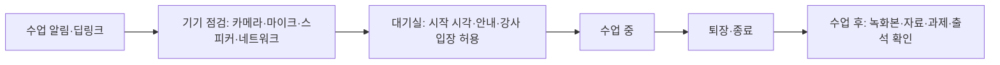

# 라이브 클래스 화면 (수업 전·중·후)

## 핵심 요약

- 라이브 수업 화면은 시간 순서로 설계한다: **수업 전**(기기 점검·대기실) → **수업 중**(영상·공유·상호작용·출석) → **수업 후**(녹화·출석 리포트·과제).
- 강사 화면과 학습자 화면은 다르다. 강사는 진행·통제(음소거, 발표자 지정, 소그룹, 녹화)를, 학습자는 참여(손들기, 채팅, 투표 응답)를 주로 한다.
- 출석은 L03 규칙의 입력이다. "입장 기록"만으로 출석을 인정할지, 체류 시간·응답 확인을 요구할지 정해야 화면 요구가 정해진다.
- 미성년 대상이면 녹화 동의, 학습자 간 비공개 채팅 금지, 강사 1:1 비공개 공간 제한, 모더레이션이 기본값이다 (E13, [[domain/아동개인정보보호]]).

## 상세

### 수업 단계별 화면

### 수업 중 컴포넌트

| 컴포넌트 | 학습자 | 강사 | 설계 포인트 |
|----------|--------|------|-------------|
| 영상 레이아웃 | 발표자 보기 / 갤러리 보기 전환 | 발표자 고정(spotlight) | 저대역에서는 발표자만 수신 |
| 화면 공유 | 보기, 확대 | 공유 시작·중지, 학습자 공유 허용 | 공유 중 알림 미리보기 노출 주의 |
| 화이트보드 | 보기, (허용 시) 그리기 | 판서, 페이지, 저장 | 판서 내용 수업 후 PDF 제공 |
| 채팅 | 전체 채팅 | 채팅 끄기, 메시지 삭제, 대상 제한 | 미성년: 학습자 간 1:1 비공개 채팅 끔 |
| 질문(Q&A) | 질문 등록, 추천 | 답변 완료 처리, 고정 | 채팅과 분리해야 질문이 묻히지 않는다 [가정] |
| 투표·퀴즈 | 응답 | 출제, 결과 공개 여부 | 결과는 익명 집계 기본 |
| 소그룹(breakout) | 배정된 방 이동, 도움 요청 | 자동·수동 배정, 방 순회, 전체 공지, 시간 | 미성년: 강사·보조교사 순회 기록 |
| 손들기·반응 | 손들기, 반응 | 순서 목록, 발언권 부여 | 키보드 단축키 |
| 출석 | 입장·퇴장 자동 기록, (필요 시) 출석 확인 응답 | 출석 현황, 수동 보정 | 체류 시간·확인 응답 기준은 L03 |
| 강사 통제 | - | 전체 음소거, 카메라 끄기 요청, 강제 퇴장, 입장 잠금 | 통제 행위 로그 |
| 녹화 | 녹화 중 표시(상시) | 녹화 시작·중지 | 녹화 전 고지와 동의, 미동의자 처리 규칙 |
| 자막 | 실시간 자막 켜기 | 자막 언어 | WCAG 1.2.4 Captions (Live)는 AA |

### 수업 후

- 녹화본: 처리 상태, 공개 범위(수강생만), 보존 기간, 챕터·대본 자동 생성(검수 후) ([[domain/강의플레이어UX]]).
- 출석 리포트: 학습자별 입·퇴장 시각, 체류 시간, 확인 응답, 수동 보정 이력 (환급·학점 과정은 증빙).
- 과제·자료: 판서 PDF, 슬라이드, 과제 링크, 불참자용 안내.

### 구축 방식 비교 (일반론)

| 방식 | 장점 | 단점 | 적합 |
|------|------|------|------|
| 외부 회의 도구 링크(일반 화상회의 서비스) | 빠름, 안정 | 출석·녹화 데이터 연동 약함, 브랜드·안전 통제 제한 | 초기 검증 |
| 회의 서비스 SDK 임베드 | 앱 안 경험, 일부 데이터 | 벤더 정책·요금·기능 범위에 종속 | 성장기 |
| WebRTC 전문 벤더(CPaaS) | 맞춤 UI·데이터, 교육 기능 직접 설계 | 개발·운영 부담, 품질 책임 | 라이브가 핵심 가치인 서비스 |
| 자체 WebRTC 인프라 | 최대 통제 | 가장 큰 비용·인력 | 대규모·특수 요구 |

선택 기준: 동시 접속 규모, 출석·녹화 데이터 필요 수준, 미성년 안전 통제, 데이터 보관 위치, 비용 구조(분당·참가자당) [가정].

## 서비스 유형별 차이

| 유형 | 차이 |
|------|------|
| AT04 라이브·튜터링 | 1:1은 예약·노트·숙제 중심, 그룹은 상호작용 도구 중심. 수업권 차감 규칙 (P01) |
| AT03 부트캠프 | 장시간 수업, 소그룹 실습, 화면 공유로 코드 리뷰, 출석이 수료 조건 |
| AT02 기업교육 | 대규모 웨비나형, 출석 증빙, 사내 SSO |
| AT05·AT06 K-12·학원 | 교사 통제 강화, 학습자 간 비공개 채팅 금지, 보호자 동의 기반 녹화 |
| AT08 고등교육 | 학사 출석 연동, 녹화 강의 보관, LMS 일정 연동 |

## 상태·예외

| 상황 | 처리 |
|------|------|
| 수업 전(대기) | 시작까지 남은 시간, 기기 점검 유도, 강사 미입장 안내 |
| 장치 권한 거부 | OS·브라우저별 권한 허용 방법, 듣기 전용으로 입장 |
| 저대역·불안정 | 비디오 자동 끄기·저화질, 오디오 우선, "연결이 불안정해요" 표시, 자동 재접속 |
| 모바일 | 발표자 + 공유 화면 위주, 채팅·Q&A는 하단 시트 |
| 재접속 | 출석은 누적 체류 시간으로 합산 [가정] |
| 권한 없음 | 미등록 학습자 입장 차단, 대기실 승인 |
| 수업 취소·지연 | 알림, 수업권 복원 규칙 (P01) |
| 녹화 미동의 | 카메라·이름 비노출 옵션 또는 녹화 제외 처리 규칙 |
| 수강 기간 만료 | 이후 일정 비노출, 녹화본 열람 정책 |

## 에듀테크 PM 적용

- [ ] 출석 인정 기준(입장·체류·확인 응답)이 L03에 정의되고 화면 요구로 내려왔는가
- [ ] 녹화 고지·동의, 보존 기간, 공개 범위가 E13에 있는가
- [ ] 미성년 대상: 학습자 간 비공개 채팅 금지, 1:1 수업 기록·모더레이션, 신고 기능이 E13에 있는가
- [ ] 저대역·모바일 경험과 재접속 처리가 E10 상태표에 있는가
- [ ] 실시간 자막·키보드 조작 등 접근성 요구가 E13 (c)에 있는가
- [ ] 구축 방식 결정이 ADR(decisions)로 남았는가, 데이터 연동 범위가 E12에 있는가
- [ ] 와이어프레임: 기기 점검, 대기실, 학습자 수업 화면(PC·모바일), 강사 통제 화면, 출석 리포트를 P0로

## 흔한 오해

- "화상회의 도구를 붙이면 라이브 클래스 완성" — 출석·녹화·과제·수업권 차감 같은 교육 운영 로직이 빠진다.
- "입장했으면 출석" — 증빙이 필요한 과정에서는 체류·확인 기준이 필요하다.
- "녹화는 무조건 좋다" — 동의·보존·초상권 문제가 생긴다. 특히 미성년 대상.

## 관련 페이지

- [[domain/아동개인정보보호]] · [[domain/접근성]] · [[domain/교사참여설계]] · [[domain/형성평가와피드백]]
- [[domain/강의플레이어UX]] · [[domain/학습자앱IA]] · [[domain/강사대시보드IA]] · [[domain/코딩실습IDE]]

## 출처

- W3C, WebRTC: Real-Time Communication in Browsers: https://www.w3.org/TR/webrtc/
- W3C, WCAG 2.2 (1.2.4 Captions (Live), 2.1.1 Keyboard): https://www.w3.org/TR/WCAG22/
- 개인정보 보호법 제22조의2 (만 14세 미만 아동): https://www.law.go.kr ([[domain/아동개인정보보호]] 참조)
- 단계별 화면 구성, 구축 방식 비교는 일반화된 실무 원칙이며 특정 벤더 평가가 아니다 [가정].
