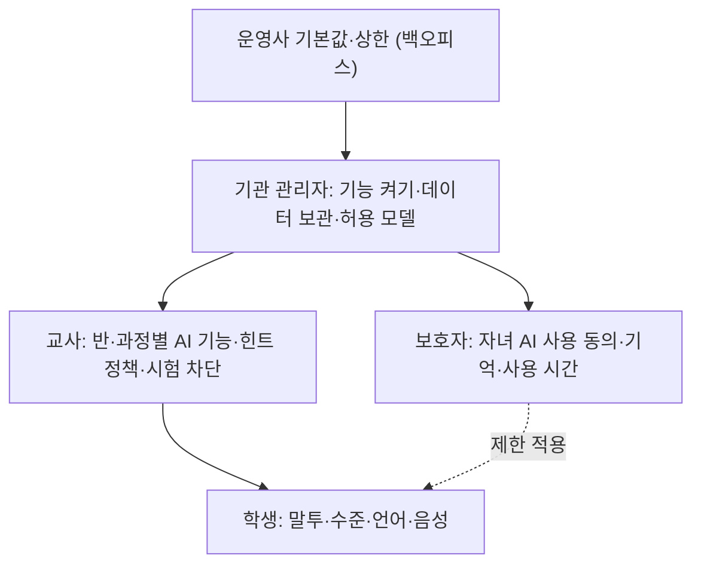

# 모델·AI 설정 화면 설계 (사용자용과 관리자용 분리)

## 핵심 요약

- AI 설정은 **사용자용**(말투·수준·언어·설명 깊이)과 **관리자용**(모델 선택·생성 다양성 같은 파라미터·라우팅·데이터 보관·기능 켜기)으로 나눈다. 학습자에게 모델명·온도 같은 기술 파라미터를 보여 주지 않는다 [가정].
- 설정은 **계층 상속**이다: 운영사 기본값 → 기관 → 반·과정 → 개인. 상위가 정한 상한 안에서만 하위가 바꾼다. 충돌 규칙을 화면에 표시한다.
- 미성년 기본값은 **안전한 쪽**으로 둔다: 기억 끄기(또는 학습 수준만), 외부 링크 끄기, 이미지 생성 끄기, 교사 가시성 켜기, 모델 개선 활용 끄기 [가정].
- 설정 변경이 결과를 바꾸면 알린다. 관리자가 모델을 바꾸면 사용자에게 "설명 방식이 바뀌었어요" 공지 (HAX G18).

## 상세

### 설정 계층

### 사용자용 설정 (학생)

| 항목 | 선택지 예 | 설계 포인트 |
|------|-----------|-------------|
| 설명 수준 | 쉽게 / 보통 / 자세히 | 학년 기본값, 미리보기 문장으로 차이를 보여 줌 |
| 말투 | 친근하게 / 차분하게 | 저학년은 선택지 줄이기 |
| 언어 | 한국어 / 영어 / 다문화 학생용 언어 [가정] | 용어는 교과서 표기 유지 옵션 |
| 설명 깊이 | 힌트 위주 / 단계별 풀이 | 교사 설정 상한 안에서 |
| 음성 | 읽어 주기 켜기, 속도 | 저학년 기본 켜기 [가정] |
| 기억 | 켜기 / 끄기, 기억 내용 보기·지우기 | 미성년 기본 끄기 또는 보호자 설정 따름 (A04) |

### 교사용 설정 (반·과정)

| 항목 | 설계 포인트 |
|------|-------------|
| AI 기능 켜기/끄기 | 튜터·피드백·생성 기능별 |
| 힌트 정책 | 힌트 단계 수, 정답 공개 조건(시도 n회 후·공개 안 함) |
| 시험·평가 차단 | 일정 예약, 차단 중 학생 화면 문구 |
| 가시성 | 학생 대화 요약 받기, 위험 신호 알림 받기 |
| 사용 한도 | 기관 상한 안에서 반별 일 사용량 |

### 관리자용 설정 (기관)

| 항목 | 설계 포인트 |
|------|-------------|
| 허용 기능 | 기관 전체 기능 목록 켜기/끄기, 학년별 |
| 허용 모델·처리 위치 | 고급 설정. "국내 처리만" 같은 정책 옵션, 국외 이전 시 표시 (제28조의8) |
| 생성 다양성·길이 | 고급 설정, 기본값 권장. 학습자 화면에는 노출하지 않음 |
| 라우팅 | "민감 요청은 기관 내 모델로" 같은 정책 토글 (A11) [가정] |
| 데이터 보관 | 대화 보관 기간, 기간 후 삭제, 모델 개선 활용 여부(기본 끔) |
| 사용량·예산 | 월 예산, 초과 시 동작(축소·차단·알림) (P09) |
| 감사 | 설정 변경 이력 |

### 화면 패턴

| 패턴 | 설명 |
|------|------|
| 상속 표시 | "기관 설정에 따라 꺼짐" 잠금 아이콘 + 누가 바꿀 수 있는지 |
| 미리보기 | 설명 수준·말투 변경 시 같은 질문의 답 예시 |
| 위험 확인 | 기억 켜기·데이터 보관 연장·모델 개선 활용 켜기는 확인 대화상자와 영향 설명 |
| 기본값으로 | 항목별·전체 초기화 |
| 변경 공지 | 관리자 변경 → 영향 받는 사용자 알림 |

## 에듀테크 맥락

- 학생: 자기 학습에 맞추는 선택권은 동기를 돕지만, 선택지가 많으면 부담이다. 3개 이내 핵심 설정 [가정] ([[domain/동기설계]]).
- 교사: 반 단위 통제가 핵심. 시험 기간 차단과 정답 공개 조건이 가장 많이 쓰일 것이다 [가정].
- 보호자: 만 14세 미만은 보호자 동의가 전제이고, 기억·사용 시간 설정을 보호자 영역에 둔다 ([[domain/아동개인정보보호]]).
- 관리자: 처리 위치·보관 기간은 계약·정책 문서(P07)와 일치해야 한다.

## 상태·예외

| 상황 | 처리 |
|------|------|
| 상위 설정으로 잠김 | 잠금 표시 + 사유 + 요청 경로 |
| 설정 저장 실패 | 이전 값 유지, 재시도 |
| AI 응답 지연·실패 | 설정 화면은 독립 동작. 미리보기만 "예시를 불러오지 못했어요" |
| 거절과 설정 충돌 | 학생이 "정답 바로" 선택 불가 이유: "선생님이 힌트 먼저로 정했어요" |
| 근거 없음 | 해당 없음 |
| 한도 초과 | 관리자 화면에 초과 동작 상태 표시, 상향 요청 |
| 모델 장애 | 허용 모델 목록에 상태 표시, 대체 모델 자동 전환 여부 |
| 동의 철회 | 기억 데이터 삭제 일정 안내, AI 기능 잠금 |
| 정책 변경 공지 | 변경 내용·시행일, 재동의 필요 시 진입 차단 |

## 에듀테크 PM 적용

- [ ] 사용자·교사·보호자·관리자 설정 항목이 분리되고 학습자에게 기술 파라미터가 없는가
- [ ] 설정 상속 규칙과 충돌 처리가 E09 권한 매트릭스와 같은가
- [ ] 미성년 기본값(기억·외부 링크·모델 개선 활용)이 P07·A04와 같은가
- [ ] 처리 위치·라우팅 정책이 A11과 같은가
- [ ] 예산·초과 동작이 A12·P09와 같은가
- [ ] 변경 공지·감사 이력이 있는가
- [ ] 와이어프레임 P0: 학생 설정, 교사 반 AI 설정, 기관 관리자 AI 정책, 보호자 AI 설정

## 흔한 오해

- "설정이 많을수록 사용자 친화적" — 대부분은 기본값을 쓴다. 기본값 설계가 핵심이다.
- "온도·모델 선택을 열어 주면 고급 사용자에게 좋다" — 학습자에게는 결과 편차와 안전 위험만 늘린다. 관리자 고급 설정으로.
- "기관이 끄면 끝" — 학생 화면에 왜 꺼졌는지 보이지 않으면 문의가 몰린다.

## 관련 페이지

- [[domain/AI서비스IA특수성]] · [[domain/관리자백오피스BO_IA]] · [[domain/사용량대시보드설계]] · [[domain/AI화면설계5원칙]]
- [[domain/아동개인정보보호]] · [[domain/학습데이터프라이버시]] · [[domain/교사대시보드IA]] · [[domain/AI튜터설계]]

## 출처

- Amershi et al. (2019), G17 Provide global controls, G18 Notify users about changes: https://www.microsoft.com/en-us/research/publication/guidelines-for-human-ai-interaction/
- 개인정보 보호법 제22조의2·제28조의8: [[domain/아동개인정보보호]], [[domain/학습데이터프라이버시]] 참조
- 설정 계층과 미성년 기본값은 일반화된 실무 원칙이다 [가정].
