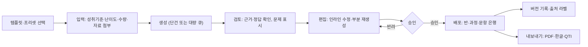
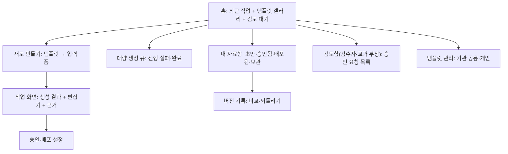

# 생성형 AI 서비스 IA (생성 → 검토 → 편집 → 승인 → 배포)

## 핵심 요약

- 생성형 AI 서비스(교사용 학습지·퀴즈 생성, 과정 콘텐츠 초안, 해설 작성)의 IA는 **생성 → 검토 → 편집 → 승인 → 배포** 파이프라인이다. 생성 버튼보다 **검토와 승인 단계**가 IA의 중심이다 [가정].
- 학생에게 나가는 생성물은 사람(교사·검수자)의 승인을 기본값으로 둔다. 승인 없이 배포되는 경로가 있다면 그 범위와 표시를 명시한다 ([[domain/교사참여설계]], [[domain/문항자동생성]]).
- 모든 생성물은 **출처 라벨**(AI 생성·사람 편집·사람 작성)과 **버전 기록**을 갖는다. 생성형 AI 결과물 표시는 AI 기본법 제31조 의무와 연결된다.
- 템플릿·프리셋이 품질과 비용을 함께 좌우한다. 자유 프롬프트보다 성취기준·난이도·문항 수를 고르는 폼이 교사 시간을 줄인다 ([[domain/프롬프트입력UX]]).

## 상세

### 흐름

### IA 트리 (교사용 자료 생성 도구 기준)

### 주요 화면·컴포넌트

| 화면 | 핵심 컴포넌트 | 설계 포인트 |
|------|---------------|-------------|
| 템플릿 갤러리 | 유형(학습지·형성평가·서술형 루브릭·수업 개요), 학년·과목 필터, 기관 공용 표시 | 템플릿에 성취기준·문항 형식·난이도 기본값이 들어 있다 |
| 입력 폼 | 성취기준 검색, 난이도, 문항 수·유형, 참고 자료 첨부, 추가 지시 | 필수 항목은 폼으로, 자유 지시는 선택. 예상 생성 시간·사용량 표시 |
| 작업 화면 | 좌: 생성 결과(문항 카드), 우: 근거·성취기준·정답 검증 결과 | 문항마다 "확인 필요" 플래그(정답 불일치·근거 없음) |
| 인라인 편집 | 직접 수정, 문항 단위 재생성, 보기만 다시 만들기 | 수정 내역은 품질 신호로 저장 ([[domain/AI생성결과피드백UI]]) |
| 승인 | 체크리스트(정답·난이도·편향·저작권), 승인자 이름, 반려 사유 | 확인 필요 플래그가 남아 있으면 승인 버튼 비활성 [가정] |
| 배포 설정 | 대상 반·과정, 공개 시점, 학생 화면 라벨 | 학생 화면에는 "AI로 만들고 선생님이 확인했어요" 같은 라벨 [가정: 문구는 P07] |
| 버전 기록 | 버전 목록(생성·편집·승인 시점·사람), 비교, 되돌리기 | 배포된 버전이 바뀌면 이미 응시한 학생 결과 처리 규칙 ([[domain/콘텐츠CMSIA]]) |
| 출처 라벨 | AI 생성 / 사람 편집 / 사람 작성 배지 | 문항 단위로 저장해 문항 은행에서도 유지 |
| 내보내기 | PDF·한글(HWP)·Word·QTI·CSV | 내보낸 파일에도 출처 표기 유지 여부 결정 [가정] |
| 대량 생성 큐 | 작업별 진행률, 실패 항목 재시도, 완료 알림, 취소 | 대량 생성은 비용 큰 작업. 예상 사용량 확인 후 실행 (A12) |

## 에듀테크 맥락

- 교사: 생성보다 검토에 시간이 든다. 검토를 빠르게 하는 장치(정답 자동 검증, 성취기준 정합 표시, 변경 부분 강조)가 핵심 가치다 [가정].
- 학생: 승인된 결과만 본다. AI 생성 표시가 있어도 "선생님 확인" 표시가 신뢰를 준다 [가정].
- 보호자: 가정 통신에 AI 활용 범위를 안내받는다 (P07).
- 관리자·교과 협의회: 기관 공용 템플릿과 승인 권한(누가 승인할 수 있는가)을 관리한다.
- 저작권: 참고 자료 첨부 시 교과서·문제집 원문 활용 범위를 안내한다 ([[domain/교육저작권]]).

## 상태·예외

| 상황 | 처리 |
|------|------|
| 생성 지연 | 단건은 진행 표시와 부분 결과 스트리밍, 대량은 큐로 넘기고 완료 알림 |
| 생성 실패(부분) | 성공한 문항은 보존, 실패 문항만 재시도 |
| 거절 | 정책 위반 요청(시험 유출 문항 재현·유해 주제)은 이유와 대안 |
| 근거 없음 | 첨부 자료·성취기준과 맞지 않는 문항에 "근거 없음" 플래그, 승인 차단 |
| 정답 검증 불일치 | 독립 검증 결과와 다르면 "확인 필요" ([[domain/문항자동생성]]) |
| 한도 초과 | 남은 생성량·초기화 시점, 기존 자료 편집·배포는 계속 가능 (P09) |
| 모델 장애 | 생성 버튼 비활성 + 상태 배너, 템플릿 빈 양식으로 직접 작성 가능 |
| 배포 후 오류 신고 | 학생·교사 신고 → 해당 문항 숨김·정정, 응시 결과 재채점 규칙 (P08, P04) |
| 승인자 부재 | 대기 기한 경과 알림, 대리 승인자 지정 |

## 에듀테크 PM 적용

- [ ] 학생에게 나가는 모든 생성물에 승인 단계가 있는가. 예외가 있다면 범위와 라벨이 정의되었는가
- [ ] 출처 라벨(AI 생성·사람 편집·사람 작성)과 학생 화면 문구가 P07과 일치하는가
- [ ] 정답·근거 검증 결과가 승인 조건에 연결되었는가 (A05, A08)
- [ ] 버전 변경 시 응시 결과 처리 규칙이 있는가
- [ ] 배포 후 오류 신고·정정 흐름이 P08·P04에 있는가
- [ ] 대량 생성의 예상 비용 표시와 기관 한도가 A12·P09와 일치하는가
- [ ] 와이어프레임 P0: 템플릿 갤러리, 입력 폼, 작업 화면(검토·편집), 승인, 버전 기록, 대량 생성 큐

## 흔한 오해

- "생성 품질만 좋으면 검토는 형식이다" — 문항 정답 오류는 소수여도 학생 평가에 직접 피해를 준다. 검토 동선이 제품의 핵심이다.
- "AI 표시는 학생 신뢰를 떨어뜨린다" — 표시는 법적 의무이며, 사람 확인 표시와 함께 쓰면 신뢰를 지킬 수 있다 [가정].
- "자유 프롬프트가 더 유연하다" — 교사 대부분은 폼·템플릿으로 더 빨리 원하는 결과를 얻는다 [가정].

## 관련 페이지

- [[domain/AI서비스IA특수성]] · [[domain/AI생성결과피드백UI]] · [[domain/프롬프트입력UX]] · [[domain/AI글쓰기도구화면사례]]
- [[domain/문항자동생성]] · [[domain/콘텐츠CMSIA]] · [[domain/교사참여설계]] · [[domain/교육저작권]] · [[domain/콘텐츠품질관리]]

## 출처

- AI 기본법 제31조(생성형 AI 결과물 표시): https://casenote.kr/법령/인공지능_발전과_신뢰_기반_조성_등에_관한_기본법/제31조
- Amershi et al. (2019), G9 Support efficient correction, G16 Convey the consequences of user actions: https://www.microsoft.com/en-us/research/publication/guidelines-for-human-ai-interaction/
- 1EdTech QTI 3.0 (문항 내보내기): https://www.1edtech.org/standards/qti
- 파이프라인 구조와 승인 규칙은 일반화된 실무 원칙이다 [가정].
