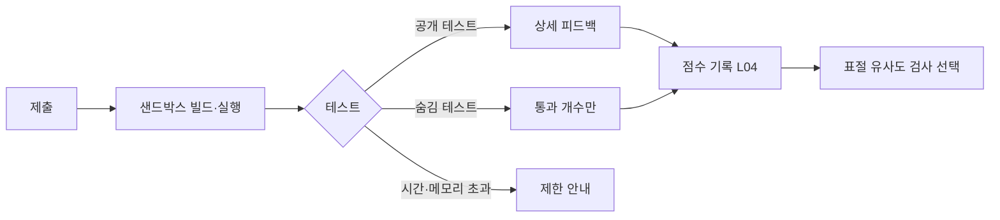

# 코딩 실습 IDE (브라우저 실습·자동 채점)

## 핵심 요약

- 브라우저 실습 화면은 **지시문 · 편집기 · 실행 결과** 3영역이 기본이다. 초보자용일수록 파일 트리·터미널을 숨기고, 고급 과정일수록 실제 개발 환경에 가깝게 연다.
- 자동 채점은 테스트 케이스로 한다. 공개 테스트(학습자가 보는 예시)와 숨김 테스트(채점용)를 나누고, 실패 메시지가 다음 행동을 알려 줘야 학습이 된다 ([[domain/형성평가와피드백]]).
- 학습자 코드를 서버에서 실행하는 것은 보안·비용 문제다. 실행 시간·메모리·네트워크·파일 시스템 제한을 정책으로 정하고 UI에 알린다.
- IDE 안의 AI 도우미는 학업 윤리와 충돌한다. 과정·과제 유형별로 허용 수준(끔, 힌트만, 설명, 코드 생성)을 정하고 학습자에게 미리 알린다 (L04, P03).

## 상세

### 화면 구조

```text
실습 화면
├─ 좌측: 지시문(목표, 입출력 예시, 제약, 힌트 버튼)
├─ 중앙: 편집기(문법 강조, 자동 완성, 오류 밑줄, 탭별 파일)
│  └─ (고급) 파일 트리, 터미널
├─ 우측 또는 하단: 실행 결과 | 테스트 결과 | 콘솔
└─ 상단 바: 실행, 제출, 초기화, 저장 상태, AI 도우미(허용 시), 해답 보기(조건부)
```

### 주요 컴포넌트

| 컴포넌트 | 설계 포인트 |
|----------|-------------|
| 편집기 | 글꼴 크기 조절, 고대비 테마, 탭 키 동작 전환(들여쓰기 vs 포커스 이동) 제공. 키보드 함정 방지 ([[domain/접근성]] 2.1.2) |
| 실행 | 실행 중 표시, 시간 초과 시 "실행 시간 제한 n초를 넘었어요. 무한 반복을 확인해 보세요" |
| 테스트 결과 | 테스트별 통과/실패, 입력·기대값·실제값 비교. 숨김 테스트는 "숨김 테스트 n개 중 m개 통과" 수준만 |
| 힌트 사다리 | 1단계 개념 → 2단계 접근 방법 → 3단계 부분 코드. 사용 횟수 기록 ([[domain/퀴즈과제UI]]) |
| 해답 보기 | 조건: n회 시도 후 또는 통과 후. 채점 과제에서는 마감 후에만 [가정] |
| 템플릿 | 언어별 시작 코드, 테스트 파일, 의존성. 강사가 CMS에서 관리 |
| 저장 | 자동 저장(로컬 + 서버), 버전 기록, "처음 상태로" 초기화는 확인 대화상자 |
| 협업 | 공유 링크, 동시 편집(페어), 멘토 코드 리뷰 코멘트(줄 단위) |
| AI 도우미 | 허용 수준 배지, 대화 기록 보존(채점자 열람 가능 여부 고지), 코드 직접 삽입 제한 옵션 |
| 노트북 | 데이터 과정은 Jupyter형 셀 실행, 커널 상태 표시, 셀 순서 의존 경고, 데이터셋 사전 탑재 |

### 자동 채점 흐름



### 샌드박스·보안·비용 체크 [가정: 수치는 인프라 결정]

| 항목 | 결정 내용 |
|------|-----------|
| 실행 시간 | 실행당 상한(예: 수 초~수십 초), 세션당 상한 |
| 메모리·CPU | 컨테이너별 상한, 초과 시 메시지 |
| 네트워크 | 기본 차단, 과정에 필요한 경우 허용 목록 |
| 파일 시스템 | 세션별 격리, 세션 종료 시 삭제 또는 보존 기간 |
| 악용 | 채굴·스팸·외부 공격 차단, 비정상 사용 탐지 |
| 비용 | 유휴 세션 자동 종료, 콜드 스타트 시간 안내, 동시 사용 피크(마감 직전) 대비 |

## 서비스 유형별 차이

| 유형 | 차이 |
|------|------|
| AT03 부트캠프 | 실제 개발 환경에 가까운 IDE + 프로젝트 저장소, 멘토 리뷰, 페어 |
| AT01 마켓플레이스 | 레슨 옆 가벼운 실습, 영상과 분할 화면 ([[domain/강의플레이어UX]]) |
| AT05 K-12 | 블록 코딩 → 텍스트 코딩 전환, 교사 열람·일시정지, 네트워크 완전 차단, 계정 공유 기기 고려 |
| AT09 자격증·코딩테스트 대비 | 시간 제한, 숨김 테스트 중심, 부정 방지(복사 붙여넣기 기록, 탭 이탈 기록) |
| AT10 AI 튜터 | AI가 힌트 사다리를 생성. 정답 코드 직접 제공 금지 규칙과 평가 (A 트랙) |

## 상태·예외

| 상황 | 처리 |
|------|------|
| 환경 준비 중 | "실습 환경을 준비하고 있어요" + 예상 시간, 그동안 지시문 읽기 가능 |
| 실행 실패(인프라) | 학습자 코드 오류와 구분해서 표시. "우리 쪽 문제예요, 다시 시도" |
| 컴파일·런타임 오류 | 줄 위치 강조, 초보자용 오류 설명(선택) |
| 세션 만료 | 코드 자동 저장 보장 후 재연결 |
| 오프라인 | 편집은 로컬 계속, 실행·제출은 비활성 + 연결 대기 |
| 권한 없음 | 미구매 과정 실습은 읽기 전용 미리보기 |
| 마감 경과 | 제출 버튼 → 지각 제출 정책 표시 (L04) |
| 수강 기간 만료 | 코드 다운로드 허용 여부 정책 결정 [가정] |

## 에듀테크 PM 적용

- [ ] 학습자 수준별로 노출할 IDE 기능(파일 트리·터미널)을 정했는가 ([[domain/인지부하이론]])
- [ ] 공개·숨김 테스트 구분, 실패 메시지 원칙, 힌트·해답 공개 조건이 L04에 있는가
- [ ] 실행 제한(시간·메모리·네트워크)과 메시지가 E10 상태표에 있는가
- [ ] AI 도우미 허용 수준과 학업 윤리 고지, 표절 검사 방식이 L04·P03에 있는가
- [ ] 미성년 대상이면 네트워크 차단·교사 열람·공유 기능 제한이 E13에 반영되었는가
- [ ] 마감 직전 동시 실행 피크 비용·용량 계획이 B 트랙에 전달되었는가
- [ ] 와이어프레임: 3영역 실습 화면, 테스트 결과, 힌트 사다리를 P0로

## 흔한 오해

- "테스트 통과 = 학습 성공" — 테스트를 맞추는 코드(하드코딩)가 통과할 수 있다. 숨김 테스트와 코드 리뷰로 보완한다.
- "AI 도우미는 모두 금지해야 한다" — 과제 목적에 따라 허용 수준을 다르게 두는 것이 현실적이다 [가정].
- "실습 환경은 무료에 가깝다" — 서버 실행 비용이 학습자 수·실행 횟수에 비례한다.

## 관련 페이지

- [[domain/퀴즈과제UI]] · [[domain/강의플레이어UX]] · [[domain/라이브클래스화면]]
- [[domain/형성평가와피드백]] · [[domain/인지부하이론]] · [[domain/숙달학습]] · [[domain/접근성]]

## 출처

- Project Jupyter Documentation: https://docs.jupyter.org
- W3C, WCAG 2.2 2.1.2 No Keyboard Trap: https://www.w3.org/TR/WCAG22/
- 화면 구조, 채점 흐름, 샌드박스 항목은 일반화된 실무 원칙이다 [가정].
