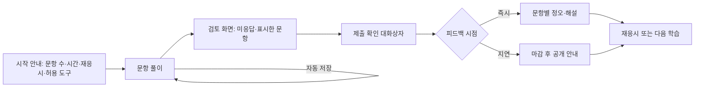

# 퀴즈·과제 UI (문항 렌더러부터 동료 평가까지)

## 핵심 요약

- 평가 화면은 **문항 렌더러 + 응시 흐름(타이머·저장·검토·제출) + 결과·피드백** 3층으로 설계한다. 문항 유형이 늘어도 응시 흐름은 하나로 통일한다.
- 저부담 연습 퀴즈와 고부담 시험은 UI 규칙이 다르다: 연습은 즉시 피드백·힌트·재시도, 시험은 지연 피드백·검토·제출 확인 ([[domain/형성평가와피드백]], [[domain/인출연습]]).
- 접근성 핵심: 시간 제한 조절(WCAG 2.2.1), 드래그 문항의 클릭 대안(2.5.7), 색만으로 정오답 표시 금지(1.4.1), 시험 응답 제출 전 검토·확인 수단(3.3.4는 시험 응답 제출을 명시적으로 포함) ([[domain/접근성]]).
- 자동 저장은 기능이 아니라 기본값이다. 연결 끊김으로 답안을 잃는 경험은 신뢰를 크게 잃게 한다 [가정].

## 상세

### 응시 흐름

### 문항 유형별 렌더러

| 유형 | 핵심 UI | 접근성·모바일 주의 |
|------|---------|-------------------|
| 선다형(단일) | 라디오 목록, 보기 전체 영역 탭 가능 | 터치 영역(2.5.8), 보기 순서 섞기 시 "가, 나" 라벨 일관성 |
| 다중 선택 | 체크박스, "모두 고르세요" 명시, 선택 개수 표시 | 부분 점수 규칙을 시작 안내에 |
| 단답형 | 입력창, 허용 형식 힌트(단위, 소수점) | 동의어·띄어쓰기 허용 규칙은 채점 쪽에서 (E11) |
| 수식 입력 | 수식 키패드 또는 LaTeX 미리보기 | 수식은 MathML 등 읽을 수 있는 형식으로 표시, 입력 대안 제공 |
| 코드 | 편집기 + 실행 | [[domain/코딩실습IDE]] |
| 드래그 앤 드롭·매칭 | 끌어 놓기 + "선택 후 위치 탭" 대안 | 2.5.7 필수. 모바일 스크롤과 충돌 주의 |
| 순서 배열 | 끌기 + 위/아래 버튼 | 키보드 조작 |
| 음성·말하기 | 녹음, 다시 듣기, 재녹음, 마이크 권한 안내 | 소음 환경·장애 학습자 대안 과제 [가정] |
| 파일 업로드 | 허용 형식·용량, 진행률, 업로드 후 미리보기 | 업로드 실패 시 재시도, 마감 직전 혼잡 |
| 서술형·에세이 | 글자 수, 자동 저장, 루브릭 미리 보기 | 붙여넣기 정책(P03) 고지 |

### 응시 중 공통 컴포넌트

| 컴포넌트 | 설계 포인트 |
|----------|-------------|
| 타이머 | 남은 시간 표시, 숨기기 옵션, 5분·1분 전 알림(스크린리더 공지). 연장 시간 개별 설정 |
| 자동 저장 | 응답 변경 시 저장, "저장됨 · 방금" 표시, 오프라인 시 로컬 저장 후 동기화 |
| 문항 표시(flag) | 나중에 볼 문항 표시, 검토 화면에서 모아 보기 |
| 문항 내비게이션 | 번호 격자(응답·미응답·표시 상태), 순차 응시 시험은 비활성 |
| 제출 확인 | 미응답 n개 경고, "제출하면 수정할 수 없어요" (3.3.4) |

### 피드백·힌트·재응시

- **즉시 vs 지연**: 연습은 즉시(정오 + 왜 + 다음 행동), 시험은 마감 후 공개로 문항 유출을 줄인다 (P03).
- **힌트 사다리**: 1단계 개념 상기 → 2단계 전략 → 3단계 풀이 일부. 힌트 사용을 점수에 반영할지 L04에서 정한다.
- **재응시**: 남은 횟수, 대기 시간, 점수 반영 방식(최고·최근·평균)을 시작 화면과 결과 화면에 모두 표시.
- **루브릭 표시**: 제출 전 기준·수준 설명 공개, 결과에서 기준별 점수와 코멘트.
- **동료 평가**: 배정된 평가 수, 루브릭 기반 평가 폼, 익명 여부, 평가 기한, 평가 품질 확인(보정 과제) [가정].

## 서비스 유형별 차이

| 유형 | 차이 |
|------|------|
| AT01 마켓플레이스 | 레슨 끝 저부담 퀴즈, 과제는 선택형. 강사 피드백 기한 표시 |
| AT02 기업교육·환급 과정 | 평가 응시 조건(진도율), 본인 확인, 시간 제한, 재응시 제한 (L03·P03) [확인 필요: 환급 기준] |
| AT03 부트캠프 | 프로젝트 제출·코드 리뷰·루브릭 중심, 동료 평가 |
| AT05·AT06 K-12·학원 | 교사가 배정, 큰 글씨·짧은 지시문, 즉시 피드백, 오답 다시 풀기 |
| AT09 시험대비 | 실전 모의고사 모드(시험지 형식 재현, OMR형 답안), 문항별 시간 기록, 오답노트 |
| AT10 AI 튜터 | AI 채점·피드백은 근거(루브릭 기준) 표시와 이의 신청 경로 (E14) |

## 상태·예외

| 상황 | 처리 |
|------|------|
| 응시 전 조건 미충족 | "진도 80% 이후 응시할 수 있어요"처럼 조건과 현재 값 [가정: 수치는 L03] |
| 로딩 | 문항 미리 불러오기, 이미지·수식 렌더링 대기 표시 |
| 연결 끊김 | 응답 로컬 저장, 타이머 정책(서버 기준 계속 vs 일시정지) 고지, 재연결 시 동기화 |
| 시간 종료 | 자동 제출 + 저장된 응답 기준임을 안내 |
| 업로드 실패 | 재시도, 마감 직전 실패 시 증빙(시각 기록) 제공 [가정] |
| 권한 없음 | 미배정·미구매 평가는 잠금, 기업은 승인 요청 |
| 마감 경과 | 지각 제출 허용 여부·감점 표시 (L04) |
| 재응시 소진 | 결과 보기만 가능, 문의 경로 |
| 수강 기간 만료 | 응시 차단, 과거 결과 열람 허용 여부 |

## 에듀테크 PM 적용

- [ ] 문항 유형 목록이 E11 문항 설계와 일치하고, 유형별 렌더러와 대안 조작이 정의되었는가
- [ ] 연습/시험 모드별 피드백 시점, 힌트, 재응시 규칙이 L04에 있는가
- [ ] 타이머 연장·숨김, 드래그 대안, 색 비의존 표시가 E13 (c)에 있는가
- [ ] 자동 저장·연결 끊김·시간 종료 처리가 E10 상태표에 있는가
- [ ] 시험 부정 방지(문항 섞기, 지연 공개, 붙여넣기 기록)가 P03과 일치하는가
- [ ] 문항 상호운용(QTI 가져오기·내보내기)이 필요한지 L05에서 정했는가
- [ ] 와이어프레임: 시작 안내, 문항 풀이(모바일), 검토, 결과·피드백, 루브릭 결과를 P0로

## 흔한 오해

- "피드백은 정답만 보여 주면 된다" — 정오만으로는 개선 방향을 주지 못한다. 무엇을 다음에 할지 알려 준다 (Hattie & Timperley).
- "타이머는 집중을 돕는다" — 시간 압박은 일부 학습자에게 불리하다. 시험 목적이 아니면 끄는 옵션을 둔다.
- "드래그 문항이 더 재미있다" — 대안 조작이 없으면 접근성 위반이 된다.

## 관련 페이지

- [[domain/형성평가와피드백]] · [[domain/인출연습]] · [[domain/블룸분류체계]] · [[domain/숙달학습]]
- [[domain/코딩실습IDE]] · [[domain/강의플레이어UX]] · [[domain/수강생대시보드]] · [[domain/접근성]] · [[domain/상호운용표준]]

## 출처

- W3C, WCAG 2.2 (1.4.1, 2.2.1, 2.5.7, 2.5.8, 3.3.1, 3.3.4): https://www.w3.org/TR/WCAG22/
- W3C, MathML Core: https://www.w3.org/TR/mathml-core/
- 1EdTech, QTI 3.0: https://www.1edtech.org/standards/qti
- Hattie, J. & Timperley, H. (2007). The Power of Feedback. *Review of Educational Research*, 77(1). https://doi.org/10.3102/003465430298487
- 응시 흐름과 렌더러 설계 포인트는 일반화된 실무 원칙이다 [가정].
