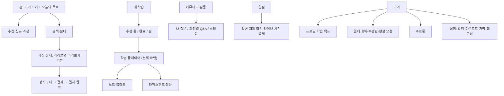

# 학습자 앱 IA (탭 구조, 딥링크, 온보딩)

## 핵심 요약

- 학습자 앱의 첫 화면은 "다음에 할 학습 한 가지"로 시작한다. 탐색·구매는 그다음이다. 재방문 학습자가 대부분인 서비스에서 홈이 카탈로그면 학습 재개까지 탭 수가 늘어난다 [가정].
- 탭은 4~5개로 묶는다: 홈(또는 탐색), 내 학습, 커뮤니티·질문, 알림(또는 상단 아이콘), 마이. 학습 플레이어는 탭이 아니라 전체 화면 모드다.
- 딥링크(푸시·이메일·공유 링크)는 로그인·수강권·기기 상태를 모두 통과한 뒤 정확한 레슨·타임스탬프로 떨어져야 한다. 딥링크 실패가 재방문 이탈의 흔한 원인이다 [가정].
- 아동용과 성인용은 같은 IA를 쓰지 않는다. 아동용은 결제·외부 링크·커뮤니티를 보호자 영역으로 분리한다 (E10 4절 연령별 UI 규칙).

## 상세

### IA 트리 (성인 VOD·구독형 기준)

### 탭별 설계 포인트

| 탭·영역 | 핵심 컴포넌트 | 설계 포인트 |
|---------|---------------|-------------|
| 홈 | 이어 보기 카드, 오늘의 목표, 추천 레일 | 이어 보기 카드는 "과정명 · 레슨명 · 남은 시간"과 재생 버튼 하나. 탭 한 번으로 마지막 위치 재생 |
| 탐색·검색 | 검색창, 자동완성, 필터(주제·난이도·길이·가격·언어·자막), 정렬 | 결과 0건 화면에 철자 교정·인기 검색어·요청하기 제공. 필터는 적용 개수 표시와 전체 해제 |
| 과정 상세 | 학습 성과 목록, 커리큘럼 아코디언, 미리보기, 강사, 리뷰, 수강 기간, 가격 CTA | "무엇을 할 수 있게 되나"(학습 성과)를 가격보다 위에. 수강 기간·환불 조건 링크 노출 (P01) |
| 장바구니·결제 | 쿠폰, 결제 수단, 약관 동의, 영수증 | 결제 완료 화면의 주 CTA는 "바로 학습 시작". 결제 실패 시 장바구니 보존 |
| 내 학습 | 수강 중/완료/찜 탭, 진도 바, 만료 임박 배지 | 진도는 L03의 진도율 정의와 같은 값. 만료 D-7 표시 |
| 학습 플레이어 | 영상·문서·퀴즈·실습 렌더러, 목차, 다음 레슨 | [[domain/강의플레이어UX]] 참조 |
| 커뮤니티·질문 | 과정별 Q&A, 내 질문, 답변 알림 | 질문 작성 시 해당 레슨·타임스탬프 자동 첨부 |
| 알림 | 알림 목록, 유형 필터 | 알림마다 딥링크 대상 명시 (아래 표) |
| 마이 | 결제·수강권, 수료증, 설정 | 수료증은 다운로드·공유·진위 확인 링크 (L06) |

### 온보딩과 레벨 테스트

- 흐름: 가입 → 목표·관심 선택(3개 이내 질문) → (선택) 레벨 테스트 → 첫 추천 과정 → 첫 레슨 1분 체험.
- 레벨 테스트는 건너뛰기 가능하게 하고, 결과를 "추천 시작점"으로만 쓴다. 결과를 등급처럼 보여 주면 유능감을 해칠 수 있다 ([[domain/동기설계]]).
- 질문 수를 최소화하고, 결과 화면에서 바로 첫 학습으로 연결한다. 레벨 테스트 자체를 진단평가 품질로 운영하려면 E11 문항 설계가 필요하다.

### 딥링크 대상 표 (E10 6절에 그대로 옮겨 쓸 수 있음)

| 진입 경로 | 목적지 | 실패 시 처리 |
|-----------|--------|--------------|
| "답변이 달렸어요" 푸시 | 질문 상세 (해당 레슨 타임스탬프 링크 포함) | 질문 삭제 시 과정 Q&A 목록 |
| 과제 마감 알림 | 과제 제출 화면 | 마감 후면 과제 결과·지각 제출 정책 안내 (L04) |
| 라이브 시작 알림 | 라이브 대기실 | 종료 후면 녹화본 또는 "녹화 준비 중" |
| 마케팅 공유 링크 | 과정 상세 | 판매 종료 과정은 대체 과정 추천 |
| 수강 기간 만료 안내 | 연장·재구매 화면 | 연장 불가 과정은 학습 기록 보기 |

## 서비스 유형별 차이

| 유형 | IA 차이 |
|------|---------|
| AT01 마켓플레이스 | 탐색·과정 상세·리뷰·장바구니 비중이 크다. 첫 화면을 탐색으로 두는 경우가 많지만 수강 중 학습자에게는 이어 보기를 최상단에 |
| AT02 기업교육 LMS | 구매 흐름이 없거나 승인형. 홈은 "필수 교육 · 마감일" 중심 ([[domain/기업관리자LMSIA]]) |
| AT03 부트캠프 | 일정(라이브·과제 마감)과 프로젝트 탭이 중심. 코호트 커뮤니티 |
| AT04 라이브·튜터링 | 예약·일정 탭, 튜터 프로필, 수업권 잔여 |
| AT05·AT06 K-12·학원 | 교사가 배정한 과제가 홈. 결제·커뮤니티는 학습자 화면에서 제외, 보호자 앱으로 |
| AT07 소비자 학습앱 | 일일 목표·짧은 세션. 구독 관리가 마이에 |
| AT09 시험대비 | 시험일 D-day, 모의고사·오답노트 탭 |
| AT10 AI 튜터 | 대화가 주 화면이 되기 쉬우나, 학습 기록·목표로 돌아오는 경로를 별도로 둔다 |

### 아동용과 성인용

| 항목 | 아동(만 14세 미만 포함) | 성인 |
|------|------------------------|------|
| 첫 화면 | 오늘 할 일 1~3개, 큰 버튼, 음성 안내 | 이어 보기 + 추천 |
| 결제·장바구니 | 학습자 화면에 노출하지 않음. 보호자 앱·보호자 확인 후 | 일반 |
| 커뮤니티 | 없음 또는 교사 관리 공간만. 자유 DM 금지 | 공개 Q&A·스터디 |
| 검색 | 제한된 카탈로그, 자유 검색 최소화 | 전체 검색 |
| 가입 | 보호자 동의 절차 ([[domain/아동개인정보보호]]) | 본인 가입 |

## 상태·예외

| 상황 | 화면 처리 |
|------|-----------|
| 신규 사용자(빈 상태) | 이어 보기 대신 온보딩 결과 기반 "첫 레슨 시작" 카드 |
| 로딩 | 레일·카드 스켈레톤. 이어 보기 카드를 가장 먼저 로드 |
| 오류 | "목록을 불러오지 못했어요" + 다시 시도. 오프라인 다운로드 목록은 계속 접근 가능 |
| 오프라인 | 내 학습 > 다운로드만 활성, 나머지 탭은 "연결되면 볼 수 있어요" |
| 권한 없음 | 미구매 레슨은 잠금 아이콘 + 미리보기 여부 + 구매 CTA. 기업 사용자는 "관리자 승인 요청" |
| 수강 기간 만료 | 내 학습에 "기간 만료" 그룹으로 분리, 연장·재구매 CTA, 노트·수료증은 계속 열람 [가정] |
| 결제 대기·실패 | 가상계좌 입금 대기 표시, 실패 사유와 재시도 |
| 동의 없음(아동) | 학습 기능 잠금, 보호자 동의 요청 안내 |

## 에듀테크 PM 적용

- [ ] E10 1절 IA에서 학습자 첫 화면이 학습 행동(이어 보기·오늘 과제)으로 시작하는가
- [ ] 홈에서 마지막 학습 위치 재생까지 탭 1회인가
- [ ] 모든 알림 유형에 딥링크 목적지와 실패 처리 규칙이 있는가 (E10 6절)
- [ ] 진도 바 값이 L03 진도율 정의와 같은가
- [ ] 수강 기간 만료·환불 진입 위치가 P01 정책과 일치하는가
- [ ] 아동 대상이면 결제·외부 링크·DM이 학습자 화면에 없는가 (E13)
- [ ] 와이어프레임: 홈, 과정 상세, 내 학습, 결제 완료를 P0로 `sb-lowfi-pptx`에 넘긴다

## 흔한 오해

- "커머스 앱처럼 홈을 추천 레일로 채우면 된다" — 학습 서비스의 핵심 행동은 구매가 아니라 재개다.
- "레벨 테스트는 길수록 정확하다" — 온보딩 이탈이 늘어난다. 짧게 시작하고 학습 데이터로 보정한다 [가정].
- "딥링크는 개발 이슈" — 목적지와 실패 처리는 기획이 정해야 하는 규칙이다.

## 관련 페이지

- [[domain/강의플레이어UX]] · [[domain/수강생대시보드]] · [[domain/퀴즈과제UI]] · [[domain/라이브클래스화면]]
- [[domain/동기설계]] · [[domain/접근성]] · [[domain/아동개인정보보호]] · [[domain/세그먼트별의사결정구조]]

## 출처

- W3C, WCAG 2.2: https://www.w3.org/TR/WCAG22/ (3.2.6 Consistent Help, 3.3.7 Redundant Entry 등 공통 내비게이션 관련 기준)
- 탭 구조·딥링크·온보딩 원칙은 일반화된 실무 원칙이며 수치 근거는 없다 [가정].
