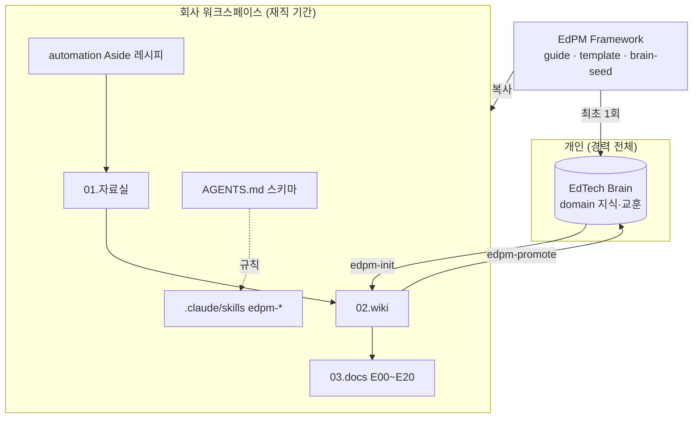

# 설계 원칙과 구조

## 1. 이 프레임워크가 풀려는 문제

에듀테크 PM은 범용 PM 방법론을 쓰다가 같은 곳에서 자주 막힙니다.

| 막히는 지점 | 범용 프레임워크에서 일어나는 일 | EdPM의 대응 |
|-------------|--------------------------------|-------------|
| 쓰는 사람과 사는 사람이 다름 | 학생 편의만 보고 만들었는데 교사가 수업에 못 쓰고, 학부모가 결제하지 않음 | E02 이해관계자맵에서 사용자·구매자·결제자·의사결정자를 나눠 정의 |
| 기능은 많은데 성적이 안 오름 | 참여 지표(접속, 체류 시간)만 오르고 학습 효과는 모름 | E05 학습성과설계서를 기능보다 먼저, E07에서 학습 효과를 북극성으로 |
| 교육적으로 그럴듯한 기획 | 학습과학 근거 없이 게임화·AI 튜터를 붙임 | 위키 `domain/`의 학습과학 페이지와 연결, 학습과학자 리뷰 패널 |
| 출시했는데 아무도 안 씀 | 학기 중간 출시, 교사 연수 없음, 예산 시기 놓침 | G-CAL 게이트, E18 도입·출시계획서 |
| 아동 개인정보 사고 | 출시 직전에 법정대리인 동의 누락 발견 | G-SAFE 게이트, E13 평가서, 수집 단계 G-PII |
| 효과를 과장 | "성적 30% 향상" 같은 근거 약한 주장 | E19에서 계산 경로·증거 수준·한계 명시, 과장 금지 규칙 |
| 회사가 바뀌면 처음부터 | 지난 회사에서 쌓은 도메인 지식이 문서 더미로 남음 | 개인 EdTech Brain과 승격 규칙 |
| 자료가 쌓이기만 함 | 인터뷰·리뷰·공지를 모아두기만 하고 다시 못 찾음 | LLM이 관리하는 위키 (ingest·query·lint) |

## 2. 구성 요소

| 구성 요소 | 역할 | 바뀌는 주기 |
|-----------|------|-------------|
| 프레임워크 | 가이드, 템플릿, 시드. 읽기 전용 | 버전 단위 |
| 워크스페이스 | 회사·제품별 작업 공간 = Obsidian 볼트 | 매일 |
| 스키마 (AGENTS.md) | 이 워크스페이스에서 에이전트가 따를 규칙 | 필요할 때 사람이 수정 |
| 스킬 | ingest·query·lint·doc 등 반복 동작 | 프레임워크 버전 단위, 회사에 맞게 조정 가능 |
| 레시피 | 웹 수집 지시문 | 회사·대상 사이트마다 |
| 개인 Brain | 회사와 무관한 지식 | 계속 누적 |

## 3. 산출물 단계와 PM의 질문

| 단계 | PM이 답해야 할 질문 | 산출물 |
|------|---------------------|--------|
| 0 온보딩 | 이 회사는 누구에게 무엇을 팔고, 무엇이 제약인가? | E00 |
| 1 발견 | 어떤 학습 문제가 실제로 있고, 누가 그 문제로 고통받으며, 누가 돈을 내는가? | E01~E04 |
| 2 정의 | 학습자가 무엇을 할 수 있게 되어야 하고, 그것을 어떻게 확인하며, 제품은 무엇을 해야 하는가? | E05~E07 |
| 3 설계 | 학습 경험, 기능, 화면, 콘텐츠, 데이터, 안전, AI를 어떻게 설계하는가? | E08~E14 |
| 4 구축 | 무엇을 언제 어떤 순서로 내보내며, 학사 일정과 맞는가? | E15 |
| 5 검증 | 실제 교실·가정에서 쓸 수 있고 배우게 되는가? | E16, E17 |
| 6 출시 | 학교·학원·가정이 어떻게 도입하고, 교사는 어떻게 익히는가? | E18 |
| 7 측정 | 실제로 배웠는가, 다음에 무엇을 할 것인가? | E19, E20 |

위 단계는 **제품 트랙(E)** 입니다. 같은 기간에 네 트랙이 함께 돕니다.

| 트랙 | PM이 답해야 할 질문 | 산출물 |
|------|---------------------|--------|
| M 관리 | 일정·자원·위험을 어떻게 관리하고 누구에게 무엇을 보고하는가? | M01~M05, 주간보고 |
| B 구현 | 개발팀이 무엇을 어떻게 만들고, 명세대로 동작하는지 어떻게 확인하는가? | B01~B07 |
| A AI 기술설계 | 어디에 AI를 쓰고, 어떻게 만들고, 교육적으로 안전한지 어떻게 증명하는가? | A00~A09 |
| S 사업 | 누구에게 어떻게 팔고, 수익을 어떻게 내고, 강사에게 어떻게 정산하는가? | S01~S07 |
| L 학습운영 | 과정을 어떤 단위로 만들고, 진도·평가·수료를 어떤 규칙으로 운영하는가? | L01~L06 |
| P 정책·운영 | 환불·권리·부정 이용·품질·CS·강사 운영을 어떤 기준으로 하는가? | P01~P06 |

어떤 트랙이 필요한지는 **서비스 유형**(`archetypes/`, AT01~AT15)이 먼저 정합니다. 이러닝 마켓플레이스라면 L·P·S07이 핵심이고, K-12 코스웨어라면 교육과정 지식그래프와 E13이, AI 튜터 제품이라면 A 트랙이 핵심입니다.

단계는 폭포수가 아닙니다. 학기마다 1~7을 한 바퀴 도는 사이클로 보고, E20의 다음 사이클 후보가 다시 E01로 들어갑니다. 이미 운영 중인 제품에 합류했다면 E00 다음에 E07(현재 지표)과 E19(현재 효과 근거)부터 써서 현재 위치를 파악하는 것이 빠릅니다.

## 4. 사람과 에이전트의 역할

| 일 | 사람 (PM) | 에이전트 |
|----|-----------|----------|
| 자료 고르기 | 무엇을 모을지, 누구를 인터뷰할지 | 수집 레시피 실행, 빠진 자료 제안 |
| 현장 | 인터뷰, 수업 관찰, 교사·학부모 관계 | 기록 정리, 비식별화, 인사이트 추출 |
| 위키 | 읽고 판단하고 고칠 점 지적 | 요약, 교차 참조, 충돌 표시, 정리 |
| 산출물 | 결정, 우선순위, 완료 승인 | 초안, 추적성 연결, 체크리스트 점검 |
| 검토 | 실제 이해관계자와 검증 | 가상 패널 비평으로 빈틈 찾기 |
| 수치 | 지표 정의와 해석 | SQL·스크립트 작성과 실행 |

에이전트가 대신할 수 없는 것: 교실에 직접 가 보는 일, 교사와의 신뢰, 출시 여부 결정, 법률 판단.

## 5. 버전 정책

- `MAJOR.MINOR.PATCH`. 산출물 추가·삭제나 게이트 변경은 MINOR, 템플릿 문구 수정은 PATCH, 폴더 체계 변경은 MAJOR.
- 변경은 `CHANGELOG.md`에 기록합니다.
- 워크스페이스는 생성 당시 버전을 `AGENTS.md` 제목에 남기고, 새 버전의 스킬·템플릿은 필요한 것만 골라 가져옵니다.
