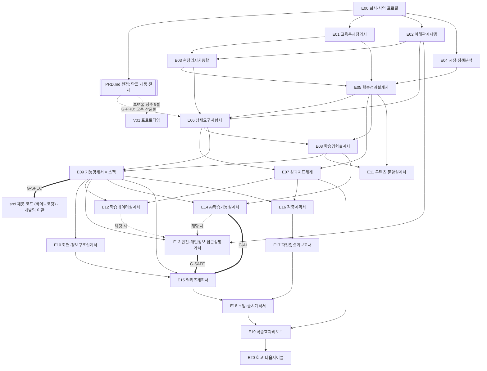
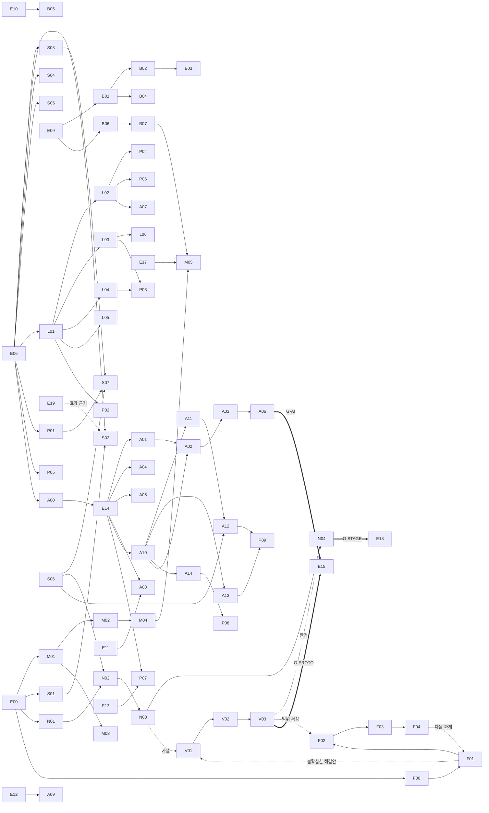

# 산출물 체인과 게이트

산출물(E00~E20)의 의존관계, 사업 유형별 모듈, 게이트 규칙입니다.

**원점은 루트의 `PRD.md`입니다.** E00으로 회사를 정의한 다음, 만들 제품 전체를 PRD로 정의하고, 이후 모든 산출물·프로토타입·코드가 PRD에서 출발합니다(G-PRD). 흐름: `E00 → PRD → 착수·근거 → E06 상세 요구사항 → E09 스펙 → 프로토타입(PRD 9절의 정수)·구현 → 출시`. 제품 코드는 스펙 승인 후(G-SPEC). `AGENTS.md`의 같은 섹션은 이 문서를 요약한 것이고, 둘이 다르면 이 문서가 기준입니다.

## 1. 의존관계



## 2. 산출물 목록

| ID | 산출물 | 경로 (`03.docs/`) | 전제조건 | 모듈 |
|----|--------|-------------------|----------|------|
| E00 | 회사·사업 프로필 | 0.온보딩/E00_회사사업프로필.md | 없음 | Core |
| PRD | 제품 요구사항 정의서 (원점) | 워크스페이스 루트 `PRD.md` | E00 | Core — review 이상이어야 다른 산출물 완료 가능 (G-PRD) |
| E01 | 교육문제정의서 | 1.발견/E01_교육문제정의서.md | E00 | Core |
| E02 | 이해관계자맵 | 1.발견/E02_이해관계자맵.md | E00 | Core |
| E03 | 현장리서치종합 | 1.발견/E03_현장리서치종합.md | E01, E02 | Core |
| E04 | 시장·정책분석 | 1.발견/E04_시장정책분석.md | E00 | Core |
| E05 | 학습성과설계서 | 2.정의/E05_학습성과설계서.md | E01, E03, E04 | Core |
| E06 | 상세요구사항서 (PRD를 REQ·인수조건으로) | 2.정의/E06_제품요구사항서.md | PRD, E02, E03, E05 | Core |
| E07 | 성과지표체계 | 2.정의/E07_성과지표체계.md | E05, E06 | Core |
| E08 | 학습경험설계서 | 3.설계/E08_학습경험설계서.md | E05, E06 | Core |
| E09 | 기능명세서 = 스펙 (기능·유저스토리·인수조건·상태 흐름·입출력 계약·작업·테스트) | 3.설계/E09_기능명세서.md | E06, E08 | Core — done 전 제품 코드 금지 (G-SPEC) |
| E10 | 화면·정보구조설계서 | 3.설계/E10_화면정보구조설계서.md | E09 | Core |
| E11 | 콘텐츠·문항설계서 | 3.설계/E11_콘텐츠문항설계서.md | E05, E08 | CONTENT |
| E12 | 학습데이터설계서 | 3.설계/E12_학습데이터설계서.md | E07, E09 | DATA |
| E13 | 안전·개인정보·접근성평가서 | 3.설계/E13_안전개인정보접근성평가서.md | E02, E09 (+E12, E14 해당 시) | SAFE |
| E14 | AI학습기능설계서 | 3.설계/E14_AI학습기능설계서.md | E08, E09 | AI |
| E15 | 릴리즈계획서 | 4.구축/E15_릴리즈계획서.md | E09, E10 (+G-SAFE, G-AI) | Core |
| E16 | 검증계획서 | 5.검증/E16_검증계획서.md | E07, E09 | Core |
| E17 | 파일럿결과보고서 | 5.검증/E17_파일럿결과보고서.md | E16 | Core |
| E18 | 도입·출시계획서 | 6.출시/E18_도입출시계획서.md | E15, E17 | GTM |
| E19 | 학습효과리포트 | 7.측정/E19_학습효과리포트.md | E07, E18 | Core |
| E20 | 회고·다음사이클 | 7.측정/E20_회고다음사이클.md | E19 | Core |

위 E 트랙은 **제품 트랙**입니다. 프로젝트를 A부터 Z까지 운영하려면 아래 네 트랙을 함께 씁니다.

## 2.1 관리 트랙 (M) — `03.docs/M.관리/`

프로젝트 단위(학기 개발, 고객사 구축, 정부 과제)로 일정·위험·보고를 관리합니다. 주간보고와 회의록은 `04.ops/`에서 `/edpm-weekly`로 운영합니다.

| ID | 산출물 | 파일 | 전제조건 | 스킬 |
|----|--------|------|----------|------|
| M01 | 착수보고서 | M.관리/M01_착수보고서.md | E00 | /edpm-report |
| M02 | WBS·일정계획 | M.관리/M02_WBS일정계획.md (+ `M02_WBS.csv`) | M01 | /edpm-wbs |
| M03 | 위험·이슈관리대장 | M.관리/M03_위험이슈관리대장.md | M01 | /edpm-report |
| M04 | 중간보고서 | M.관리/M04_중간보고서.md | M02 + 산출물 3건 이상 done | /edpm-report |
| M05 | 완료보고서 | M.관리/M05_완료보고서.md | M04, E17 (+B07 해당 시) | /edpm-report |

## 2.2 구현 트랙 (B) — `03.docs/B.구현/`

회사 개발팀 표준 문서가 있으면 B 트랙은 `n/a`로 두고 링크만 `02.wiki/company/`에 둡니다. 개발 문서가 없거나 PM이 MVP를 직접 만들거나 외주 개발을 관리할 때 씁니다.

| ID | 산출물 | 파일 | 전제조건 | 스킬 |
|----|--------|------|----------|------|
| B01 | 시스템구조서 | B.구현/B01_시스템구조서.md | E09, E12 | /edpm-doc |
| B02 | API명세서 | B.구현/B02_API명세서.md | B01 | /edpm-doc |
| B03 | 데이터베이스설계서 | B.구현/B03_데이터베이스설계서.md | E12, B02 | /edpm-doc |
| B04 | 인프라·배포설계서 | B.구현/B04_인프라배포설계서.md | B01, E13 | /edpm-doc |
| B05 | 디자인시스템가이드 | B.구현/B05_디자인시스템가이드.md | E10 | /edpm-doc |
| B06 | 테스트시나리오 | B.구현/B06_테스트시나리오.md | E09, E10 | /edpm-qa |
| B07 | 테스트결과보고서 | B.구현/B07_테스트결과보고서.md | B06 + 테스트 실행 증거 | /edpm-qa |

## 2.3 AI 기술설계 트랙 (A) — `03.docs/A.AI/`

E14가 "AI가 교육적으로 무엇을 해야 하는가"(역할, 가드레일, 평가 기준)를 정하면, A 트랙은 "어떻게 만드는가"를 설계합니다. AI 기능은 두 축으로 판정합니다. **교육적 역할**(`ai_role`): T 튜터·설명, F 피드백·채점, G 콘텐츠·문항 생성, P 예측·추천, O 운영 보조. **구성 요소**(`ai_parts`): **근거**(교과·교재·FAQ를 찾아 근거로 답함 → A01·A02), **학습자상태**(학습자의 이전 오류·숙달·선호를 세션 너머 이어 씀 → A04), **데이터조회**(성적·출결·진도를 도구로 조회·계산 → A05), **생성물**(학습자·교사에게 그대로 나가는 자료·리포트·문항 → A05, 문항이면 A08), **대화**(LLM이 문장을 생성해 주고받음 → A03). A10 방식 선택·A14 가드레일·A06 평가는 모든 AI 기능 공통이고, 예측 모델(P)은 A09입니다. 해당 구성 요소가 없는 산출물은 `n/a`.

| ID | 산출물 | 파일 | 전제조건 | 구성 요소·역할 |
|----|--------|------|----------|------|
| A01 | 지식베이스설계서 | A.AI/A01_지식베이스설계서.md | E14, E11 | 근거 |
| A02 | 검색·RAG설계서 | A.AI/A02_검색RAG설계서.md | A01, B01, A10 (+A04, A05 해당 시) | 근거 (학습자상태·데이터조회를 검색할 때 포함) |
| A03 | 프롬프트·대화설계서 | A.AI/A03_프롬프트대화설계서.md | E14, A02 | 대화 |
| A04 | 학습자메모리설계서 | A.AI/A04_학습자메모리설계서.md | E14, E13 | 학습자상태 |
| A05 | 도구·생성물설계서 | A.AI/A05_도구생성물설계서.md | E14, E12 | 데이터조회·생성물 |
| A06 | AI평가결과보고서 | A.AI/A06_AI평가결과보고서.md | A03 + `/edpm-eval` 실행 결과 | 모든 AI 기능 공통 |
| A00 | AI적용기회맵 | A.AI/A00_AI적용기회맵.md | E06 | 전체 (E14 앞에서 어디에 AI를 쓸지 고름) |
| A07 | 자동자막·번역설계서 | A.AI/A07_자동자막번역설계서.md | L02 | 콘텐츠 제작 AI |
| A08 | 문항자동생성설계서 | A.AI/A08_문항자동생성설계서.md | E11, E14 | 생성물 (문항, 역할 G) |
| A09 | 학습이탈예측설계서 | A.AI/A09_학습이탈예측설계서.md | E07, E12 | 예측 모델 (역할 P, LLM 아님) |
| A10 | AI방식선택·아키텍처설계서 | A.AI/A10_AI방식선택아키텍처설계서.md | E14 | 기능마다 규칙·템플릿 / 고전 NLP / 검색·FAQ 매칭 / RAG / 소형·파인튜닝 모델 / 로컬·온프레미스 LLM / 클라우드 LLM / 혼합 중 선택과 근거, 전체 구성도 |
| A11 | 모델선택·라우팅설계서 | A.AI/A11_모델선택라우팅설계서.md | A10 | 후보 모델 비교(평가 결과 기반), 요청 난이도·데이터 민감도·비용에 따른 라우팅, 대체 경로(fallback), 모델 교체 절차 |
| A12 | AI비용·과금설계서 | A.AI/A12_AI비용과금설계서.md | A11, S06 | 요청·학습자·월 단위 원가(토큰·GPU·검색), 캐싱·라우팅 절감, 사용자 과금(포함량·크레딧·요금제), 마진 |
| A13 | AI운영(MLOps·LLMOps)설계서 | A.AI/A13_AI운영설계서.md | A10 | 데이터·프롬프트·모델 버전 관리, 평가 자동화, 배포·롤백, 모니터링(품질·지연·비용·드리프트), 로컬 모델 서빙·갱신, 고전 ML 재학습 |
| A14 | AI가드레일설계서 | A.AI/A14_AI가드레일설계서.md | E14, A10 | 입력·출력 단계별 통제(개인정보 마스킹, 주제·연령 제한, 탈옥 방어, 근거 확인, 거절·교사 연결), 규칙·분류기·LLM 판정의 층 구성, 오탐·미탐 관리 |

평가 데이터: `A.AI/골든셋.csv`(정답형: 질문 한 번 → 기대 답·근거·필수 포함·금지 내용, 주로 구성 요소 근거), `A.AI/시나리오셋.csv`(시나리오형: 사전 상태와 여러 턴 → 기대 행동, 구성 요소 학습자상태·데이터조회·생성물), E14의 `E14_평가세트.csv`(교육적 행동). `/edpm-eval`이 세 파일을 실행·채점합니다.

## 2.4 사업 트랙 (S) — `03.docs/S.사업/`

| ID | 산출물 | 파일 | 전제조건 | 스킬 |
|----|--------|------|----------|------|
| S01 | RFP분석서 | S.사업/S01_RFP분석서.md | E00 + `01.자료실/제안/`에 제안요청서 | /edpm-proposal |
| S02 | 제안서 | S.사업/S02_제안서.md | E04, E06, S01 (RFP 없는 영업 제안은 S01 n/a) | /edpm-proposal |
| S03 | 가격·견적서 | S.사업/S03_가격견적서.md | E00, E06 | /edpm-proposal |
| S04 | 세일즈플레이북 | S.사업/S04_세일즈플레이북.md | E02, E06 | /edpm-content |
| S05 | 마케팅·콘텐츠계획 | S.사업/S05_마케팅콘텐츠계획.md | E02, E04, E06 | /edpm-content |
| S06 | 수익모델설계서 | S.사업/S06_수익모델설계서.md | E02, E06 | /edpm-doc |
| S07 | 강사정산설계서 | S.사업/S07_강사정산설계서.md | S03, S06, P01 | /edpm-doc |

E18(도입·출시계획서)은 제품을 시장에 내는 계획이고, S 트랙은 수주·판매 활동입니다. E19 학습효과리포트가 있으면 S02·S04의 효과 주장은 E19 수치만 인용합니다.

## 2.4.1 학습운영 트랙 (L) — `03.docs/L.학습운영/`

이러닝·LMS·라이브 클래스처럼 **과정을 판매·운영하는 서비스의 핵심 비즈니스 로직**입니다. E11(문항·콘텐츠의 교육적 설계)과 경계: E11은 "무엇을 어떻게 가르치고 평가하나", L 트랙은 "과정을 어떤 단위로 묶어 만들고, 진도·평가·수료를 어떤 규칙으로 운영하나"입니다.

| ID | 산출물 | 파일 | 전제조건 | 다루는 것 |
|----|--------|------|----------|-----------|
| L01 | 과정·콘텐츠구조설계서 | L.학습운영/L01_과정콘텐츠구조설계서.md | E06 | 카탈로그 분류, 과정 > 섹션 > 레슨 > 활동, 콘텐츠 유형(VOD·라이브·실습·문서·퀴즈), 메타데이터, 번들·트랙·자격 경로, 버전 관리 |
| L02 | 콘텐츠제작파이프라인 | L.학습운영/L02_콘텐츠제작파이프라인.md | L01 | 기획 → 강사 섭외 → 원고 → 촬영 → 편집 → 자막 → 검수 → 인코딩·업로드 → 출시 → 개정, 일정·비용·외주·AI 보조 |
| L03 | 학습진도·수료규칙서 | L.학습운영/L03_학습진도수료규칙서.md | L01, E12 | 진도율 정의, 완료 조건, 배속·건너뛰기, 순차 잠금, 수강 기간, 라이브 출석, 수료 기준, 환급 과정 기준 |
| L04 | 과제·평가운영설계서 | L.학습운영/L04_과제평가운영설계서.md | L01, E05 | 퀴즈·시험·과제·프로젝트·동료평가, 채점·루브릭, 재응시, 지각 제출, 표절, 피드백 기한, 시험 감독 |
| L05 | 표준연동설계서 | L.학습운영/L05_표준연동설계서.md | L01, B01 | SCORM 1.2/2004, xAPI·LRS, cmi5, LTI 1.3, QTI, OneRoster, SSO(SAML·OIDC), HRIS 연동 |
| L06 | 수료증·크레덴셜설계서 | L.학습운영/L06_수료증크레덴셜설계서.md | L03 | 수료증 디자인·발급·진위 확인, Open Badges 3.0, W3C Verifiable Credentials, 블록체인 선택 기준 |

## 2.4.2 정책·운영 트랙 (P) — `03.docs/P.정책운영/`

판매·운영 정책입니다. 개인정보·아동 안전·접근성은 E13이 맡습니다.

| ID | 산출물 | 파일 | 전제조건 | 다루는 것 |
|----|--------|------|----------|-----------|
| P01 | 이용·환불정책서 | P.정책운영/P01_이용환불정책서.md | E06, S03 | 청약철회·환불 기준(수강 진행률·기간), 쿠폰·할인 처리, 기업·환급 과정 예외, 약관 반영 |
| P02 | 콘텐츠권리·강사계약정책 | P.정책운영/P02_콘텐츠권리강사계약정책.md | L01 | 저작권 귀속, 독점·비독점, 2차 이용(클립·번역·AI 학습), 계약 종료 후 처리, 제3자 자료 |
| P03 | 부정이용방지정책 | P.정책운영/P03_부정이용방지정책.md | L03, L04 | 계정 공유·동시 접속, 대리 수강, 진도 조작, 시험 부정, 콘텐츠 유출(DRM·워터마크), 대응 단계 |
| P04 | 콘텐츠품질관리기준 | P.정책운영/P04_콘텐츠품질관리기준.md | L02 | 출시 전 검수 기준, 오류 신고·수정 SLA, 리뷰·평점 관리, 재제작·폐기 기준, 정기 점검 |
| P05 | 고객지원·운영정책 | P.정책운영/P05_고객지원운영정책.md | E06 | CS 채널·응답 기준, 문의 분류, 장애·공지, 민원(학부모·기관) 대응, VOC 반영 |
| P06 | 강사·튜터운영정책 | P.정책운영/P06_강사튜터운영정책.md | L02 | 모집·심사, 온보딩, 품질 평가·등급, 인센티브, 제재·퇴출, 강사 지원 |
| P07 | AI윤리·투명성정책 | P.정책운영/P07_AI윤리투명성정책.md | E14, E13 | AI 윤리 원칙, AI 사용 고지·생성물 표시(AI 기본법), AI와 개인정보(학습자 데이터의 모델 학습·국외 이전·자동화된 결정), AI 생성물 저작권 |
| P08 | AI품질·안전정책 | P.정책운영/P08_AI품질안전정책.md | A14 | 할루시네이션 대응(예방·탐지·정정·신고), 콘텐츠 안전(유해·연령 부적합·위기 신호), 사람 검토 기준 |
| P09 | AI서비스운영정책 | P.정책운영/P09_AI서비스운영정책.md | A12, A13 | SLA·가용성(장애 시 대체 동작), 비용 관리(예산·한도·알림), Rate Limiting(사용자·기관·API 키 단위) |

## 2.4.3 신사업 트랙 (N) — `03.docs/N.신사업/` (업무 모드: 신사업)

새 서비스·새 사업을 0에서 시작할 때 경영진 의사결정(투자·단계 심사)을 위한 문서입니다. 제품 설계는 E 체인이 맡고, N 트랙은 "할 가치가 있는가, 언제 더 투자하나"를 다룹니다. 업무 모드는 `guide/09.업무모드.md`.

| ID | 산출물 | 파일 | 전제조건 | 다루는 것 |
|----|--------|------|----------|-----------|
| N01 | 사업기회검토서 | N.신사업/N01_사업기회검토서.md | E00 | 기회 가설, 고객·문제, 시장·경쟁, 전략 적합성, why us·why now, 핵심 가설(HY-01), 탐색 계획 |
| N02 | 사업타당성·투자심의서 | N.신사업/N02_사업타당성투자심의서.md | N01, E04, S06 | 시장 규모 근거, 수익 모델·손익 시나리오, 투자·인력 계획, 리스크·대안, 진행/보류/중단 요청 |
| N03 | MVP·PMF검증계획서 | N.신사업/N03_MVP_PMF검증계획서.md | N02, E06 | MVP 범위(뺄 것), 가설별 검증 실험, PMF·학습 효과 신호와 기준(GT-01), 기간·예산, 다음 단계 조건 |
| N04 | 단계심사보고서 | N.신사업/N04_단계심사보고서.md | N03 | 탐색 → 검증 → 확장 단계별 기준 대비 증거, 결정(진행·방향 전환·중단), 다음 단계 자원 |

## 2.4.4 기능개선 트랙 (F) — `03.docs/F.개선/` (업무 모드: 운영 개선)

운영 중인 서비스의 PM이 이해관계자 문제를 기능 개선·신규 기능으로 푸는 반복 흐름입니다. **F00은 서비스당 하나**, **F01~F04는 개선 과제마다 한 벌**을 `F.개선/{YYYYMM}_{과제명}/`에 만듭니다 (`/edpm-feature new`가 `_과제템플릿/`을 복사). 과제 frontmatter에 `initiative: FI-001`을 둡니다.

| ID | 산출물 | 파일 | 전제조건 | 다루는 것 |
|----|--------|------|----------|-----------|
| F00 | 서비스현황진단서 | F.개선/F00_서비스현황진단서.md | E00 | 현재 사용자·지표 기준선, 기능 지도, 이해관계자, 기술·정책 제약, 알려진 문제, 개선 기회 (반기마다 갱신) |
| — | 개선백로그 | F.개선/개선백로그.csv | F00 | 요청 접수 → 우선순위(가치·교육적 효과·도달·노력·위험) → 상태 |
| F01 | 문제정의서 | F.개선/{과제}/F01_문제정의서.md | F00 | 누구의 어떤 문제인가(이해관계자·근거·규모), 현재 우회 방법, 성공의 정의, 하지 않을 것 |
| F02 | 기능기획서 | F.개선/{과제}/F02_기능기획서.md | F01 | 목표 지표(기준선·목표), 사용자 스토리(US-01)·인수조건, 화면 변경, 데이터·이벤트, **영향 점검표**, 의존성 |
| F03 | 실험·출시계획서 | F.개선/{과제}/F03_실험출시계획서.md | F02 | A/B·단계 출시(EX-01), 가드레일 지표, 기능 플래그, 공지·CS·교육 준비, 시즌 타이밍, 롤백 기준 |
| F04 | 출시후효과리뷰 | F.개선/{과제}/F04_출시후효과리뷰.md | F03 + 출시 | 목표 대비 결과(SQL), VOC, 이해관계자 반응, 결정(유지·개선·롤백), 백로그 반영 |

## 2.4.5 프로토타입 트랙 (V) — `03.docs/V.프로토타입/` (두 업무 모드 공통)

문제·가설을 직접 만들어 사람 앞에서 확인하는 반복 흐름입니다. **프로토타입마다 한 벌**을 `V.프로토타입/{PT-ID}_{이름}/`에 만들고(`/edpm-proto new`가 `_프로토타입템플릿/`을 복사), 목록은 `프로토타입목록.csv`, 결과물(HTML·운영 스크립트·코드)은 `06.prototypes/{PT-ID}_{이름}/`에 둡니다. 흐름과 충실도(P0 종이 ~ P4 코드 MVP): `guide/11.프로토타입과MVP.md`.

| ID | 산출물 | 파일 | 전제조건 | 다루는 것 |
|----|--------|------|----------|-----------|
| — | 프로토타입목록 | V.프로토타입/프로토타입목록.csv | — | PT-ID, 연결 가설·과제, 충실도, 상태, 결정 |
| V01 | 프로토타입계획서 | V.프로토타입/{PT}/V01_프로토타입계획서.md | E00 + 연결(N03 HY 또는 F01) | 검증 질문, 가장 위험한 가정, 충실도 선택, 진짜·가짜·안 만듦 범위, 성공·중단 기준, 테스트 계획, timebox, 데이터·안전, 빌드 환경 |
| V02 | 프로토타입빌드기록 | V.프로토타입/{PT}/V02_프로토타입빌드기록.md | V01 | 결과물 위치, 계획 대비 구현, 구성·비용, 데이터, 알려진 한계(운영에서 다시 만들 것), 테스트 준비 점검 |
| V03 | 검증결과·결정서 | V.프로토타입/{PT}/V03_검증결과결정서.md | V02 + 테스트 기록 | 기준 대비 결과, 발견, 가설 판정, 결정(폐기·재검증·MVP 확장·개발 이관), 이관 패키지 |

## 2.4.6 연구 이관 트랙 (D) — `03.docs/D.연구이관/` (연구·교과 조직이 있을 때)

교육 회사에는 제품팀 밖에 연구소·교과 개발팀·교수법 연구팀이 있고, 그쪽의 PoC와 학습 알고리즘(레벨 진단, 유창성 측정, 추천, 채점 규칙)이 제품 기능의 출발점이 되는 일이 많습니다. D 트랙은 연구 결과를 PRD·E06이 받아 쓸 수 있는 말로 옮깁니다. 연구에서 사람이 하던 일(데이터 정제, 예외 판정)이 제품에서 누구의 일이 되는지, 연구 동의와 서비스 동의의 차이, 연구 환경과 제품 환경의 차이를 빠뜨리지 않게 합니다. PoC마다 한 건씩 씁니다 (`D01_..._{PoC 이름}.md`처럼 복사).

| ID | 산출물 | 파일 | 전제조건 | 다루는 것 |
|----|--------|------|----------|-----------|
| D01 | 연구PoC제품화검토서 | D.연구이관/D01_연구PoC제품화검토서.md | E00 (+ G-PRD) | 결론(진행·조건부·추가 연구·보류), PoC 요약(연구 측 사실·출처), 알고리즘 명세(재현 가능하게), 제품 관점 전환표, 데이터 구조·동의, 제품화 조건(규모·지연·비용·공정성·운영 부담·갱신·권리), 남은 불확실성(HY-D)과 검증, 연구 조직과의 합의, PRD·E06·E12 반영 |

## 2.5 전체 흐름



## 3. 서비스 유형(아키타입)과 모듈

에듀테크는 범주가 넓어서, 먼저 **서비스 유형**을 고르고 그 유형에 맞는 산출물·플레이북만 켭니다. 유형별 상세(핵심 비즈니스 로직, 역할, IA, 지표, 규제)는 프레임워크 `archetypes/`에 있고, E00에서 1~2개를 고릅니다 (`/edpm-blueprint`).

| 유형 | 예 | 핵심 트랙 (Core 외) |
|------|----|---------------------|
| AT01 이러닝 마켓플레이스 | 성인 직무·취미 VOD 강의 판매, 강사 입점 | L, P, S06·S07, A07 |
| AT02 기업교육 LMS | 임직원 교육, 사업주 환급 과정, B2B 좌석 | L, P01·P03·P05, S06, DATA |
| AT03 부트캠프·직무교육 | 코딩·데이터 부트캠프, 라이브 + 실습 + 프로젝트 | L, P, E16·E17, A00 |
| AT04 라이브 클래스·튜터링 | 실시간 그룹 수업, 1:1 과외 매칭 | L03·L04, P01·P05·P06, S07 |
| AT05 K-12 코스웨어 | 학교 수업용 디지털 학습, 교사 대시보드 | CONTENT, DATA, SAFE, 교육과정 KG, GTM(조달) |
| AT06 학원·사교육 서비스 | 학원 관리·학습 앱, 원장·강사·학부모 | CONTENT, SAFE, 교육과정 KG, S04 |
| AT07 소비자 학습앱 | 어학·수학·독서 자기주도 앱, 구독 | E08 동기 설계, S05·S06, A09 |
| AT08 고등교육·평생교육 | 대학 LMS, K-MOOC 같은 공개강좌 | L05, L06, DATA |
| AT09 자격증·시험대비 | 문제은행, 모의고사, 합격 예측 | L04, CONTENT, A08, A09 |
| AT10 AI 튜터·학습 에이전트 | AI 튜터 단독 제품, 기존 서비스의 AI 기능 | AI, AI-TECH(A00~A14), SAFE |
| AT11 온라인학위·원격교육 위탁운영(OPM) | 대학 온라인 학위·사이버대학·평생교육원 위탁운영 | L01~L06, P01~P05, S06·S07, CONTENT·DATA·SAFE·GTM |
| AT12 평가·원격감독 벤더 | 기관 온라인 시험, 대학 원격감독, 기업 역량·인적성 검사 | L01·L04·L05, P01~P05, S06, CONTENT·DATA·SAFE, AI 시 A10·A11·A13·A14 |
| AT13 LXP·스킬 인텔리전스 | 기업 콘텐츠 통합·추천, 재직자 스킬·커리어 개발 | L01·L03·L05, P01·P02·P05, S06, DATA, SAFE, AI 시 A10~A14 |
| AT14 특수교육·학습지원 | 특수학교·특수학급·치료지원·가정의 개별화 학습 | CONTENT, DATA, SAFE, L01·L02·L04, P04·P05, S06, GTM |
| AT15 영유아 교육 플랫폼 | 만 0~7세 놀이 콘텐츠, 어린이집·유치원 교사 도구, 알림장·가정연계 | CONTENT, DATA, SAFE, L01·L02, P01·P02·P04·P05, S06 |

아래 표는 사업 유형(구매 구조) 기준의 모듈 필수 여부입니다. 서비스 유형이 정하는 트랙과 함께 봅니다.

E00에서 정한 사업 유형으로 모듈 필수 여부가 정해집니다. 해당하지 않는 산출물은 frontmatter `status: n/a`와 사유를 적고, 다른 산출물의 전제조건 확인 시 충족으로 봅니다.

| 모듈 | 산출물 | K-12 공교육 (B2G·B2S) | 학원·사교육 (B2B2C) | 소비자 학습앱 (B2C) | 고등교육 | 기업교육 (B2B HRD) |
|------|--------|:---:|:---:|:---:|:---:|:---:|
| Core | E00~E10, E15~E17, E19, E20 | 필수 | 필수 | 필수 | 필수 | 필수 |
| CONTENT | E11 | 필수 | 필수 | 콘텐츠 제공 시 | 선택 | 콘텐츠 제공 시 |
| DATA | E12 | 필수 (표준 연동) | 필수 | 필수 | 필수 (LMS 연동) | 필수 (HRIS·LMS 연동) |
| SAFE | E13 | 필수 | 필수 | 미성년 대상이면 필수 | 필수 (학생 데이터) | 필수 (개인정보) |
| AI | E14 | AI 기능 시 | AI 기능 시 | AI 기능 시 | AI 기능 시 | AI 기능 시 |
| GTM | E18 | 필수 (조달·도입 지원) | 필수 (원장 영업) | 필수 (시즌 마케팅) | 필수 | 필수 (영업·제안) |
| MGMT | M01~M05 | 필수 | 필수 | 필수 | 필수 | 필수 |
| BUILD | B01~B07 | 개발 문서 없을 때 | 개발 문서 없을 때 | 개발 문서 없을 때 | 개발 문서 없을 때 | 개발 문서 없을 때 |
| AI-TECH | A00~A09 (유형별) | AI 기능을 만들 때 | AI 기능을 만들 때 | AI 기능을 만들 때 | AI 기능을 만들 때 | AI 기능을 만들 때 |
| LEARN-OPS | L01~L06 | 과정 운영 시 | 과정 운영 시 | 과정 판매 시 | 필수 | 필수 |
| POLICY | P01~P06 | 해당 항목 | 필수 | 필수 (유료 판매) | 필수 | 필수 |
| BIZ | S01~S07 | 필수 (S01·S02 조달 제안) | 필수 (S03·S04 원장 영업) | S05 중심 | 필수 | 필수 (S02·S03 기업 제안) |
| VENTURE | N01~N04 | 업무 모드 N (신사업)일 때 필수, 아니면 해당없음 | 〃 | 〃 | 〃 | 〃 |
| FEATURE | F00~F04, 개선백로그 | 업무 모드 F (운영 개선)일 때 필수, 아니면 해당없음 | 〃 | 〃 | 〃 | 〃 |
| RND | D01 | 연구·교과 조직의 PoC·알고리즘을 제품화할 때 | 〃 | 〃 | 〃 | 〃 |

## 4. 게이트 규칙

### 4.0 생성 게이트 — A가 끝나야 B

산출물은 전제조건(`requires`)이 `done`·`n/a`이고 PRD가 `review` 이상일 때 **쓰기 시작**합니다. 워크스페이스 훅이 전제 전 본문 쓰기를 막습니다(frontmatter만 바꾸기, `n/a` 처리, `gate_skip`·`early_draft: [사유]`는 통과). 진행 상황은 `python3 automation/scripts/edpm_check.py progress` 한 장으로 봅니다 — 문서·상태·완료일·전제·지금 착수 가능 여부. 이 생성 게이트 위에 에듀테크 게이트(4.2)를 더합니다.

### 4.1 기본 게이트 (모든 산출물)

`/edpm-doc <ID>` 실행 시 (E·M·B·A·S·L·P·N·F·V·D 모든 트랙 공통) 다음 순서로 확인합니다.

1. **전제조건**: 전제 산출물의 frontmatter `status`가 `done` 또는 `n/a`인지 확인합니다. 미충족이면 무엇이 부족한지 알리고 해당 산출물부터 작성하자고 제안합니다.
2. **근거 확인**: 작성에 필요한 위키 페이지가 있는지 확인합니다. 없으면 "어떤 자료를 ingest해야 하는지"를 먼저 안내합니다. 근거 없이 쓴 문장은 `[가정]` 표시를 붙입니다.
3. **완료 처리**: 사용자가 완료를 승인하면 `status: done`, `updated` 날짜를 기록하고 `02.wiki/log.md`에 `## [YYYY-MM-DD] doc | E05 학습성과설계서 완료`를 추가합니다.
4. **강제 스킵**: 사용자가 "게이트 무시"를 명시하면 경고 후 진행하고 frontmatter `gate_skip: [사유]`를 남깁니다. `/edpm-lint`가 스킵 목록을 보고합니다.

### 4.2 흐름 게이트와 에듀테크 특화 게이트

| 게이트 | 조건 | 막는 것 | 이유 |
|--------|------|---------|------|
| **G-PRD** | 루트 `PRD.md`가 `review` 이상 | E00·PRD 외 모든 산출물 완료, 제품 코드 쓰기 | 만들 제품 전체가 정의되지 않은 채 문서·코드가 앞서가면 범위가 흔들리고 순서가 무너짐 |
| **G-SPEC** | E09(스펙)가 `done`. 개발 체계가 "개발팀"이면 PM은 제품 코드를 쓰지 않음 | `src/` 제품 코드 쓰기 (PreToolUse 훅) | 스펙이 곧 구현 지시서. 스펙 없이 짠 코드는 그때그때의 판단이 됨. 검증용 코드는 `06.prototypes/`(V01 필요) |
| **G-LEARN** | E05가 `done` | E08, E09 완료 | 학습 성과 없이 기능부터 정하면 "있으면 좋은 기능"만 쌓임 |
| **G-SAFE** | 미성년 학습자 또는 학생 개인정보를 다루면 E13이 `done`이고 "출시 차단" 항목이 0건 | E15 완료 | 아동 개인정보·보호자 동의·접근성 문제는 출시 후 고치기 어렵고 신뢰 손실이 큼 |
| **G-AI** | AI 기능이 있으면 E14·A10(방식 선택)·A14(가드레일)가 `done`이고, A 트랙을 쓰면 A06에서 평가 기준 합격. 유료·대량 사용이면 A12(비용)도 `done` | E15 완료 | 정답을 바로 알려주는 튜터, 틀린 콘텐츠 생성은 학습 효과를 해침. 한국에서는 초·중등 학생 평가용 AI가 AI 기본법(2026.1.22. 시행)의 고영향 AI에 해당해 법적 의무도 생김 (E13 d8·d9) |
| **G-EVIDENCE** | E17에 실제 교사·학습자 파일럿 결과가 있음 (가상 데이터만이면 불가) | E18 완료 | 교육 현장 검증 없는 출시는 도입 후 이탈로 이어짐 |
| **G-CAL** | E15·E18의 주요 일정이 시즌 캘린더와 충돌 검토됨: 학교·학원은 `02.wiki/domain/학사일정`, 기업교육은 연간 교육 계획·예산 시기·환급 과정 심사 일정, 소비자 서비스는 성수기(신년·방학·시험 전) | E15, E18 완료 | 시험 기간 배포, 신학기 직후 교사 연수 같은 일정 충돌 방지 |
| **G-STAGE** | 신사업 모드면 N04 단계 심사에서 "확장 진행" 결정이 있음 | E18 완료 (정식 출시) | 검증 없이 확장 투자를 하는 것을 막음. MVP·파일럿은 N03 범위에서 먼저 가능 |
| **G-IMPACT** | 기능개선 과제의 F02 영향 점검표에서 해당 항목(개인정보·미성년, AI, 가격·환불·정산, 진도·수료·평가 규칙, 교육과정, 접근성, 시즌)이 모두 처리됨 | F03 완료 | 작은 기능 변경이 환불·정산·개인정보·AI 평가 기준을 조용히 깨는 것을 막음 |
| **G-MEASURE** | F02에 목표 지표의 기준선·목표값이 있고, F04에 같은 지표를 SQL로 계산한 결과가 있음 | F02, F04 완료 | 출시하고 끝나는 개선을 막음 |
| **G-POLICY** | 유료 판매·구독 서비스면 P01(이용·환불)이 `done`, 강사 수익배분이 있으면 S07이 `done` | E18 완료 | 환불·정산 규칙 없이 판매를 시작하면 분쟁과 소급 정산이 생김 |
| **G-CURRIC** | 국가 교육과정 기반 제품이면 E05의 LO가 교육과정 지식그래프 성취기준 코드에 정렬되고, `E11_교육과정매핑.csv`와 커버리지 결과가 있음 | E15 완료 | 교육과정 연계는 학교·학원 도입과 제안의 핵심 근거. 기억이나 추측으로 쓴 성취기준은 틀리기 쉬움 (도구: `/edpm-curriculum`, 가이드 07) |
| **G-PROTO** | 프로토타입이면 V01의 성공·중단 기준과 timebox가 확정되고, 가상 데이터만 쓰며 미성년 참여는 보호자 동의·동석, 프로토타입 코드를 운영에 넣으려면 V03 이관 패키지와 B 트랙(B01·B04·E13) 검토가 있음 | P3·P4 빌드 시작(V02), 사용자 테스트, 프로토타입 코드를 포함한 E15 완료 | 만든 뒤 기준을 정하면 무엇이든 성공으로 보이고, 검증용 코드가 보안·개인정보 검토 없이 운영에 들어가는 것을 막음 |
| **G-PII** | `01.자료실/`와 `02.wiki/`에 실명·연락처·학번 등 식별 정보가 없음 | 모든 ingest | 원본 단계에서 막지 않으면 위키·산출물·외부 AI로 퍼짐 |

### 4.3 실체 검증

| 산출물 | 확인 내용 |
|--------|-----------|
| E03 | `01.자료실/현장/`에 인터뷰·관찰 원본이 3건 이상 |
| E05 | 학습 목표마다 평가 증거(무엇을 보면 달성했다고 판단하는가)가 있음 |
| E07 | 북극성 지표가 학습 성과와 연결됨 (참여 지표만으로 구성 불가) |
| E13 | 체크리스트 전 항목에 판정(적합/보완/출시 차단/해당없음)이 있음 |
| E14 | 교육적 평가 세트(`03.docs/3.설계/E14_평가세트.csv`)가 20건 이상 |
| E17 | 참여자 수, 기간, 원자료 위치(`01.자료실/데이터/`)가 명시됨 |
| E19 | 효과 수치를 계산한 스크립트·쿼리 경로가 명시됨 (LLM 추정치 불가) |
| E11 (교육과정 기반) | `E11_교육과정매핑.csv`의 코드가 모두 KG에서 조회되고(`coverage`의 "없는 코드" 0건), 커버리지 결과 경로가 적혀 있음 |
| L03 | 진도율·완료·수료 조건이 계산식으로 정의되고, 이벤트(E12)로 측정 가능함 |
| P01 | 환불 계산 예시(진행률·경과일별)가 표나 스크립트로 재현 가능하고, 법령 근거는 `[확인 필요]` 없이 검토됨 |
| S07 | 정산 계산 예시(판매가 → 수수료·쿠폰·환불·세금 → 지급액)가 재현 가능함 |
| A09 | 예측 성능(기준선 대비)과 오탐·미탐 시 개입 비용이 적혀 있고, 집단별 성능 차이를 점검함 |
| M02 | `M02_WBS.csv`가 있고 학사일정 이벤트가 마일스톤 열에 반영됨. 일정 관리 도구를 쓰면 WP마다 `이슈` 열이 채워짐 |
| V03 | 테스트 원자료(관찰 기록·이벤트 로그)가 `01.자료실/`에 있고, V01 기준표 그대로 판정됨 |
| M05 | 활성 산출물(n/a 제외) 중 80% 이상 done, 미완료 항목은 사유 기재 |
| B07 | 테스트 실행 기록(`01.자료실/데이터/` 결과 파일 또는 테스트 코드 경로)이 있음 |
| A01 | 지식 소스마다 저작권·이용 허락 상태가 기재됨 |
| A06 | `/edpm-eval` 결과 파일(`05.outputs/eval_*.csv`)이 있고 골든셋 30건 이상 또는 시나리오셋 10건 이상 |
| S02 | 효과·성과 주장마다 E19·E17 또는 공개 출처가 연결됨 (근거 없는 수치 금지) |
| S03 | 가격 계산이 표·스크립트로 재현 가능함 |

## 5. 병렬 작성

전제조건이 동시에 충족되는 묶음은 서브에이전트로 함께 작성할 수 있습니다.

| 묶음 | 산출물 | 시점 |
|------|--------|------|
| P1 | E01, E02, E04 | E00 완료 후 |
| P2 | E07, E08 | E06 완료 후 |
| P3 | E10, E11, E12, E13, E14, E16 | E09 완료 후 (E11은 E08도 필요) |
| P4 | B01, B05, B06 | E09·E10·E12 완료 후 |
| P5 | B02·B04, A04·A05 | B01·E14 완료 후 |
| P6 | S03, S04, S05 | E06 완료 후 |
| P7 | L01, P05, A00, S06 | E06 완료 후 |
| P8 | L02, L03, L04, P02 | L01 완료 후 (L03은 E12, L04는 E05도 필요) |
| P9 | P04, P06, A07 | L02 완료 후 |

## 6. frontmatter 표준

모든 산출물은 다음 frontmatter로 시작합니다. 진행 상태는 이 값만 기준으로 하며, 별도 진행표를 두지 않습니다. `03.docs/_dashboard.md`가 Dataview로 이 값을 모아 보여줍니다.

```yaml
---
doc_id: E05
title: 학습성과설계서
stage: 2.정의
module: Core
status: draft        # draft | review | done | n/a
requires: [E01, E03, E04]
owner: 
reviewers: []        # 예: [교사 패널, 학습과학 자문]
sources: []          # 근거 위키 페이지, 예: ["[[learners/중2-수학-하위권]]"]
updated: YYYY-MM-DD
gate_skip:           # 게이트를 건너뛴 경우 사유
---
```

## 7. ID 체계

| 대상 | 형식 | 정의 위치 |
|------|------|-----------|
| 교육 문제 | PB-01 | E01 |
| 이해관계자 | SH-01 | E02 |
| 인사이트 | IN-001 | E03, 위키 research/ |
| 학습 목표 | LO-01 | E05 |
| 요구사항 | REQ-001 | E06 |
| 지표 | M-01 | E07 |
| 학습 활동 | LA-01 | E08 |
| 기능 | F-001 | E09 |
| 화면 | SCR-001 | E10 |
| 문항·콘텐츠 유형 | CT-01 | E11 |
| 학습 이벤트 | EV-01 | E12 |
| 위험·통제 | RK-01 | E13 |
| AI 기능·가드레일 | AI-01, GR-01 | E14 |
| 검증 항목 | VA-01 | E16 |
| 의사결정 | ADR-001 | 위키 decisions/ |
| 프로젝트 목표 | OBJ-1 | M01 |
| 작업 패키지 | WP-{단계}.{순번} (1~7 제품 단계, 8 관리, 9 사업) | M02 |
| 프로토타입 | PT-01 | V.프로토타입/프로토타입목록.csv, V01 |
| 변경 요청 | CR-01 | M03 |
| 위험·이슈 | RI-01, IS-01 | M03 |
| 컴포넌트·API | C-01, API-001 | B01, B02 |
| 테이블 | TB-01 | B03 |
| 테스트 케이스·결함 | TC-001, DF-001 | B06, B07 |
| 지식 소스·청크 규칙 | KB-01 | A01 |
| 프롬프트·고정 문구 | PR-01, FP-01 | A03 |
| 기억 정책 | MEM-01 | A04 |
| 도구·생성물 | TL-01, OUT-01 | A05 |
| 골든셋·시나리오 | GS-001, SC-001 | A.AI/*.csv |
| 과정·레슨·트랙 | CRS-01, LSN-001, TRK-01 | L01 |
| 진도·수료 규칙 | PG-01, CP-01 | L03 |
| 평가 유형 | AS-01 | L04 |
| 정책 조항 | POL-01 | P01~P06 |
| 정책 보조 (법령 근거, 위협·신호·통제, 품질 차원·재제작 트리거) | L-01 (P01), TH-01·SG-01·CTL-01 (P03), QD-01·TR-01 (P04) | P01, P03, P04 |
| 수익원·정산 항목 | RV-01, ST-01 | S06, S07 |
| AI 기회 | OPP-01 | A00 |
| 문항 생성 사양 | SPEC-01 | A08 |
| AI 방식 결정·모델·라우팅 규칙 | MD-01, MOD-01, RT-01 | A10, A11 |
| AI 원가 항목·가드레일·운영 지표 | CO-01, GD-01, OP-01 | A12, A14, A13 |
| 신사업 가설·단계 기준 | HY-01, GT-01 | N01, N03, N04 |
| 개선 과제·사용자 스토리·실험 | FI-001, US-01, EX-01 | F 트랙 |
| 과제 전용 지표·이벤트·폴더 | M-F{과제번호}(예: M-F71), EV-F{과제번호}, `automation/sql/FI{번호}_*.sql`, 폴더 `F.개선/{YYYYMM}_{과제명}` | F02, F04 |
| 예측 특징 | FT-01 | A09 |
| RFP 요구·평가항목·질의 | RFP-001, EVAL-01, Q-01 | S01 |
| 가격 항목 | PR-P01 | S03 |

보조 ID (산출물 안에서만 쓰는 번호):

| 대상 | 형식 | 정의 위치 |
|------|------|-----------|
| 학습 변화 가설 | PB-01-H1 | E01 |
| 비기능 요구사항 | REQ-1xx (REQ-101부터) | E06 |
| 지표 대역 | M-01 북극성, M-1x 학습 효과, M-2x 참여, M-3x 교수자·관리자 도입, M-4x 사업, M-9x 가드레일 | E07 |
| AI 평가 문항 | T-01 | E14_평가세트.csv |
| 마일스톤·의존성·변경 동결·릴리즈 위험 | MS-01, DEP-01, FZ-01, RL-01 | E15 |
| 파일럿 이슈 | PI-01 | E17 |
| 연구 질문·권고 | RQ-01, RC-01 | E19 |
| 다음 사이클 후보·승격 후보 | NC-01, PC-01 | E20 |

ID는 산출물 사이에서 추적됩니다. 예: `LO-01 → REQ-002 → F-012 → SCR-004 → EV-03 → M-13`. `/edpm-lint`는 어디에도 연결되지 않은 LO(기능 없는 성과)와 LO에 연결되지 않은 F(성과 없는 기능)를 보고합니다. 단, E09에서 "운영·지원" 분류로 사유를 적은 기능(반 생성, 계정 관리 등)은 제외합니다. 템플릿의 `예시` 행은 점검 대상에서 빠집니다.
