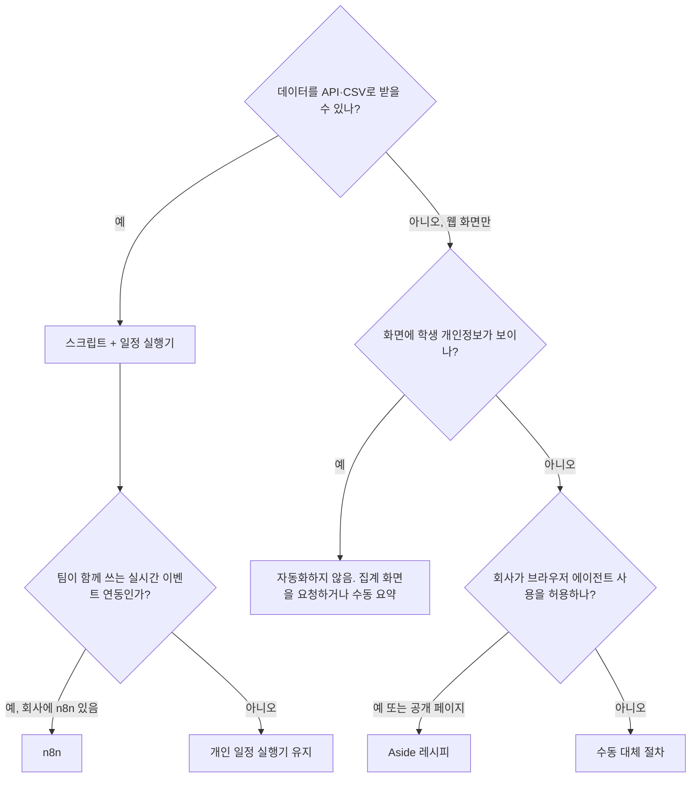

# 자동화 레이어 선택: Aside CLI, n8n, 일정 실행기

## 결론

에듀테크 PM 개인의 기본 자동화는 **Claude Code 스킬 + Aside CLI + 일정 실행기(Aside Routines·launchd·GitHub Actions)** 로 합니다. n8n은 **회사가 이미 운영 중이고, 항상 켜져 있어야 하는 이벤트 연동**이 필요할 때만 씁니다.

전통적인 PM 자동화는 n8n 같은 워크플로우 서버로 이슈 알림, 주간 요약, 배포 알림, 사내 AI 질의 봇을 돌리는 방식이었습니다. 대부분 팀 인프라 일입니다. EdPM Framework의 자동화는 PM 한 사람이 **어느 회사에 가도 첫 주부터** 돌릴 수 있어야 하고, 에듀테크 PM이 실제로 많이 하는 일은 **API가 없는 웹 화면에서 자료를 모으는 일**이라서 기본값을 다르게 잡았습니다.

## 1. 에듀테크 PM의 반복 작업과 알맞은 도구

| 반복 작업 | 데이터가 있는 곳 | API | 알맞은 도구 |
|-----------|------------------|:---:|-------------|
| 교육부·교육청 공지, 정책 모니터링 | 기관 게시판 | 대부분 없음 | Aside (R03) |
| 입찰·사업 공고 모니터링 | 조달·교육청 게시판 | 일부 | Aside (R04), API가 있으면 스크립트 |
| 경쟁 학습앱 리뷰, 가격·커리큘럼 변화 | 앱스토어, 경쟁사 웹 | 없음 또는 제한 | Aside (R01, R02) |
| 학부모·교사 커뮤니티 VOC | 공개 게시판 | 없음 | Aside (R08), 약관 확인 필수 |
| 역할별(학생·교사·보호자) 스모크 테스트 | 스테이징 웹 | 해당없음 | Aside (R05) 또는 Playwright |
| 접근성 빠른 점검 | 학습 화면 | 해당없음 | Aside (R06) + Lighthouse |
| 주간 지표 확인 | 분석 도구·어드민 | 있는 경우 많음 | CSV export·API 스크립트 우선, 없으면 Aside (R07) |
| 위키 정리, 산출물 작성, 주간보고 | 워크스페이스 | 해당없음 | Claude Code 스킬 |
| 이슈 생성 → 메신저 알림, 배포 알림 | 이슈 트래커·CI | 있음 | 회사 n8n·Zapier·트래커 내장 연동 |
| 파일럿 신청 폼 → 시트·CRM | 폼 서비스 | 있음 | n8n 또는 폼 서비스 내장 연동 |

## 2. 비교

| 기준 | Aside CLI / MCP | n8n | 일정 실행기 + 스크립트 |
|------|-----------------|-----|------------------------|
| 잘하는 일 | 로그인된 브라우저로 API 없는 화면 읽기, 화면 점검, 스크린샷 | 웹훅·API 사이 이벤트 연동, 팀 공용 흐름 | 정해진 시간에 정해진 명령 실행 |
| 시작 비용 | 설치 + 로그인. 사내 인증 정보 등록 불필요 | 서버(또는 Cloud 구독) + 서비스마다 인증 정보 등록 + 회사 보안 승인 | 거의 없음 |
| 회사 이동 시 | 레시피 파일을 그대로 가져감. URL만 바꿈 | 회사 인프라·인증 정보에 묶여 다시 만들어야 함 | 그대로 가져감 |
| 결과의 정확성 | 비결정적. 같은 지시도 결과가 달라질 수 있음 → 출처 URL 기록, 수치 검증 필요 | 결정적 | 결정적 |
| 비용 | Aside 요금제·크레딧 [확인 필요] | Cloud 구독 또는 서버 운영 | 무료 |
| 항상 켜져 있어야 하는가 | 실행 시 PC·Aside 필요 (Routines는 [확인 필요]) | 서버가 항상 켜져 있음 | PC 또는 CI |
| 개인정보 위험 | 브라우저가 보는 화면 전체가 모델에 들어감 → 개인정보 화면 금지 규칙 필수 | 연동 데이터 범위가 명확 | 명확 |
| 결과물 | 마크다운 파일 → 위키 | 메시지·레코드 → 필요하면 inbox로 내보내기 | 파일 |

## 3. 판단 순서

## 4. Aside를 쓸 때 지킬 것

1. **도구에 묶이지 않기**: 레시피는 자연어 지시문 + 출력 형식 + 수동 대체 절차로 씁니다. Aside가 바뀌거나 없어져도 Claude in Chrome, Playwright, 손으로 같은 일을 할 수 있습니다.
2. **개인정보 화면 금지**: 학생 목록, 성적 상세, 상담 기록 화면에서는 실행하지 않습니다 (`pii_risk: high` 금지).
3. **결과 검증**: 숫자·가격·날짜에는 원문 URL을 붙이게 하고, 산출물에 쓰기 전에 확인합니다. 공식 지표는 SQL 결과만 씁니다.
4. **약관 확인**: 자동 수집을 금지하는 사이트는 빼고, 공개 글도 원문을 길게 옮기지 않습니다.
5. **회사 승인**: 사내 시스템(어드민, 분석 도구)에 쓰기 전에 보안 담당과 범위를 정하고 `AGENTS.md` 2절 "브라우저 에이전트"에 적습니다.
6. **쓰기 동작 금지**: 레시피는 읽기·캡처만 합니다. 게시, 제출, 결제, 메시지 발송은 지시하지 않습니다.

## 5. 흔한 팀 자동화를 EdPM에서 하는 방법

| 흔한 n8n 워크플로우 | EdPM에서 | 비고 |
|---------------------|----------|------|
| 이슈 생성 → 메신저 알림 | 회사 이슈 트래커 내장 연동 또는 회사 n8n | PM 개인 자동화 대상 아님 |
| 주간 요약 → 메신저 | `/edpm-brief weekly` + launchd 예약 | log.md·산출물 상태·학사 일정까지 반영 |
| 배포 완료 알림 | CI 내장 알림, 배포 후 R05 스모크 테스트 | |
| 프로젝트 현황 질의 봇 | `/edpm-wiki query` (위키 기반) | 근거가 누적 위키 |
| WBS → 이슈 일괄 생성 | `/edpm-wbs export` | 승인 후 생성 |
| 평가 자동 실행 | `/edpm-ai eval` + 예약 실행 | 비용 발생, 주기는 프롬프트 변경 시로 제한 권장 |

출처: [Aside 개발자 문서](https://docs.aside.com/help/developers), [Aside 개발자 블로그](https://aside.com/blog/developers) (2026-10-12 확인). CLI 출력 형식, Routines의 로컬 파일 저장, 요금은 문서에 명시돼 있지 않아 첫 사용 때 확인이 필요합니다.
