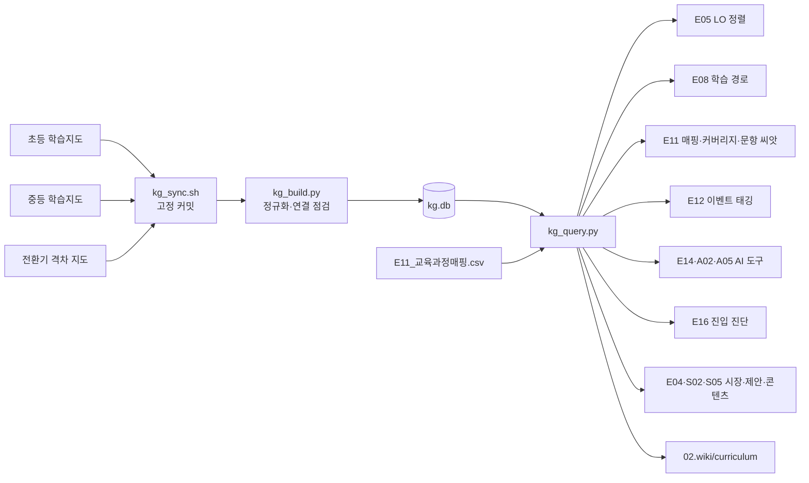

# 교육과정 지식그래프 활용

국가 교육과정(2022 개정)을 다루는 제품이라면, 성취기준과 선수 관계를 기억이나 PDF 검색으로 다루지 말고 **교육과정 지식그래프(KG)** 로 조회합니다. 공개 온톨로지 데이터 세 가지를 로컬 SQLite 하나로 묶어 기획·콘텐츠·AI·제안 전 과정에서 같은 근거를 씁니다.

## 1. 무엇이 들어 있나

| 원천 (MIT) | 규모 | PM이 쓰는 것 |
|------------|------|--------------|
| 초등 학습지도 | 성취기준 620, 토픽 1,956, 공식 선수 416 + 권장 1,877, 묶음 152 | 성취기준·학년군·영역, 달성 증거·평가 예시·오개념, 학부모용 묶음 요약 |
| 중등 학습지도 | 중 성취기준 714·토픽 2,160, 고 일반 3,124(+직업계 47,625 선택), 공식·권장 선수, 과목 순서, 이수학점·선택 묶음·예시 경로, 초→중 290(+후보 3,699)·중→고 175 연결 | 중학교 콘텐츠 설계, 고교 선택 과목 구조, 학교급 간 연결 |
| 전환기 격차 지도 | 초→중 24·중→고 37과목, 신규 성취기준 1,046(쉬운 설명), 연계 근거 317 | 예비 중1·고1 진단·브리지·시즌 콘텐츠 |

세부 설명: `workspace-template/automation/kg/README.md`, 개인 Brain `domain/교육과정지식그래프.md`.

## 2. 구조

- **원천은 고정 커밋으로** 받습니다 (`automation/kg/sources.lock.json`). 갱신은 의식적으로 합니다.
- **우리 제품과 KG의 연결점은 매핑 파일 하나**입니다: `03.docs/3.설계/E11_교육과정매핑.csv` (콘텐츠·기능·진단 ↔ 성취기준 코드).
- **위키에는 제품 범위만** 올립니다 (`02.wiki/curriculum/`). KG 전체를 복사하지 않습니다.

## 3. 산출물별 사용법

| 산출물 | 질문 | 명령 |
|--------|------|------|
| E00 | 국가 교육과정 기반인가, 어느 학년·과목, 2022/2015 중 무엇 | `/edpm-curriculum setup` |
| E04 | 대상 과목 규모, 전환기 연계가 약한 곳 | `kg_query.py courses`, `gaps` |
| E05 | LO ↔ 성취기준, 달성 증거 초안 | `search`, `standard`, `seed` |
| E06 | 범위에 넣을/뺄 성취기준 | `coverage` |
| E08 | 학습 순서 (공식 = 잠금 후보, 권장 = 추천) | `path --layer all` |
| E11 | 매핑, 커버리지, 빠진 선수, 문항 씨앗 | `/edpm-curriculum map`, `coverage`, `seed` |
| E12 | 이벤트에 성취기준 코드 | 매핑 CSV의 코드 |
| E14·A01·A02·A05 | AI가 쓸 교육과정 정보 (SQL 도구) | `standard`, `path` 로직 |
| E16·E17 | 진입 진단 문항 후보 | `gaps --subject`, `path` |
| E19 | 성취기준별 효과 | 매핑 + SQL |
| S01·S02 | RFP 교육과정 요구 충족도, 정합표 | `coverage`, `export` |
| S05·콘텐츠 | 예비 중1·고1 시즌 콘텐츠 | `gaps` (쉬운 설명 검토 후) |
| M02 | 콘텐츠 제작 공수 | 범위 성취기준 수 |

## 4. 게이트와 규칙

- **G-CURRIC**: 국가 교육과정 기반 제품이면 E05 LO가 KG 성취기준에 정렬되고 E11 매핑·커버리지가 있어야 E15를 완료합니다.
- 공식 관계와 권장 순서를 구분합니다. 권장 순서는 "필수"가 아닙니다.
- KG는 공식 자료가 아니며 성취기준 원문이 아니라 요약을 담습니다. 출처 고지를 남깁니다.
- 전환기 격차는 문서 지표입니다. 학생 개인 진단처럼 쓰지 않습니다.
- 평가 예시·오개념·쉬운 설명은 초안입니다. 교과 전문가 검토 후 씁니다.
- 2022 개정만 다룹니다. 2026년 기준 중3·고3은 2015 개정입니다.

## 5. 한계와 대응

| 한계 | 대응 |
|------|------|
| 교과서 단원·쪽과 연결 없음 | 교과서 기반 제품은 자체 매핑 열(교과서·단원)을 매핑 CSV에 추가 |
| 고교 일반 과목 토픽은 템플릿 수준 (오개념·평가 예시 없음) | 고교 콘텐츠는 자체 오개념 사전(A01) 구축 |
| 공식 선수 관계가 없는 과목이 많음 | 관계 없음을 독립으로 해석하지 않음. 교과 전문가 판단을 E08에 기록 |
| 데이터는 candidate 단계, 외부 교과 전문가 검토 진행 중 | 중요 판단은 교과 전문가 확인, 버전 기록 |
| 전환기 지도는 이전 버전 위에서 생성 | 빌드 연결 점검 확인 (고정 버전 기준 모두 연결됨) |
| 2015 개정 미포함 | 2015 개정 학년 콘텐츠는 별도 관리 |
| 성취수준(A~E) 미포함 | KICE 성취수준 자료는 별도 이용 조건 확인 후 사용 [확인 필요] |

## 6. 다른 데이터와 함께 쓰기

같은 형식으로 다른 공개 교육 데이터(성취수준, 교과서 단원표, 자사 문항 은행)를 붙이려면 `kg_build.py`에 테이블을 추가하고, 연결 키를 성취기준 `code_norm` 또는 KG `standard.id`로 둡니다. 새 원천은 `sources.lock.json`에 버전·라이선스와 함께 기록합니다.
