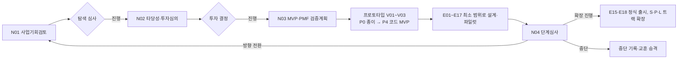
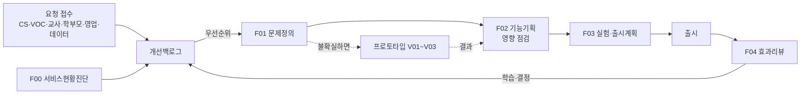

# 업무 모드: 신사업과 운영 개선

에듀테크 PM의 일은 크게 두 가지입니다. 같은 프레임워크를 쓰되, **어떤 문서를 얼마나 무겁게 쓰는지**가 다릅니다. E00에서 업무 모드를 정합니다 (둘 다일 수 있음).

| | 모드 N: 신사업 (0 → 1) | 모드 F: 운영 개선 (1 → n) |
|--|------------------------|---------------------------|
| 상황 | 새 서비스·새 사업을 시작한다 | 이미 운영 중인 서비스의 PM이다 |
| 핵심 질문 | 할 가치가 있나? 무엇을 먼저 검증하나? 언제 더 투자하나? | 누구의 어떤 문제를 이번에 풀까? 효과가 있었나? |
| 주기 | 단계(탐색 → 검증 → 확장), 수개월 | 과제 단위, 수주 |
| 주 문서 | N01~N04 + E 체인 + M 트랙 | F00(한 번) + 과제별 F01~F04 + 백로그 |
| 의사결정자 | 경영진·투자 심의 | PO·리더·이해관계자 |
| 스킬 | `/edpm-venture` | `/edpm-feature` |
| 핵심 게이트 | G-STAGE (확장 전 단계 심사) | G-IMPACT (영향 점검), G-MEASURE (효과 측정) |

두 모드 모두 서비스 유형(`archetypes/`)과 공통 규칙(위키, 근거, 데이터 보호, 계산 가능한 정책)은 같습니다.

**두 모드 모두 PRD가 원점입니다.** 신사업이면 PRD는 만들 새 제품 전체를, 운영 개선이면 운영 중인 서비스 전체(F00이 현재 상태를 받침)를 정의합니다. 과제(F01~F04)나 단계 심사(N02~N04)가 범위·목표를 바꾸면 PRD 판을 올립니다. 개발 체계에 따라 PM의 구현 범위도 다릅니다.

| 개발 체계 | 모드 N | 모드 F |
|-----------|--------|--------|
| 개발팀 | PRD → E06 → E09 스펙 → 프로토타입(PRD 9절 정수)으로 가설 검증 → `/edpm-handoff dev` | 과제마다 F02(기능 단위 PRD·스펙) → `/edpm-handoff dev` |
| 바이브코딩 | 같은 문서 → E09 승인 → `/edpm-spec build`로 `src/`에 구현 | F02 승인 → `/edpm-spec build` |

## 1. 모드 N — 신사업

| 단계 | 할 일 | 문서 | 명령 |
|------|-------|------|------|
| 탐색 | 기회 가설, 고객 인터뷰, 경쟁·정책 조사 | N01, E01~E04 (가볍게) | `/edpm-venture opportunity`, `/edpm-collect`, `/edpm-ingest` |
| 투자 결정 | 시장 근거, 수익·손익 시나리오, 투자 계획 | N02, S06 | `/edpm-venture case` |
| 검증 | MVP 범위, 가설별 실험, PMF·학습 효과 신호 | N03, E05~E10(최소), E16·E17 | `/edpm-venture mvp`, `/edpm-doc` |
| 만들어 검증 | 가장 위험한 가설을 가장 낮은 충실도로: 클릭 프로토타입 → 오즈의 마법사 → 코드 MVP | V01~V03 (가설마다) | `/edpm-proto` ([11.프로토타입과MVP](11.프로토타입과MVP.md)) |
| 단계 심사 | 기준 대비 증거, 진행·전환·중단 | N04 | `/edpm-venture gate` |
| 확장 | 정식 출시, 정책·운영·영업 체계 | E15, E18, P, L, S | `/edpm-blueprint check`, `/edpm-policy` |

원칙:
- **MVP에서는 문서를 최소로.** 검증할 가설에 필요한 산출물만 쓰고, 나머지는 N03 "지금 하지 않을 것"에 적습니다. 단, 미성년 대상이면 E13(G-SAFE)은 MVP에서도 필수입니다.
- **문서보다 먼저 만들어 봅니다.** 사람의 반응이 필요한 가설은 계획서를 키우기 전에 P1·P2 프로토타입으로 확인하고, 코드 MVP(P4)는 가치·사용성 신호가 나온 뒤 만듭니다.
- **학습 효과 신호를 PMF 기준에 넣습니다.** 리텐션·결제만으로 PMF를 판단하지 않습니다.
- **중단도 성과입니다.** 중단 결정과 이유를 ADR과 E20으로 남기고, 일반화할 교훈은 `/edpm-promote`로.

## 2. 모드 F — 운영 개선

| 단계 | 할 일 | 문서 | 명령 |
|------|-------|------|------|
| 합류·반기 | 서비스 기준선·기능 지도·제약·이해관계자 정리 | F00 | `/edpm-feature baseline` |
| 상시 | 요청을 모아 근거와 함께 백로그로 | 개선백로그.csv | `/edpm-feature intake` |
| 계획 | 가치·교육적 효과·도달·노력·위험으로 우선순위 | 개선백로그.csv | `/edpm-feature prioritize` |
| 과제 시작 | 이해관계자 문제를 근거로 정의 | F01 | `/edpm-feature new <과제명>` |
| 검증 (선택) | 해결안의 사용성·수요가 불확실하면 개발 전에 클릭 프로토타입·오즈의 마법사로 확인 | V01~V03 | `/edpm-proto` |
| 기획 | 목표 지표, 스토리·인수조건, 화면, 데이터, 영향 점검 | F02 | `/edpm-feature spec` |
| 출시 준비 | A/B·단계 출시, 가드레일, 공지·CS | F03 | `/edpm-feature launch` |
| 효과 확인 | 지표·VOC로 결정 | F04 | `/edpm-feature review` |

원칙:
- **요청이 아니라 문제를 받습니다.** "버튼 추가해 주세요"를 "누가 어떤 상황에서 무엇을 못 하나"로 바꿔 F01에 씁니다.
- **영향 점검은 생략하지 않습니다.** 작은 기능도 환불·정산·진도·개인정보·AI 평가 기준을 건드릴 수 있습니다 (G-IMPACT). 영향이 있으면 해당 산출물(E13, P01, S07, L03, L04, E14·A06, E11 매핑)을 함께 갱신합니다.
- **출시 후 리뷰까지가 과제입니다.** F02의 목표 지표를 F04에서 같은 SQL로 계산합니다 (G-MEASURE).
- **큰 과제는 관리 문서를 붙입니다.** 여러 팀이 몇 달 걸리는 과제면 M01(착수)·M02(WBS)·M03(위험)을 함께 쓰고, WBS는 팀이 보는 일정 관리 도구(기본 GitHub)에 올립니다 ([12.일정관리도구연동](12.일정관리도구연동.md)).

### 운영 중 서비스에 합류했을 때의 E 체인

이미 운영 중인 서비스에서는 E 체인을 처음부터 쓰지 않습니다.
- F00 서비스현황진단서가 E01~E07의 "현재 상태"를 대신합니다. E 산출물 중 이미 회사에 있는 문서는 `01.자료실/회사/`에 넣고 F00에서 링크합니다.
- 계속 유지해야 하는 기준 문서만 E·P·L 트랙으로 둡니다: E07 지표 체계, E12 데이터, E13 안전·개인정보, P01 환불, L03 진도·수료 규칙 등. 개선 과제가 이 기준을 바꾸면 기준 문서를 갱신합니다.
- 나머지 E 산출물은 `status: n/a`, 사유 "운영 중 서비스: F00이 대체".

## 3. 서비스별 예

| 서비스 형태 | 유형 | 모드 N 예 | 모드 F 예 |
|-------------|------|-----------|-----------|
| AI 영어 스피킹 앱 (Speak형) | AT07 + AT10 | 비즈니스 영어 B2B 신규 라인 | 발음 피드백 지연 시간 줄이기, 레벨 테스트 개선 |
| 수학 문제 풀이·필기 앱 (오르조형) | AT07 + AT09 | 교사용 과제 배포 신사업 | 오답 노트 자동 분류, 출판사 신규 문제집 탑재 흐름 개선 |
| 수학 학원 프랜차이즈 (매쓰홀릭형) | AT06 | 온라인 관리형 신규 브랜드 | 가맹점 원장용 학부모 리포트 개선 |
| 대학 LMS | AT08 | 마이크로디그리·비교과 플랫폼 | 과제 제출 마감 연장 승인 흐름, 장애학생 자막 지원 |
| 유초등 영어 리딩 (리딩게이트·리딩앤형) | AT07 + AT06 | 유아용 신규 앱 | 레벨 테스트 정확도, 독서 기록 학부모 알림 |
| 초등 전과목 구독 (엘리하이형) | AT07 + AT05 | 중등 확장 상품 | 학습 습관 알림, 전용 기기 해지 흐름 정비 |

각 형태에 필요한 고유 지식은 `brain-seed/domain/`의 서비스 특화 페이지를 봅니다: 음성AI스피킹학습, 레벨드리딩과영어독서, 디지털문제집과풀이앱, 학원프랜차이즈운영, 대학LMS운영, 전용기기학습서비스, 유아초등학습UX.
