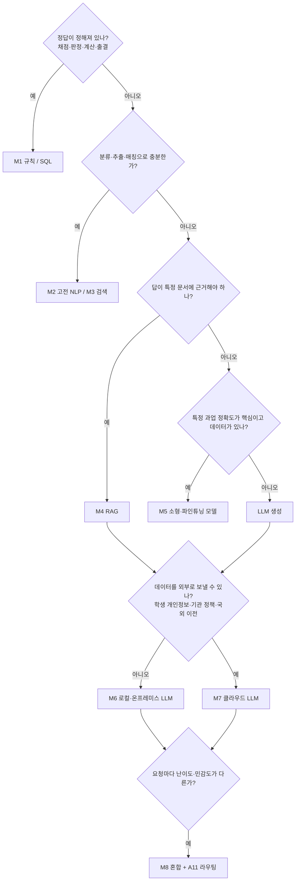

# AI 방식 선택: LLM만이 답이 아니다

에듀테크의 "AI 기능"은 실제로는 여러 기술의 조합입니다. 채점·분류·출석·추천처럼 **정해진 답이 있어야 하는 일**에 생성형 LLM을 쓰면 비싸고 틀리고 설명하기 어렵습니다. 학생 데이터 때문에 외부로 보낼 수 없는 경우도 많습니다. PM은 기능마다 **가장 단순하면서 요구를 충족하는 방식**을 고르고, 그 근거를 A10에 남깁니다.

## 1. 방식 스펙트럼

| 방식 | 잘하는 일 | 에듀테크 예 | 장점 | 한계 |
|------|-----------|-------------|------|------|
| M1 규칙·템플릿 | 정해진 조건 → 정해진 출력 | 정답 비교 채점, 출결·진도 판정, 정형 피드백 문구, 알림 | 결정적·설명 가능·무료·즉시 | 표현 다양성 없음, 규칙 관리 부담 |
| M2 고전 NLP | 분류·추출·매칭 | 문의 의도 분류, 키워드·개체 추출, 단답형 유사도 채점, 비속어 필터, 형태소 기반 검색 | 빠름·저렴·로컬 실행·평가 쉬움 | 학습 데이터 필요, 열린 대화 불가 |
| M3 검색·FAQ 매칭 | 이미 있는 답 찾기 | FAQ 챗봇, 교재·해설 검색, 유사 문항 찾기 | 답이 검증된 원문 그대로 | 질문 표현 변화에 약함 (임베딩으로 보완) |
| M4 RAG (검색 + 생성) | 근거 문서로 설명 생성 | 교재 근거 질의응답, 강의 요약, 학습 자료 기반 튜터 | 근거 인용, 최신 자료 반영 | 검색 품질에 좌우, 환각 관리 필요 |
| M5 소형·파인튜닝 모델 | 특정 과업 고정밀 | 발음 평가, 필기 인식, 에세이 루브릭 채점, 수식 인식 | 과업 정확도·비용·지연 | 학습 데이터·MLOps 필요 |
| M6 로컬·온프레미스 LLM | 데이터를 밖으로 못 보낼 때의 생성 | 학교·기관 내부 설치, 학생 글 피드백, 오프라인 교실 | 데이터 통제, 사용량 비용 없음 | GPU·운영 부담, 품질 격차, 모델 라이선스 확인 |
| M7 클라우드 LLM API | 열린 대화·복잡한 생성·추론 | AI 튜터 대화, 문항·자료 초안, 복잡한 설명 | 최고 품질, 운영 부담 적음 | 사용량 비용, 지연, 국외 이전·개인정보, 공급사 의존 |
| M8 혼합 | 위를 단계별로 결합 | 의도 분류(M2) → FAQ(M3) → 실패 시 RAG(M4·M7), 민감 요청은 로컬(M6) | 비용·품질·안전 균형 | 설계·운영 복잡 |

## 2. 고르는 순서

## 3. 판단 기준표 (A10에 기능마다 채움)

| 기준 | 질문 | 영향 |
|------|------|------|
| 정확성·결정성 | 같은 입력에 같은 답이 필요한가? 틀리면 피해가 큰가(성적·자격)? | 높으면 M1·M2·M5, LLM은 보조 |
| 설명 가능성 | 학생·학부모·기관에 판단 근거를 설명해야 하나? | AI 기본법 고영향(학생 평가), 개인정보 보호법 제37조의2(자동화된 결정) |
| 데이터 민감도 | 학생 실명·글·음성이 들어가나? 기관이 외부 전송을 막나? | M6 로컬, 가명화, 국외 이전 검토 |
| 지연 | 대화·발음 피드백처럼 즉시 응답이 필요한가? | 소형 모델·캐싱·스트리밍 |
| 비용 | 학습자당 월 몇 회, 요청당 몇 토큰인가? | A12에서 계산, 라우팅·캐싱 |
| 오프라인·망 | 학교망 차단, 오프라인 교실, 전용 기기인가? | 기기 내 모델·로컬 서버 |
| 품질 격차 | 로컬·소형 모델이 평가세트 기준을 넘나? | `/edpm-ai eval`로 방식별 비교 |
| 운영 역량 | 모델 학습·서빙·모니터링을 할 사람이 있나? | 없으면 M1~M4·M7 중심 |
| 라이선스 | 모델 가중치·데이터의 상업 이용 조건은? | 오픈 모델 라이선스 확인 [확인 필요] |

## 4. 같은 평가셋으로 방식을 비교한다

`automation/scripts/ai_eval.py`는 같은 골든셋·평가세트로 여러 방식을 비교할 수 있습니다.

| 대상 | 옵션 | 예 |
|------|------|----|
| 클라우드 LLM (Claude) | 기본값 | `--model claude-opus-5-5` |
| 로컬 LLM (OpenAI 호환 서버: Ollama·vLLM·llama.cpp 등) | `--target local --endpoint http://localhost:11434/v1 --model <로컬 모델명>` | 학생 데이터용 로컬 모델 품질 확인 |
| 규칙·NLP·검색 시스템 (자체 스크립트) | `--target cmd --cmd "python my_classifier.py"` | 표준입력으로 질문, 표준출력으로 답 |
| 정형 답 채점 | `--judge exact` | 기대답변 포함·정규식 일치로 채점 (LLM 채점 없이) |

결과에는 방식별 합격률, 점수, 지연(p50·p95), 추정 비용이 나옵니다. A11 라우팅과 A12 비용 설계는 이 비교 결과를 근거로 합니다. 비용 시뮬레이션은 `automation/scripts/ai_cost.py`.

## 5. 자주 하는 실수

- 정답 비교·점수 계산을 LLM에게 시킨다 → M1·SQL로.
- 학생 글·음성을 검토 없이 해외 API로 보낸다 → E13·P07 검토, 가명화 또는 M6.
- RAG 품질 문제를 프롬프트로만 고치려 한다 → 검색(A01·A02)부터 평가.
- 로컬 모델이 "무료"라고 생각한다 → GPU·운영 인력·업데이트 비용을 A12에 넣는다.
- 한 모델로 모든 요청을 처리한다 → 쉬운 요청은 작은 모델·FAQ로 (A11).
- 가드레일을 프롬프트 한 줄로 끝낸다 → 입력·출력 단계별 규칙·분류기·판정 층 (A14).
