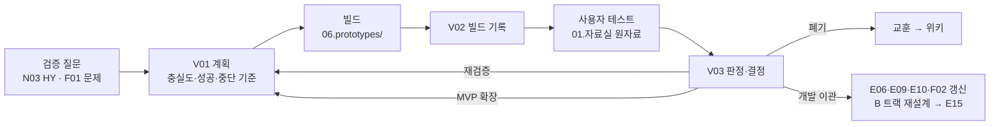

# 프로토타입과 MVP: 만들어서 빨리 검증하기

PM은 문서로 문제를 정의하는 데서 멈추지 않고, 가장 위험한 가정을 **직접 만들어 사람 앞에 놓고** 확인합니다.

> **프로토타입은 PRD의 정수를 보여주는 것입니다.** 축소판 PRD가 아닙니다. 루트 `PRD.md`에는 만들 제품 전체가 있고, 9절에 "먼저 눈으로 확인할 핵심 경험과 가장 위험한 가정"이 있습니다. 프로토타입은 그 행을 골라 보여주고(V01 0절), 결과는 PRD 갱신으로 돌아갑니다. 프로토타입 코드는 `06.prototypes/`에만 두고, 제품은 스펙(E09)에서 다시 시작합니다 — 개발팀이 있으면 `/edpm-handoff dev`, 개발자 없이 직접 만들면(바이브코딩) `/edpm-spec build`. 이 가이드는 트랙 V(프로토타입)와 `/edpm-proto` 스킬의 흐름입니다. 신사업(모드 N)에서는 N03 가설 검증 수단으로, 운영 개선(모드 F)에서는 F02 기능 기획을 확정하기 전 검증 수단으로 씁니다.

## 1. 흐름

| 단계 | 산출물 | 명령 | 기간 감각 |
|------|--------|------|-----------|
| 계획 | V01 프로토타입계획서 | `/edpm-proto new <이름>` → `plan` | 반나절 |
| 빌드 | `06.prototypes/PT-xx/` + V02 | `/edpm-proto build` | P0·P1 1~3일, P2 2~5일, P4 1~3주 |
| 테스트 | 관찰 기록·이벤트 로그 → `01.자료실/` | `/edpm-proto test` | 1~2주 |
| 결정 | V03 검증결과·결정서 | `/edpm-proto decide` | 반나절 |
| 이관 | V03 6절 + 갱신할 문서 | `/edpm-proto handoff` | 1~2일 |

여러 프로토타입은 `03.docs/V.프로토타입/프로토타입목록.csv`(PT-01, PT-02 …)로 관리합니다.

## 2. 충실도 사다리

**질문에 답할 수 있는 가장 낮은 단계**를 고릅니다. 높은 단계는 더 많은 것을 알려주지만, 만드는 데 오래 걸리고 버리기 어렵습니다.

| 단계 | 형태 | 답하는 질문 | 만드는 법 | 에듀테크 예 |
|------|------|-------------|-----------|-------------|
| P0 | 종이·스토리보드·low-fi | 흐름을 이해하나, 빠진 단계는 | E10 ASCII → `sb-lowfi-pptx` | 교사가 숙제 배포 흐름을 순서대로 짚어 봄 |
| P1 | 클릭 프로토타입 | 화면을 쓸 수 있나, 가치 제안에 반응하나 | `06.prototypes/_starter/click-prototype.html`, `sb-lowfi-figma`, Figma | 학부모 주간 리포트 화면을 보고 "구독하겠다"는 반응 |
| P2 | 오즈의 마법사·컨시어지 | 진짜 결과를 받으면 행동이 바뀌나 | P1 화면 + 사람이 뒤에서 처리하는 운영 스크립트 | AI 오답 해설을 교사가 대신 써서 앱으로 전달 |
| P3 | 노코드·로우코드 | 소규모 실사용에서 데이터가 쌓이나, AI 답이 쓸 만한가 | Forms·Sheets, n8n, NotebookLM, `/edpm-ai nocode` | 골든셋 10문항으로 튜터 답 품질 확인 |
| P4 | 코드 MVP | 실제 사용·재방문·학습 신호가 나오나 | Claude Code로 구현, 가상 데이터, 접근 제한 배포 | 학원 1곳 2개 반에서 4주 사용 |

위험 유형별 출발점:

| 가장 위험한 가정 | 출발 단계 | 넘어가는 조건 |
|------------------|-----------|---------------|
| 가치 (원하는가) | P1 → P2 | 행동 신호(재사용, 대기 등록, 사전 결제) |
| 사용성 (쓸 수 있는가) | P0 → P1 | 역할별 5명 내외에서 과제 성공 |
| 실현 가능성 (AI 품질 포함) | P3 | 골든셋 기준 통과 (`/edpm-ai eval`) |
| 사업성 (돈을 내나, 운영이 되나) | P2 (컨시어지) | 사전 결제, 운영 시간 실측 |
| 학습 효과 (배우나) | P4 + E16 설계 | N03 GT-04, 파일럿으로 넘어감 |

## 3. 코드 MVP (P4)를 PM이 만들 때

Claude Code로 PM이 직접 동작하는 MVP를 만들 수 있습니다. 목적은 **검증**이지 운영 제품이 아닙니다.

| 항목 | 기본값 |
|------|--------|
| 스택 | 회사 스택이 있으면 그것. 없으면 Next.js(App Router) + Tailwind CSS + Supabase(DB·인증·스토리지) + Vercel |
| AI | 서버 라우트에서 Claude API 호출(키는 서버에만). 방식은 A10 원칙: 정답이 있으면 규칙, 근거가 필요하면 검색·RAG, 학생 원문이면 가명·로컬 검토 |
| 위치 | 작게 시작: `06.prototypes/PT-xx/app/`. 개발자와 협업·장기화: 별도 비공개 저장소 |
| 데이터 | 가상 데이터 시드 스크립트. 실제 학생 데이터 연동 없음 |
| 측정 | 이벤트 테이블 하나(시각, 참여자 ID, 이벤트, 값)로 V01 신호 계산 |
| 배포 | 접근 보호된 미리보기(비밀번호·초대), 검색 차단 |
| 결제 | 테스트 모드 또는 가짜 결제 화면 |

순서: 핵심 흐름 하나를 끝까지 → 가상 데이터 → 이벤트 로그 → 배포 → 리허설·스모크 테스트(`webapp-testing`, 챗봇·튜터 답 품질은 `/edpm-ai eval`) → 테스트. 기능을 넓히기 전에 핵심 흐름부터 끝냅니다.

필요한 도구: Node.js 20 이상, git, (선택) GitHub CLI `gh`, Vercel CLI, Supabase 계정. `./install.sh --check`가 Node.js와 `gh`를 확인합니다.

## 4. G-PROTO 게이트

| 조건 | 막는 것 | 이유 |
|------|---------|------|
| V01의 성공·중단 기준과 timebox가 확정됨 | P3·P4 빌드 시작 (V02) | 만든 뒤 기준을 정하면 무엇이든 성공으로 보임 |
| 가상 데이터만 사용, 미성년 참여는 보호자 동의·동석·시간 상한 | 사용자 테스트 시작 | 프로토타입이라도 아동 개인정보·녹음은 실제 처리임 |
| 프로토타입 코드는 V03 이관 패키지와 B 트랙(B01·B04·E13) 검토를 거침 | E15 포함 | 인증·보안·개인정보·접근성을 건너뛴 코드가 운영에 들어가는 것을 막음 |

실체 검증: V03은 `01.자료실/`에 테스트 원자료(관찰 기록·이벤트 로그)가 있어야 `done`이 됩니다.

## 5. 업무 모드별 쓰는 법

| 모드 | 언제 | 결과가 가는 곳 |
|------|------|----------------|
| N 신사업 | N03 가설 중 "만들어 봐야 아는 것". N02 승인 전 탐색 단계(N01)에서도 P0~P2는 가능 | V03 판정 → N03 3절 실험 결과 → N04 단계 심사 증거 |
| F 운영 개선 | F01 이후, F02 해결안의 사용성·수요가 불확실할 때. 큰 화면 변경, 새 역할(학부모·교사)의 첫 기능 | V03 → F02 범위·US·AC 확정 → F03 실험 출시 |

F03(A/B 실험)과의 차이: 프로토타입은 **만들기 전에** 소수에게 확인하고, F03은 **만든 뒤에** 실제 사용자 일부에게 내보내 지표로 확인합니다.

## 6. 자주 하는 실수

| 실수 | 대신 |
|------|------|
| 가장 쉬운 부분부터 만듦 | 가장 위험한 가정이 있는 부분부터 |
| 코드부터 시작 | 클릭·오즈의 마법사로 답이 나오는지 먼저 |
| "써 보니 좋대요"로 판정 | V01에서 정한 행동 신호(재시도, 재방문, 결제)로 |
| 테스트하며 기준 수정 | 기준은 고정, 바꾸면 ADR |
| 프로토타입을 계속 덧대어 운영으로 | V03 이관 → B 트랙 재설계 |
| 아이에게 빨간 표시·점수부터 보여줌 | 격려형 피드백, 보호자 동석, 짧은 세션 |
