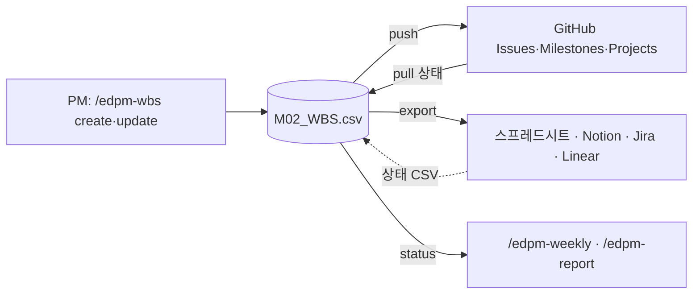

# 일정 관리 도구 연동: GitHub 기본, 회사 도구로 확장

WBS(M02)는 팀과 함께 봐야 의미가 있습니다. EdPM은 **GitHub를 기본 일정 관리 도구**로 쓰고, 회사 사정에 따라 스프레드시트·Notion·Jira·Linear로 바꿀 수 있게 열어 둡니다.

## 1. 원칙: 계획은 CSV, 진행은 도구

| 필드 | 정본 | 바꾸는 곳 |
|------|------|-----------|
| 계획: 이름, 단계, 산출물ID, 공수, 시작, 종료, 선행, 학사제약 | `03.docs/M.관리/M02_WBS.csv` | PM이 CSV(또는 `/edpm-wbs`)로 고치고 `push` |
| 진행: 상태 | 일정 관리 도구 | 팀이 도구에서 바꾸고 PM이 `pull` |
| 연결: 이슈 번호·키 | 도구 | `push`가 CSV `이슈` 열에 기록 |

이렇게 나누는 이유: 학사일정·게이트·선행 관계를 반영한 계획은 PM이 한 곳에서 관리해야 일관되고, 진행 상태는 실제로 일하는 사람이 자기 도구에서 바꾸는 것이 정확합니다. 도구를 바꿔도 CSV가 남아 있어 옮기기 쉽습니다.

## 2. GitHub (기본)

### 2.1 준비 (한 번)

| 단계 | 명령·작업 |
|------|-----------|
| GitHub CLI 설치·로그인 | `brew install gh` → `gh auth login` |
| 저장소 | 워크스페이스를 **비공개** 저장소로 올리거나(`gh repo create <이름> --private --source . --push`), 개발팀 저장소에 이슈만 만들기 |
| 설정 | `automation/wbs.json`의 `repo`에 `owner/name`. 담당 역할을 GitHub 아이디로 연결하려면 `assignees`: `{"개발 리드": "devlead"}` |
| 라벨·마일스톤 | `/edpm-wbs setup` (내부: `wbs_sync.py setup --dry-run` → 승인 → 실행) |
| (선택) 로드맵 | GitHub Projects 만들기 → `gh auth refresh -s project` → 날짜 필드 `시작`·`종료` 추가 → `wbs.json`의 `project`에 번호 → Roadmap 보기를 `시작`~`종료`로 |

워크스페이스에는 회사 기밀과 자료실이 있습니다. 공개 저장소에 올리지 않습니다. 외부 협력사와 공유할 때는 이슈 전용 저장소를 따로 만들어 그 저장소를 `repo`로 지정합니다.

### 2.2 매핑

| WBS | GitHub |
|-----|--------|
| WP 한 줄 | 이슈 하나, 제목 `[WP-3.2] 이름`, 본문 = 계획 필드 표 |
| 단계 (발견~사업) | 마일스톤, 기한 = 그 단계 WP의 마지막 종료일 |
| 산출물ID | 라벨 `산출물:E09` (여러 개 가능) |
| 단계 | 라벨 `단계:설계` |
| 상태 완료 | 이슈 닫힘 |
| 상태 진행·지연 | 라벨 `상태:진행`·`상태:지연` |
| 담당 | `assignees` 매핑이 있으면 담당자 지정 |
| 시작·종료 | 본문 표, Projects를 쓰면 날짜 필드 |

### 2.3 일상 흐름

| 누가 | 언제 | 무엇을 |
|------|------|--------|
| PM | 계획을 만들거나 바꿀 때 | `/edpm-wbs create` 또는 CSV 수정 → `/edpm-wbs push` |
| 팀원 | 작업하면서 | 이슈에 `상태:진행` 라벨, 막히면 `상태:지연`, 끝나면 이슈 닫기. 새 작업은 "작업 패키지 (WP)" 템플릿으로 이슈 생성 |
| PM | 주간보고 전 | `/edpm-weekly` (내부에서 `pull` → `status`) |
| PM | 팀이 만든 새 이슈가 보이면 | `pull`이 목록으로 알려줌 → CSV에 넣을지 판단 → `push`로 제목 정리 |

워크스페이스에는 이슈 템플릿 3종이 들어 있습니다: 작업 패키지(WP), 개선 요청(→ `/edpm-feature intake`), 결함(→ `/edpm-qa defects`).

### 2.4 안전장치

- `push`·`setup`은 먼저 `--dry-run`으로 만들 이슈 수와 명령을 보여주고 승인 후 실행합니다.
- 반복 실행해도 이슈가 중복되지 않습니다 (`이슈` 열의 번호, 없으면 제목의 `[WP-x.x]`로 찾음).
- 닫힌 이슈를 CSV가 미완료로 가지고 있으면 GitHub 상태를 유지합니다(`--reopen`을 줄 때만 다시 엶).
- `(예시)` 행은 보내지 않습니다.

## 3. 다른 도구

`/edpm-wbs export <도구>` → `05.outputs/wbs_<도구>_YYYYMMDD_HHMM.csv` (UTF-8 BOM이라 엑셀에서 한글이 깨지지 않음).

| 도구 | 가져오기 | 타임라인 보기 | 상태 되돌리기 |
|------|----------|---------------|---------------|
| 스프레드시트 (Excel·Google Sheets) | 파일 열기 / 가져오기. Google Sheets 연결 도구가 있으면 시트에 직접 기록 | 조건부 서식 간트 또는 Sheets 타임라인 보기 | 상태 열을 CSV로 반영 |
| Notion | Import → CSV → 데이터베이스. `시작`·`종료`를 날짜 속성으로 변경 | Timeline 보기 | 데이터베이스 CSV 내보내기 → 반영 |
| Jira | 시스템 가져오기 → CSV, 날짜 형식 `yyyy-MM-dd`, `External ID` = wp_id | Timeline(로드맵) | 필터 결과 CSV 내보내기 → 반영 |
| Linear | 가져오기 → CSV, 상태는 Todo·In Progress·Done | Project 타임라인 | CSV 내보내기 → 반영 |

도구를 바꾸면 `AGENTS.md` 2절 "일정 관리 도구"와 `automation/wbs.json`의 `tool`을 바꿉니다. 도구별 API 직접 연동(Notion·Jira MCP 등)을 붙일 때도 같은 원칙(계획은 CSV, 진행은 도구, 쓰기 전 승인)을 지킵니다.

## 4. 명령 정리

| 명령 | 하는 일 |
|------|---------|
| `python3 automation/scripts/wbs_sync.py status` | 상태별 개수, 완료율, 지난 미완료, 7일 안 마감 |
| `... setup [--dry-run]` | GitHub 라벨·마일스톤 준비 |
| `... push [--dry-run] [--reopen]` | WP → 이슈 생성·갱신, 이슈 번호 기록, 완료 WP 닫기, Projects 날짜 |
| `... pull [--dry-run]` | 이슈 상태 → CSV 상태, CSV에 없는 이슈 목록 |
| `... export --to jira\|linear\|notion\|sheets` | 가져오기용 CSV |

옵션 `--repo owner/name`, `--project <번호>`로 설정을 덮어쓸 수 있습니다. Claude Code에서는 `/edpm-wbs push`처럼 부르면 승인 절차까지 함께 진행합니다.
