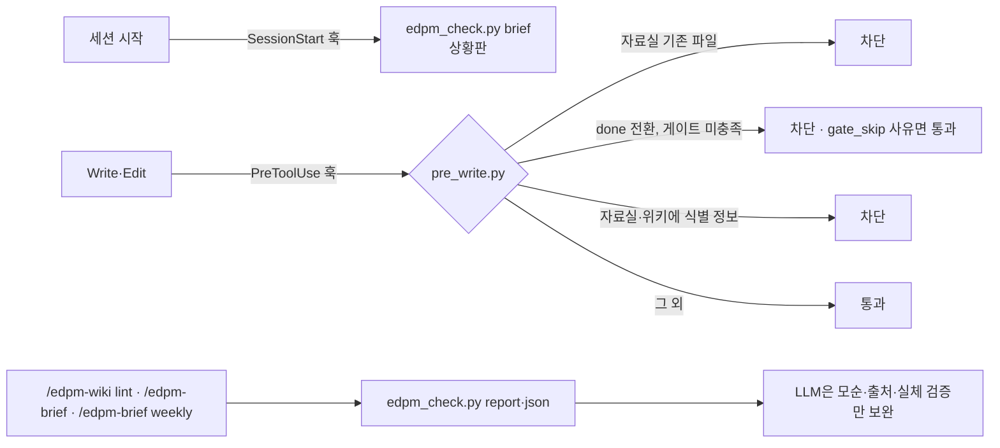

# 하네스와 점검: 규칙을 문장이 아니라 장치로

프레임워크의 규칙(게이트, 자료실 보호, 개인정보, 수치는 스크립트로)은 에이전트가 문서를 읽고 지켜 주기를 기대하는 것만으로는 부족합니다. 대화가 길어지거나 서두르면 빠집니다. 그래서 워크스페이스에는 **결정적 점검기**와 **훅**이 들어 있습니다.

## 1. 구성

| 파일 | 역할 |
|------|------|
| `automation/scripts/edpm_check.py` | frontmatter·CSV·링크를 읽어 판정. `brief`(요약), `report`(상세), `json`, `gate <문서>`(done 가능?), `pii <파일>`, `next`(쓸 수 있는 산출물) |
| `automation/hooks/pre_write.py` | PreToolUse 훅. 세 가지 차단 규칙 |
| `.claude/settings.json` | 훅 등록, 권한(묻지 않을 것 / 확인할 것) |
| `automation/scripts/metrics.py` + `automation/sql/` | 수치 계산. LLM이 숫자를 지어내지 않게 |
| `automation/scripts/wbs_sync.py` | 일정 동기화 (가이드 12) |
| 프레임워크 `tests/` | 위 스크립트의 회귀 테스트 (`python3 -m unittest discover -s tests`) |

## 2. 점검기가 보는 것

| 영역 | 판정 | 근거 |
|------|------|------|
| 단계 | 지금 단계와 다음 할 일: 0 시작 → 1 PRD → 2 착수·근거 → 3 상세 요구사항 → 4 스펙 → 5 프로토타입·구현(개발 체계별) → 6 출시 준비 (`phase`) | E00·PRD·M01·N01·F00·E06·E09·E15·E18 상태, AGENTS.md 업무 모드·개발 체계 |
| 명확도 (G-CLEAR) | PRD·F01의 차원별 명확도와 모호도(`clarity`), PRD review 전환 차단(훅), F01 done 차단 | PRD·F01 표 |
| 숨긴 평가셋·테스트 고정 | holdout 평가셋 열람 차단(Read·Grep·Bash 훅, `.ignore`), `ai_eval.py --holdout` 점수만, 커밋된 `tests/` 수정 차단과 `.edpm/test-unlock` 해제 기록(상황판 표시) | 파일 이름, git HEAD |
| 아직 모르는 것 | V03·F04·E20에서 넘긴 곳이 빈 항목을 상황판에 표시 | 각 문서 "아직 모르는 것" 표 |
| 생성 게이트 | A가 끝나야 B: 전제조건(+G-PRD)이 끝나기 전 산출물 본문 쓰기 차단(`start`), frontmatter만 수정·n/a·`gate_skip`·`early_draft` 사유는 통과. 워크스페이스에 없는 전제(보관함에 있는 문서)는 "이번 경로에 없음"으로 보고 막지 않음 — 명시적 게이트(G-LEARN·G-EVIDENCE 등)가 요구하는 문서만 없으면 막음. 진행표 한 장(`progress`), 보관함 목록(`library`)·꺼내기(`add`) | 각 문서 frontmatter `requires`·`status`, `.edpm/library/` |
| 흐름 게이트 | G-PRD(PRD review 이상 전에는 다른 산출물 완료 불가), G-SPEC(E09 done 전 `src/` 코드 차단, 개발팀 체계면 PM 코드 차단 — `code-gate`) | PRD.md·E09 frontmatter |
| 산출물 | status 값 형식, done인데 updated 없음, 전제조건(`requires`)·게이트(G-LEARN·G-SAFE·G-AI·G-EVIDENCE·G-POLICY·G-STAGE·G-IMPACT·G-PROTO) 미충족인데 done, `gate_skip` 목록, 지금 쓸 수 있는 산출물 | frontmatter |
| 위키 | 끊긴 `[[링크]]` (예시·자리표시자 제외), `verified` 180일 초과 | 파일 존재, 날짜 |
| 개인정보 | 자료실·위키의 휴대전화·주민등록번호·이메일 패턴 (`example.com`, `{…}` 제외) | 정규식 |
| 일정 | 종료일 지난 WP, 7일 내 마감, 도구 미연결 WP | `M02_WBS.csv` |
| 프로토타입 | timebox 지난 계획·진행, 결정 비어 있는 완료 | `프로토타입목록.csv` |
| 결정 | `review_date`가 지났는데 `outcome` 없음 | ADR frontmatter |
| 회의 | `ingest: pending` 회의록 | 회의록 frontmatter |

못 보는 것: 시즌 충돌(G-CAL), 같은 SQL로 측정했는지(G-MEASURE), 교육과정 매핑(G-CURRIC), 모순·출처 없는 주장·실체 검증. 이것은 `/edpm-wiki lint`가 LLM으로 봅니다.

## 3. 게이트 차단과 우회

문서를 `status: done`으로 바꾸는 저장이 게이트에 걸리면 훅이 사유를 돌려줍니다. 두 가지 길이 있습니다.

1. 전제 산출물을 먼저 완료한다 (권장).
2. 사용자가 명시적으로 허용하면 frontmatter에 `gate_skip: [사유]`를 적고 저장한다. 스킵은 상황판과 린트에 계속 표시됩니다.

규칙이 너무 엄격하면 사람이 우회하므로, 차단은 "사유를 남기면 통과"로 설계했습니다. 어떤 게이트가 자주 스킵되는지가 프레임워크를 고칠 신호입니다.

## 4. 권한

| 묻지 않음 | 확인 |
|-----------|------|
| 점검기, 지표 계산, WBS 상태·내보내기·pull, 비용 계산, 교육과정 조회, `git log·status·diff`, `grep` | WBS push·setup, `gh issue`·`gh project`, 클라우드 AI 평가(비용), Aside 실행(브라우저), `git push` |

회사 정책에 맞게 `.claude/settings.json`을 고칩니다. 팀 공용 규칙은 이 파일, 개인 취향은 `settings.local.json`.

## 5. 끄기·조정

| 상황 | 방법 |
|------|------|
| 훅이 오작동 | 훅은 자체 오류 시 통과합니다. 재현되면 `python3 automation/hooks/pre_write.py < 입력.json`으로 확인 |
| 특정 규칙만 끄기 | `pre_write.py`의 해당 블록 주석 처리 (팀 합의 후, CHANGELOG에 기록) |
| 게이트 규칙 바꾸기 | `edpm_check.py`의 `GATES` 표. AGENTS.md 6절과 같이 유지 |
| 개인정보 패턴 추가 | `edpm_check.py`의 `PII` (예: 학번 형식) |

## 6. 프레임워크 개발자용

스크립트를 고치면 프레임워크 루트에서 `python3 -m unittest discover -s tests -v`를 실행합니다. 테스트는 템플릿 워크스페이스를 임시 폴더에 복사해 점검기·훅·WBS 동기화(가짜 `gh`)·지표 계산을 실제로 돌립니다.
