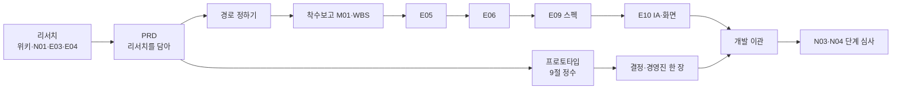

# Agent Driven EdPM A to Z 사용 가이드

PM이 실제로 걷는 두 여정을 처음부터 끝까지 따라가는 가이드입니다. 하나는 **신사업을 착수해 리서치 → PRD → 화면·IA·스펙 → 프로토타입 또는 개발 이관**까지 가는 길, 다른 하나는 **운영 중 서비스의 특정 기능을 조사하고 프로토타입으로 제안한 뒤 스펙으로 개발에 넘기는** 길입니다. 무엇을 입력하면 무엇이 생기고, 에이전트가 무엇을 대신 챙기며, 막히면 어떻게 하는지만 적었습니다.

| 먼저 읽을 것 | 내용 |
|--------------|------|
| [README](../README.md) | 무엇을 하는 프레임워크인지, 한 사이클, 스킬 목록 |
| [00.시작하기](00.시작하기.md) | 설치·작업 환경(Antigravity + Claude Code 확장)·문제 해결. 이 문서는 설치를 다루지 않습니다 |
| 워크스페이스 `AGENTS.md` 5절 | 스킬별 하위 명령 전체 표 ([원본](../workspace-template/AGENTS.md)) |

예시는 가상 회사 **에듀랩**의 PM입니다. 여정 1은 유아 영어 신사업 **리딩버디**, 여정 2는 운영 중인 중학 수학 앱 **매스핏**의 오답 해설 기능 고도화입니다. 둘 다 개발팀이 있는 회사(`--dev team`)로 가정하고, 개발자 없이 직접 만드는 경우(바이브코딩)는 따로 적습니다. 모든 수치는 가상입니다.

## 목차

0. [이 프레임워크의 요점](#0-이-프레임워크의-요점)
1. [1일차 공통](#1-1일차-공통)
2. [여정 1: 신사업 — 착수에서 개발 이관·단계 심사까지](#2-여정-1-신사업--착수에서-개발-이관단계-심사까지)
3. [여정 2: 기능 고도화 — 조사·프로토타입·제안·스펙 이관](#3-여정-2-기능-고도화--조사프로토타입제안스펙-이관)
4. [매일·매주 루틴](#4-매일매주-루틴)
5. [막혔을 때](#5-막혔을-때)
6. [마무리: 채점·회고·Brain·인수인계·업그레이드](#6-마무리-채점회고brain인수인계업그레이드)
7. [체크리스트](#7-체크리스트)

---

## 0. 이 프레임워크의 요점

- **PM은 판단합니다.** 무엇을 왜 만들지, 어떤 근거를 믿을지, 무엇을 하지 않을지. 정리·초안·계산·추적은 에이전트가 합니다.
- **같은 근거에서 모든 것이 파생됩니다.** 리서치와 자료는 위키(`02.wiki/`)에 쌓이고, PRD가 그것을 담습니다. IA·스펙·프로토타입·착수보고·주간보고는 모두 PRD와 같은 위키에서 나오므로 서로 말이 어긋나지 않습니다.
- **놓친 것은 장치가 잡습니다.** 기억에 기대지 않고 아래가 알려 줍니다.

| 장치 | 무엇을 잡나 | 어떻게 보나 |
|------|-------------|-------------|
| 위키 점검 | 페이지끼리의 모순(같은 경쟁사 가격·법 조항·지표 정의가 다름), 출처 없는 주장, 180일 넘은 규제·가격 페이지, 끊긴 링크, 식별 정보 | `/edpm-wiki lint` |
| 남은 표시 | 근거 없이 쓴 `[가정]`, 확인하지 않은 `[확인 필요]` | 산출물 본문, `edpm_check.py portfolio`의 `open_marks` 개수 |
| 게이트 차단 | 전제 없이 쓰는 문서, 안전·AI·증거 없이 출시, 스펙 전 제품 코드 | 저장할 때 훅이 사유와 함께 막음 |
| 상황판 주의 | 재검토일 지난 결정, 위키에 반영 안 된 회의록, 종료일 지난·7일 내 마감 WP, timebox 지난·결정 안 한 프로토타입, 검토 대기 문서, 게이트 스킵 | 세션 시작 때 자동, `/edpm-brief` |
| 회의록 | 회의에서 나온 결정·액션·새 사실이 흩어지는 것 | `/edpm-brief meeting notes` → 되돌리기 어려운 결정은 ADR, 액션 목록, `meeting ingest`로 위키 반영 |

---

## 1. 1일차 공통

### 1.1 첫 세션과 상황판

권장 환경은 Antigravity에서 워크스페이스 폴더를 열고 **Claude Code 확장 패널**에서 일하는 것입니다(설정은 [00.시작하기](00.시작하기.md) 2절). 터미널이면 `cd ~/Work/에듀랩-edpm && claude`. 스킬·상황판·훅은 Claude Code에서만 동작하므로, 에디터에 내장된 다른 에이전트로 작업하지 않습니다.

세션이 열리면 상황판이 뜹니다. 첫날에는 이렇게 보입니다.

```text
# EdPM 상황판 2026-11-03

## 처음 오셨군요
이 워크스페이스는 PRD에서 출발해 요구사항 → 스펙 → 프로토타입·구현으로 갑니다. 세 단계로 시작합니다.
1. `/edpm-start` — 무엇을 하려는지(신사업 / 운영 중 서비스 개선 / 기존 기획서 있음) 묻고 길을 안내합니다
2. `/edpm-start init` — 회사·제품 인터뷰 (20~30분)
3. `/edpm-prd` — 만들 제품 전체를 PRD로 정의

## 지금 단계: 0 시작
회사·제품 프로필(E00)이 아직 없습니다
```

상황판의 **"지금 단계"** 가 길잡이입니다: `0 시작 → 1 PRD(리서치 포함) → 1.5 경로 정하기 → 2 착수·근거 → 3 상세 요구사항 → 4 스펙 → 5 프로토타입·이관(또는 구현) → 6 출시 준비`. 언제든 "지금 뭐 해야 해?"라고 묻거나 `/edpm-brief progress`(진행표 한 장)를 봅니다. 처음이면 `/edpm-start`만 입력해도 하려는 일을 묻고 순서대로 이어 줍니다.

설치 직후 `03.docs/`에는 핵심 경로 문서만 있습니다: E00, E05, E06, E09, `V.프로토타입/`, `M.관리/M02_WBS.csv`, 그리고 모드 문서(N이면 N01·N03·N04, F면 F00·개선백로그·과제 템플릿). 나머지는 보관함 `.edpm/library/`에 있고 `/edpm-doc <ID>`로 꺼냅니다(목록 `/edpm-doc list`).

### 1.2 회사·제품 프로필 — `/edpm-start init`

에이전트가 3~4개씩 묻습니다. 모르면 "모름"이라고 하면 `[확인 필요]`로 남기고 넘어갑니다.

| 질문 | 에듀랩 PM의 답 |
|------|----------------|
| 회사·제품 | 에듀랩 / 매스핏(중학 수학 문제풀이·오답 해설 앱), 신사업 리딩버디 |
| 학습자 | 중1~3 (미성년), 리딩버디는 만 5~9세 |
| 사용자·구매자·결제자 | 학생 / 학원(B2B2C)·학부모 / 학원·학부모 카드 |
| AI 기능 | 매스핏 오답 해설 AI, 리딩버디는 음성 피드백 계획 |
| 일정 관리 도구 | GitHub 비공개 저장소 |
| 기밀 규칙 | 학생 데이터 외부 AI 전송 금지 |

**생기는 것**: E00 회사·사업 프로필, `AGENTS.md` 2절 변경안(사람이 승인해 반영), `02.wiki/company/회사개요.md`. E00을 읽고 "E00 완료 처리해줘"라고 하면 단계가 "1 PRD"로 넘어갑니다.

### 1.3 연결해 두면 좋은 것 (짧게)

| 무엇 | 명령 | 첫날 정할 것 |
|------|------|--------------|
| 회사 문서 양식 | `/edpm-template import <양식 파일>` → `map` | 방식 A(회사 양식 구조로 작성) / B(EdPM으로 쓰고 회사 양식으로 옮겨 냄). 어느 쪽이든 frontmatter와 게이트 항목은 남김 |
| 지표 데이터 | `/edpm-metrics connect` | 분석 DB(`DATABASE_URL` 환경변수) / 집계 CSV → sqlite / 없으면 가상 데이터로 지표 정의부터 |
| 일정 도구 | `/edpm-wbs setup` | GitHub 비공개 저장소. 시트·Notion·Jira·Linear는 `/edpm-wbs export` ([12](12.일정관리도구연동.md)) |
| 교육과정 (해당 시) | `/edpm-curriculum setup` | 국가 교육과정 기반이면 지식그래프 ([07](07.교육과정지식그래프활용.md)) |

> 학생 실명·연락처가 든 원본은 `00.inbox/`에 넣지 마세요. 남은 전화번호·이메일은 훅이 위키·자료실 저장을 막습니다(G-PII).

---

## 2. 여정 1: 신사업 — 착수에서 개발 이관·단계 심사까지

리딩버디: "만 5~9세 아이가 소리 내어 영어책을 읽으면 AI가 단어별로 피드백한다." 설치는 `--mode N --dev team`. 경영진은 6개월 뒤 확장 여부를 판단하고 싶어 합니다.



### 2.1 리서치가 먼저 — 위키, N01, 필요하면 E03·E04

상황판의 "1 PRD" 단계는 PRD보다 먼저 리서치를 제안합니다. 리서치 문서(N01, E01~E04, D01)는 PRD의 입력이라 PRD 전에 쓰고 완료할 수 있습니다.

| 할 일 | 명령 | 생기는 것 |
|-------|------|-----------|
| 보호자 인터뷰·교사 자문·회사 자료 넣기 | `00.inbox/`에 넣고 `/edpm-wiki ingest` | 가명 처리된 `01.자료실/` 원본, 위키 페이지 갱신, 핵심 발견과 서로 충돌하는 내용 보고 |
| 공개 자료 수집 | `/edpm-wiki collect R01`(앱스토어 리뷰), `R02`(경쟁사 가격·커리큘럼), `R08`(공개 커뮤니티 VOC) | `00.inbox/`에 수집본 → ingest. Aside가 없으면 수동 안내 |
| 근거 확인 | `/edpm-wiki query 유아 영어 읽기 앱 경쟁사 가격대와 근거` | 출처가 달린 답 |
| 사업기회 | `/edpm-doc venture opportunity` | N01: 기회 가설, 고객·문제, 시장·경쟁, why us·why now, **핵심 가설 HY-ID와 중단 기준** |
| 현장 리서치 종합 (인터뷰가 많으면) | `/edpm-doc E03` | 보관함에서 꺼내 인터뷰를 페르소나·과업·문제로. 원본 3건 이상 필요 |
| 시장·정책 (규제·경쟁이 중요하면) | `/edpm-doc E04` | 시장 규모 근거, 아동 대상 서비스 규제, 경쟁 구도 |

근거가 부족하면 에이전트가 먼저 말합니다: "E03을 쓰려면 현장 원본이 3건 이상 필요한데 현재 1건입니다." 그래도 진행하면 근거 없는 문장에 `[가정]`이 붙고, 이 표시는 나중에 점검과 포트폴리오에서 개수로 드러납니다.

### 2.2 PRD — 리서치를 담아 `/edpm-prd`

```text
/edpm-prd
```

에이전트는 N01·E03·E04와 위키를 먼저 읽고, 이미 아는 것은 묻지 않습니다. 리서치 결과는 PRD 1·2절(문제·근거)에 출처와 함께 들어갑니다. 루트 `PRD.md`에는 **만들 제품 전체**를 적습니다: 목표·성공 지표, 사용자, 기능 묶음 전부(Must/Should/Could), 비기능(아동 안전·라이선스·의존 플랫폼 정책), 릴리스 계획(8절), **프로토타입으로 먼저 보여줄 정수**(9절), 개발 체계(10절). "MVP니까"라며 줄여 쓰지 않고, 언제 무엇을 내놓을지는 8절에서 나눕니다.

리딩버디 PM은 9절 정수에 "아이가 피드백을 보고 다시 읽기를 시도하는가(HY-03)"를 적었습니다.

**핵심 개념을 정확히 (5.1절).** 인터뷰는 기능보다 개념을 먼저 묻습니다. "리딩 완료"는 책 끝까지 넘긴 것인가, 소리 내어 끝까지 읽은 것인가? "정확히 읽은 단어"는 누가 판정하나? 리딩버디 PM은 `완료 = 마지막 페이지까지 녹음 제출`, `정확 단어 = 음성 인식 일치 + 교사 이의 반영` 같은 정의 3개를 적었고, 이 정의가 E09 입출력 계약과 지표 SQL로 그대로 이어집니다.

**명확도 확인 (G-CLEAR).** review로 올리기 전에 상황판이 모호도를 보여줍니다.

```text
python3 automation/scripts/edpm_check.py clarity
PRD 모호도 0.42 (통과 기준 0.3 이하) — 미달 (G-CLEAR)
| 성공 기준 | 0.2 | 0.5 | 4절 지표·목표·측정 방법 (북극성 필수) |
| 핵심 개념 | 0.15 | 0.33 | 5.1절 계산 가능한 개념 정의 3개 이상 |
```

모호도가 0.3을 넘으면 훅이 `status: review` 저장을 막습니다. 흐린 채 스펙·프로토타입으로 가면 엉뚱한 것을 만들기 때문입니다. `/edpm-prd review`가 흐린 차원마다 "무엇을 물어야 선명해지는지"를 제안하고, 리서치·인터뷰로 채우면 통과합니다. 검토 후 `status: review`로 올리면 G-PRD가 풀려 다른 산출물을 완료할 수 있습니다. 기획서·RFP가 이미 있으면 `/edpm-prd import 00.inbox/<파일>`.

### 2.3 경로 정하기 — `/edpm-prd path`

PRD 하나로는 업무가 안 됩니다. 그렇다고 문서를 다 꺼내면 느려집니다. 에이전트가 PRD의 어느 절이 근거인지와 함께 후보를 보여주고 PM이 고릅니다.

| PRD 근거 | 후보 | 리딩버디 PM의 선택 |
|----------|------|--------------------|
| 3절: 만 5~9세 | E13 안전·개인정보·접근성 | 꺼냄 (G-SAFE) |
| 5절: 음성 AI 피드백 | E14 AI 학습 기능, A10 방식 선택, A14 가드레일, A06 평가 | 꺼냄 (G-AI) |
| 경영진 보고 체계 | M01 착수보고, M02 WBS 계획, M03 위험·이슈 | 꺼냄 |
| 화면이 많고 개발팀에 넘김 | E10 화면·IA | 꺼냄 |
| 개발팀 연동이 많음 | B01 시스템 구조 (+ 회사 개발 표준이 없으면 B02·B03) | B01만 꺼냄. API·DB는 개발팀 표준이 있음 |
| 8절: 구독 결제 | P01 이용·환불 | 꺼냄 (G-POLICY) |
| 학습 효과를 주장하며 출시 | E16 검증 계획, E17 파일럿 결과 | **지금은 안 꺼냄.** 파일럿을 설계할 때 꺼냄 |
| 국가 교육과정 연계 | E11 | 해당 없음 (유아 영어) |

고른 것만 꺼내지고 PRD frontmatter에 `path:`가 기록됩니다. 안 꺼낸 문서는 나중에 `/edpm-doc <ID>`로 언제든 꺼냅니다. 서비스 유형을 정해 두고 싶으면 이때 `/edpm-start blueprint detect`(선택).

### 2.4 착수보고와 WBS — 알아서 만들어 두기

```text
/edpm-brief report M01      # 착수보고: PRD의 목표·범위·릴리스, 마일스톤, 위험
/edpm-wbs create            # PRD 8절 릴리스 → 작업 패키지, 학사일정·게이트 반영, 간트
/edpm-wbs push              # GitHub 이슈·마일스톤·라벨 (dry-run을 보여주고 승인 후)
```

계획은 `M02_WBS.csv`, 진행은 GitHub입니다. 팀원이 이슈를 닫거나 `상태:지연` 라벨을 붙이면 금요일 주간보고가 가져옵니다. 경영진용은 `--format docx·pdf·pptx`로 냅니다.

### 2.5 E05 → E06 → E09 — 학습 성과에서 스펙까지

| 문서 | 명령 | 리딩버디에서 |
|------|------|--------------|
| E05 학습 성과 | `/edpm-doc E05` | LO-01 "그림책 한 쪽을 소리 내어 읽고 틀린 단어를 다시 읽는다". 학습 목표마다 평가 증거. 꺼낸 E03·E04가 있으면 그것들이 먼저 끝나야 씀 |
| E06 상세 요구사항 | `/edpm-doc E06` | PRD 5·7절을 REQ와 인수조건으로. E13·E14가 있으면 "아동 음성 원본은 30일 후 삭제" 같은 안전·AI 요구도 REQ로 |
| E09 스펙 | `/edpm-spec write` | 기능마다 **유저스토리 → 인수조건 → 상태 흐름**, 교육 현장 예외, 입출력 계약, 작업(T)·테스트 |

E09의 기능 블록은 이렇게 생깁니다(템플릿 예시 F-012와 같은 형식).

| 단계 | 예 |
|------|----|
| 유저스토리 | "학습자로서 혼자 읽기를 이어 가기 위해, 틀린 단어만 짚어 주는 피드백을 받고 싶다" |
| 인수조건 | Given 음성 인식이 실패하거나 3초를 넘는다 / When 피드백을 요청한다 / Then "다시 한 번 읽어 볼까?" 정적 안내로 대체되고 오류가 기록된다 |
| 상태 흐름 | `stateDiagram-v2`: 읽기중 → 인식대기 → (통과) 단어피드백 / (실패·초과·가드레일 차단) 정적안내 → 다시읽기 → 완료. 빈 상태·오프라인·보호자 이관까지 |

AI가 관여하는 상태는 E14 **2.1 AI 응답 흐름**(거절·대체·이관)과 같은 이름을 씁니다. `/edpm-spec check`가 `PRD 5절 → REQ → F → US → AC → T → 테스트`에서 끊긴 곳을 표로 보여줍니다. E09가 `done`이 되기 전에는 제품 코드를 쓸 수 없고(G-SPEC), E05가 없으면 E09를 완료할 수 없습니다(G-LEARN).

AI 설계는 같은 시기에 채웁니다: `/edpm-ai method`(A10: 규칙 → 검색 → RAG → 로컬 → 클라우드 중 가장 단순한 것) → `guardrail`(A14) → `goldenset` → `/edpm-ai eval run goldenset`(A06). 출시 판단에는 교과 전문가가 따로 만든 **holdout 세트**(파일 이름에 holdout) 점수를 함께 봅니다. 에이전트는 이 세트를 열 수 없고 `ai_eval.py --holdout`으로 점수만 받습니다 — 보이는 문항에 맞춰 프롬프트를 고쳐 점수만 오르는 것을 막습니다. 근거는 [10.AI방식선택](10.AI방식선택.md).

### 2.6 E10 화면·IA — 개발과 디자인이 읽는 구조

```text
/edpm-doc E10
```

E09가 끝나면 역할별 IA(아이·보호자·교사), 화면 목록(SCR-ID), 화면별 상태를 정리합니다. 와이어프레임이 필요하면 `sb-lowfi-pptx`로 low-fi 와이어프레임 HTML·편집 가능한 PPTX를, Figma 화면설계서가 필요하면 `sb-lowfi-figma`를 씁니다. 스펙의 SCR-ID와 E10의 화면이 같은 번호로 이어집니다.

### 2.7 갈림길: 먼저 보여줄 것인가, 바로 넘길 것인가

둘 중 하나만 고르는 것이 아니라 무엇을 먼저 할지의 문제입니다. 상황판은 PRD가 `review`가 된 뒤부터 스펙과 나란히 `/edpm-proto new`를 제안합니다.

**(a) PRD 9절의 정수를 프로토타입으로 먼저 보여주기**

| 단계 | 명령 | 생기는 것 |
|------|------|-----------|
| V01 계획 | `/edpm-proto new 음성피드백` | 검증 질문, 가장 위험한 가정, 충실도(P0 종이 ~ P4 코드 MVP), **성공·중단 기준**, timebox, 보호자 동의서 초안 |
| V02 빌드 | `/edpm-proto build` | `06.prototypes/PT-01_음성피드백/`. 여기서는 P1 클릭 + P2 오즈의 마법사(교사가 녹음을 듣고 손으로 피드백) |
| 테스트 | `/edpm-proto test` | 진행자 스크립트, 관찰지, 사후 설문. 10가구 2주 |
| V03 결정 | `/edpm-proto decide` | 기준 대비 판정 → 폐기 / 재검증 / MVP 확장 / 개발 이관. 답하지 못한 것은 "아직 모르는 것"에 적고 PRD 12절·다음 가설로 넘김 (넘기지 않으면 상황판이 계속 표시) |
| 경영진 한 장 | `/edpm-handoff exec PT-01` | 결론과 결정 요청, 근거 수치 3개 이내, 선택지, 위험, 예측 |
| 결정 | `/edpm-decide new 리딩버디 검증단계 진행` | 선택지·이유·**예측**("6개월 뒤 주 3회 읽기 가구 50% 이상")·재검토일. 되돌리기 어려우면 `premortem` |

프로토타입은 축소판 PRD가 아니라 컨셉 합의용입니다. 결과를 본 뒤 기준을 바꾸려면 ADR이 필요하고, P3·P4 빌드는 V01 기준과 timebox가 확정돼야 시작됩니다(G-PROTO). 결과는 PRD(`/edpm-prd update`)와 스펙에 반영합니다. 충실도 고르는 법과 테스트 요령은 [11.프로토타입과MVP](11.프로토타입과MVP.md).

**(b) 개발 이관**

```text
/edpm-spec tasks                          # E09 작업을 WBS에
/edpm-handoff dev E09 --format issues     # 스토리·인수조건·상태·엣지 케이스·측정 이벤트를 GitHub 이슈로
/edpm-handoff design E10                  # 디자이너: 문제·사용자·제약·화면 상태·연령별 규칙
```

개발팀은 프로토타입이 아니라 E09·E10을 기준으로 만듭니다. 직군별 전달 요령은 [15.협업가이드](15.협업가이드.md).

### 2.8 매주 돌아가는 것

| 언제 | 명령 | 에이전트가 하는 일 |
|------|------|-------------------|
| 회의 전 | `/edpm-brief meeting prep 투자심의 사전 미팅` | 목적·결정할 것·관련 수치(스크립트 결과만) 한 장 |
| 회의 후 | `/edpm-brief meeting notes` | 메모 → 결정·액션·근거 분리, 되돌리기 어려운 결정은 ADR 제안, 위키 반영 대기로 표시 |
| 금요일 | `/edpm-brief weekly` | GitHub 진척 pull, 산출물 상태 변화, 결정, 다가오는 일정으로 주간보고 초안 |
| 위험이 생기면 | `/edpm-brief report M03`, `/edpm-wbs impact 교사 파일럿 2주 지연` | 위험·이슈 갱신, 영향받는 작업과 대안 |

### 2.9 MVP와 단계 심사 — N03·N04

| 단계 | 명령 | 핵심 |
|------|------|------|
| 투자심의 (회사가 요구할 때) | `/edpm-doc venture case` | N02는 보관함에서 꺼냄. 시장 규모·손익 시나리오는 스크립트로 재현 |
| MVP·PMF 계획 | `/edpm-doc venture mvp` | N03: MVP 범위와 **하지 않을 것**, 가설별 실험, 학습 효과 신호. 미성년이면 E13은 MVP에서도 필수 |
| 코드 MVP·파일럿 | `/edpm-proto new 리딩MVP`(P4), `/edpm-doc E16`·`E17` | 프로토타입 코드는 `06.prototypes/` 안에서만. 파일럿은 E16 → 실행 → E17 |
| 단계 심사 | `/edpm-doc venture gate` | N04: 기준 대비 증거로 확장·전환·중단. 수치는 `/edpm-metrics run`·`effect` |
| 예측 채점 | `/edpm-decide review ADR-xxx` | 투자심의 때 적은 예측의 적중·빗나감 |

**"확장 진행" 전에는 정식 출시 E18 완료가 막힙니다(G-STAGE).** 확장하면 출시 문서 E15·E18을 꺼내고 2.10의 게이트를 통과합니다. 중단도 성과로 기록하고 회고(E20)와 Brain 승격으로 남깁니다. 마지막으로 `/edpm-portfolio new 리딩버디 검증단계`로 한 장 정리합니다(6장).

### 2.10 출시 게이트 (확장 진행 후)

| 게이트 | 무엇이 필요한가 |
|--------|------------------|
| G-SAFE | 미성년이면 E13 "출시 차단" 0건 (E15) |
| G-AI | E14·A10·A14 done, A06 합격, 유료·대량 사용이면 A12 (E15) |
| G-PROTO | 프로토타입 코드는 V03 이관과 구현(B 트랙) 검토 없이 E15에 포함 불가 |
| G-CAL | 학사일정·시즌 충돌 검토 (E15·E18) |
| G-POLICY | 유료 판매면 P01 done (E18) |
| G-EVIDENCE | 실제 파일럿 결과 E17 (E18) |

경로에서 꺼내지 않은 문서라도 **명시적 게이트가 요구하면 막습니다.** 메시지에 나온 ID를 `/edpm-doc <ID>`로 꺼내 채웁니다. 전체 표는 [02.산출물체인과게이트](02.산출물체인과게이트.md).

### 2.11 여정 1 한눈에

| 단계 | 명령 | 생기는 것 | 에이전트가 대신 챙기는 것 |
|------|------|-----------|---------------------------|
| 리서치 | `/edpm-wiki ingest`·`collect`·`query`, `/edpm-doc venture opportunity`, `/edpm-doc E03`·`E04` | 위키, N01, E03·E04 | 가명 처리, 출처, 자료 간 충돌, 근거 부족 경고 |
| PRD | `/edpm-prd` | `PRD.md` (제품 전체, 9절 정수) | 리서치를 1·2절에 출처와 함께, `[가정]`·`[확인 필요]` 표시 |
| 경로 | `/edpm-prd path` | 꺼낸 문서, `path:` | PRD 근거로 필요한 문서만 제안 |
| 착수 | `/edpm-brief report M01`, `/edpm-wbs create`·`push` | M01, WBS, GitHub 이슈 | 학사일정·게이트를 일정에 반영 |
| 요구사항·스펙 | `/edpm-doc E05`·`E06`, `/edpm-spec write`·`check` | E05, E06, E09 | 추적 끊김, G-LEARN·G-SPEC |
| IA·화면 | `/edpm-doc E10`, `sb-lowfi-pptx` | E10, 와이어프레임 | SCR-ID를 스펙과 맞춤 |
| 프로토타입·결정 | `/edpm-proto`, `/edpm-handoff exec`, `/edpm-decide new` | V01~V03, 경영진 한 장, ADR | 기준 선확정(G-PROTO), 결정 안 한 프로토타입 알림 |
| 이관 | `/edpm-spec tasks`, `/edpm-handoff dev`·`design` | 이슈, 디자인 브리프 | 인수조건·상태·엣지 케이스를 이슈 본문에 |
| 매주 | `/edpm-brief weekly`·`meeting` | 주간보고, 회의록, ADR | 반영 안 된 회의록, 지연 WP, 재검토일 |
| 단계 심사 | `/edpm-doc venture mvp`·`gate`, `/edpm-metrics` | N03, N04 | G-STAGE, 수치는 스크립트로 |

---

## 3. 여정 2: 기능 고도화 — 조사·프로토타입·제안·스펙 이관

매스핏의 오답 해설은 지금 정답과 풀이를 바로 보여줍니다. 강사들은 "애들이 해설만 읽고 넘어간다"고 하고, PM은 이 기능을 **힌트 사다리**(정답 대신 오류 위치 → 단계 힌트 → 마지막에 정답)로 고도화하는 과제를 맡았습니다. 설치는 `--mode F --dev team`.

운영 중 서비스에서는 서비스 전체를 PRD가, 현재 상태를 F00이 정의하고, 과제마다 F01~F04를 씁니다. **F02가 기능 단위 스펙**이라 과제 하나에 E05→E06→E09를 다시 돌지 않습니다. (F 템플릿의 예시는 가상 대학 LMS "캠퍼스온"의 마감 연장 과제입니다.)


### 3.1 현황과 기준선 — F00

```text
/edpm-doc feature baseline
/edpm-metrics run 오답후재시도율 --param from=2026-09-01 --param to=2026-10-31
```

F00에는 사용자·이해관계자, **기준선 지표**(SQL 경로·날짜), 기능 지도, 알려진 문제, 기술 제약, **깨지면 안 되는 기준**(환불 P01, 진도·수료 L03, 개인정보 E13, AI 평가 A06이 어디 있는지)이 들어갑니다. F00은 PRD보다 먼저 써도 되고, 운영 중 서비스의 PRD가 아직 없다면 F00을 근거로 `/edpm-prd`가 현재 서비스 전체를 정의합니다. F00이 대체하는 E01~E07은 `n/a`로 바꿀지 묻습니다.

### 3.2 요청 접수와 우선순위

```text
/edpm-doc feature intake        # CS·VOC·회의록·강사 요청 → 개선백로그.csv
/edpm-doc feature prioritize    # (도달 × 가치 × 교육적 효과) ÷ (노력 × 위험)
```

요청은 "기능"이 아니라 "누가 어떤 상황에서 무엇을 못 하나"로 바뀌어 FI-ID로 들어갑니다. 같은 문제의 요청은 합쳐지고 근거 건수가 늘어납니다. 점수는 제안일 뿐이고 결정은 PM이 합니다.

### 3.3 기능 조사

| 무엇을 | 명령 |
|--------|------|
| 해설 관련 VOC·강사 요청 원문 | `00.inbox/` → `/edpm-wiki ingest` (가명 처리) |
| 지금 학생들이 해설을 어떻게 쓰나 | `/edpm-metrics run 해설열람후재시도율`, 필요한 SQL이 없으면 `/edpm-metrics sql` |
| 경쟁 앱의 힌트·해설 방식 | `/edpm-wiki collect R01`(앱 리뷰), `R02`(경쟁사 변경 감시) → ingest |
| 지금까지 알게 된 것 | `/edpm-wiki query 오답 해설에 대한 강사·학생 불만과 근거` |

### 3.4 문제 정의 — F01

```text
/edpm-doc feature new 힌트사다리
```

`03.docs/F.개선/202611_힌트사다리/`에 F01~F04가 복사되고 F01을 씁니다: 요청 원문 → 재정의한 문제("학생은 오답 직후 해설을 읽고 다시 풀지 않아 같은 유형을 또 틀린다"), 이해관계자, 근거(VOC 건수, SQL, 인터뷰), 규모, 우회 방법, 성공의 정의, 하지 않을 것. 근거가 요청 1건뿐이면 "강사 3명 통화" 같은 확인부터 제안합니다.

운영 중인 서비스를 고칠 때 가장 흔한 실수는 **지금의 규칙을 모르고 바꾸는 것**입니다. F01 6.1절에 지금 해설·정답 공개·재시도가 어떤 규칙으로 돌아가는지(F00 7절, 코드·데이터에서 확인)를 적습니다. F01은 기존 서비스 맥락(F00 완료, 지금의 규칙, 현재 우회 방법)의 가중치가 가장 큰 명확도 검사(`edpm_check.py clarity <F01 경로>`)를 통과해야 완료됩니다 (G-CLEAR).

### 3.5 직접 만들어 보여주기 — 프로토타입 P1

```text
/edpm-proto new 힌트사다리
/edpm-proto build      # 06.prototypes/_starter/click-prototype.html을 채운 클릭 프로토타입
/edpm-proto test
/edpm-proto decide
```

V01에 검증 질문("학생이 힌트 1단계에서 재도전하는가, 강사가 정답 공개를 막고 싶어 하는가")과 성공·중단 기준을 먼저 적고, 이틀 만에 클릭 프로토타입을 만들어 학생 5명(보호자 동의)과 강사 2명에게 보입니다. 참여자 ID를 넣으면 화면 이동·클릭이 기록되고, "기록 → CSV 내보내기"가 V03의 근거가 됩니다. 결과: "학생은 대부분 1단계에서 재도전, 강사는 정답 공개를 반 단위로 막고 싶다." 이것이 F02의 US·AC가 됩니다.

### 3.6 제안 — 한 장과 예측

```text
/edpm-handoff exec PT-01
/edpm-decide new 힌트 사다리 2학기 학원 반 단계 출시
```

경영진·리드에게 결론과 결정 요청, 근거 수치(SQL 결과만), 선택지(현상 유지 포함), 위험, **예측**("6주 뒤 힌트 사용 반의 재도전 후 정답률이 기준선보다 10%p 높다")을 한 장으로 냅니다. 결정이 나면 ADR에 결정자·일자·재검토일이 남습니다.

### 3.7 F02 = 기능 단위 스펙 — `/edpm-doc feature spec`

프로토타입은 합의용이고, 개발이 기준으로 삼는 것은 F02입니다. F02 완료 체크리스트에는 **"개발팀이 프로토타입 없이도 구현할 수 있다"** 가 들어 있습니다.

| F02 절 | 채우는 것 |
|--------|-----------|
| 1 목표 지표 | 기준선(SQL로 지금 계산)·목표·판정 시점, 학습 지표 하나 이상 (G-MEASURE). `/edpm-metrics baseline F02` |
| 2 US·AC | US-01 "학습자로서 막혔을 때 혼자 계속하기 위해 정답이 아니라 어디가 틀렸는지만 알고 싶다", Given/When/Then |
| 2.1 상태 흐름 | `stateDiagram-v2`: 첫오답 → 재도전 → 힌트대기 → 힌트표시 / 정적힌트(AI 실패·3초 초과) → 정답공개 또는 교사질문. 분기마다 AC |
| 3 화면 변경 | 전·후, E10 패턴, 필요하면 `sb-lowfi-pptx` 와이어프레임 |
| 4 데이터·이벤트 | 새 이벤트(예: `hint_requested`), 개인정보 등급 |
| 5 영향 점검 | 개인정보·미성년, AI, 환불, 진도, 교육과정, 접근성, 권리, CS, 시즌을 하나씩 판정 (G-IMPACT) |
| 5.1 계약·작업 | 입출력 계약(필드·타입·검증 방법), 작업 T(하루 이내, AC 하나 이상)와 테스트 |

화면 구조가 바뀌면 E10(IA)을, 제품 전체 기능 목록이 바뀌면 E09 1절을 함께 갱신하라고 알립니다. 영향 점검에서 AI 해설이 걸리면 E14·A06 재평가(`/edpm-ai eval run`)를, 학부모 알림이 걸리면 E13 갱신을 붙입니다. 과제가 서비스 범위·목표를 바꾸면 PRD도 갱신합니다(`/edpm-prd update`).

```text
/edpm-spec check 03.docs/F.개선/202611_힌트사다리/F02_기능기획서.md
```

`/edpm-spec`은 F02 경로를 받으면 US·AC·상태 흐름·계약·작업에 E09와 같은 추적 규칙을 적용합니다.

### 3.8 개발 이관 — 스펙을 넘기고, 프로토타입은 참고로

```text
/edpm-spec tasks 03.docs/F.개선/202611_힌트사다리/F02_기능기획서.md     # 작업 T를 WBS에
/edpm-handoff dev 03.docs/F.개선/202611_힌트사다리 --format issues        # 스토리·AC·상태·엣지 케이스·이벤트를 이슈로
/edpm-wbs push
```

개발팀은 F02(와 갱신된 E10)를 받습니다. 프로토타입은 "무엇을 합의했나"를 보여주는 참고 자료이고, **프로토타입 코드는 그대로 출시하지 않습니다**(G-PROTO). `/edpm-proto handoff`가 재사용 / 참고만 / 버림을 나눠 줍니다.

**바이브코딩이면**: F02가 승인(`done`)되면 G-SPEC에서 E09와 같이 취급되어 제품 코드가 열립니다. `/edpm-spec build T-01`로 인수조건을 테스트로 먼저 쓰고(`tests/`) **테스트만 먼저 커밋**합니다. 커밋된 테스트는 훅이 고정해서, 구현 중에 테스트를 구현에 맞춰 바꾸지 못합니다 (AC가 바뀌면 F02부터 고치고 `.edpm/test-unlock`에 사유). 그다음 `src/`에 구현하고, 통과하면 작업 하나에 커밋 하나. 계약과 다르게 만들어야 하면 멈추고 F02부터 고칩니다.

### 3.9 실험·출시와 효과 리뷰 — F03·F04

```text
/edpm-doc feature launch      # F03: 학원 단위 단계 출시, 가드레일(민원율·학습 지표), 기능 플래그, 안내·CS 스크립트, 시즌 확인, 롤백 기준
/edpm-doc feature review      # F04: 정한 기간 후 F02와 같은 SQL로
/edpm-metrics compare M-F12   # 기준선·목표·실제
/edpm-decide review ADR-xxx   # 제안 때 적은 예측 채점
```

F02 영향 점검 항목이 남아 있으면 F03을 완료할 수 없습니다(G-IMPACT). F04는 F02와 **같은 SQL** 결과여야 합니다(G-MEASURE). 결과로 유지·개선·롤백을 정하고, 배운 것은 위키, 다음 과제는 백로그로 갑니다. 마지막으로 `/edpm-portfolio new 매스핏 힌트 사다리`(6장).

### 3.10 여정 2 한눈에

| 단계 | 명령 | 생기는 것 | 에이전트가 대신 챙기는 것 |
|------|------|-----------|---------------------------|
| 현황·기준선 | `/edpm-doc feature baseline`, `/edpm-metrics run` | F00, 기준선 수치 | 깨지면 안 되는 기준의 위치, 수치는 스크립트로 |
| 접수·우선순위 | `/edpm-doc feature intake`·`prioritize` | 개선백로그.csv | 요청을 문제로, 중복 합치기, 근거 없는 점수에 `[가정]` |
| 기능 조사 | `/edpm-wiki ingest`·`collect`·`query`, `/edpm-metrics` | 위키, 지표 결과 | 가명 처리, 출처, 자료 간 모순 |
| 문제 정의 | `/edpm-doc feature new` | F01 | 근거가 약하면 확인 방법 제안 |
| 프로토타입 | `/edpm-proto new`·`build`·`test`·`decide` | V01~V03, 클릭 프로토타입, 기록 CSV | 기준 선확정, 보호자 동의, 결정 안 한 프로토타입 알림 |
| 제안 | `/edpm-handoff exec`, `/edpm-decide new` | 한 장, ADR | 예측·재검토일, 재검토일 지나면 상황판 |
| 기능 스펙 | `/edpm-doc feature spec`, `/edpm-spec check` | F02 (US·AC·상태 흐름·화면·계약·작업) | E10·E09 1절·E13·E14 갱신 알림, G-IMPACT·G-MEASURE |
| 이관 | `/edpm-spec tasks`, `/edpm-handoff dev`, `/edpm-wbs push` | WBS, GitHub 이슈 | 프로토타입 코드 출시 차단(G-PROTO) |
| 출시·효과 | `/edpm-doc feature launch`·`review`, `/edpm-metrics compare` | F03, F04 | 시즌 확인, 같은 SQL, 예측 채점 |

---

## 4. 매일·매주 루틴

| 언제 | 할 일 | 명령 |
|------|-------|------|
| 매일 아침 | 상황판에서 오늘 할 일 3~5개 | 세션 시작 자동, `/edpm-brief`, 다음 문서는 `/edpm-brief next` |
| 자료가 생기면 | `00.inbox/`에 넣고 반영 | `/edpm-wiki ingest` |
| 회의 전·후 | 한 장 준비 / 회의록 → 결정·액션·위키 반영 | `/edpm-brief meeting prep`, `meeting notes`, `meeting ingest` |
| 결정했을 때 | 되돌리기 어려운 결정은 예측과 재검토일 | `/edpm-decide new` |
| 숫자가 필요할 때 | 추정하지 말고 계산 | `/edpm-metrics run <지표>` |
| 월요일 | 이번 주 우선순위, 지난주 액션 | `/edpm-brief week`, `meeting actions` |
| 수요일 | 위키·산출물 점검 (5분) | `/edpm-wiki lint` |
| 금요일 | 주간보고 | `/edpm-brief weekly` |
| 보고가 필요할 때 | 착수·위험·중간·완료·경영진 요약 | `/edpm-brief report M01`·`M03`·`M04`·`M05`·`exec` (`--format docx·pdf·pptx`) |

주간보고와 보고서는 초안입니다. "무엇을 했다"보다 "무엇을 알게 됐고 무엇을 정했나"로 사람이 다듬습니다.

---

## 5. 막혔을 때

| 상황 | 뜻 | 할 일 |
|------|----|-------|
| `차단: E09 done 불가: - G-LEARN: E05 status=draft` | 게이트가 요구하는 문서가 미완료 | E05를 먼저 완료. 정당한 사유가 있으면 아래 `gate_skip` |
| 전제 전 본문 쓰기 차단 | A가 끝나야 B | 상황판의 지금 단계를 따름. 미리 초안만 쓰려면 "미리 초안만"이라고 말하면 `early_draft: [사유]`를 남기고 씀 |
| 진행표의 "이번 경로에 없는 전제" | 막는 것이 아니라 알림 | 이 제품에 필요하면 `/edpm-doc <ID>`로 꺼내고, 아니면 그대로 둠 |
| 게이트가 요구하는 문서가 워크스페이스에 없음 | 경로에서 안 꺼냈지만 명시적 게이트(G-SAFE·G-AI·G-EVIDENCE 등)는 막음 | 메시지의 ID를 `/edpm-doc <ID>`로 꺼내 채움 |
| `G-SPEC: 스펙(E09 기능명세, 운영 개선 과제는 F02)이 done이 아닙니다` | 스펙 전 제품 코드 | 스펙 승인 먼저. 검증용 코드는 `06.prototypes/`에 |
| `차단 (G-PII): 식별 정보 의심` | 위키·자료실에 연락처·실명 | 가명으로 바꿔 다시 저장 |
| `차단: 01.자료실의 기존 파일은 수정하지 않습니다` | 원본 보호 | 정정은 새 파일로 추가 |
| 숫자가 이상함 | 기간·분모 문제 | 결과 CSV와 SQL을 같이 열어 SQL을 고침. LLM에게 숫자를 고치게 하지 않음 |

게이트를 사람이 판단해 넘길 때는 이렇게 말합니다.

```text
E09는 게이트 무시하고 완료 처리해줘. 사유: 운영 중 서비스, 학습 목표는 F00 4절로 대체
```

에이전트가 frontmatter에 `gate_skip: [사유]`를 적고 저장합니다. 스킵은 상황판과 린트에 계속 보이고, 자주 스킵되는 게이트는 프레임워크를 고칠 신호입니다. 하네스 상세는 [13.하네스와점검](13.하네스와점검.md), 설치·환경 문제는 [00.시작하기](00.시작하기.md).

---

## 6. 마무리: 채점·회고·Brain·인수인계·업그레이드

| 언제 | 할 일 | 명령 |
|------|-------|------|
| 월 1회 | 재검토일 지난 결정의 예측을 SQL로 확인해 적중·빗나감 기록, 적중률 | `/edpm-decide review`, `/edpm-decide stats` |
| 사이클(학기·분기·과제 묶음) 끝 | 회고: ADR, 게이트 스킵, 빗나간 예측을 함께 봄 | `/edpm-doc E20` |
| 사이클 하나를 사례로 | 문제 정의 → 결정과 이유 → 개발이 참조한 산출물 → AI 결과 검증 → 결과 → 배운 것 | `/edpm-portfolio new <이름> --ids … --adr …` → `check` |
| 분기, 퇴사 전 | 회사 기밀·개인정보를 뺀 일반 에듀테크 지식만 개인 Brain으로 | `/edpm-wiki promote --dry-run` → `promote` |

포트폴리오는 `05.outputs/portfolio/`에만 만들어지고, 수치는 `edpm_check.py portfolio`와 지표 결과만 씁니다. 빗나간 예측과 폐기한 프로토타입도 넣습니다. 외부 공유는 사람이 정하고, 회사 계약이 우선합니다.

**인수인계**: 워크스페이스 자체가 인수인계 문서입니다. 후임자에게 비공개 저장소 접근 권한을 주고 상황판 → `/edpm-brief progress` → `PRD.md` → 최근 주간보고 3개 → `02.wiki/decisions/` 순으로 읽게 합니다. 여러 PM이 함께 쓰면 산출물 frontmatter `owner`로 문서를 나눕니다.

**업그레이드**:

```bash
cd ~/agent-driven-edpm && git pull
./install.sh --upgrade ~/Work/에듀랩-edpm   # 스킬·스크립트·훅·보관함만. 작성한 산출물·위키는 그대로
```

`AGENTS.md`는 사람이 관리하므로 [CHANGELOG](../CHANGELOG.md)를 보고 필요한 부분만 옮깁니다.

---

## 7. 체크리스트

### 첫날

- [ ] Claude Code 패널(또는 터미널)에서 세션 시작 시 상황판이 뜸
- [ ] `/edpm-start init` → E00 done, `AGENTS.md` 2절 반영
- [ ] 회사 자료 첫 묶음 ingest, `/edpm-wiki query`로 출처 달린 답 확인
- [ ] 데이터 연결 방식과 일정 도구 결정, 회사 양식이 있으면 연결

### 첫 주

- [ ] (신사업) N01, 인터뷰 3건 ingest, 필요하면 E03·E04 → PRD review → `/edpm-prd path`
- [ ] (기능 고도화) F00과 기준선 지표 2~3개를 SQL로, 백로그 정리, 과제 하나 F01
- [ ] 첫 회의록 `/edpm-brief meeting notes`, 첫 결정 `/edpm-decide new`
- [ ] 첫 `/edpm-brief weekly`

### 첫 달

- [ ] (신사업) M01·WBS, E05 → E06 → E09 done, E10, 첫 프로토타입 V03 결정
- [ ] (기능 고도화) 프로토타입 V03, 제안 한 장, F02 done(`/edpm-spec check` 끊긴 곳 0)
- [ ] 개발팀 이관(`/edpm-handoff dev`) 또는 첫 작업 구현(`/edpm-spec build`)
- [ ] WBS를 일정 도구에 올림, 주간 pull이 돎
- [ ] `/edpm-wiki lint` 주의 항목 0~2개 수준 유지, 남은 `[확인 필요]` 줄이기
