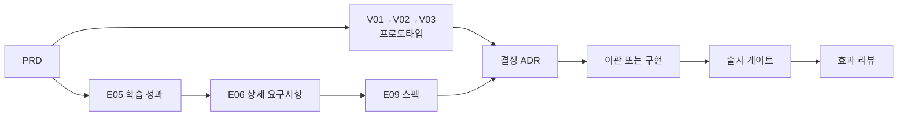

# Agent Driven EdPM A to Z 사용 가이드

PRD 한 장에서 출발해 스펙·프로토타입 → 결정 → 출시 → 효과 리뷰까지 **한 사이클을 실제 순서대로** 따라가는 가이드입니다. 무엇을 입력하면 무엇이 생기고, 어디서 막히며, 막히면 어떻게 하는지만 적었습니다.

| 먼저 읽을 것 | 내용 |
|--------------|------|
| [README](../README.md) | 무엇을 하는 프레임워크인지, 한 사이클, 스킬 목록 |
| [00.시작하기](00.시작하기.md) | 설치·옵션·외부 스킬·문제 해결 (이 문서는 설치를 다루지 않습니다) |
| 워크스페이스 `AGENTS.md` 5절 | 스킬별 하위 명령 전체 표 ([원본](../workspace-template/AGENTS.md)) |

예시는 가상 회사 **에듀랩**의 PM입니다. 운영 중인 중학 수학 앱 **매스핏**에 AI 오답 해설(힌트 사다리)을 붙이는 릴리스를 맡았고, 동시에 유아 영어 신사업 **리딩버디**를 시작합니다. 설치는 `--mode NF --dev team`으로 했습니다. 템플릿 안의 예시와 같은 회사이고, 모든 수치는 가상입니다.

## 목차

1. [1일차: 워크스페이스에서 PRD와 경로까지](#1-1일차-워크스페이스에서-prd와-경로까지)
2. [한 사이클: 요구사항 → 스펙·프로토타입 → 결정 → 출시 → 효과](#2-한-사이클-요구사항--스펙프로토타입--결정--출시--효과)
3. [시나리오 F: 운영 개선 과제 하나](#3-시나리오-f-운영-개선-과제-하나)
4. [시나리오 N: 신사업 단계 심사](#4-시나리오-n-신사업-단계-심사)
5. [매일·매주 루틴](#5-매일매주-루틴)
6. [막혔을 때](#6-막혔을-때)
7. [마무리: 채점·회고·Brain·인수인계·업그레이드](#7-마무리-채점회고brain인수인계업그레이드)
8. [체크리스트](#8-체크리스트)

---

## 1. 1일차: 워크스페이스에서 PRD와 경로까지

### 1.1 첫 세션과 상황판

Antigravity에서 `~/Work/에듀랩-edpm` 폴더를 열고 Claude Code 패널을 엽니다 (설정은 [00.시작하기](00.시작하기.md) 2절, 터미널이면 `cd ~/Work/에듀랩-edpm && claude`). 이후 생기는 문서는 왼쪽 탐색기에서 바로 열어 미리보기(`Cmd+Shift+V`)로 확인합니다.

세션이 열리면 상황판이 뜹니다 (안 보이면 `/edpm-brief`). 첫날에는 이렇게 보입니다.

```text
# EdPM 상황판 2026-11-03

## 처음 오셨군요
이 워크스페이스는 PRD에서 출발해 요구사항 → 스펙 → 프로토타입·구현으로 갑니다. 세 단계로 시작합니다.
1. `/edpm-start` — 무엇을 하려는지(신사업 / 운영 중 서비스 개선 / 기존 기획서 있음) 묻고 길을 안내합니다
2. `/edpm-start init` — 회사·제품 인터뷰 (20~30분)
3. `/edpm-prd` — 만들 제품 전체를 PRD로 정의

## 지금 단계: 0 시작
회사·제품 프로필(E00)이 아직 없습니다
```

상황판의 **"지금 단계"** 가 이 가이드의 길잡이입니다. 단계는 `0 시작 → 1 PRD → 1.5 경로 정하기 → 2 착수·근거 → 3 상세 요구사항 → 4 스펙 → 5 프로토타입·이관(또는 구현) → 6 출시 준비` 순서로 바뀝니다. 언제든 "지금 뭐 해야 해?"라고 묻거나 `/edpm-brief progress`(진행표 한 장)를 보면 됩니다.

설치 직후 `03.docs/`에는 핵심 경로 문서만 있습니다: E00, E05, E06, E09, `V.프로토타입/`(목록 CSV와 V01~V03 템플릿), `M.관리/M02_WBS.csv`, 그리고 모드 문서(N이면 N01·N03·N04, F면 F00·개선백로그·과제 템플릿). 나머지는 보관함 `.edpm/library/`에 있고 필요할 때 꺼냅니다.

> 처음이면 `/edpm-start`만 입력해도 됩니다. 하려는 일을 묻고 아래 순서로 이어 줍니다. 슬래시 명령을 몰라도 "주간보고 써줘"처럼 말하면 맞는 스킬이 돕습니다.

### 1.2 회사·제품 프로필 — `/edpm-start init`

에이전트가 3~4개씩 묻습니다. 모르면 "모름"이라고 하면 `[확인 필요]`로 남기고 넘어갑니다.

| 질문 | 에듀랩 PM의 답 |
|------|----------------|
| 회사·제품 | 에듀랩 / 매스핏(중학 수학 문제풀이·오답 해설 앱), 신사업 리딩버디 |
| 학습자 | 중1~3 (미성년), 리딩버디는 만 5~9세 |
| 사용자·구매자·결제자 | 학생 / 학원(B2B2C)·학부모 / 학원·학부모 카드 |
| AI 기능 | 오답 해설 AI, 리딩버디는 음성 피드백 계획 |
| 일정 관리 도구 | GitHub 비공개 저장소 |
| 기밀 규칙 | 학생 데이터 외부 AI 전송 금지 |

**생기는 것**: E00 회사·사업 프로필, `AGENTS.md` 2절 변경안(사람이 승인해 반영), `02.wiki/company/회사개요.md`. E00을 읽고 "E00 완료 처리해줘"라고 하면 `status: done`이 되고 단계가 "1 PRD"로 넘어갑니다.

### 1.3 PRD — `/edpm-prd` (원점)

```text
/edpm-prd                                  # 인터뷰로 작성
/edpm-prd import 00.inbox/매스핏_기획서.pdf   # 기획서·RFP가 이미 있으면
```

루트 `PRD.md`에 **만들 제품 전체**를 적습니다: 목표·성공 지표, 사용자, 기능 묶음 전부(Must/Should/Could), 비기능(아동 안전·라이선스·의존 플랫폼 정책), 릴리스 계획(8절), **프로토타입으로 먼저 보여줄 정수**(9절), 개발 체계(10절). "이번엔 MVP니까"라며 줄여 쓰지 않고, 언제 무엇을 내놓을지는 8절에서 나눕니다.

에듀랩 PM은 9절 정수에 "학생이 정답 대신 힌트를 받고 다시 풀어 보는가"를 적었습니다. 검토를 마치고 `status: review`로 올리면 G-PRD가 풀려 다른 산출물을 완료할 수 있고, 단계가 "1.5 경로 정하기"로 바뀝니다.

### 1.4 경로 정하기 — `/edpm-prd path`

PRD를 읽고 **이 제품에 꼭 필요한 산출물만** 보관함에서 꺼냅니다. 많이 꺼낼수록 사이클이 느려집니다. 에이전트는 PRD의 어느 절이 근거인지와 함께 후보를 보여주고, PM이 고릅니다.

| PRD 근거 | 후보 | 에듀랩 PM의 선택 |
|----------|------|------------------|
| 3절: 중학생(미성년) | E13 안전·개인정보·접근성 | 꺼냄 (G-SAFE) |
| 5절: AI 오답 해설 | E14 AI 학습 기능, A10 방식 선택, A14 가드레일, A06 평가 | 꺼냄 (G-AI) |
| 8절: 학부모 카드 결제 | P01 이용·환불 | 꺼냄 (G-POLICY). 이미 운영 중인 규정을 옮겨 적음 |
| 중학 수학 성취기준 연계 | E11 교육과정 매핑 | 꺼냄 (G-CURRIC) |
| 4절: 지표를 SQL로 재야 함 | E07 성과 지표 | 꺼냄 |
| 학습 효과를 주장하며 출시 | E16 검증 계획, E17 파일럿 결과 | **지금은 안 꺼냄.** 효과 문구를 쓰기로 정할 때 꺼냄 |
| 화면이 많고 개발팀에 넘김 | E10 화면·IA | **안 꺼냄.** 바뀌는 화면이 2개뿐, 디자이너가 Figma로 맡음 |
| 2절 근거가 약함 | E03 현장 리서치 | **안 꺼냄.** VOC·인터뷰가 이미 자료실에 있음 |
| 연구 조직 PoC에서 출발 | D01 | 해당 없음 |

고른 것만 `edpm_check.py add`로 꺼내고 PRD frontmatter에 `path: [E13, E14, A10, A14, A06, P01, E11, E07]`가 기록됩니다. 아무것도 꺼낼 필요가 없으면 `path: [핵심]`입니다. 안 꺼낸 문서는 나중에 필요해지면 `/edpm-doc <ID>`로 언제든 꺼냅니다. 보관함 전체는 `/edpm-doc list`로 봅니다.

서비스 유형을 정해 두고 싶으면 이때 `/edpm-start blueprint detect`(선택)를 씁니다. 첫날 필수는 아닙니다.

### 1.5 회사 양식 맞추기 (해당 시)

프레임워크의 템플릿·지표 SQL·정책 초안은 **출발점**입니다. 회사 문서 양식이 있으면 처음에 연결합니다.

```text
/edpm-template import 00.inbox/에듀랩_서비스기획서양식.docx
/edpm-template map        # PRD·E06·E09·보고서와 짝짓고 방식 A(회사 양식 구조로 작성) / B(EdPM으로 쓰고 옮겨 냄) 선택
```

어느 방식이든 frontmatter와 게이트 항목은 남아야 진행표와 게이트가 동작합니다.

### 1.6 자료 넣기 — `/edpm-wiki ingest`

회사 소개서, 제품 기획서, 최근 VOC·인터뷰 요약, 지표 캡처·집계 CSV, 약관·환불 규정, 경쟁사 조사를 `00.inbox/`에 넣고 `/edpm-wiki ingest`. 에이전트가 개인정보를 가명 처리해 `01.자료실/`에 저장하고 위키 페이지를 갱신한 뒤, 핵심 발견과 서로 충돌하는 내용을 보고합니다. `/edpm-wiki query 매스핏 환불 규정 요약과 근거 파일`로 출처가 달린 답이 나오면 됩니다.

> 학생 실명·연락처가 든 원본은 넣지 마세요. 남은 전화번호·이메일은 훅이 위키·자료실 저장을 막습니다(G-PII).

기획서가 이미 있다면 PRD보다 먼저 넣어 두면 `/edpm-prd import`가 그 자료를 근거로 씁니다.

### 1.7 데이터·일정 연결

| 무엇 | 명령 | 첫날 정할 것 |
|------|------|--------------|
| 지표 데이터 | `/edpm-metrics connect` | 분석 DB(`DATABASE_URL` 환경변수) / 집계 CSV → sqlite / 아직 없으면 가상 데이터로 지표 정의부터 |
| 일정 도구 | `/edpm-wbs setup` | GitHub 비공개 저장소. 시트·Notion·Jira·Linear면 `/edpm-wbs export` ([12.일정관리도구연동](12.일정관리도구연동.md)) |
| 교육과정 (해당 시) | `/edpm-curriculum setup` | 국가 교육과정 기반이면 지식그래프를 받아 둠 ([07](07.교육과정지식그래프활용.md)) |

1일차가 끝나면 상황판이 **"2 착수·근거"** 를 가리킵니다. NF 모드면 다음 할 일로 N01(`/edpm-doc venture opportunity`)과 F00(`/edpm-doc feature baseline`)이 보입니다. 이 둘은 3·4장에서 다룹니다.

---

## 2. 한 사이클: 요구사항 → 스펙·프로토타입 → 결정 → 출시 → 효과

매스핏 AI 오답 해설 릴리스로 사이클 하나를 돕니다.



### 2.1 E05 학습 성과 — `/edpm-doc E05`

기능보다 먼저 "학생이 무엇을 할 수 있게 되나"를 정합니다. 예: LO-02 "일차방정식 풀이에서 자기 오류 단계를 찾는다". 학습 목표마다 평가 증거를 붙입니다. 교육과정 연계 제품이면 `/edpm-curriculum search 일차방정식`으로 성취기준 코드를 데이터에서 가져옵니다(기억으로 쓰지 않음).

E05의 전제 중 E01·E03·E04는 경로에 없으므로 막지 않습니다. 진행표에 "이번 경로에 없는 전제"로만 보입니다. E05가 없으면 E09를 완료할 수 없습니다(G-LEARN).

### 2.2 E06 상세 요구사항 — `/edpm-doc E06`

PRD 5·7절을 REQ와 인수조건으로 쪼갭니다. 꺼낸 E13·E14가 있으면 안전·AI 요구도 여기서 REQ가 됩니다(예: "학생 풀이 원문은 외부 AI로 보내지 않는다").

### 2.3 E09 스펙 — `/edpm-spec write`

E09는 개발이 그대로 읽는 계약입니다. 기능마다 **유저스토리 → 인수조건 → 상태 흐름** 순서로 씁니다. 템플릿의 F-012 예시가 바로 이 기능입니다.

| 단계 | 매스핏 F-012 예 |
|------|-----------------|
| 유저스토리 | US-012-2 "학습자로서 막혔을 때 혼자 계속하기 위해, 정답이 아니라 어디가 틀렸는지만 단계적으로 알고 싶다" |
| 인수조건 | AC-5 Given AI 응답이 실패하거나 3초를 넘는다 / When 힌트를 요청한다 / Then 사전 저작된 정적 힌트로 대체되고 오류가 기록된다 |
| 상태 흐름 | `stateDiagram-v2`: 풀이중 → 첫오답 → 재도전 → 힌트대기 → (AI 통과) 힌트표시 / (실패·초과·가드레일 차단) 정적힌트 → … → 정답공개 또는 교사질문 |

상태 흐름에는 정상 경로만이 아니라 빈 상태·실패·시간 초과·권한 없음·오프라인·사람 이관을 넣습니다. AI가 관여하는 상태는 E14 **2.1 AI 응답 흐름**(거절·대체·이관)과 같은 이름을 씁니다. 그다음 교육 현장 예외(반 이동, 시험 기간 동결 등), 입출력 계약, 작업(T, 하루 이내) 분해와 테스트를 채웁니다.

```text
/edpm-spec check      # PRD 5절 → REQ → F → US → AC → T → 테스트에서 끊긴 곳
```

E09가 `done`이 되기 전에는 제품 코드(`src/`)를 쓸 수 없습니다(G-SPEC).

### 2.4 프로토타입은 스펙과 나란히 — `/edpm-proto`

PRD가 `review`가 된 뒤부터 상황판은 스펙과 함께 `/edpm-proto new`를 제안합니다. 프로토타입은 축소판 PRD가 아니라 **PRD 9절의 정수**를 보여주는 컨셉 합의용입니다. 개발 수준으로 만들지 않습니다.

| 단계 | 명령 | 생기는 것 |
|------|------|-----------|
| V01 계획 | `/edpm-proto new 힌트사다리` | 검증 질문, 가장 위험한 가정, 충실도(P0 종이 ~ P4 코드 MVP), **성공·중단 기준**, timebox |
| V02 빌드 | `/edpm-proto build` | `06.prototypes/PT-01_힌트사다리/`. P1이면 `_starter/click-prototype.html`을 채운 클릭 프로토타입 |
| 테스트 | `/edpm-proto test` | 진행자 스크립트, 관찰지, 사후 설문 |
| V03 결정 | `/edpm-proto decide` | 기준 대비 판정 → 폐기 / 재검증 / MVP 확장 / 개발 이관 |

에듀랩 PM은 P1 클릭 프로토타입을 이틀 만에 만들어 학생 5명(보호자 동의)과 강사 2명에게 보였습니다. 결과는 "학생은 힌트 1단계에서 대부분 재도전하지만, 강사는 정답 공개를 반 단위로 막고 싶다"였고, 이것이 US-012-3·AC-4로 스펙에 들어갔습니다.

**기준은 결과 전에** 정합니다. P3·P4 빌드는 V01 기준과 timebox가 확정돼야 시작되고(G-PROTO), 결과를 본 뒤 기준을 바꾸려면 ADR이 필요합니다. 충실도 고르는 법과 테스트 요령은 [11.프로토타입과MVP](11.프로토타입과MVP.md).

### 2.5 AI 기능이면 함께 — `/edpm-ai`

경로에서 E14·A10·A14·A06을 꺼냈다면 스펙과 같은 시기에 채웁니다.

```text
/edpm-ai method        # A10: 규칙 → 검색 → RAG → 로컬 → 클라우드 중 가장 단순한 방식
/edpm-ai guardrail     # A14
/edpm-ai goldenset     # 평가 세트
/edpm-ai eval run goldenset   # A06 합격 여부
```

정답이 있는 일(채점, 오류 단계 판정)은 규칙·SQL로 하고, 생성형은 힌트 문구에만 씁니다. 방식 선택의 근거는 [10.AI방식선택](10.AI방식선택.md).

### 2.6 결정은 예측과 함께 — `/edpm-decide`

V03과 스펙이 모이면 결정합니다.

```text
/edpm-decide new AI 힌트 사다리 2학기 학원 반 출시
```

선택지·이유와 함께 **예측**("6주 뒤 힌트 사용 반의 재도전 후 정답률이 기준선보다 10%p 높다")과 재검토일을 적습니다. 되돌리기 어려운 결정이면 `/edpm-decide premortem ADR-004`로 사전 부검도 합니다. 채점은 7장.

### 2.7 이관 또는 구현

| 개발 체계 | PM이 할 일 |
|-----------|------------|
| 개발팀 (team) | `/edpm-spec tasks`로 작업을 WBS에, `/edpm-handoff dev <대상> --format issues`로 스토리·인수조건·상태·엣지 케이스·측정 이벤트를 GitHub 이슈로. 디자이너는 `/edpm-handoff design`. 제품 코드는 개발팀 몫 |
| 바이브코딩 (vibe) | E09 `done` 후 `/edpm-spec build T-07`. 인수조건을 테스트로 먼저 쓰고(`tests/`), `src/`에 구현, 통과하면 작업 하나에 커밋 하나. 계약과 다르게 만들어야 하면 멈추고 스펙부터 고침 |

진척은 `/edpm-wbs push`·`pull`(GitHub) 또는 `/edpm-spec status`(바이브코딩)로 봅니다. 직군별 전달 요령은 [15.협업가이드](15.협업가이드.md).

### 2.8 출시 게이트: 필요한 문서를 그때 꺼냅니다

출시 문서 E15(릴리즈 계획)·E18(도입·출시 계획)은 보관함에 있습니다. 구현이 끝나 가면 꺼내고, 이때 걸리는 게이트를 하나씩 통과합니다.

```text
/edpm-doc E15
```

| 게이트 | 무엇이 필요한가 | 매스핏에서 |
|--------|------------------|------------|
| G-SAFE | 미성년이면 E13 "출시 차단" 0건 | E13에서 "학부모 알림 문구" 1건 해결 |
| G-AI | E14·A10·A14 done, A06 합격 | 골든셋 재평가 통과 |
| G-CURRIC | E05 LO가 성취기준 코드에 정렬, E11 매핑·커버리지 | `/edpm-curriculum coverage` |
| G-CAL | 학사일정·시즌 충돌 검토 | 기말고사 2주 전 배포 금지 |
| G-POLICY | 유료면 P01 done (E18) | 기존 환불 규정 확인 |
| G-EVIDENCE | 실제 파일럿 결과 E17 (E18) | 효과를 주장하기로 했다면 이때 `/edpm-doc E16`·`E17` |

경로에서 꺼내지 않은 문서라도 **명시적 게이트가 요구하면 막습니다.** 막히면 메시지에 필요한 문서 ID가 나오므로 `/edpm-doc <ID>`로 꺼내 채웁니다. 게이트 전체 표는 [02.산출물체인과게이트](02.산출물체인과게이트.md).

### 2.9 효과 리뷰

결정 때 정한 기간이 지나면 같은 SQL로 계산합니다. 숫자는 항상 스크립트가 냅니다.

```text
/edpm-metrics compare M-012         # 기준선·목표·실제
/edpm-metrics effect <결과 csv>      # 효과크기·신뢰구간 (0을 포함하면 단정하지 않음)
/edpm-doc E19                        # 학습 효과 리포트 (보관함에서 꺼냄)
/edpm-decide review ADR-004          # 예측 채점
```

### 2.10 사이클을 한 장으로 — `/edpm-portfolio`

```text
/edpm-portfolio new 매스핏 AI 힌트 사다리 --ids PRD,E09,V01,V03,A06 --adr ADR-004
```

문제 정의 → 주요 결정과 이유 → 개발이 참조한 산출물 → AI 결과 검증 → 결과 지표 → 배운 것을 워크스페이스 기록에서 뽑아 `05.outputs/portfolio/`에 만듭니다. 수치는 `edpm_check.py portfolio`와 지표 결과만 쓰고, 빗나간 예측과 폐기한 프로토타입도 넣습니다. `/edpm-portfolio check`로 기밀을 점검하고, 외부 공유는 사람이 정합니다.

---

## 3. 시나리오 F: 운영 개선 과제 하나

운영 중 서비스에서는 서비스 전체를 PRD가, 현재 상태를 F00이 정의하고, 과제마다 F01~F04를 씁니다. **F02가 기능 단위 PRD·스펙**이라 과제 하나에 E05→E06→E09를 다시 돌지 않습니다.

매스핏 강사들의 요청: "숙제 안 낸 학생을 반별로 한 번에 보고 싶다."

| 순서 | 명령 | 핵심 |
|------|------|------|
| 현황 진단 (합류 첫 주, 반기마다) | `/edpm-doc feature baseline` | F00: 기준선 지표(SQL), 기능 지도, 알려진 문제, **깨지면 안 되는 기준**(P01·L03·E13·A06이 어디 있나). F00이 E01~E07의 현재 상태를 대신함 |
| 요청 접수 | `/edpm-doc feature intake` | 요청을 "누가 어떤 상황에서 무엇을 못 하나"로 바꿔 `개선백로그.csv`에 FI-ID로 |
| 우선순위 | `/edpm-doc feature prioritize` | (도달 × 가치 × 교육적 효과) ÷ (노력 × 위험). 결정은 사람, ADR로 남길지 물음 |
| 문제 정의 | `/edpm-doc feature new 반별미제출현황` | `F.개선/202611_반별미제출현황/`에 F01~F04. 근거가 요청 1건뿐이면 "강사 3명 통화" 같은 확인부터 |
| (해결안이 불확실하면) | `/edpm-proto new 반별미제출` | 목록인지 수업 직전 알림인지 P1으로 강사 5명에게 확인 → V03 결과로 F02 범위 확정 |
| 기능 기획 | `/edpm-doc feature spec` | F02: 목표 지표(기준선·목표·SQL), US·인수조건, **영향 점검표**(개인정보·AI·환불·진도·교육과정·접근성·CS·시즌) |
| 실험·출시 | `/edpm-doc feature launch` | F03: 단계 출시·가드레일·롤백, 시즌 확인. 영향 항목이 남아 있으면 완료 불가(G-IMPACT) |
| 효과 리뷰 | `/edpm-doc feature review` | F04: F02와 **같은 SQL**로 계산(G-MEASURE) → 유지·개선·롤백, 다음 과제는 백로그로 |

영향 점검에서 "학부모에게 미제출 알림"이 나오면 E13을 꺼내 갱신하라고 합니다(`/edpm-doc E13`). 개발팀에는 `/edpm-handoff dev <과제 폴더> --format issues`, 바이브코딩이면 F02 승인 후 `/edpm-spec build`. 과제가 서비스 범위·목표를 바꾸면 PRD를 갱신합니다(`/edpm-prd update`). 모드 상세는 [09.업무모드](09.업무모드.md).

---

## 4. 시나리오 N: 신사업 단계 심사

리딩버디: "만 5~9세 아이가 소리 내어 영어책을 읽으면 AI가 단어별로 피드백한다." 리딩버디도 자기 PRD에서 출발해 2장과 같은 사이클을 돕니다. 신사업에서 달라지는 점만 적습니다.

| 순서 | 명령 | 2장과 다른 점 |
|------|------|---------------|
| 사업기회 | `/edpm-doc venture opportunity` | N01은 PRD 2절(왜 이 문제·왜 지금)과 11절(가정·위험)의 근거. 핵심 가설 HY-ID마다 검증 방법과 중단 기준. 제품 정의는 PRD에 |
| 가장 위험한 가설부터 | `/edpm-proto new 음성피드백` | AI를 만들기 전에 P1 + P2(오즈의 마법사: 교사가 녹음을 듣고 손으로 피드백)로 10가구 2주. 미성년이라 보호자 동의서부터 |
| 투자심의 (회사가 요구할 때) | `/edpm-doc venture case` | N02는 보관함에서 꺼냄. 손익 시나리오는 스크립트로 재현. `/edpm-decide new`에 예측("6개월 뒤 주 3회 읽기 가구 50% 이상")과 사전 부검 |
| MVP·PMF 계획 | `/edpm-doc venture mvp` | N03: MVP 범위와 **하지 않을 것**, 가설별 실험, 학습 효과 신호. 미성년이면 E13은 MVP에서도 필수(G-SAFE) |
| 코드 MVP와 파일럿 | `/edpm-proto build`(P4), `/edpm-ai eval run goldenset` | 프로토타입 코드는 `06.prototypes/` 안에서만. 파일럿은 E16 → 실행 → E17 |
| 단계 심사 | `/edpm-doc venture gate` | N04: 기준 대비 증거로 확장·전환·중단. **"확장 진행" 전에는 E18 완료가 막힘(G-STAGE).** 중단도 회고와 Brain 승격으로 남김 |

---

## 5. 매일·매주 루틴

| 언제 | 할 일 | 명령 |
|------|-------|------|
| 매일 아침 | 상황판에서 오늘 할 일 3~5개 | 세션 시작 자동, `/edpm-brief`, 다음 문서는 `/edpm-brief next` |
| 자료가 생기면 | `00.inbox/`에 넣고 반영 | `/edpm-wiki ingest` |
| 회의 전·후 | 목적·결정할 것 한 장 / 회의록 → 결정·액션 분리 | `/edpm-brief meeting prep`, `meeting notes` |
| 결정했을 때 | 되돌리기 어려운 결정은 예측과 재검토일 | `/edpm-decide new` |
| 숫자가 필요할 때 | 추정하지 말고 계산 | `/edpm-metrics run <지표>` |
| 월요일 | 이번 주 우선순위, 지난주 액션 | `/edpm-brief week`, `meeting actions` |
| 수요일 | 위키·산출물 점검 (5분) | `/edpm-wiki lint` |
| 금요일 | 주간보고 (GitHub 진척, 상태 변화, 결정, 다가오는 학사일정) | `/edpm-brief weekly` |
| 보고가 필요할 때 | 착수·위험·중간·완료·경영진 요약 | `/edpm-brief report M01`·`M04`·`exec` 등 (`--format docx·pdf·pptx`) |

주간보고와 보고서는 초안입니다. "무엇을 했다"보다 "무엇을 알게 됐고 무엇을 정했나"로 사람이 다듬습니다.

---

## 6. 막혔을 때

| 상황 | 뜻 | 할 일 |
|------|----|-------|
| `차단: E09 done 불가: - G-LEARN: E05 status=draft` | 게이트가 요구하는 문서가 미완료 | E05를 먼저 완료. 정당한 사유가 있으면 아래 `gate_skip` |
| 전제 전 본문 쓰기 차단 (생성 게이트) | A가 끝나야 B | 상황판의 지금 단계를 따름. 미리 초안만 쓰려면 "미리 초안만"이라고 말하면 `early_draft: [사유]`를 남기고 씀 |
| 진행표의 "이번 경로에 없는 전제" | 막는 것이 아니라 알림 | 이 제품에 필요하면 `/edpm-doc <ID>`로 꺼내고, 아니면 그대로 둠 |
| 게이트가 요구하는 문서가 워크스페이스에 없음 | 경로에서 안 꺼냈지만 명시적 게이트(G-SAFE·G-AI·G-EVIDENCE 등)는 막음 | 메시지의 ID를 `/edpm-doc <ID>`로 꺼내 채움 |
| `차단 (G-PII): 식별 정보 의심` | 위키·자료실에 연락처·실명 | 가명으로 바꿔 다시 저장 |
| `차단: 01.자료실의 기존 파일은 수정하지 않습니다` | 원본 보호 | 정정은 새 파일로 추가 |
| 숫자가 이상함 | 기간·분모 문제 | 결과 CSV와 SQL을 같이 열어 SQL을 고침. LLM에게 숫자를 고치게 하지 않음 |

게이트를 사람이 판단해 넘길 때는 이렇게 말합니다.

```text
E09는 게이트 무시하고 완료 처리해줘. 사유: 운영 중 서비스, 학습 목표는 F00 4절로 대체
```

에이전트가 frontmatter에 `gate_skip: [사유]`를 적고 저장합니다. 스킵은 상황판과 린트에 계속 보이고, 자주 스킵되는 게이트는 프레임워크를 고칠 신호입니다. 하네스 상세는 [13.하네스와점검](13.하네스와점검.md), 설치·환경 문제는 [00.시작하기](00.시작하기.md) 6절.

---

## 7. 마무리: 채점·회고·Brain·인수인계·업그레이드

| 언제 | 할 일 | 명령 |
|------|-------|------|
| 월 1회 | 재검토일 지난 결정의 예측을 SQL로 확인해 적중·빗나감 기록, 적중률 보기 | `/edpm-decide review`, `/edpm-decide stats` |
| 사이클(학기·분기·과제 묶음) 끝 | 회고: ADR, 게이트 스킵, 빗나간 예측을 함께 봄 | `/edpm-doc E20` |
| 분기, 퇴사 전 | 회사 기밀·개인정보를 뺀 일반 에듀테크 지식만 개인 Brain으로 | `/edpm-wiki promote --dry-run` → `/edpm-wiki promote` |
| 사례 정리 | 사이클 하나를 한 장으로 | `/edpm-portfolio new` (2.10) |

**인수인계**: 워크스페이스 자체가 인수인계 문서입니다. 후임자에게 비공개 저장소 접근 권한을 주고 상황판 → `/edpm-brief progress` → `PRD.md` → 최근 주간보고 3개 → `02.wiki/decisions/` 순으로 읽게 합니다. 여러 PM이 함께 쓰면 산출물 frontmatter `owner`로 문서를 나눕니다.

**업그레이드**:

```bash
cd ~/agent-driven-edpm && git pull
./install.sh --upgrade ~/Work/에듀랩-edpm   # 스킬·스크립트·훅·보관함만. 작성한 산출물·위키는 그대로
```

`AGENTS.md`는 사람이 관리하므로 [CHANGELOG](../CHANGELOG.md)를 보고 필요한 부분만 옮깁니다.

---

## 8. 체크리스트

### 첫날

- [ ] 세션 시작 시 상황판이 뜸
- [ ] `/edpm-start init` → E00 done, `AGENTS.md` 2절 반영
- [ ] `/edpm-prd` → PRD review (9절 정수 1개 이상)
- [ ] `/edpm-prd path` → PRD `path:` 기록, 필요한 문서만 꺼냄
- [ ] 회사 자료 첫 묶음 ingest, `/edpm-wiki query`로 출처 달린 답 확인
- [ ] 데이터 연결 방식과 일정 도구 결정

### 첫 주

- [ ] (F) F00 현황 진단, 기준선 지표 2~3개를 SQL로 / (N) N01 사업기회, 인터뷰 3건
- [ ] E05 초안, `/edpm-proto new`로 PRD 9절 정수의 V01
- [ ] 첫 회의록 `/edpm-brief meeting notes`, 첫 결정 `/edpm-decide new`
- [ ] 첫 `/edpm-brief weekly`

### 첫 달

- [ ] E06 → E09 스펙 done (`/edpm-spec check` 끊긴 곳 0), V03 결정
- [ ] 개발팀 이관(`/edpm-handoff dev`) 또는 첫 작업 구현(`/edpm-spec build`)
- [ ] (F) 백로그 5건 이상, 과제 1개를 F02까지 / (N) 첫 프로토타입 결정, N03 초안
- [ ] WBS를 일정 도구에 올림, 주간 pull이 돎
- [ ] `/edpm-wiki lint` 주의 항목 0~2개 수준 유지
