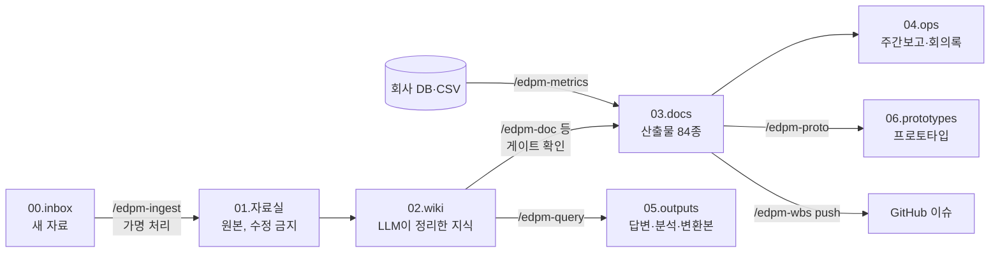
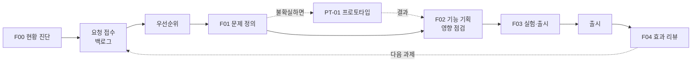
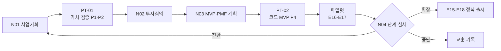

# EdPM Framework A to Z 사용 가이드

설치부터 첫 과제 출시 후 효과 리뷰, 신사업 단계 심사, 퇴사 전 지식 정리까지 실제 순서대로 따라가는 가이드입니다. 개념 설명은 줄이고 **무엇을 입력하면 무엇이 생기고, 어디서 막히며, 막히면 어떻게 하는지**를 적었습니다.

> **이 문서를 읽는 법**
> - 처음이면 A → D를 순서대로 따라 하세요 (반나절). E·F는 내 업무 모드에 해당하는 쪽만 읽습니다.
> - 이미 쓰고 있으면 부록 1(명령 전체 표)과 부록 3(이럴 땐 이렇게)만 옆에 두세요.
> - 예시는 가상 회사 **에듀랩**의 PM이 운영 중인 중학 수학 앱 **매스핏**(모드 F)을 맡고, 동시에 유아 영어 신사업 **리딩버디**(모드 N)를 시작하는 상황입니다. 템플릿 안의 예시와 같은 회사입니다. 모든 수치는 가상입니다.

## 목차

| 장 | 내용 | 언제 |
|----|------|------|
| [A. 큰 그림](#a-큰-그림-5분) | 폴더 층, 업무 모드, 하네스 | 처음 한 번 |
| [B. 설치](#b-설치-30분) | 사전 점검, 워크스페이스 만들기, 외부 스킬 | 처음 한 번 |
| [C. 1일차 온보딩](#c-1일차-온보딩-반나절) | init, 서비스 유형, 자료 넣기, 데이터·일정 도구 연결 | 회사 합류 첫날 |
| [D. 매일·매주 루틴](#d-매일매주-루틴) | 상황판, 자료, 회의, 결정, 주간보고 | 매일 |
| [E. 시나리오 F: 운영 개선 과제 하나 끝내기](#e-시나리오-f-운영-개선-과제-하나-끝내기) | 요청 → 문제 → 프로토타입 → 기획 → 출시 → 효과 | 과제마다 |
| [F. 시나리오 N: 신사업 0에서 단계 심사까지](#f-시나리오-n-신사업-0에서-단계-심사까지) | 사업기회 → 프로토타입 → 투자심의 → MVP → 심사 | 신사업 |
| [G. 프로토타입·MVP 실전](#g-프로토타입mvp-실전) | 충실도 고르기, 빌드, 사용자 테스트 | 검증할 때 |
| [H. 일정·보고](#h-일정보고) | WBS를 GitHub로, 주간·중간·완료 보고 | 프로젝트 |
| [I. 영역별 작업](#i-영역별-작업) | AI, 정책, 교육과정, 품질, 영업 | 필요할 때 |
| [J. 하네스: 막혔을 때](#j-하네스-막혔을-때) | 차단 메시지 읽기, gate_skip | 막혔을 때 |
| [K. 지식 자산화와 마무리](#k-지식-자산화와-마무리) | promote, 회고, 인수인계 | 분기·퇴사 전 |
| [L. 팀과 함께 쓰기, 업그레이드](#l-팀과-함께-쓰기-업그레이드) | 공유 범위, 버전 갱신 | 팀 확장 |
| [부록](#부록-1-명령-전체-표) | 명령 표, 첫날·첫주·첫달 체크리스트, FAQ | 늘 |

---

## A. 큰 그림 (5분)

### A.1 한 문장 요약

**PRD(만들 제품 전체)가 원점이고, 자료를 넣으면(01) 위키가 자라며(02), 위키와 PRD를 근거로 산출물을 쓰고(03), 순서는 게이트가, 수치는 스크립트가, 규칙은 훅이 지킵니다.**

```
E00 회사 → PRD 제품 전체 → 착수·근거 → E06 상세 요구사항 → E09 스펙 → 프로토타입(PRD의 정수)·구현 → 출시
```

세션을 열 때마다 상황판 첫 줄이 **지금 단계와 다음 할 일**을 알려줍니다. 막히면 "지금 뭐 해야 해?"라고 물으세요. **A가 끝나야 B를 씁니다** — 전제 산출물이 끝나기 전에 다음 문서를 쓰려 하면 훅이 막고 이유를 알려줍니다. 전체 진행은 `python3 automation/scripts/edpm_check.py progress`(진행표 한 장)로 봅니다.



### A.2 폴더와 규칙

| 폴더 | 무엇이 있나 | 누가 쓰나 | 지켜지는 규칙 |
|------|-------------|-----------|---------------|
| `00.inbox/` | 새로 받은 자료 (git 제외) | 사람 | 처리 후 비움 |
| `01.자료실/` | 비식별화된 근거 원본, 9분류 | 에이전트 (ingest) | **추가만, 수정 차단** (훅) |
| `02.wiki/` | 도메인·회사·학습자·인사이트·시장·결정 | 에이전트 | 모든 주장에 출처, **식별 정보 저장 차단** (훅) |
| `03.docs/` | 산출물 (E·M·B·A·S·L·P·N·F·V 트랙) | 에이전트 + 사람 승인 | **게이트 미충족이면 done 차단** (훅) |
| `04.ops/` | 주간보고, 회의록 | 에이전트 | |
| `05.outputs/` | 답변, 분석, Word·PDF·PPT, 지표 결과 | 에이전트 | 파일명에 `_YYYYMMDD_HHMM` |
| `06.prototypes/` | 클릭 프로토타입, 운영 스크립트, 코드 MVP | 에이전트 | 가상 데이터만, 비밀값 커밋 금지 |
| `automation/` | 점검기, 훅, 지표·WBS·AI 평가 스크립트, SQL | 사람 승인 후 수정 | |
| `AGENTS.md` | 이 워크스페이스의 헌법 | **사람만** | 에이전트는 변경 제안만 |

### A.3 업무 모드: 내가 하는 일은 어느 쪽인가

| 모드 | 이런 PM | 중심 흐름 | 대표 명령 |
|------|---------|-----------|-----------|
| **F 운영 개선** (1→n) | 운영 중인 서비스를 맡았다 | F00 현황 진단 → 백로그 → 과제마다 F01~F04 | `/edpm-feature` |
| **N 신사업** (0→1) | 새 서비스·사업을 시작한다 | N01 사업기회 → N02 투자심의 → N03 MVP·PMF → N04 단계 심사 | `/edpm-venture` |
| 둘 다 (NF) | 기존 서비스 + 신사업 | 위 둘을 병행, 하나의 워크스페이스 | 둘 다 |

두 모드 모두 프로토타입(V), 관리(M), 정책(P), AI(A), 지표, 결정 기록을 함께 씁니다.

### A.4 하네스: 무엇이 자동으로 돌아가나

| 언제 | 무엇이 | 결과 |
|------|--------|------|
| Claude Code를 열 때 | 상황판 | 막힌 게이트, 검토 대기, 지연 WP, 프로토타입 timebox, 재검토할 결정, 반영 안 된 회의록, 개인정보 의심 |
| 파일을 저장할 때 | 쓰기 검사 | 자료실 원본 수정, 게이트 미충족 done, 자료실·위키에 전화번호·이메일 등 → 차단하고 사유 표시 |
| 외부로 나가는 명령 | 권한 확인 | GitHub 쓰기, 클라우드 AI 평가, `git push`는 매번 묻기 |

---

## B. 설치 (30분)

### B.1 사전 점검

```bash
git clone https://github.com/rey-hailey/agent-driven-edpm.git ~/agent-driven-edpm
cd ~/agent-driven-edpm
./install.sh --check
```

| 결과 | 조치 |
|------|------|
| `✗ python3` / `✗ git` | `xcode-select --install` (macOS). 필수라 없으면 설치가 멈춥니다 |
| `✗ Claude Code` | [claude.com/claude-code](https://claude.com/claude-code)에서 설치 후 `claude` 실행해 로그인 |
| 외부 스킬 `– 없음` | 문서 변환이 필요하면 B.3. 없어도 마크다운 산출물은 나옵니다 |
| `– GitHub CLI` | WBS를 GitHub로 공유하려면 `brew install gh && gh auth login` |
| `– Node.js 20` | 코드 MVP(P4)를 만들 때만 `brew install node` |

### B.2 워크스페이스 만들기

회사·제품마다 워크스페이스 하나. **가장 쉬운 방법은 인자 없이 실행하는 것**입니다. 회사 이름, 하는 일(신사업/운영 개선), 제품을 누가 만드는지(개발팀/직접 구현), 서비스 유형을 차례로 묻습니다. 화면설계 스킬 sb-lowfi는 함께 설치됩니다.

```bash
./install.sh
```

직접 지정해도 됩니다.

```bash
./install.sh ~/Work/에듀랩-edpm --mode NF --dev team --archetype AT07,AT09
```

| 옵션 | 에듀랩 예 | 고르는 법 |
|------|-----------|-----------|
| `--mode` | `NF` | 운영 중 서비스만 F, 신사업만 N, 둘 다 NF |
| `--dev` | `team` | 개발팀이 있으면 `team`(PM은 PRD·스펙·프로토타입까지, 제품 코드는 개발팀), 개발자 없이 직접 만들면 `vibe`(스펙 승인 후 PM이 LLM과 `src/`에 구현) |
| `--archetype` | `AT07,AT09` | 매스핏은 소비자 학습앱 + 문제 풀이(시험대비). [archetypes/README.md](../archetypes/README.md) 3.1절 "서비스 형태별 예" 참고. 최대 2~3개 |
| `--with-kg` | (C.6에서) | 국가 교육과정 기반이면. 260MB라 나중에 해도 됨 |
| `--no-sb-lowfi` | 기본은 설치 | 화면설계서 스킬 `sb-lowfi-pptx`·`sb-lowfi-figma` 2종은 기본으로 `~/.claude/skills`에 설치됩니다(이미 있으면 건너뜀). 건너뛸 때만 지정. Word·PDF는 `edpm_export.py`가 맡아 설치 불필요 |
| `--brain` | 기본 | 회사가 바뀌어도 가져가는 개인 지식 저장소 위치 |

설치되면 다음이 생깁니다: 워크스페이스 폴더, 개인 Brain(`~/EdTech-Brain`, 처음 한 번), 위키 도메인 지식 87페이지, 서비스 유형 프로필.

### B.3 (선택) 공식 문서 스킬

Word·PPT·엑셀을 많이 만든다면 Claude Code 안에서 한 번:

```text
/plugin marketplace add anthropics/skills
/plugin install document-skills@anthropic-agent-skills
/plugin install example-skills@anthropic-agent-skills
```

### B.4 첫 세션 열기

```bash
cd ~/Work/에듀랩-edpm
claude
```

이렇게 상황판이 뜨면 정상입니다.

```text
# EdPM 상황판 2026-11-03
업무 모드: 둘 다 (N 신사업 + F 운영 개선) · 서비스 유형: AT07,AT09 · 개발 체계: 개발팀

## 처음 오셨군요
1. /edpm-start — 무엇을 하려는지 묻고 길을 안내합니다
2. /edpm-init — 회사·제품 인터뷰 (20~30분)
3. /edpm-prd — 만들 제품 전체를 PRD로 정의

## 지금 단계: 0 시작
회사·제품 프로필(E00)이 아직 없습니다
- 다음: /edpm-start
```

처음이면 **`/edpm-start`**를 입력하세요. 하려는 일을 묻고 맞는 순서로 바로 이어 줍니다.

`/edpm`을 입력하면 자동완성에 스킬 33종이 보입니다. 슬래시 명령을 몰라도 "주간보고 써줘", "이 회의록 정리해줘"처럼 말하면 맞는 스킬이 돕니다.

> **Claude Code 기본 조작**: 에이전트가 파일을 고치거나 명령을 실행하기 전에 승인을 묻습니다. 내용을 보고 승인하거나 거절하며 방향을 바꾸면 됩니다. 대화가 길어져도 산출물·위키가 파일로 남으므로 다음 세션에서 이어집니다.

---

## C. 1일차 온보딩 (반나절)

### C.1 회사 프로필 인터뷰 — `/edpm-init`

```text
/edpm-init
```

에이전트가 3~4개씩 묻습니다. 모르는 것은 "모름"이라고 하면 `[확인 필요]`로 남기고 넘어갑니다. 에듀랩 PM의 답 예시:

| 질문 | 답 |
|------|----|
| 회사·제품 | 에듀랩 / 매스핏(중학 수학 문제풀이·오답 해설 앱), 신사업 리딩버디 |
| 업무 모드 | 둘 다 |
| 학습자 | 중1~3 (미성년), 리딩버디는 만 5~9세 |
| 사용자·구매자·결제자 | 학생 / 학원(B2B2C)·학부모 / 학원·학부모 카드 |
| AI 기능 | 오답 해설 AI 있음, 리딩버디는 음성 피드백 계획 |
| 국가 교육과정 기반 | 예, 중학 수학 |
| 일정 관리 도구 | GitHub 비공개 저장소 |
| 프로토타입 스택 | 회사 스택: Next.js + Supabase |
| 기밀 규칙 | 학생 데이터 외부 AI 전송 금지 |

**생기는 것**: E00 회사·사업 프로필(done 후보), `AGENTS.md` 2절 변경안(승인 후 반영), 해당 없는 산출물 `n/a` 처리, `02.wiki/company/회사개요.md`, index·log 갱신.

E00을 검토하고 "E00 완료 처리해줘"라고 하면 `status: done`이 됩니다. E00은 전제조건이 없어 훅이 바로 통과시킵니다.

### C.1.1 PRD — `/edpm-prd` (원점)

```text
/edpm-prd                 # 인터뷰로 작성
/edpm-prd import 00.inbox/기획서.pdf   # 이미 기획서·RFP가 있으면
```

루트 `PRD.md`에 **만들 제품 전체**를 적습니다: 목표·성공 지표, 사용자, 기능 묶음 전부(Must/Should/Could), 비기능(아동 안전·라이선스·의존 플랫폼 정책 포함), 릴리스 계획, **프로토타입으로 먼저 보여줄 정수**(9절), 개발 체계. "이번엔 MVP니까"라며 범위를 줄여 쓰지 않습니다. 언제 무엇을 내놓을지는 릴리스 계획으로 나눕니다.

검토 후 `status: review`가 되면 다른 산출물을 완료할 수 있게 열립니다(G-PRD). 그 전에는 상황판이 계속 "1 PRD" 단계를 가리킵니다.

### C.1.2 회사 기준에 맞추기 — 산출물은 출발점입니다

프레임워크가 만드는 산출물·지표 SQL·정책 초안·도메인 지식은 모두 **템플릿에서 출발한 초안**입니다. 예시 행은 가상입니다. 회사에 문서 양식이 있으면 처음에 연결해 두세요.

```text
/edpm-template import 00.inbox/우리회사_서비스기획서양식.docx   # 회사 양식을 md로 구조화
/edpm-template map                                              # PRD·E06·E09·보고서와 짝짓기, 방식 A/B 선택
```

| 방식 | 의미 |
|------|------|
| A. 회사 양식 적용 | 그 산출물을 처음부터 회사 양식 구조로 씁니다. 회사 양식에 없는 EdPM 필수 항목(게이트·추적 대상)은 끝에 "EdPM 필수 항목" 절로 남습니다 |
| B. 회사 양식으로 옮기기 | EdPM 템플릿으로 쓰고, 공유할 때 `/edpm-template apply <ID> --format docx`로 회사 양식 출력본을 만듭니다 |

문서 말고도 맞출 것이 있습니다: 지표 SQL은 회사 DB 스키마에(C.4), 정책 초안은 회사 약관·법무 검토에, 도메인 지식은 회사 사례로. 전체 표는 README "프레임워크가 주는 것은 출발점입니다".

### C.2 서비스 유형 적용 — `/edpm-blueprint`

```text
/edpm-blueprint apply AT07,AT09
/edpm-blueprint check
```

`apply`는 유형별 필수·권장·해당없음 산출물을 켜고 끕니다. `check`는 비즈니스 로직·IA·화면·정책·AI 영역별로 **빈칸**을 보여줍니다. 이 빈칸 목록이 첫 달 작업 범위의 초안입니다.

### C.3 기존 자료 넣기 — `/edpm-ingest`

1. 회사 자료를 `00.inbox/`에 넣습니다. 형식은 PDF·docx·pptx·xlsx·md 무엇이든 됩니다. 처음 넣을 것:

   | 자료 | 자료실 분류 |
   |------|-------------|
   | 회사 소개서, 조직도, 학사·영업 캘린더 | 회사/ |
   | 제품 기획서, 화면 캡처, 개발 문서 | 기술/ |
   | 최근 3개월 VOC·CS 요약, 인터뷰 기록 | 현장/ |
   | 지표 대시보드 캡처·추출 CSV (집계만) | 데이터/ |
   | 이용약관·환불 규정 | 정책/ |
   | 경쟁사 조사 | 시장/ |

2. 실행:

   ```text
   /edpm-ingest
   ```

   에이전트가 파일마다 개인정보를 확인하고(실명 → `학생A` 등), `01.자료실/`에 저장하고, 원본 요약 페이지와 관련 위키 페이지 5~15개를 갱신한 뒤 핵심 발견과 서로 충돌하는 내용을 보고합니다.

3. 확인:

   ```text
   /edpm-query 매스핏 환불 규정을 요약하고 근거 파일을 알려줘
   ```

   출처가 달린 답이 나오면 위키가 제대로 자란 것입니다.

> **주의**: 학생 실명·연락처가 든 원본(상담 기록, 성적표)은 넣지 마세요. 넣었다면 ingest가 가명 처리를 제안하고, 그래도 남은 전화번호·이메일은 훅이 위키·자료실 저장을 막습니다.

### C.4 데이터 연결 — `/edpm-metrics connect`

산출물의 모든 숫자는 SQL·스크립트로 계산합니다. 첫날 연결 방식만 정합니다.

| 상황 | 방법 |
|------|------|
| 분석용 PostgreSQL 접근 가능 | 터미널에서 `export DATABASE_URL=...` (파일에 쓰지 않음) |
| 데이터팀이 CSV로만 줌 | 집계·가명 키 CSV를 `01.자료실/데이터/`에 넣고 sqlite로 적재 |
| 아직 없음 | `python3 automation/scripts/metrics.py sample-db 05.outputs/sample.sqlite`로 가상 데이터를 만들어 지표 정의부터 |

회사 테이블이 기본 스키마(`learners`, `enrollments`, `learning_events`)와 다르면 에이전트가 매핑 뷰를 제안합니다. 매핑은 `automation/sql/README.md` 끝에 기록됩니다.

### C.5 일정 도구 연결 — `/edpm-wbs setup`

GitHub를 쓴다면:

```text
/edpm-wbs setup
```

저장소(`owner/name`, **반드시 비공개**)를 묻고, 만들 라벨·마일스톤을 미리 보여준 뒤 승인하면 만듭니다. 스프레드시트·Notion·Jira를 쓰는 회사면 H.1의 `export`로 갑니다.

### C.6 (해당 시) 교육과정 지식그래프 — `/edpm-curriculum setup`

국가 교육과정 기반 제품이면 받아 둡니다 (약 260MB, 몇 분). 이후 성취기준 검색·선수 경로·커버리지를 기억이 아니라 데이터로 답합니다.

```text
/edpm-curriculum setup
/edpm-curriculum search 일차방정식
```

### C.7 1일차 끝 확인

세션을 다시 열어 상황판을 봅니다. **지금 단계가 "2 착수·근거"**로 바뀌고 모드별 다음 문서(F00, N01, M01)가 보이면 1일차 완료입니다. 이후 단계는 "3 상세 요구사항(E06) → 4 스펙(E09) → 5 프로토타입·구현 → 6 출시 준비" 순서로 상황판이 안내합니다.

---

## D. 매일·매주 루틴

### D.1 하루

| 시점 | 할 일 | 명령 |
|------|-------|------|
| 아침 | 상황판 보고 오늘 할 일 3~5개 정하기 | 세션 시작 자동, 또는 `/edpm-brief` |
| 자료가 생기면 | `00.inbox/`에 넣고 반영 | `/edpm-ingest` |
| 회의 전 | 목적·결정할 것·근거 한 장 | `/edpm-meeting prep 원장미팅` |
| 회의 후 | 메모를 붙여 넣으면 회의록 → 결정·액션·근거 분리 | `/edpm-meeting notes` |
| 결정했을 때 | 되돌리기 어려운 결정은 예측과 재검토일을 붙여 기록 | `/edpm-decide new 오답해설 학원 확대` |
| 궁금할 때 | 위키 근거로 답 | `/edpm-query …` |
| 숫자가 필요할 때 | 추정 말고 계산 | `/edpm-metrics run 진도율` |

`/edpm-brief` 예시 출력을 PM의 언어로 읽으면:

```text
## 주의
- 검토 대기(review) 2건: F02, E13          ← 누가 나를 기다리고 있다
- 7일 내 마감 WP 1건: WP-4.1               ← 이번 주 약속
- 재검토일 지난 결정 1건: ADR-003 → /edpm-decide review   ← 지난 판단 채점할 때
- 위키 반영 안 된 회의록 2건 → /edpm-meeting ingest      ← 근거가 흩어지는 중
```

### D.2 한 주

| 요일 | 할 일 | 명령 |
|------|-------|------|
| 월 | 이번 주 우선순위, 지난주 액션 확인 | `/edpm-brief week`, `/edpm-meeting actions` |
| 수 | 위키·산출물 점검 (5분) | `/edpm-lint` |
| 금 | 주간보고 (GitHub 진척 pull, 산출물 상태 변화, 결정, 다음 4주 학사 일정 포함) | `/edpm-weekly` |

주간보고는 초안입니다. "무엇을 했다"보다 "무엇을 알게 됐고 무엇을 정했나"로 사람이 다듬습니다.

---

## E. 시나리오 F: 운영 개선 과제 하나 끝내기

매스핏에 학원 강사들의 요청이 쌓여 있습니다. "숙제 안 낸 학생을 반별로 한 번에 보고 싶다." 이 요청이 과제로 정의되고, 검증되고, 출시되고, 효과가 확인되기까지의 전 과정입니다.



### E.1 서비스 현황 진단 (합류 첫 주, 반기마다) — F00

```text
/edpm-feature baseline
```

회사 자료와 위키를 읽고 F00을 채웁니다: 사용자·이해관계자, **기준선 지표**, 기능 지도, 알려진 문제, 기술 제약, 그리고 **깨지면 안 되는 기준**(환불 P01, 진도·수료 L03, 개인정보 E13, AI 평가 A06이 어디 있는지). 기준선 숫자는 `/edpm-metrics`로 계산합니다.

```text
/edpm-metrics run 과제제출률 --param from=2026-09-01 --param to=2026-09-30 --param course=C-MATH-2
```

기준 문서가 회사에 없으면(예: 환불 규정이 문서화되지 않음) 무엇을 먼저 만들지 제안합니다.

### E.2 요청 접수와 우선순위

```text
/edpm-feature intake        # CS·VOC·회의록·강사 요청을 백로그로
/edpm-feature prioritize    # (도달 × 가치 × 교육적 효과) ÷ (노력 × 위험)
```

요청은 "기능"이 아니라 "누가 어떤 상황에서 무엇을 못 하나"로 바뀌어 `개선백로그.csv`에 FI-ID로 들어갑니다. 같은 문제의 요청은 합쳐지고 근거 건수가 늘어납니다. 우선순위는 제안일 뿐이고, 결정은 사람이 하며 `/edpm-decide`로 남길지 묻습니다. GitHub에서 팀이 "개선 요청" 이슈 템플릿으로 올린 것도 intake 대상입니다.

### E.3 문제 정의 — F01

```text
/edpm-feature new 반별미제출현황
```

`03.docs/F.개선/202610_반별미제출현황/`에 F01~F04가 복사되고 F01을 씁니다: 요청 원문 → 재정의한 문제, 영향받는 이해관계자, 근거(VOC 건수, 데이터 SQL, 인터뷰), 규모, 현재 우회 방법, 성공의 정의, 하지 않을 것. **근거가 요청 1건뿐이면 F02로 넘어가지 않습니다.** 에이전트가 "강사 3명 통화" 같은 확인 방법을 제안합니다.

### E.4 (해결안이 불확실하면) 프로토타입 — V

강사가 "반별 목록"을 원한다고 했지만, 실제로 쓸 화면이 목록인지 알림인지 모릅니다. 개발 전에 확인합니다.

```text
/edpm-proto new 반별미제출
```

→ G장 흐름대로 클릭 프로토타입(P1)을 1~2일에 만들고 강사 5명에게 보여 V03 결정을 받습니다. 결과로 "목록보다 수업 직전 알림이 핵심"이 나오면 F02 범위가 바뀝니다. **이 단계가 개발 3주를 아낍니다.**

### E.5 기능 기획 — F02 (G-IMPACT, G-MEASURE)

```text
/edpm-feature spec
```

| 채우는 것 | 에듀테크 포인트 |
|-----------|-----------------|
| 목표 지표 (기준선·목표·SQL) | 학습 지표를 하나 이상. `/edpm-metrics baseline F02`가 기준선을 계산 |
| 사용자 스토리·인수조건 | Given/When/Then |
| 화면 변경 | E10 패턴, 필요하면 `sb-lowfi-pptx`로 와이어프레임 |
| 데이터·이벤트 | E12에 새 이벤트 |
| **영향 점검표** | 개인정보·미성년, AI, 환불·정산, 진도·수료, 교육과정, 접근성, 권리, CS, 시즌 — 하나씩 판정 |

영향 점검에서 "학부모에게 미제출 알림" 같은 항목이 나오면 E13(미성년 개인정보)을 함께 갱신하라고 합니다. **영향 항목이 남아 있으면 F03을 완료할 수 없습니다.**

개발팀에 넘길 때는 `/edpm-handoff dev <과제> --format issues`로 스토리·인수조건·화면 상태·엣지 케이스·측정 이벤트를 GitHub 이슈로 만듭니다. 디자이너에게는 `/edpm-handoff design`, 영업·CS에는 출시 확정 후 `sales`·`cs` ([15.협업가이드](15.협업가이드.md)).

### E.6 실험·출시 계획 — F03

```text
/edpm-feature launch
```

A/B 또는 단계 출시(학원 단위 무작위 등), 가드레일 지표(민원율, 학습 지표), 기능 플래그, 강사·학부모 안내, CS 스크립트, **시즌 확인**(기말고사 2주 전 배포 금지 등), 롤백 기준. 출시 일정은 WBS에 WP로 넣습니다.

### E.7 출시 후 효과 리뷰 — F04

출시 후 F02에 적은 기간(예: 6주)이 지나면:

```text
/edpm-feature review
/edpm-metrics compare M-F12     # 기준선·목표·실제 비교표
```

F02와 **같은 SQL**로 계산한 결과, 가드레일, VOC로 유지·개선·롤백을 결정합니다. 결정은 ADR, 배운 것은 위키, 다음 과제는 백로그로. 이걸로 과제 하나가 끝납니다.

### E.8 과제 하나의 산출물 요약

| 단계 | 산출물 | 분량 | 걸리는 시간 (감) |
|------|--------|------|------------------|
| 문제 | F01 | 1~2쪽 | 반나절 + 근거 확인 |
| 검증 (선택) | V01~V03, 클릭 프로토타입 | 각 1쪽 | 1주 |
| 기획 | F02 | 2~3쪽 | 1~2일 |
| 출시 | F03 | 1~2쪽 | 반나절 |
| 효과 | F04 | 1~2쪽 | 반나절 |

---

## F. 시나리오 N: 신사업 0에서 단계 심사까지

리딩버디: "만 5~9세 아이가 소리 내어 영어책을 읽으면 AI가 단어별로 피드백한다." 경영진은 6개월 뒤 확장 여부를 판단하고 싶어 합니다.



### F.1 사업기회 — N01

```text
/edpm-venture opportunity
```

N01은 PRD 2절(왜 이 문제·왜 지금·왜 우리)과 11절(가정·위험)의 근거입니다. 제품의 정의는 N01이 아니라 PRD에 적고, 가설이 바뀌면 PRD 판을 올립니다. 기회 가설, 고객·문제, 시장·경쟁, 전략 적합성, why us·why now, **핵심 가설(HY-01…)과 중단 기준**. 근거가 부족하면 `/edpm-collect`(앱 리뷰·경쟁사 가격 수집)와 보호자 인터뷰 3건 ingest를 먼저 제안합니다.

### F.2 가장 위험한 가설부터 만들어 보기 — PT-01

"아이가 피드백을 보고 다시 읽기를 시도하는가"(HY-03)는 계획서로 답이 안 나옵니다.

```text
/edpm-proto new 음성피드백
```

AI를 만들기 전에 P1(클릭) + P2(오즈의 마법사: 영어 교사가 녹음을 듣고 피드백을 손으로 입력)로 10가구에 2주 테스트합니다. 미성년이므로 **보호자 동의서**를 먼저 만들고(`06.prototypes/PT-01_음성피드백/ops/동의서.md`), 훅이 가상 데이터·동의 항목을 지키게 합니다. 결과(V03)가 N02의 근거가 됩니다.

### F.3 투자심의 — N02

```text
/edpm-venture case
/edpm-decide new 리딩버디 검증단계 투자
```

시장 규모 근거, 손익 시나리오(기본·낙관·비관, 스크립트로 재현), 투자·인력, 리스크, 대안, 결정 요청. 경영진 한 쪽 요약은 `/edpm-report exec --format pptx` 또는 docx로. 투자 결정은 ADR로 남기고 **예측**("6개월 뒤 주 3회 읽기 가구 50% 이상")과 재검토일을 붙입니다. 되돌리기 어려운 결정이니 `/edpm-decide premortem ADR-xxx`로 사전 부검도 합니다.

### F.4 MVP·PMF 계획 — N03

```text
/edpm-venture mvp
```

MVP 범위와 **지금 하지 않을 것**, 가설별 실험, PMF·학습 효과 신호(GT-01 리텐션 평탄화, GT-04 학습 효과는 필수), 동의·안전, 예산. 지금 쓸 E 산출물과 미룰 산출물을 정하는데, **미성년 대상이면 E13은 MVP에서도 필수**(G-SAFE)입니다. 신호를 계산할 SQL은 `/edpm-metrics sql 주간리텐션`으로 미리 만들어 둡니다.

### F.5 코드 MVP와 파일럿

PT-01이 "다시 읽기 68%"로 가치 신호를 줬다면, 다음 위험(음성 AI 품질, 실사용 리텐션)은 P4 코드 MVP로 검증합니다.

```text
/edpm-proto new 리딩MVP
/edpm-ai-design method          # A10: 음성 인식은 벤더 API, 피드백 생성은 규칙+LLM?
/edpm-eval run goldenset        # 음성 피드백 품질을 골든셋으로
/edpm-proto build               # Next.js + Supabase, 가상 데이터, 접근 제한 배포
```

파일럿은 E16(검증계획) → 실행 → E17(파일럿 결과)로 기록합니다. 원자료는 `01.자료실/현장/`·`데이터/`에.

### F.6 단계 심사 — N04 (G-STAGE)

```text
/edpm-venture gate
/edpm-metrics run 주간리텐션 …
/edpm-metrics effect …          # 사전·사후 WCPM 효과크기
/edpm-decide review ADR-xxx     # 투자심의 때 예측 채점
```

기준 대비 증거로 확장·방향 전환·중단을 결정합니다. **"확장 진행" 결정 전에는 정식 출시(E18) 완료가 막힙니다.** 중단도 성과로 기록하고, 일반화할 교훈은 K장의 promote로 개인 Brain에 남깁니다.

---

## G. 프로토타입·MVP 실전

### G.1 충실도 고르기 (가장 낮은 것부터)

| 묻고 싶은 것 | 단계 | 빌드 기간 | 예 |
|--------------|------|-----------|----|
| 흐름을 이해하나 | P0 종이·low-fi | 반나절 | 숙제 배포 흐름을 강사가 짚어 봄 |
| 화면을 쓸 수 있나, 원하나 | P1 클릭 프로토타입 | 1~2일 | 반별 미제출 화면 |
| 진짜 결과를 받으면 행동이 바뀌나 | P2 오즈의 마법사 | 2~5일 | 교사가 손으로 쓴 피드백을 앱으로 |
| AI 답이 쓸 만한가 | P3 노코드 점검 | 1~3일 | 골든셋 10문항 |
| 실제로 계속 쓰나, 배우나 | P4 코드 MVP | 1~3주 | 학원 2개 반 4주 |

### G.2 흐름과 명령

```text
/edpm-proto new <이름>   → V01: 검증 질문, 가장 위험한 가정, 충실도, 성공·중단 기준, timebox, 데이터·안전
/edpm-proto build        → 06.prototypes/PT-xx/ + V02 (만든 것, 알려진 한계)
/edpm-proto test         → 진행자 스크립트, 관찰 기록지, 사후 설문
/edpm-proto decide       → V03: 기준 대비 판정 → 폐기 / 재검증 / MVP 확장 / 개발 이관
/edpm-proto handoff      → E06·E09·E10·F02 갱신, 다시 만들 것, WBS
```

**기준은 빌드 전에.** P3·P4 빌드는 V01의 성공·중단 기준과 timebox가 확정돼야 시작됩니다(G-PROTO). 결과를 본 뒤 기준을 바꾸려면 ADR이 필요합니다.

### G.3 클릭 프로토타입 1시간 만에

`06.prototypes/_starter/click-prototype.html`을 복사해 화면을 채우는 것이 가장 빠릅니다. 에이전트에게 "E10의 SCR-021, 022를 클릭 프로토타입으로"라고 하면 됩니다. 빌드 도구·인터넷 없이 브라우저로 열리고, 참여자 ID를 넣으면 화면 이동·클릭이 기록되어 "기록 → CSV 내보내기"로 V03의 근거가 됩니다.

### G.4 사용자 테스트 요령

| 원칙 | 이유 |
|------|------|
| 역할별 5명 내외 | 주요 사용성 문제 대부분이 이 안에서 나옴 |
| 정답 경로를 알려주지 않음 | "어디를 누르면 될 것 같아요?" |
| 말보다 행동 | "좋네요"보다 재시도·재방문·결제 의향 |
| 아이는 짧게, 보호자 동석 | 20~30분, 격려형 피드백 |
| 세션 직후 기록 | 기록 CSV·관찰지를 `00.inbox/` → `/edpm-ingest` |

---

## H. 일정·보고

### H.1 WBS 만들고 팀과 공유

```text
/edpm-wbs create      # M01 범위 → 작업 패키지, 학사일정·게이트 반영, 간트
/edpm-wbs push        # GitHub 이슈·단계 마일스톤·라벨 (dry-run 후 승인)
```

**원칙: 계획은 CSV, 진행은 도구.** PM은 `M02_WBS.csv`에서 일정을 고치고 `push`, 팀원은 GitHub에서 이슈를 닫거나 `상태:진행`·`상태:지연` 라벨을 붙입니다. 금요일 `/edpm-weekly`가 자동으로 `pull`해 진척을 가져옵니다.

| 회사가 쓰는 도구 | 명령 |
|------------------|------|
| GitHub (기본) | `push` / `pull` / `status` |
| 엑셀·Google Sheets | `/edpm-wbs export sheets` |
| Notion | `/edpm-wbs export notion` → Import → 날짜 속성으로 바꾸고 Timeline |
| Jira·Linear | `/edpm-wbs export jira` / `linear` |

"교사 파일럿이 2주 밀리면?"은 `/edpm-wbs impact 교사 파일럿 2주 지연`으로 영향받는 작업, 학사일정 충돌, 대안을 봅니다.

### H.2 보고서

| 보고 | 명령 | 근거 |
|------|------|------|
| 착수 | `/edpm-report M01` | E00, 범위, 마일스톤 |
| 위험·이슈 갱신 | `/edpm-report M03` | WBS 지연, 게이트 미충족 |
| 중간 | `/edpm-report M04 --format pptx` | 산출물 상태, WBS 진척, 지표(SQL) |
| 완료 | `/edpm-report M05 --format docx` | 산출물 80% 이상 done, 파일럿, 테스트 |
| 경영진 한 쪽 | `/edpm-report exec` | 위 전체 요약 |

`--format docx`·`pdf`는 `edpm_export.py`(docx는 pandoc, pdf는 Chrome 필요), `pptx`는 공식 `pptx` 스킬이 맡습니다. 필요한 도구나 스킬이 없으면 마크다운(또는 인쇄용 HTML)으로 남습니다(B.3).

---

## I. 영역별 작업

필요할 때 해당 줄만 보세요. 주제별 전체 지도는 [08.에듀테크PM커버리지맵](08.에듀테크PM커버리지맵.md).

| 영역 | 이럴 때 | 명령 순서 | 꼭 기억할 것 |
|------|---------|-----------|---------------|
| **AI 기능** | AI 튜터·오답 해설·문항 생성 | `/edpm-ai-design opportunity` → `method`(A10: 규칙·검색·RAG·로컬·클라우드 중 가장 단순한 것) → `guardrail`(A14) → `goldenset` → `/edpm-eval run` → `cost`(A12) | 정답이 있는 일은 규칙·SQL로. 학생 원문은 외부 API 전에 E13·P07 확인. G-AI: E14·A10·A14 done 전 출시 불가 |
| **정책** | 환불·약관·부정 수강·강사 계약 | `/edpm-policy P01` → `calc-refund` → `legal-check P01` → `sync P01`(약관·결제 화면·CS 반영 점검) | 법률 자문이 아님. `[확인 필요]`는 법무 검토. G-POLICY: 유료 판매면 P01 done 전 출시 불가 |
| **교육과정** | 성취기준 매핑, 커버리지, 선수학습 | `/edpm-curriculum search` → `map` → `coverage` → `gaps` | 성취기준은 기억으로 쓰지 않음. 공식 관계와 권장 순서 구분. G-CURRIC |
| **학습 설계** | 학습 목표·평가·학습 경험 | `/edpm-doc E05` → `E08` → `E11` | G-LEARN: E05 없이 E08·E09 완료 불가. 학습 목표마다 평가 증거 |
| **안전·개인정보** | 미성년, 학생 데이터, 접근성 | `/edpm-doc E13` | G-SAFE: 미성년이면 E13 "출시 차단" 0건이어야 출시 |
| **품질** | 테스트·검수·출시 판정 | `/edpm-qa plan` → `run --manual` / `--auto`(webapp-testing, 챗봇·튜터 답 품질은 `/edpm-eval`) → `defects` → `report` | 실제 학생 데이터로 테스트하지 않음 |
| **화면** | IA·와이어프레임 | `/edpm-doc E10` → `sb-lowfi-pptx` 또는 `sb-lowfi-figma` | 역할별 IA 패턴(학습자·강사·관리자·CMS) 참고 |
| **영업·제안** | RFP, 제안서, 견적 | `/edpm-proposal analyze <RFP>` → `gonogo` → `write` → `price` → `deck` → `check` | 효과 주장은 E19·E17 근거와 증거 수준만 |
| **마케팅·콘텐츠** | 학부모 안내문, 교사 가이드, 블로그 | `/edpm-content make 학부모안내문` | 과장 금지. 미성년 광고 규정 |
| **이해관계자 검토** | 문서를 교사·보호자 눈으로 | `/edpm-review F02 --panel 교사,보호자,원장` | 실제 사용자 검증을 대신하지 않음 |
| **웹 수집** | 앱 리뷰, 경쟁사 가격, 교육청 공지 | `/edpm-collect R01` | Aside 없으면 수동 안내. 학생 정보 화면 금지 |
| **자료실** | 자료 찾기, 제안서 첨부 묶음 | `/edpm-library find`, `bundle 제안서` | |

---

## J. 하네스: 막혔을 때

### J.1 차단 메시지 읽는 법

| 메시지 | 뜻 | 할 일 |
|--------|----|-------|
| `차단: 01.자료실의 기존 파일은 수정하지 않습니다` | 원본 보호 | 정정은 새 파일로 추가하고 원본은 둠 |
| `차단: E09 done 불가: - G-LEARN: E05 status=draft` | 전제 산출물 미완료 | 먼저 E05를 완료하거나, 정당한 사유가 있으면 J.2 |
| `차단 (G-PII): 식별 정보 의심: 휴대전화(010-…)` | 위키·자료실에 연락처 | 가명으로 바꿔 다시 저장. 예시면 `example.com`이나 `{…}` |

### J.2 게이트를 의도적으로 넘을 때

운영 중 서비스라 E05(학습성과설계서)를 지금 쓰지 않고 E09를 완료해야 하는 경우처럼, 사람이 판단해 넘길 수 있습니다.

```text
E09는 게이트 무시하고 완료 처리해줘. 사유: 운영 중 서비스, 학습 목표는 F00 4절로 대체
```

에이전트가 frontmatter에 `gate_skip: [운영 중 서비스, 학습 목표는 F00 4절로 대체]`를 적고 저장합니다. 스킵은 상황판과 린트에 계속 보입니다. **자주 스킵되는 게이트는 프레임워크를 고칠 신호**이니 팀 회고에서 다룹니다.

### J.3 그 밖의 문제

| 증상 | 확인 |
|------|------|
| 상황판이 안 뜸 | `.claude/settings.json` 존재, `python3 automation/scripts/edpm_check.py brief` 직접 실행 |
| `/edpm-*`가 안 보임 | 워크스페이스 폴더에서 `claude`를 열었는지. `ls -a .claude/skills` |
| 숫자가 이상함 | 결과 CSV(`05.outputs/metrics_*.csv`)와 SQL 파일을 같이 열어 기간·분모 확인. LLM에게 숫자를 고치게 하지 말고 SQL을 고침 |
| GitHub push가 안 됨 | `automation/wbs.json`의 `repo`, `gh auth status` |
| 대시보드가 코드로 보임 | Obsidian Dataview 플러그인. 없으면 `/edpm-brief`, `/edpm-lint` |

더 자세한 문제 해결: [00.시작하기](00.시작하기.md) 6절, 하네스 상세: [13.하네스와점검](13.하네스와점검.md).

---

## K. 지식 자산화와 마무리

### K.1 결정 채점 (월 1회)

```text
/edpm-decide review     # 재검토일 지난 ADR의 예측을 SQL로 확인해 적중·빗나감 기록
/edpm-decide stats      # 판단 적중률, 사전 부검 효과
```

### K.2 회고 — E20

사이클(학기·분기·과제 묶음)이 끝나면 `/edpm-doc E20`. ADR 트리거, 게이트 스킵, 빗나간 예측을 함께 봅니다.

### K.3 개인 Brain으로 승격 (분기, 퇴사 전)

```text
/edpm-promote --dry-run
/edpm-promote
```

회사 기밀(매출, 단가, 미공개 로드맵, `company/`, `decisions/`)과 개인정보를 뺀 **일반화 가능한 에듀테크 지식**만 `~/EdTech-Brain`으로 옮깁니다. 다음 회사에서 `install.sh`가 이 Brain으로 위키를 시드합니다.

### K.4 인수인계

워크스페이스 자체가 인수인계 문서입니다. 후임자에게 저장소 접근 권한을 주고, 상황판 → `03.docs/_dashboard.md` → 최근 주간보고 3개 → `decisions/` 순으로 읽게 하세요.

---

## L. 팀과 함께 쓰기, 업그레이드

### L.1 공유 범위

| 무엇을 | 누구와 | 어떻게 |
|--------|--------|--------|
| 워크스페이스 전체 | PM 팀 | **비공개** GitHub 저장소. `00.inbox/`·비밀값은 `.gitignore`가 제외 |
| WBS·과제 | 개발·디자인 | GitHub 이슈(같은 저장소 또는 개발팀 저장소) |
| 산출물 일부 | 경영진·고객 | `--format docx·pdf·pptx`로 변환해 전달 |
| 일반 지식 | 다음 회사의 나 | 개인 Brain (`/edpm-promote`) |

여러 PM이 한 워크스페이스를 쓰면 산출물 frontmatter `owner`를 채우고, 같은 문서를 동시에 고치지 않도록 WBS 담당으로 나눕니다. 팀 공통 훅·권한은 `.claude/settings.json`(커밋), 개인 설정은 `settings.local.json`.

### L.2 프레임워크 업그레이드

```bash
cd ~/agent-driven-edpm && git pull
./install.sh --upgrade ~/Work/에듀랩-edpm
```

스킬·스크립트·훅·설정·새 템플릿만 갱신하고, 작성 중인 산출물·위키는 그대로 둡니다. `AGENTS.md`는 사람이 관리하므로 [CHANGELOG](../CHANGELOG.md)를 보고 필요한 절만 옮깁니다.

---

## 부록 1. 명령 전체 표

| 스킬 | 하위 명령 | 한 줄 |
|------|-----------|-------|
| `/edpm-init` | [Brain 경로] | 회사 프로필 인터뷰 → E00, AGENTS.md, 위키 시드 |
| `/edpm-blueprint` | `detect` · `apply <AT>` · `check` · `map` | 서비스 유형 판정·적용, 영역별 빈칸 |
| `/edpm-brief` | (없음) · `week` · `next` · `gates` | 상황판 → 오늘 할 일 |
| `/edpm-ingest` | [파일·URL] | 자료 → 가명 처리 → 자료실 → 위키 |
| `/edpm-query` | `<질문>` [`--save`] [`--format`] | 위키 근거로 답 |
| `/edpm-lint` | `wiki` · `docs` · `pii` · `all` | 점검 (결정적 항목은 스크립트) |
| `/edpm-library` | `catalog` · `find` · `stale` · `bundle` · `nlm-sync` | 자료실 관리 |
| `/edpm-collect` | `R01~R08` [`--dry-run`] | Aside 웹 수집 |
| `/edpm-promote` | [Brain 경로] [`--dry-run`] | 일반 지식 → 개인 Brain |
| `/edpm-portfolio` | `new` · `build` · `check` · `list` | 한 사이클 → 포트폴리오 한 장 (사실은 스크립트, 기밀 점검) |
| `/edpm-feature` | `baseline` · `intake` · `prioritize` · `new` · `spec` · `launch` · `review` · `status` | 운영 개선 F00~F04 |
| `/edpm-venture` | `opportunity` · `case` · `mvp` · `gate` · `plan` | 신사업 N01~N04 |
| `/edpm-proto` | `new` · `plan` · `build` · `test` · `decide` · `handoff` · `list` | 프로토타입 V01~V03 |
| `/edpm-doc` | `<ID>` [`--update`] [`--force`] · 묶음 `P1~P6` | 모든 산출물 공통 작성 |
| `/edpm-review` | `<ID·파일>` [`--panel`] | 이해관계자 패널 비평 |
| `/edpm-decide` | `new` · `premortem` · `review` · `stats` · `list` | ADR, 예측 채점 |
| `/edpm-meeting` | `prep` · `notes` · `ingest` · `actions` | 회의 준비·회의록 |
| `/edpm-handoff` | `dev` · `design` · `sales` · `exec` · `cs` · `content` · `legal` · `feedback` | 받는 사람에 맞춘 전달 패키지, 피드백 반영 |
| `/edpm-metrics` | `connect` · `define` · `sql` · `run` · `effect` · `compare` · `baseline` | 지표 계산 |
| `/edpm-wbs` | `create` · `setup` · `push` · `pull` · `status` · `update` · `impact` · `export` | WBS·일정 도구 |
| `/edpm-weekly` | [기준일] | 주간보고 |
| `/edpm-report` | `M01` · `M03` · `M04` · `M05` · `exec` [`--format`] | 관리 보고서 |
| `/edpm-policy` | `P01~P09` · `legal-check` · `sync` · `calc-refund` | 정책·운영 |
| `/edpm-ai-design` | `opportunity` · `method` · `route` · `cost` · `ops` · `guardrail` · `type` · `A01~A09` · `goldenset` · `scenarioset` · `nocode` · `prompt-export` | AI 설계 |
| `/edpm-eval` | `run` · `compare` · `report` · `triage` | AI 평가 |
| `/edpm-curriculum` | `setup` · `search` · `standard` · `path` · `seed` · `map` · `coverage` · `gaps` · `courses` · `export` · `wiki` · `update` | 교육과정 지식그래프 |
| `/edpm-qa` | `plan` · `run` · `defects` · `report` | 품질 검수 |
| `/edpm-proposal` | `analyze` · `gonogo` · `write` · `price` · `deck` · `check` | 수주·제안 |
| `/edpm-content` | `S04` · `S05` · `make` · `calendar` · `check` | 영업·마케팅 콘텐츠 |

## 부록 2. 체크리스트

### 첫날

- [ ] `./install.sh --check` 필수 항목 통과
- [ ] 워크스페이스 설치, 세션 시작 시 상황판이 뜸
- [ ] `/edpm-init` 완료, E00 done, AGENTS.md 2절 반영
- [ ] `/edpm-blueprint apply`·`check`로 빈칸 목록 확보
- [ ] 회사 자료 첫 묶음 ingest, `/edpm-query`로 출처 달린 답 확인
- [ ] 데이터 연결 방식과 일정 도구 결정

### 첫 주

- [ ] (F) F00 현황 진단, 기준선 지표 2~3개를 SQL로 / (N) N01 사업기회, 인터뷰 3건
- [ ] M01 착수보고서
- [ ] 첫 회의록을 `/edpm-meeting notes`로, 첫 결정을 `/edpm-decide new`로
- [ ] 첫 `/edpm-weekly`

### 첫 달

- [ ] (F) 백로그 5건 이상, 과제 1개를 F02까지 / (N) PT-01 프로토타입 결정, N02 초안
- [ ] WBS를 일정 도구에 올림, 주간 pull이 돎
- [ ] 기준 문서(P01·L03·E13) 중 회사에 없는 것 1개 보강
- [ ] `/edpm-lint` 결과 주의 항목 0~2개 수준 유지

## 부록 3. 이럴 땐 이렇게

| 상황 | 이렇게 |
|------|--------|
| "다음에 뭐 써야 해?" | `/edpm-brief next` |
| 경영진이 "효과 있어?"라고 물음 | `/edpm-metrics effect` → 신뢰구간·표본을 함께 보고. 0을 포함하면 단정하지 않음 |
| 영업이 "효과 40% 향상"이라고 쓰고 싶어 함 | `/edpm-content check`·`/edpm-proposal check`가 E19·E17 근거 없는 효과 문장을 찾아 삭제·정성 표현을 제안. 측정된 수치와 증거 수준만 씀 |
| 요청이 "버튼 하나만 추가"인데 급함 | 그래도 `/edpm-feature intake` → F02 영향 점검은 생략하지 않음. 작은 기능이 환불·진도 규칙을 깸 |
| 시험 기간이 다가옴 | 상황판의 7일 내 마감, `/edpm-wbs impact`, F03 시즌 확인. 배포 동결 |
| 학부모 민원이 들어옴 | 원문은 가명 처리해 ingest, `/edpm-feature intake`, 반복되면 P05 CS 정책 |
| AI 답이 이상하다는 신고 | `/edpm-eval triage`로 실패 유형 분류 → 골든셋에 추가 → 재평가 |
| 파일럿 결과가 애매함 | V03 "재검증"으로 바꿀 것 하나만 바꿔 PT-다음. 기준을 바꾸고 싶으면 ADR |
| 회사가 Jira로 바꿈 | `AGENTS.md` 2절·`automation/wbs.json` 변경, `/edpm-wbs export jira` |
| 개발·디자인·영업·대표에게 넘길 때 | `/edpm-handoff <역할> <대상>`. 직군별 요령은 [15.협업가이드](15.협업가이드.md) |
| 새 PM이 합류 | K.4 순서로 읽게 하고 `owner`로 문서 나누기 |
| 프레임워크 새 버전 | L.2 `--upgrade` |

## 다음에 읽을 문서

| 궁금한 것 | 문서 |
|-----------|------|
| 설치 옵션·외부 스킬 상세 | [00.시작하기](00.시작하기.md) |
| 산출물 순서와 게이트 전체 | [02.산출물체인과게이트](02.산출물체인과게이트.md) |
| 위키 운영 원칙 | [03.LLM위키운영](03.LLM위키운영.md) |
| 기존 자료 가져오기 | [06.기존자료가져오기](06.기존자료가져오기.md) |
| 업무 모드 상세 | [09.업무모드](09.업무모드.md) |
| AI 방식 선택 | [10.AI방식선택](10.AI방식선택.md) |
| 프로토타입·MVP | [11.프로토타입과MVP](11.프로토타입과MVP.md) |
| 일정 도구 연동 | [12.일정관리도구연동](12.일정관리도구연동.md) |
| 하네스 | [13.하네스와점검](13.하네스와점검.md) |
| 영업·개발·디자인·경영진과 일하기 | [15.협업가이드](15.협업가이드.md) |
