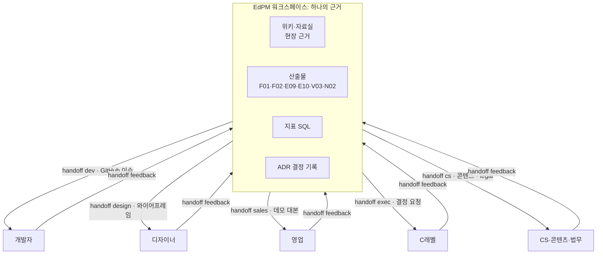

# 협업 가이드: 영업·개발·디자인·경영진과 함께 제품 만들기

PM의 일은 혼자 문서를 쓰는 것이 아니라 **여러 사람이 같은 사실을 보고 각자 옳은 결정을 내리게 만드는 것**입니다. 이 가이드는 EdPM 워크스페이스를 중심에 두고 영업, 개발자, 디자이너, C레벨 결정권자, 그리고 교육 현장 사람들과 어떻게 주고받는지 정리합니다.

설치와 기본 흐름은 [14.AtoZ사용가이드](14.AtoZ사용가이드.md)를 먼저 보세요. 예시는 같은 가상 회사 **에듀랩**(중학 수학 앱 **매스핏**, 신사업 **리딩버디**)입니다.

---

## 1. "그래서 내 업무에 어떻게 도움이 되는데요?"

PM이 매주 겪는 일과, 이 프레임워크가 대신하거나 막아 주는 것입니다.

| PM이 겪는 일 | 보통은 | 이 프레임워크에서는 |
|--------------|--------|---------------------|
| 영업이 "고객이 원해요"라며 기능을 들고 옴 | 급한 순서로 개발에 넘김 | 요청을 "누가 무엇을 못 하나"로 바꿔 백로그에 근거와 함께 쌓고, 점수로 우선순위를 보여줌. 거절도 근거로 설명 (`/edpm-doc feature intake·prioritize`) |
| 개발자가 "그래서 정확히 뭘 만들어요?" | 회의를 다시 잡음 | 스토리·인수조건·화면 상태·교육 현장 엣지 케이스·측정 이벤트를 한 묶음으로 넘김 (`/edpm-handoff dev`) |
| 디자이너가 "왜 이 화면이 필요해요?" | 기능 목록만 줌 | 문제, 사용자 맥락, 연령별 규칙, 관찰 근거를 넘기고 화면은 맡김 (`/edpm-handoff design`) |
| 대표가 "그래서 하자는 거야 말자는 거야?" | 30장 보고서 | 결론·수치 3개·선택지·위험·예측이 담긴 한 장 (`/edpm-handoff exec`, `/edpm-decide`) |
| 영업 자료에 "성적 40% 향상"이 들어감 | 나중에 문제됨 | 측정된 효과와 증거 수준만 말할 수 있는 말로, 근거 없는 문장은 점검에서 걸림 (`/edpm-handoff sales`, `/edpm-doc content check`) |
| 3개월 전 결정을 왜 했는지 아무도 모름 | 슬랙을 뒤짐 | ADR에 맥락·선택지·근거·예측이 있고, 재검토일에 채점 (`/edpm-decide`) |
| 출시했는데 효과가 있었는지 모름 | "반응 좋았어요" | 출시 전에 기준선·목표·SQL을 정하고 출시 후 같은 SQL로 비교 (`/edpm-metrics`, F04) |
| "작은 기능"이 환불 규정·진도 계산을 깨뜨림 | CS가 먼저 앎 | 기능마다 영향 점검표(환불·정산·진도·개인정보·AI·교육과정·시즌)를 거쳐야 출시 계획 완료 (G-IMPACT) |
| 시험 기간에 배포해 학원 민원 | 매년 반복 | 학사일정이 WBS와 출시 계획에 제약으로 들어감 (G-CAL) |
| 회의는 많은데 정해진 게 없음 | 회의록이 흩어짐 | 회의 전 "무엇을 정할지" 한 장, 회의 후 결정·액션·근거로 분리 (`/edpm-brief meeting`) |
| 새 팀원·후임자 온보딩 | 몇 주 걸림 | 위키·산출물·결정 기록이 워크스페이스에 남아 있음 |

요약하면, PM이 쓰는 시간을 **문서 서식과 정리**에서 **판단과 대화**로 옮깁니다. 문서 초안·묶기·변환·점검은 에이전트가, 무엇을 할지와 누구를 설득할지는 PM이 합니다.

## 2. 원칙: 하나의 근거, 여러 언어

| 원칙 | 의미 |
|------|------|
| 근거는 하나 | 같은 사실을 사람마다 다르게 쓰지 않습니다. 패키지는 산출물에서 뽑아 만들고, 항목마다 원문 위치(`F02 2절`)를 답니다 |
| 언어는 받는 사람 것 | 개발자에게는 인수조건, 디자이너에게는 사용자 맥락, 영업에게는 고객 언어, 경영진에게는 결정과 위험 |
| 피드백은 다시 근거로 | 받은 의견은 가명 처리해 위키·백로그·WBS·ADR로 되돌립니다. 대화가 사라지지 않게 |
| 숫자는 스크립트만 | 누구에게 보내든 수치는 `/edpm-metrics` 결과와 SQL 경로 |
| 확정 아님을 숨기지 않음 | `draft`·`review` 문서에서 만든 패키지는 첫 줄에 "확정 아님"을 표시 |

---

## 3. 개발자·개발 리드

### 3.1 그들이 PM에게 바라는 것

- 무엇을 왜 만드는지, **무엇을 만들지 않는지**
- 모호하지 않은 완료 기준
- 중간에 바뀌지 않는 범위 (바뀌면 이유와 영향)
- 일정을 정하기 전에 자기 의견을 묻는 것

### 3.2 자주 생기는 마찰

| 마찰 | 원인 | 프레임워크로 막는 법 |
|------|------|----------------------|
| "기획서에 예외 상황이 없어요" | 정상 흐름만 씀 | E09 4절 교육 현장 예외(반 이동, 학기 초 일괄 계정, 동의 철회, 수업 시작 5분 동시 접속)를 handoff에 기본 포함 |
| "출시 직전에 측정 이벤트 넣어 달래요" | 지표를 나중에 생각 | F02 1절 목표 지표와 E12 이벤트가 handoff에 들어감 (G-MEASURE) |
| "프로토타입 코드 그대로 쓰면 안 돼요?" | 검증 코드와 운영 코드 혼동 | V02 5절 "알려진 한계", V03 "재사용/참고만/버림" (G-PROTO) |
| "왜 갑자기 우선순위가 바뀌죠?" | 결정 이유가 전달 안 됨 | ADR 링크를 함께 보냄 |

### 3.3 주고받기

| 시점 | PM → 개발 | 명령 | 개발 → PM | 들어가는 곳 |
|------|-----------|------|-----------|-------------|
| 문제 정의 직후 | F01 요약, "같이 볼 기술 위험" 질문 | `/edpm-handoff dev F.개선/202610_반별미제출` (초안) | 기술 제약, 대략 공수 | F02 의존성, M03 위험 |
| 기획 확정 | 스토리·인수조건·화면 상태·이벤트·엣지 케이스 | `/edpm-handoff dev <과제> --format issues` | 공수 추정, 대안 | `/edpm-handoff feedback dev` → M02 |
| 개발 중 | 범위 변경 요청은 ADR로 | `/edpm-decide new` | 블로커 | GitHub 이슈 라벨 `상태:지연` → `/edpm-wbs pull` |
| 출시 전 | 테스트 시나리오, 출시 판정 기준 | `/edpm-spec qa plan`, `report` | 결함 | GitHub "결함" 이슈 → B07 |
| 출시 후 | 효과 리뷰 결과 | F04 공유 | 운영 이슈 | 백로그 |

### 3.4 장면 예시 (매스핏)

> PM: `/edpm-handoff dev F.개선/202610_반별미제출 --format issues`
>
> 에이전트가 F02의 스토리 4개를 GitHub 이슈 4건으로 만들 계획을 보여줍니다. 각 이슈에는 인수조건, 화면 상태(미제출 0명일 때, 반이 없을 때), 이벤트 `EV-F21 missing_list_viewed`, 엣지 케이스(수업 직전 5분 동시 조회), "시험 2주 전 배포 금지"가 들어갑니다. PM이 승인하면 이슈가 생기고, 개발 리드는 Jira·GitHub에서 그대로 추정을 붙입니다. 추정 결과를 붙여 넣으면 `/edpm-handoff feedback dev`가 WBS와 위험대장에 반영합니다.

### 3.5 하지 말 것

- 화면 설계와 기술 설계를 PM이 확정해서 넘기기. 무엇과 왜는 PM, 어떻게는 개발·디자인
- 개발팀 도구를 바꾸라고 하기. 회사가 Jira를 쓰면 `/edpm-wbs export jira`, 이슈는 거기로
- 프로토타입을 "거의 다 됐으니 이어서 개발"로 넘기기

---

## 4. 디자이너

### 4.1 그들이 PM에게 바라는 것

- 풀어야 할 **문제**와 성공의 정의 (기능 목록이 아니라)
- 실제 사용자 근거: 인터뷰, 관찰, 데이터
- 제약을 미리: 기술, 연령, 접근성, 개인정보
- 화면을 결정할 재량

### 4.2 에듀테크 디자이너에게 꼭 넘겨야 하는 것

| 항목 | 이유 | 근거 문서 |
|------|------|-----------|
| 사용 맥락 | 같은 학생도 교실 태블릿·학원 자습실·집 스마트폰에서 다르게 씀 | `02.wiki/learners/` |
| 사용자 ≠ 구매자 ≠ 결제자 | 학생이 쓰고, 원장이 사고, 학부모가 냄. 화면마다 주인공이 다름 | E02 |
| 연령별 규칙 | 한 화면 과제 수, 글자 크기, 격려형 피드백, 공개 순위 금지 | E10 4절, B05 1절 |
| AI 표시 | "AI가 만든 힌트" 라벨, 설명 가능성 | E13, B05 |
| 접근성 | 대비 4.5:1, 터치 영역, 자막 | E13 c, B05 |
| 하지 말 것 | 랭킹으로 동기 부여, 빨간 오답 강조(저연령), 해지 어렵게 만들기 | B05, P01 |

### 4.3 주고받기

| 시점 | PM → 디자인 | 명령 | 디자인 → PM | 들어가는 곳 |
|------|-------------|------|-------------|-------------|
| 문제 정의 후 | 디자인 브리프 | `/edpm-handoff design <과제>` | 질문, 탐색안 | F01·F02 열린 질문 |
| 검증 필요 | 테스트할 가설, 참여자 | `/edpm-proto new` | 클릭 프로토타입 (Figma 또는 starter HTML) | V02 |
| 테스트 후 | V03 결과 | `/edpm-proto decide` | 흐름 수정 | E10, F02 3절 |
| 개발 전 | 화면 상태 목록 확인 | E10 3절 | 디자인 시스템 반영 | B05 |

와이어프레임이 필요하면 E10을 입력으로 `sb-lowfi-pptx`(low-fi HTML·편집 가능한 PPTX), `sb-lowfi-figma`(Figma 화면설계서), 클릭 프로토타입 `06.prototypes/_starter/click-prototype.html`를 씁니다. 디자이너가 Figma만 본다면 Figma로 넘기면 됩니다.

### 4.4 장면 예시 (리딩버디)

> PM: `/edpm-handoff design PT-01`
>
> 브리프의 첫 줄은 "아이가 피드백을 보고 다시 읽고 싶어지게"입니다. 근거로 V03의 관찰 "빨간색 표시를 보고 아동C가 녹음을 멈춤"이 붙고, 만 5~9세 규칙(주요 행동 1개, 그림·캐릭터 격려, 보호자 동석)과 하지 말 것(점수 먼저 보여주기)이 들어갑니다. 디자이너는 색이 아니라 "격려 방식"을 다시 설계하고, PT-02로 다시 테스트합니다.

---

## 5. 영업·사업개발

### 5.1 그들이 PM에게 바라는 것

- 고객에게 지금 말할 수 있는 것과 날짜
- 경쟁사 대비 차별점
- 고객 요청이 반영되는지, 안 되면 왜인지
- 데모가 깨지지 않는 것

### 5.2 PM이 지켜야 하는 것

| 원칙 | 이유 |
|------|------|
| 측정된 효과와 증거 수준만 | 교육 효과 과장은 신뢰와 법적 위험 (설계 원칙 7) |
| 출시 전 기능은 약속하지 않음 | 단계 출시·롤백 가능성 |
| 고객 요청은 거절하더라도 기록 | 근거가 쌓이면 우선순위가 바뀜 |
| 학사·예산 시즌 공유 | 학원은 학기 초, 학교는 예산 편성, 기업은 연간 교육 계획 |

### 5.3 주고받기

| 시점 | PM → 영업 | 명령 | 영업 → PM | 들어가는 곳 |
|------|-----------|------|-----------|-------------|
| 분기 초 | 세일즈 플레이북 (의사결정 구조, 디스커버리 질문, 반론, 증거 목록) | `/edpm-doc S04` | 파이프라인, 잃은 딜 사유 | `research/`, 백로그 |
| 출시 확정 | 무엇이 바뀌나, 말할 수 있는 것·없는 것, 데모 대본 | `/edpm-handoff sales <과제>`, `/edpm-doc content make 데모 대본` | 고객 반응 | `/edpm-handoff feedback sales` |
| 고객 요청 | (받음) | `/edpm-doc feature intake` | 요청 원문 | 백로그 FI, 근거 건수 |
| RFP | 분석·Go/No-Go·제안서 | `/edpm-doc proposal analyze` → `gonogo` → `write` | 고객 정보 | S01~S03 |
| 고객 자료 | 원장 소개서, 학부모 안내문, 기관 소개서 | `/edpm-doc content make 원장 대상 소개서` | — | `05.outputs/` |

### 5.4 장면 예시 (매스핏)

> 영업: "OO학원이 반별 리포트 PDF 내보내기 해 달래요. 이번 달 계약 걸려 있어요."
>
> PM: 요청 원문을 붙여 `/edpm-doc feature intake` → 백로그에 FI-031로 들어가고 같은 요청이 이미 4건 있었음이 드러납니다. `/edpm-doc feature prioritize`로 순위를 보여주며 "다음 분기 후보이고, 지금은 화면 캡처 가이드로 대체 가능"이라고 답합니다. 계약 판단이 걸린 결정이면 `/edpm-handoff exec`로 대표에게 올리고, 결과는 ADR로 남습니다.

---

## 6. C레벨·결정권자

### 6.1 그들이 PM에게 바라는 것

- 결론 먼저, 결정 요청 분명하게
- 숫자 몇 개와 그 숫자를 믿어도 되는지
- 위험과 되돌릴 수 있는지
- 지난번 판단이 맞았는지

### 6.2 프레임워크가 주는 것

| 상황 | 명령 | 형태 |
|------|------|------|
| 특정 결정 하나 | `/edpm-handoff exec <대상>` | 한 장: 결론·결정 요청 / 근거 수치 3개 / 선택지와 권고 / 위험·중단 기준 / 예측 |
| 정기 보고 | `/edpm-brief report exec`, `M04 --format pptx` | 3분 요약, 중간 보고 |
| 신사업 투자 | `/edpm-doc venture case` (N02), `/edpm-decide premortem` | 투자심의서, 사전 부검 |
| 단계 심사 | `/edpm-doc venture gate` (N04) | 기준 대비 증거, 확장·전환·중단 |
| "그때 판단 맞았어?" | `/edpm-decide stats` | 판단 적중률, 빗나간 결정과 교훈 |

### 6.3 C레벨과 일하는 요령

| 요령 | 프레임워크에서 |
|------|----------------|
| 결정에 예측을 붙여 받기 | ADR `prediction`·`review_date`. 나중에 함께 채점 |
| 중단 기준을 먼저 합의 | N01 중단 기준, V01 중단 기준. "언제 멈출지"를 미리 정하면 매몰비용 논쟁이 줄어듦 |
| 숫자의 신뢰도를 함께 | 효과크기 신뢰구간, 표본 수, 증거 수준 (`/edpm-metrics effect`) |
| 학습자 영향을 항상 한 줄 | ADR 선택지 표의 "학습자 영향" 열 |

### 6.4 장면 예시 (리딩버디)

> PM: `/edpm-handoff exec N02`
>
> "검증 단계 6개월, X억 투자를 승인해 주십시오. 기한 11월 말." 근거 수치는 PT-01의 다시 읽기 68%(10가구, 탐색적), 대기자 등록 수, 경쟁 앱 가격대. 선택지는 직접 개발 / 음성 AI 벤더 제휴 / 보류. 위험은 아동 음성 데이터 규제, 중단 기준은 "4주 차 주간 활성 가구 35% 미만". 예측은 "6개월 후 주 3회 읽기 가구 50%". 승인되면 ADR이 되고 재검토일에 함께 채점합니다.

---

## 7. 그 밖의 협업자

| 협업자 | 그들에게 필요한 것 | 명령 | 그들에게서 받는 것 |
|--------|--------------------|------|---------------------|
| **CS·운영** | 바뀌는 기능 FAQ, 답변 스크립트, 정책 변경점, 장애 안내 | `/edpm-handoff cs <과제>`, `/edpm-doc policy P05` | 반복 문의 → `/edpm-doc feature intake` |
| **콘텐츠·교육 전문가** (교사 자문, 집필·감수) | 학습 목표·성취기준, 제작량, AI 생성물 검수 기준, 일정 | `/edpm-handoff content`, `/edpm-curriculum coverage` | 오류·난이도 의견 → E11, A06 |
| **데이터 분석가** | 지표 정의, 이벤트, SQL 템플릿 | `/edpm-metrics define·sql`, E07·E12 | 검증된 SQL → `automation/sql/` |
| **법무·개인정보** | 수집 항목, 동의, 외부 전송, 법령 목록 | `/edpm-handoff legal`, `/edpm-doc policy legal-check` | 승인·보완·차단 → E13, 게이트 |
| **고객: 학원 원장·교육청·HRD** | 도입 효과, 운영 부담, 보안·절차 | `/edpm-doc content make 원장 대상 소개서`·`기관 소개서` | 요구·불만 → 백로그, `research/` |
| **현장: 교사·학생·학부모** | 쉬운 설명, 동의, 짧은 세션 | `/edpm-brief meeting prep`, `/edpm-proto test`, `/edpm-doc content make 학부모 안내문` | 인터뷰·관찰 → `/edpm-wiki ingest` |

이해관계자에게 보내기 전에 그 사람 눈으로 미리 보려면 `/edpm-doc review <문서> --panel 교사,보호자,원장`. 실제 사용자를 대신하지는 않지만 빈틈을 먼저 찾습니다.

---

## 8. 과제 한 사이클에서 누가 언제 들어오나

운영 개선 과제(F) 기준. ● 주도, ○ 참여·검토, · 공유만.

| 단계 | PM | 개발 | 디자인 | 영업 | 경영진 | CS | 콘텐츠 | 법무 |
|------|----|------|--------|------|--------|----|--------|------|
| 요청 접수·우선순위 | ● | ○ | · | ○ | ○ (큰 건) | ○ | · | · |
| F01 문제 정의 | ● | ○ | ○ | ○ | · | ○ | · | · |
| 프로토타입 (V) | ● | ○ (P4) | ● | · | · | · | ○ | ○ (미성년) |
| F02 기획·영향 점검 | ● | ○ | ○ | · | · | ○ | ○ | ○ |
| 개발 | ○ | ● | ○ | · | · | · | ○ | · |
| F03 출시 계획 | ● | ○ | · | ○ | ○ (결정) | ○ | · | ○ |
| 출시 | ○ | ● | · | ● (고객 안내) | · | ● | · | · |
| F04 효과 리뷰 | ● | · | ○ | ○ | ○ | ○ | · | · |

신사업(N)은 경영진이 N02·N04에서 ●, 영업이 N01 고객 검증과 유료 베타에서 ○로 들어옵니다.

## 9. 협업 리듬

| 주기 | 무엇 | 누구 | 준비 |
|------|------|------|------|
| 매주 | 주간보고 공유 | 팀 전체 | `/edpm-brief weekly`, Slack용 10줄 요약 |
| 매주 | 개발 싱크 (진척·블로커) | 개발·디자인 | `/edpm-wbs pull`, `/edpm-brief meeting prep` |
| 격주 | 백로그 리뷰 | 영업·CS·개발 리드 | `/edpm-doc feature prioritize` |
| 월 1회 | 지표 리뷰, 결정 채점 | 경영진 | `/edpm-metrics`, `/edpm-decide review` |
| 분기 | 로드맵·단계 심사 | 경영진 | `/edpm-doc venture gate`, `/edpm-brief report M04` |
| 출시마다 | 영업·CS 브리핑 | 영업·CS | `/edpm-handoff sales`, `cs` |
| 학기마다 | 교사·원장 패널 | 현장 | `/edpm-brief meeting prep 교사패널`, `/edpm-proto test` |

## 10. 산출물 → 독자 지도

| 독자 | 주로 읽는 것 | 받는 형태 |
|------|--------------|-----------|
| 개발 | F02, E09, E10, E12, A10~A14, V02·V03, B01~B07 | GitHub 이슈, handoff dev |
| 디자인 | F01, V01·V03, E10, B05, `learners/`·`research/` | handoff design, 와이어프레임, Figma |
| 영업 | S04, E06 3절, E19·E17 요약, S01~S03 | handoff sales, 데모 대본, 소개서 |
| 경영진 | N02, N04, F04, ADR, M04·M05 | handoff exec, report exec, pptx |
| CS | P01, P05, F03 공지 | handoff cs, FAQ |
| 콘텐츠 | E05, E11, A08, KG 커버리지 | handoff content |
| 법무 | E13, P01·P07·P09 | handoff legal |

## 11. 예상되는 반론과 답

| 반론 | 답 |
|------|----|
| "문서를 더 많이 쓰자는 거잖아요" | 반대입니다. 모드와 서비스 유형으로 필요한 것만 켜고, 과제 문서는 한두 쪽입니다. 초안·변환·점검은 에이전트가 하고, PM은 판단에 시간을 씁니다. 첫 2주 최소 경로는 [00.시작하기](00.시작하기.md) 5.3.1 |
| "개발팀은 Jira 써요" | 그대로 쓰세요. `/edpm-wbs export jira`, handoff도 Jira 이슈 형식으로 옮길 수 있습니다. 계획의 근거만 워크스페이스에 있습니다 |
| "디자이너는 Figma만 봐요" | `sb-lowfi-figma`로 화면설계서를 Figma로, 브리프는 Figma 페이지에 붙이면 됩니다 |
| "대표는 문서 안 읽어요" | 그래서 한 장(handoff exec)과 결정 요청 한 문장입니다. 문서는 부록 링크 |
| "AI가 쓴 문서를 믿어도 돼요?" | 사실 주장은 위키 출처가 달리고, 근거 없는 문장은 `[가정]`, 수치는 SQL 결과뿐입니다. 판단과 승인은 사람이 하고, 게이트·개인정보는 훅이 지킵니다 |
| "영업 속도가 느려져요" | 고객 요청은 바로 백로그에 근거와 함께 들어가고, 거절도 이유가 남습니다. 말할 수 있는 효과가 정리돼 있어 자료 검토가 빨라집니다 |
| "우리 회사는 이미 PRD 양식이 있어요" | 회사 양식을 쓰세요. `AGENTS.md`에 적으면 에이전트가 따릅니다. 이 프레임워크가 더하는 것은 교육 특화 점검(학습 성과, 미성년, 시즌, 효과 증거)입니다 |

---

## 부록: 명령 빠른 참조

| 하고 싶은 것 | 명령 |
|--------------|------|
| 개발팀에 넘기기 | `/edpm-handoff dev <과제> [--format issues]` |
| 디자이너 브리프 | `/edpm-handoff design <과제·PT>` |
| 영업 공유 | `/edpm-handoff sales <과제>`, `/edpm-doc content make 데모 대본` |
| 대표에게 결정 요청 | `/edpm-handoff exec <대상>` → 결정 후 `/edpm-decide new` |
| CS 준비 | `/edpm-handoff cs <과제>` |
| 받은 피드백 반영 | `/edpm-handoff feedback <역할>` |
| 보내기 전 이해관계자 눈으로 | `/edpm-doc review <문서> --panel …` |
| 회의 준비·정리 | `/edpm-brief meeting prep`·`notes` |
