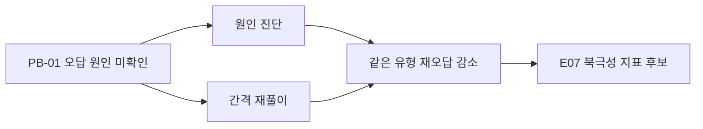

# E01 교육문제정의서

> **작성 가이드**
> - **목적**: 해결할 **학습 문제**를 기능이나 해법과 분리해서 정의합니다. "AI 해설을 만든다"가 아니라 "학생이 같은 유형을 반복해서 틀린다"처럼 학습자에게 일어나는 일을 씁니다.
> - **입력**: E00(학습자·사업 유형), `02.wiki/learners/`, `02.wiki/research/`, `01.자료실/현장/`, `01.자료실/데이터/`(집계 데이터), 관련 학습과학 페이지([[domain/형성평가와피드백]], [[domain/인출연습]] 등)
> - **게이트**: E00이 `done`이어야 합니다. 증거가 하나도 없는 문제는 `[가정]`으로 두고 E03 리서치 질문으로 넘깁니다. 문제 진술에 기능·해법 단어가 들어 있으면 완료하지 않습니다.
> - **검토 패널 제안**: 교사(강사) 2명 이상, 학습과학 자문, 영업 담당(구매자 관점)
> - 표의 예시 행은 샘플 제품 '매스핏'(중학생 수학 오답 코칭 앱, 학원 B2B2C + 학부모 결제, AI 오답 해설) 기준입니다. 실제 작성 시 지웁니다.

## 1. 문제 진술

| ID | 문제 진술 (학습자에게 일어나는 일) | 대상 학습자 | 학습 영역 |
|----|----------------------------------|------------|----------|
| PB-01 | {누가} {어떤 상황에서} {무엇을 못 해서} {어떤 학습 결과가 나빠진다} | {} | {교과·단원·역량} |
| 예시: PB-01 | 중학생이 수학 문제를 틀린 뒤 오답 원인을 확인하지 않고 정답만 베껴, 같은 유형을 시험에서 다시 틀린다 | 중2 수학 중하위권 | 일차함수, 연립방정식 |

> 한 문서에 PB는 1~3개로 제한합니다. 우선순위가 가장 높은 PB를 PB-01로 둡니다.

## 2. 문제가 아닌 것 (해법과 분리)

| 해법처럼 들리는 진술 | 바꾼 문제 진술 |
|---------------------|---------------|
| {예: "~ 기능이 없다"} | {학습자에게 일어나는 결과로 다시 씀} |
| 예시: "AI 오답 해설이 없다" | 학생이 오답 원인을 스스로 진단하지 못하고, 강사는 1:1 오답 설명에 시간을 쓰지 못한다 |

## 3. 누가 겪는가

| 대상 | 겪는 일 | 빈도·규모 | 근거 |
|------|--------|----------|------|
| 학습자 | {} | {} | {} |
| 교사·강사 | {} | {} | {} |
| 보호자 | {} | {} | {} |
| 기관 (학교·학원) | {} | {} | {} |
| 예시: 강사 | 반 20명의 오답 노트를 확인할 시간이 없어 검사가 "했는지 여부" 확인에 그침 | 주 2회 수업, 반당 20명 [가정] | `01.자료실/현장/2026-09-20_강사인터뷰_A.md` |

## 4. 증거

증거 수준은 [[domain/효과크기와증거수준]]의 구분을 따릅니다. 수치는 SQL·스크립트로 계산하고 경로를 적습니다.

| # | 증거 | 유형 | 강도 | 출처 |
|---|------|------|:---:|------|
| 1 | {} | {인터뷰/관찰/로그/설문/연구} | {상/중/하} | {} |
| 예시 1 | 학원 내부 시험에서 직전 시험 오답 유형 재오답률이 높음 | 로그(집계) | 중 | `01.자료실/데이터/2026-09_재오답률.csv`, 계산: `automation/sql/재오답률.sql` |
| 예시 2 | 학생들이 오답 노트를 "정답 옮겨 적기"로 처리 | 관찰 | 중 | `01.자료실/현장/2026-09-25_학원참관_B.md` |
| 예시 3 | 피드백이 정답 제시보다 오류 원인을 다룰 때 효과가 크다는 연구 | 연구 | 상 | [[domain/형성평가와피드백]] |

## 5. 현재 대안 (지금은 어떻게 버티는가)

| 대상 | 현재 대안 | 한계 | 비용 (시간·돈) |
|------|----------|------|---------------|
| {} | {} | {} | {} |
| 예시: 학생 | 해설지 보고 오답 노트에 옮겨 적기 | 원인 진단 없음, 인출 연습 없음 ([[domain/인출연습]]) | 주 1~2시간 [가정] |
| 예시: 학부모 | 과외·클리닉 추가 수강 | 비용 부담 | 월 {금액} [확인 필요] |

## 6. 왜 지금인가

| 요인 | 내용 | 출처 |
|------|------|------|
| 교육과정·정책 | {} | {[[market/...]]} |
| 기술 | {} | {} |
| 시장·경쟁 | {} | {} |
| 회사 | {} | E00 |
| 예시: 기술 | 손글씨 풀이 사진 인식과 생성형 AI 해설 품질이 학원 현장에서 쓸 수준에 도달 [가정] | E04 확인 예정 |

## 7. 학습 변화 가설

"이 문제가 해결되면 학습자에게 어떤 변화가 생기는가"를 측정 가능한 형태로 씁니다. E05의 학습 목표와 E07의 북극성 지표 후보가 됩니다.

> **가설 형식**: {대상}이 {행동 변화}를 하면 {기간} 안에 {학습 성과 지표}가 {방향·크기} 변한다. 이유: {학습과학 근거}

| ID | 가설 | 측정 방법 (안) | 근거 | 확신도 |
|----|------|--------------|------|:---:|
| PB-01-H1 | {} | {} | {} | {상/중/하} |
| 예시: PB-01-H1 | 중2 학생이 오답마다 원인을 진단하고 3일·7일 뒤 유사 문항을 다시 풀면, 한 학기 안에 같은 유형 재오답률이 의미 있게 줄어든다 | 학원 단원평가 재오답률 (사전·사후, 비교반) | [[domain/인출연습]], [[domain/간격반복]] | 중 |

## 8. 열린 질문 (E03 리서치로 넘김)

| # | 질문 | 확인 방법 | 담당 |
|---|------|----------|------|
| 1 | {} | {인터뷰/관찰/데이터} | {} |
| 예시 1 | 하위권과 중위권의 오답 원인 분포가 다른가? | 학원 오답 샘플 100건 분류 | PM + 콘텐츠팀 |

## 완료 체크리스트

- [ ] PB 진술에 기능·해법 단어가 없다 (2절로 분리 완료)
- [ ] 각 PB에 대상 학습자와 학습 영역(교과·단원·역량)이 명시되었다
- [ ] PB마다 증거가 2건 이상이고, 그중 1건 이상은 `01.자료실/` 원본 또는 집계 데이터다
- [ ] 수치 증거에 계산 스크립트·쿼리 경로가 있다 (LLM 추정치 없음)
- [ ] 현재 대안과 그 한계가 학습자·교사 관점에서 적혀 있다
- [ ] 학습 변화 가설이 측정 가능한 형태이고 `[[domain/...]]` 근거가 연결되었다
- [ ] 근거 없는 문장에 `[가정]`이 붙어 있다
- [ ] 열린 질문이 E03 리서치 계획으로 넘어갈 수 있게 정리되었다
