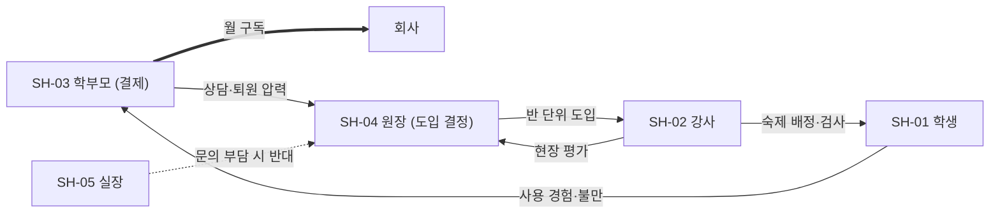

# E02 이해관계자맵

> **작성 가이드**
> - **목적**: 학습자·교사·보호자·기관 담당자가 각각 사용자·구매자·결제자·의사결정자·영향자·저지자 중 어떤 역할인지, 무엇을 성공으로 보는지 정리합니다. 이후 E06 가치 제안, E13 동의 구조, E18 도입 계획의 기준이 됩니다.
> - **입력**: E00 4절, [[domain/세그먼트별의사결정구조]], [[domain/교사참여설계]], `02.wiki/learners/`, 영업·CS 기록(`01.자료실/회의/`)
> - **게이트**: E00이 `done`이어야 합니다. 이해관계자마다 근거(인터뷰·영업 기록·위키)가 없으면 `[가정]`을 붙이고 E03에서 검증할 대상으로 표시합니다.
> - **검토 패널 제안**: 영업 담당, 교사(강사), 보호자 1명 이상, 개인정보 담당(동의 주체 확인)
> - 예시 행은 샘플 제품 '매스핏'(중학생 수학 오답 코칭 앱, 학원 B2B2C + 학부모 결제, AI 오답 해설) 기준입니다.

## 1. 이해관계자 목록

역할 약어: U 사용자, B 구매자(계약 주체), P 결제자, D 의사결정자, I 영향자, X 저지자(거부권·반대 가능). 한 이해관계자가 여러 역할을 가질 수 있습니다.

| ID | 이해관계자 | 역할 | 목표 | 고충 | 이들의 성공 정의 | 이들이 보는 숫자 | 근거 |
|----|-----------|------|------|------|----------------|----------------|------|
| SH-01 | 학습자 | {U} | {} | {} | {} | {} | {} |
| SH-02 | 교사·강사 | {U, I} | {} | {} | {} | {} | {} |
| SH-03 | 보호자 | {P, I} | {} | {} | {} | {} | {} |
| SH-04 | 기관 의사결정자 (원장·교장·HR 리더) | {B, D} | {} | {} | {} | {} | {} |
| SH-05 | 기관 운영 담당 (교무·정보 담당, 실장) | {I, X} | {} | {} | {} | {} | {} |
| SH-06 | 교육청·상위 기관 | {D, X} | {} | {} | {} | {} | {} |
| 예시: SH-01 | 중학생 (만 12~15세) | U | 시험에서 점수 올리기, 숙제 빨리 끝내기 | 해설을 읽어도 왜 틀렸는지 모름 | 다음 시험에서 같은 유형을 맞힘 | 시험 점수, 남은 숙제 수 | `01.자료실/현장/2026-09-22_학생인터뷰_C.md` |
| 예시: SH-02 | 학원 강사 | U, I | 반 평균 향상, 수업 준비 시간 확보 | 오답 노트 검사·1:1 설명 시간 부족 | 채점·검사 시간 감소 + 반 평균 상승 | 반 평균, 숙제 제출률 | `01.자료실/현장/2026-09-20_강사인터뷰_A.md` |
| 예시: SH-03 | 학부모 | P, I | 성적 향상, 사교육비 대비 효과 | 아이가 실제로 공부했는지 모름 | 성적표·상담에서 개선 확인 | 학교 시험 점수, 월 결제액 | [가정] |
| 예시: SH-04 | 학원 원장 | B, D | 재원생 유지, 신규 모집, 강사 효율 | 퇴원 사유 1위가 성적 정체 [가정] | 재등록률 유지 + 학부모 만족 | 재원생 수, 퇴원율, 강사 1인당 학생 수 | `01.자료실/회의/2026-09-18_영업미팅.md` |
| 예시: SH-05 | 학원 실장 | I, X | 학부모 응대·결제 관리 부담 최소화 | 새 앱마다 학부모 문의 폭증 | 문의 없이 결제·가입 완료 | 문의 건수 | [가정] |

> 사업 유형별로 행을 바꿉니다. K-12 공교육은 교육청 담당 장학사·정보화 담당·학교운영위원회, 기업교육은 HRD 담당·현업 팀장·재무를 추가합니다. 근거: [[domain/세그먼트별의사결정구조]]

## 2. 영향력·관심도

| ID | 영향력 (도입 결정) | 관심도 (일상 사용) | 관리 전략 |
|----|:---:|:---:|----------|
| SH-xx | {상/중/하} | {상/중/하} | {밀착 관리 / 만족 유지 / 정보 제공 / 모니터링} |
| 예시: SH-04 원장 | 상 | 중 | 밀착 관리: 월간 반별 성과 리포트 제공 |
| 예시: SH-02 강사 | 중 | 상 | 만족 유지: 업무량 증가 없는 운영 설계 ([[domain/교사참여설계]]) |

## 3. 영향 관계도

화살표는 "누가 누구의 결정·사용에 영향을 주는가"입니다. 굵은 선은 돈의 흐름입니다.

> 위 그림은 예시입니다. 자기 사업 구조에 맞게 다시 그립니다.

## 4. 구매 여정 vs 사용 여정

구매를 결정하는 사람이 보는 가치와 매일 쓰는 사람이 겪는 경험이 어긋나는 지점을 찾습니다. 이 간극이 도입 후 이탈의 주된 원인입니다.

| 단계 | 구매 여정 (누가, 무엇을 봄) | 사용 여정 (누가, 무엇을 겪음) | 간극 | 대응 산출물 |
|------|---------------------------|----------------------------|------|------------|
| 인지 | {} | {} | {} | {E18} |
| 평가·체험 | {} | {} | {} | {E16·E17} |
| 도입·온보딩 | {} | {} | {} | {E08·E18} |
| 일상 사용 | {} | {} | {} | {E08·E09} |
| 갱신·추천 | {} | {} | {} | {E07·E19} |
| 예시: 평가·체험 | 원장: 데모에서 AI 해설 품질과 리포트 화면을 봄 | 강사: 첫 주에 학생 계정 발급·숙제 배정에 30분 이상 소요 | 원장이 본 가치는 강사 부담을 반영하지 않음 | E08 온보딩, E17 강사 소요 시간 측정 |
| 예시: 갱신·추천 | 학부모: 결제 문자에서 월 금액만 봄 | 학생: 앱을 주 1회만 엶 | 결제자가 학습 성과를 볼 수 없음 | E07 보호자용 지표, E09 리포트 |

## 5. 동의·권한 구조

미성년 학습자가 있으면 누가 동의하고 누가 데이터를 볼 수 있는지 정합니다. 상세 평가는 E13에서 합니다.

| 데이터·행위 | 동의 주체 | 열람 가능 | 근거 |
|------------|----------|----------|------|
| {가입·개인정보 수집} | {} | {} | [[domain/아동개인정보보호]] |
| 예시: 만 14세 미만 가입 | 법정대리인(학부모) | 학생 본인, 학부모, 담당 강사 | [[domain/아동개인정보보호]] |
| 예시: 학습 리포트 | 학부모 동의 시 학원 공유 | 원장·강사(반 단위), 학부모(자녀만) | [가정] E13에서 확인 |

## 6. 리서치로 넘길 질문

| SH | 검증할 가정 | 방법 |
|----|-----------|------|
| {} | {} | {E03 인터뷰/관찰} |
| 예시: SH-03 | 학부모는 점수 외에 학습 과정 지표(오답 해결 수)에도 가치를 느낀다 | 학부모 인터뷰 5명 |

## 완료 체크리스트

- [ ] 사용자·구매자·결제자·의사결정자가 모두 한 명 이상 지정되었다
- [ ] 저지자(X) 역할 후보를 검토했다 (실장·정보 담당·교육청 등)
- [ ] SH마다 성공 정의와 "이들이 보는 숫자"가 있다 (E07 지표 후보)
- [ ] 영향 관계도에 돈의 흐름과 결정의 흐름이 구분되어 있다
- [ ] 구매 여정과 사용 여정의 간극이 1개 이상 도출되고 대응 산출물이 지정되었다
- [ ] 미성년 학습자가 있으면 동의 주체와 열람 범위가 적혀 있다
- [ ] 근거 없는 항목에 `[가정]`이 붙고 6절에 검증 질문으로 넘어갔다
