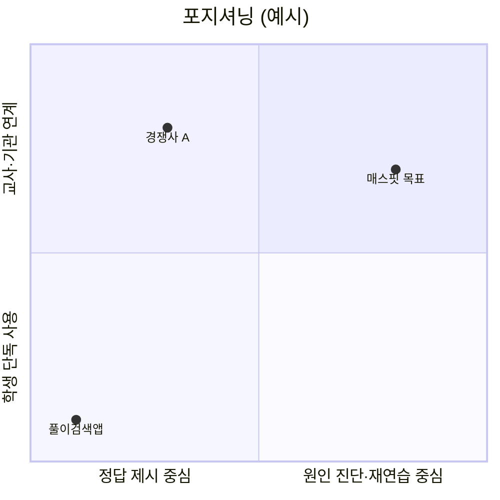

# E04 시장·정책분석

> **작성 가이드**
> - **목적**: 대상 세그먼트의 규모, 경쟁 구도, 가격, 교육과정·정책·조달 환경, 규제 노출, 시기적 요인을 정리해 "이 문제를 지금 이 시장에서 풀 만한가"를 판단합니다.
> - **입력**: E00(사업 유형·규제 노출), `02.wiki/market/`(경쟁사·가격·정책 동향), `01.자료실/시장/`, `01.자료실/정책/`, [[domain/학사일정]], [[domain/세그먼트별의사결정구조]], [[domain/아동개인정보보호]], [[domain/접근성]], [[domain/상호운용표준]]
> - **게이트**: E00이 `done`이어야 합니다. **모든 사실 주장에 출처와 확인 일자**를 달거나 `[확인 필요]`를 붙입니다. 가격·정책·규제 수치는 위키 페이지의 `verified` 날짜가 180일 이내여야 합니다. 시장 규모 추정 계산은 스프레드시트·스크립트로 하고 경로를 적습니다.
> - **검토 패널 제안**: 사업 리더, 영업 담당, 정책·조달 경험자
> - 예시 행은 샘플 제품 '매스핏'(중학생 수학 오답 코칭 앱, 학원 B2B2C + 학부모 결제, AI 오답 해설) 기준이며, 수치는 형식을 보여주기 위한 자리표시입니다.

## 1. 세그먼트 규모

TAM·SAM·SOM은 산식과 출처를 함께 씁니다. 학생 수·기관 수 같은 기초 통계는 공식 통계 출처를 우선합니다.

| 구분 | 정의 | 규모 | 산식 | 출처 (확인 일자) |
|------|------|------|------|----------------|
| TAM | {} | {} | {} | {} |
| SAM | {} | {} | {} | {} |
| SOM (3년) | {} | {} | {} | {} |
| 예시: SAM | 수학 교습을 하는 중등 대상 학원의 재원 중학생 | {N}명 [확인 필요] | 중학생 수 × 수학 학원 수강 비율 | 교육 통계 연보, 사교육비 조사 [확인 필요] (YYYY-MM-DD) |

계산 경로: `{automation/scripts/시장규모.py 또는 05.outputs/시장규모_YYYYMMDD.xlsx}`

## 2. 경쟁 구도

직접 경쟁(같은 문제·같은 고객), 간접 경쟁(같은 문제·다른 방식), 대체재(현재 대안)를 모두 봅니다.

| 경쟁자 | 유형 | 대상·채널 | 핵심 가치 | 가격 | 학습 효과 주장과 근거 수준 | 약점 | 위키 |
|--------|------|----------|----------|------|-------------------------|------|------|
| {} | {직접/간접/대체} | {} | {} | {} | {} | {} | {[[market/...]]} |
| 예시: 경쟁사 A (학원용 문제은행·채점) | 간접 | 학원 B2B | 문항 출제·자동 채점 | 학원 월 정액 [확인 필요] | "성적 향상" 주장, 비교군 없음 ([[domain/효과크기와증거수준]] 기준 하) | 오답 원인 진단 없음 | [[market/경쟁사-A]] |
| 예시: 해설지·질문 앱 | 대체 | B2C | 사진 찍으면 풀이 제공 | 무료~월 구독 | 학습 효과 주장 없음 | 정답 즉시 제시로 인출 연습 없음 | [[market/풀이검색앱]] |

## 3. 가격 환경

| 대상 | 지불 주체 | 일반적 가격대 | 예산 출처 | 출처 (확인 일자) |
|------|----------|-------------|----------|----------------|
| {} | {} | {} | {} | {} |
| 예시: 학원 연계 학습앱 | 학부모 | 월 {금액} [확인 필요] | 가계 사교육비 | 경쟁사 공개 가격 페이지 (YYYY-MM-DD) |

## 4. 교육과정·정책·조달 환경

| 영역 | 현황 | 우리에게 주는 의미 | 출처 (확인 일자) |
|------|------|-----------------|----------------|
| 교육과정 | {적용 중인 교육과정, 성취기준 개편 시기} | {E05 성취기준 매핑 기준} | {} |
| 정책 | {디지털 교육·AI 교육 관련 정책} | {} | {} |
| 평가 제도 | {내신·수행평가 방식 변화} | {} | {} |
| 조달 채널 | {공공 조달, 학교 자율 구매, 학원 직판 등} | {} | {} |
| 예시: 교육과정 | 중학교 수학 성취기준이 개정 교육과정 기준으로 적용 중 [확인 필요] | 학년별 단원·성취기준 코드로 문항 태깅 필요 | `01.자료실/정책/{교육과정 고시}` (YYYY-MM-DD) |
| 예시: 조달 채널 | 학원은 원장 단독 결정, 공공 조달 불필요 | 영업 주기가 짧고 학기 시작 전 집중 | [[domain/세그먼트별의사결정구조]] |

## 5. 규제 노출

상세 판정은 E13에서 합니다. 여기서는 사업 타당성에 영향을 주는 항목만 짚습니다.

| 규제 영역 | 적용 여부 | 영향 | 위키 (verified) |
|----------|:---:|------|----------------|
| 아동·학생 개인정보 | {} | {} | [[domain/아동개인정보보호]] ({YYYY-MM-DD}) |
| 접근성 | {} | {} | [[domain/접근성]] |
| 표준·연동 | {} | {} | [[domain/상호운용표준]] |
| AI 관련 규범·가이드라인 | {} | {} | {[[domain/...]]} [확인 필요] |
| 예시: 아동·학생 개인정보 | 적용 | 만 14세 미만 가입 시 법정대리인 동의 흐름 필수, 가입 전환율 하락 위험 | [[domain/아동개인정보보호]] |

## 6. 시기·계절성

[[domain/학사일정]] 기준으로 수요·영업·출시 창을 정리합니다. E15·E18 G-CAL의 입력이 됩니다.

| 시기 | 수요 변화 | 영업 창 | 출시 적합성 | 출처 |
|------|---------|--------|:---:|------|
| {월} | {} | {} | {적합/주의/금지} | {} |
| 예시: 2월 | 신학기 학원 등록 성수기 | 원장 도입 결정 집중 | 적합 (1월 말까지 안정화 필요) | [[domain/학사일정]] |
| 예시: 시험 4주 전~시험 | 학습 수요 최고 | 영업 불가 (원장 바쁨) | 금지 (장애 시 피해 큼) | [[domain/학사일정]] |

## 7. 기회와 위협

| 구분 | 내용 | 근거 | 대응 |
|------|------|------|------|
| 기회 | {} | {} | {} |
| 위협 | {} | {} | {} |
| 예시: 기회 | 경쟁 제품 대부분이 정답 제시형이라 "원인 진단·재연습" 포지션이 비어 있음 | 2절 경쟁 표 | E06 가치 제안 차별점 |
| 예시: 위협 | 무료 풀이 검색 앱이 학생 습관을 선점 | [[market/풀이검색앱]] | E08에서 즉시 정답 대신 힌트 흐름 설계 |

## 8. 결론

| 질문 | 판단 | 근거 |
|------|------|------|
| 이 세그먼트를 우선 공략할 만한가? | {예/조건부/아니오} | {} |
| 진입 시기는? | {} | {6절} |
| 가장 큰 미확인 사실은? | {} | {[확인 필요] 목록} |

## 교육과정 지식그래프 연결

> 국가 교육과정(2022 개정) 기반 제품일 때 작성합니다. 도구: `/edpm-curriculum`, `automation/kg/kg_query.py`. KG는 공식 자료가 아니며, 공식 관계와 권장 순서(후보)를 구분해 씁니다. KG 릴리스: {`kg_query.py stats` 결과}

| 분석 | 명령 | 결과 요약 | 시사점 |
|------|------|-----------|--------|
| 대상 과목의 성취기준 규모 | `kg_query.py courses`, `search --course` | {…} | {콘텐츠 제작량 추정} |
| 전환기 연계가 약한 과목 | `kg_query.py gaps` | {…} | {브리지·진단 기회 — 문서상 지표임을 명시} |
| 예시 (매스핏) | `kg_query.py gaps --subject 수학` | 초→중 수학 격차 점수 49, 연계율 21.7%, 신규 성취기준 47/60 (연계 과소집계 가능 표시) | 중1 진입 진단·비례식 복습을 차별점 후보로 [가정] |
| 고교 과목 구조 (해당 시) | `kg_query.py courses --level high` | {…} | {선택 과목 대응 범위} |

## 완료 체크리스트

- [ ] 모든 사실 주장에 출처와 확인 일자가 있거나 `[확인 필요]`가 붙어 있다
- [ ] 시장 규모에 산식과 계산 파일 경로가 있다 (LLM 추정치 없음)
- [ ] 경쟁자 표에 직접·간접·대체재가 모두 있고, 학습 효과 주장의 근거 수준을 평가했다
- [ ] 교육과정·정책·조달 채널이 사업 유형에 맞게 정리되었다
- [ ] 규제 노출 항목이 `02.wiki/domain/` 페이지에 연결되고 verified 날짜가 180일 이내다
- [ ] 시기·계절성 표에 출시 금지 기간이 1개 이상 표시되었다
- [ ] 기회·위협마다 대응 산출물이 지정되었다
- [ ] 새로 확인한 경쟁사·가격·정책 정보가 `02.wiki/market/`에 반영되었다
- [ ] (교육과정 기반이면) 전환기 격차를 시장 기회로 쓸 때 '문서상 연계 지표이지 성취도가 아님'을 적었다
