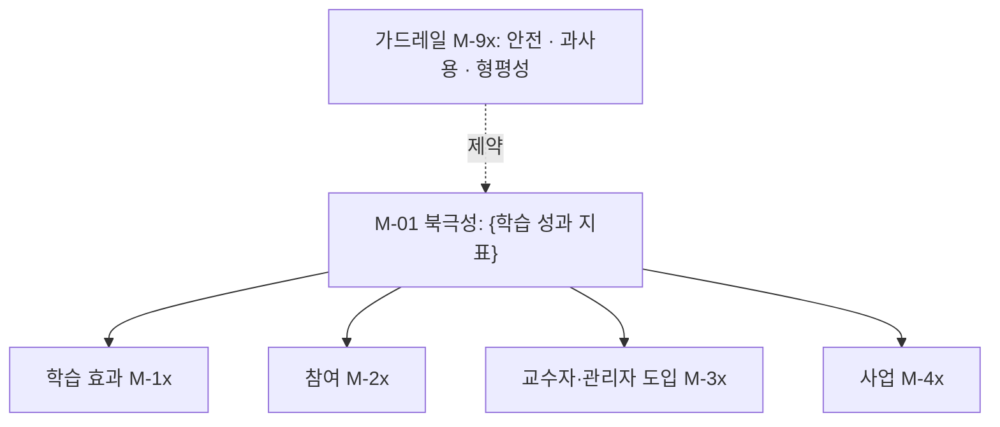
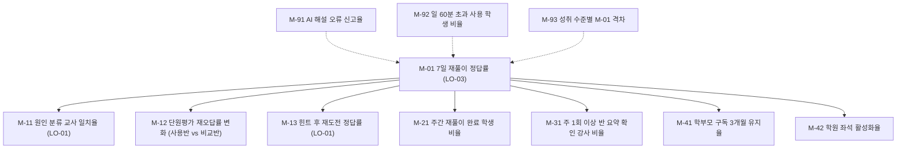

# E07 성과지표체계

> **작성 가이드**
> - **목적**: 학습 효과를 북극성으로 두고, 참여·교수자 도입·사업 지표를 그 아래에, 안전·과사용·형평성을 가드레일로 둡니다. 각 지표의 산식·데이터 출처·담당·주기·목표를 정의해 E12(학습데이터설계)와 E16·E19(검증·효과 리포트)에 넘깁니다.
> - **입력**: E05(LO·평가 증거·성과 목표), E06(REQ·이해관계자 가치 제안), E02(이해관계자가 보는 숫자), [[domain/학습분석지표]], [[domain/효과크기와증거수준]], [[domain/동기설계]]
> - **게이트**: E05, E06이 `done`이어야 합니다. **실체 검증**: 북극성 지표가 학습 성과(LO)와 연결되어야 하며, 참여 지표만으로 구성할 수 없습니다. 모든 지표 값은 **SQL·스크립트로 계산**하고 경로를 적습니다. LLM이 수치를 추정하지 않습니다.
> - **검토 패널 제안**: 데이터 분석가, 학습과학 자문, 사업 리더, 개인정보 담당(수집 범위)
> - 예시 행은 샘플 제품 '매스핏'(중학생 수학 오답 코칭 앱, 학원 B2B2C + 학부모 결제, AI 오답 해설) 기준입니다.

## 1. 지표 트리

예시 (매스핏):

## 2. 북극성 지표

| 항목 | 내용 |
|------|------|
| ID | M-01 |
| 이름 | {} |
| 연결 LO | {LO-xx} — 참여 지표만으로는 불가 |
| 왜 이 지표인가 | {학습 성과를 직접 반영하고, 사업 성과의 선행 지표인 이유} |
| 조작 위험 | {지표만 오르고 학습은 안 되는 경우와 방지책} |
| 예시 | M-01 7일 재풀이 정답률 / LO-03 / 오답이 "내 것"이 되었는지를 직접 보며, 학부모가 체감하는 시험 성과의 선행 지표 [가정] / 쉬운 문항만 재출제하면 오르므로 원래 오답과 난이도가 같은 문항만 집계 |

## 3. 지표 정의표

사업 유형에 해당하는 행만 남깁니다. B2C는 유지율·ARPU, 학원·기업 B2B는 좌석 활성화·NRR, B2G는 재계약·학교 활용률을 씁니다.

| ID | 분류 | 지표 | 산식 | 데이터 출처·이벤트 | 담당 | 주기 | 목표 |
|----|------|------|------|-----------------|------|------|------|
| M-01 | 북극성 | {} | {} | {EV-xx} | {} | {} | {} |
| M-1x | 학습 효과 | {} | {} | {} | {} | {} | {} |
| M-2x | 참여 | {} | {} | {} | {} | {} | {} |
| M-3x | 교수자·관리자 도입 (교사·강사·튜터·HRD·교수·학부모) | {} | {} | {} | {} | {} | {} |
| M-4x | 사업 | {B2C 유지율·ARPU / B2B NRR·좌석 활성화 / B2G 재계약} | {} | {} | {} | {} | {} |
| M-9x | 가드레일 | {} | {} | {} | {} | {} | {상한·하한} |
| 예시: M-01 | 북극성 | 7일 재풀이 정답률 | 7일 재출제 문항 정답 수 ÷ 7일 재출제 문항 응답 수 (원 오답과 같은 난이도 구간만) | 재출제 응답 이벤트 (E12에서 EV 지정) | PM | 주간 | 70% [가정] |
| 예시: M-11 | 학습 효과 | 원인 분류 교사 일치율 | 교사 표본 판정과 학생 원인 선택이 일치한 건수 ÷ 표본 수 | 원인 선택 이벤트 + 교사 표본 채점 | 콘텐츠팀 | 월간 | 80% [가정] |
| 예시: M-12 | 학습 효과 | 단원평가 재오답률 효과 크기 | 사용반·비교반 재오답률 차이의 효과 크기 | 학원 단원평가 집계 (`01.자료실/데이터/`) | 데이터 분석가 | 학기 | [[domain/효과크기와증거수준]] 기준 "의미 있음" |
| 예시: M-13 | 학습 효과 | 힌트 후 재도전 정답률 | 힌트를 1단계 이상 본 오답 문항 중 3회 이내 재도전에서 정답인 비율 | 힌트 요청·응답 이벤트 (E12 EV-03, EV-04) | AI 담당 | 주간 | 60% [가정] |
| 예시: M-21 | 참여 | 주간 재풀이 완료 학생 비율 | 주간 재출제 1건 이상 완료 학생 ÷ 활성 학생 | 재출제 응답 이벤트 | PM | 주간 | 60% |
| 예시: M-31 | 교수자 도입 | 반 요약 확인 강사 비율 | 주 1회 이상 반 요약 화면을 연 강사 ÷ 계정 발급 강사 | 화면 조회 이벤트 | 학원 CS | 주간 | 70% |
| 예시: M-41 | 사업 (B2C 결제) | 학부모 구독 3개월 유지율 | 3개월 차 결제 유지 ÷ 첫 결제 코호트 | 결제 DB | 사업 리더 | 월간 | {[확인 필요]} |
| 예시: M-42 | 사업 (B2B) | 학원 좌석 활성화율 | 주 1회 이상 사용 학생 ÷ 학원 등록 좌석 | 사용 이벤트 + 계약 DB | 영업 | 월간 | 75% |
| 예시: M-43 | 사업 (B2C 전환) | 체험 전환율 | 14일 체험 후 유료 결제 학부모 ÷ 체험 시작 학부모 | 체험·결제 이벤트 + 결제 DB | 마케팅 | 주간 | {[가정]} |
| 예시: M-44 | 사업 (B2B 도입) | 도입 후 4주 활성 반 비율 | 도입 4주 차 주 1회 이상 사용 반 ÷ 도입 반 | 사용 이벤트 + 계약 DB | 도입 지원 | 월간 | 70% [가정] |
| 예시: M-91 | 가드레일 (안전) | AI 해설 오류 신고율 | 오류 신고 건 ÷ AI 해설 제공 건 | 신고 이벤트 | AI 담당 | 주간 | 1% 이하, 초과 시 기능 축소 |
| 예시: M-92 | 가드레일 (과사용) | 일 60분 초과 사용 학생 비율 | 일 사용 60분 초과 학생 ÷ 활성 학생 | 세션 이벤트 | PM | 주간 | 5% 이하 |
| 예시: M-93 | 가드레일 (형평성) | 성취 수준별 북극성 격차 | 상위·하위 성취 집단 M-01 차이 | M-01 + 진단 평가 구간 | 데이터 분석가 | 월간 | 격차가 기준선보다 커지지 않음 |

## 4. 이해관계자별 대시보드

E02의 "이들이 보는 숫자"를 지표로 연결합니다.

| SH | 보는 지표 | 형태 | 주기 |
|----|---------|------|------|
| {} | {} | {} | {} |
| 예시: SH-03 학부모 | M-01(자녀 개인값), 재풀이 성공 수 | 주간 알림 | 주 1회 |
| 예시: SH-04 원장 | M-42, 반별 M-01 | 월간 리포트 | 월 1회 |

## 5. 계산 원칙과 계측 요구

- 모든 지표는 SQL·스크립트로 계산하고 경로를 아래 표에 적습니다. LLM은 계산 결과를 해석·설명만 합니다.
- 학습 효과 지표(M-1x)는 비교 기준(사전·사후, 비교반)을 함께 정합니다. 효과 크기와 증거 수준 해석은 [[domain/효과크기와증거수준]]을 따릅니다.
- 개인 단위 지표는 집계 화면에서만 다루고, 위키·산출물에는 집계값만 둡니다.

| ID | 필요한 이벤트·속성 (E12로 전달) | 계산 경로 | 상태 |
|----|-------------------------------|----------|------|
| {} | {} | {automation/sql/...} | {미구현/구현/검증} |
| 예시: M-01 | 재출제 응답(문항 ID, 원 오답 ID, 난이도 구간, 정오, 경과일) | `automation/sql/M01_7일재풀이정답률.sql` | 미구현 |
| 예시: M-92 | 세션 시작·종료, 학생 가명 ID | `automation/sql/M92_과사용.sql` | 미구현 |

## 6. 반(反)지표 경고

아래 지표는 단독 목표로 쓰지 않습니다.

| 지표 | 왜 위험한가 | 대신 볼 것 |
|------|-----------|----------|
| 앱 체류 시간 | 체류 시간은 학습이 아니다. 막혀서 오래 머문 것일 수 있다 | M-01, M-21 |
| 해설 열람 수 | 정답을 바로 보는 습관이 늘어도 오른다 | 힌트 단계별 진행률, M-11 |
| 풀이 문항 수 | 쉬운 문항 반복으로 부풀려진다 | 난이도 구간별 정답률 |
| 연속 출석일(스트릭) | 의무감 접속만 늘고 과사용으로 이어질 수 있다 ([[domain/동기설계]]) | M-21, M-92 |
| {} | {} | {} |

## 완료 체크리스트

- [ ] 북극성 지표가 특정 LO에 연결되어 있다 (참여 지표만으로 구성되지 않음, 실체 검증)
- [ ] 북극성 지표의 조작 위험과 방지책이 적혀 있다
- [ ] 학습 효과·참여·교수자 도입·사업·가드레일 분류마다 지표가 1개 이상 있다
- [ ] 가드레일에 안전, 과사용(화면 시간), 집단 간 형평성 지표가 있다
- [ ] 모든 지표에 산식, 데이터 출처, 담당, 주기, 목표가 있다
- [ ] 계산 경로(SQL·스크립트)가 지정되었고, LLM 추정치가 없다
- [ ] 계측 요구가 E12로 넘길 수 있게 이벤트·속성 단위로 정리되었다
- [ ] 반지표 경고를 검토했고 사업 유형에 맞게 추가했다
- [ ] 근거 없는 목표값에 `[가정]`이 붙어 있다
