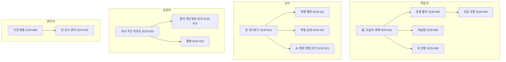

# E10 화면·정보구조설계서

> **작성 가이드**
> - **목적**: 역할별 정보 구조(IA)와 화면 목록(SCR)을 정하고, 각 화면이 어떤 기능(F)을 담는지, 어떤 상태를 가져야 하는지를 정의합니다.
> - **입력**: E09 기능명세서(F, 권한 매트릭스), E08 학습 흐름, `02.wiki/learners/`, [[domain/접근성]]
> - **게이트**: 전제는 E09. 연령 UI 규칙과 접근성 메모는 E13 (c) 접근성 점검의 입력이 됩니다.
> - **검토 패널 (권장)**: 디자이너, 교사 1명 이상, 대상 연령 사용성 참여자(보호자 동의), 접근성 점검자
> - **상세 와이어프레임**: 이 문서는 목록과 규칙까지만 다룹니다. 화면별 와이어프레임은 스킬 `sb-lowfi-pptx`(low-fi HTML·편집 가능한 PPTX) 또는 `sb-lowfi-figma`(Figma 화면설계서)로 만들고, 클릭해 보는 흐름은 `06.prototypes/_starter/click-prototype.html`로 만들며, 출력물은 `05.outputs/`에 `파일명_YYYYMMDD_HHMM` 형식으로 저장합니다.
> - 표의 첫 행은 예시 제품 **매스핏**(중학생 수학 오답 코칭, 학원 B2B2C + 학부모 결제) 기준입니다.

---

## 1. 역할별 정보 구조 (IA)

> 역할마다 첫 화면과 깊이 3단계 이내를 원칙으로 합니다. 학습자 IA는 "오늘 할 일"이 첫 화면이어야 합니다.

## 2. 화면 목록 (SCR)

| SCR-ID | 화면명 | 역할 | 목적 | 연결 F | 연결 LA | 플랫폼 | 우선순위 |
|--------|--------|------|------|--------|---------|--------|----------|
| SCR-004 (예시) | 오답 코칭 | 학습자 | 오답 직후 오류 단계를 찾고 힌트 사다리로 재도전 | F-012 | LA-03 | 모바일·태블릿 | P0 |
| {SCR-0NN} | {화면명} | {역할} | {한 문장} | {F-ID} | {LA-ID} | {웹/모바일/태블릿} | {P0~P2} |

## 3. 화면별 핵심 상태

> 모든 화면은 아래 상태를 정의합니다. "동의 없음"은 보호자 동의 전·철회 후 상태입니다. 해당 없으면 "해당없음"으로 적습니다.

| SCR-ID | 빈 상태 | 로딩 | 오류 | 동의 없음 | 오프라인 | 권한 없음 |
|--------|---------|------|------|-----------|----------|-----------|
| SCR-004 (예시) | (해당없음: 오답 시에만 진입) | 힌트 생성 중 "생각 중" 표시, 3초 초과 시 정적 힌트 | "힌트를 불러오지 못했어요. 다시 풀어 볼까요?" + 재도전 | 학습 기능 잠금, "보호자 동의가 필요해요" 안내 | 정적 힌트 1단계만 제공, 동기화 대기 표시 | 해당없음 |
| SCR-010 (예시) | "아직 학생이 없어요" + 초대 코드 복사 | 스켈레톤 | 재시도 버튼 | 동의 미완 학생은 이름 대신 "동의 대기" 표시 | 마지막 동기화 시각 표시 | 담당 반이 아니면 접근 차단 |
| {SCR} | {상태} | {상태} | {상태} | {상태} | {상태} | {상태} |

오류 문구 원칙: 학습자 탓을 하지 않고, 다음 행동을 하나만 제시하며, 기술 용어를 쓰지 않습니다.

## 4. 연령별 UI 규칙

근거: [[domain/접근성]], [[domain/인지부하이론]]. 수치는 회사 디자인 시스템과 위키 근거로 확정하고 `[가정]`을 지웁니다.

| 항목 | 초등 저학년 | 초등 고학년 | 중학생 (예시: 매스핏) | 고등·성인 |
|------|-------------|-------------|------------------------|-----------|
| 지시문 읽기 수준 | 해당 학년 교과서 어휘, 한 문장 15자 내외 [가정] | 한 문장 25자 내외 [가정] | 한 문장 30자 내외, 수학 용어는 교과서 표기 그대로 | 일반 |
| 본문 글자 크기 | 18px 이상 [가정] | 16px 이상 [가정] | 16px 이상, 수식 18px 이상 | 16px |
| 터치 영역 | 48×48dp 이상 [가정] | 44×44 이상 | 44×44 이상 (WCAG 2.2 2.5.8 최소 24×24 충족) | 44×44 |
| 아이콘 | 텍스트 라벨 필수 | 라벨 필수 | 주요 동작은 라벨 병기 | 선택 |
| 음성 안내 | 기본 제공 | 선택 | 선택 | 선택 |
| 한 화면 주요 행동 | 1개 | 1~2개 | 2개 이하 | 제한 없음 |
| 외부 링크·결제 진입 | 보호자 확인 후 | 보호자 확인 후 | 학습자 화면에 노출 금지 (보호자 앱에서만) | 일반 |

## 5. 접근성 메모

> 화면별로 특이 사항만 적습니다. 전체 판정은 E13 (c)에서 합니다.

| SCR-ID | 항목 | 요구 사항 | 메모 |
|--------|------|-----------|------|
| SCR-004 (예시) | 수식 읽기 | 수식은 이미지가 아니라 MathML 등 스크린리더가 읽을 수 있는 형식 | 화면 낭독 시 "x 더하기 3은 7" |
| SCR-004 (예시) | 색 의존 | 오류 단계는 빨간색과 함께 아이콘·밑줄로 표시 | 색각 이상 학습자 |
| SCR-003 (예시) | 시간 제한 | 풀이 타이머는 끄거나 연장 가능 | 특수교육 대상 학습자 |
| {SCR} | {키보드/대비/자막/시간} | {요구} | {메모} |

## 6. 내비게이션·공통 규칙

| 규칙 | 내용 | 예시 |
|------|------|------|
| 세션 종료 | {학습 흐름 마무리 방식} | 20분 경과 시 "오늘은 여기까지" 제안, 강제 종료 아님 |
| 뒤로 가기 | {풀이 중 이탈 처리} | 풀이 중 이탈 시 임시 저장 |
| 공용 기기 | {로그아웃 노출} | 학원 태블릿 모드는 상단에 이름과 로그아웃 상시 노출 |
| 알림 | {시간대} | 오후 9시~오전 8시 학습자 푸시 금지 [가정] |

## 7. 와이어프레임 산출

| 대상 | 스킬 | 입력 | 출력 위치 |
|------|------|------|-----------|
| P0 화면 low-fi | `sb-lowfi-pptx` | 이 문서 2~5절 + 화면별 ASCII 배치 | `05.outputs/E10_wireframe_YYYYMMDD_HHMM.pptx` |
| 개발 전달용 HTML | `sb-lowfi-pptx` (low-fi HTML) | 동일 | `05.outputs/E10_screens_YYYYMMDD_HHMM.html` |

---

## 역할별 IA·화면 패턴 참조

> 서비스 유형에 맞는 패턴을 출발점으로 쓰고, 우리 제품 결정만 이 문서에 적습니다. 패턴은 위키 `domain/`(개인 Brain에서 시드)에 있습니다.

| 영역 | 패턴 페이지 | 적용 여부 | 우리 결정 (패턴과 다른 점) |
|------|-------------|-----------|----------------------------|
| 학습자 앱 | [[domain/학습자앱IA]] | {예/아니오} | {…} |
| 강사 대시보드 | [[domain/강사대시보드IA]] | {…} | {…} |
| 교사 대시보드 (K-12·학원) | [[domain/교사대시보드IA]] | {…} | {…} |
| 기업 관리자 LMS | [[domain/기업관리자LMSIA]] | {…} | {…} |
| 콘텐츠 CMS | [[domain/콘텐츠CMSIA]] | {…} | {…} |
| 강의 플레이어 | [[domain/강의플레이어UX]] | {…} | {진도 저장·배속·건너뛰기 규칙은 L03·P03과 일치} |
| 코딩 실습 IDE | [[domain/코딩실습IDE]] | {…} | {…} |
| 퀴즈·과제 | [[domain/퀴즈과제UI]] | {…} | {L04 평가 규칙과 일치} |
| 수강생 대시보드 | [[domain/수강생대시보드]] | {…} | {…} |
| 라이브 클래스 | [[domain/라이브클래스화면]] | {…} | {미성년이면 녹화 동의·채팅 제한, E13} |
| 예시 (매스핏) | 학습자앱IA, 퀴즈과제UI, 수강생대시보드 | 예 | 탭 3개(오늘·오답노트·리포트)로 축소, 탐색·결제는 학원 경유라 제외 |

와이어프레임은 이 문서를 입력으로 `sb-lowfi-pptx`(low-fi HTML·화면설계서 PPTX) 또는 `sb-lowfi-figma`(Figma 화면설계서) 스킬로 만듭니다.

## 완료 체크리스트

- [ ] 역할별 IA가 Mermaid로 그려지고, 학습자 첫 화면이 학습 행동으로 시작한다
- [ ] 모든 SCR이 하나 이상의 F에 연결되고, 모든 P0 F가 화면을 가진다
- [ ] 모든 화면에 빈·로딩·오류·동의 없음·오프라인·권한 없음 상태가 정의되었다
- [ ] 연령별 UI 규칙 값이 확정되었거나 `[가정]` 표시가 있다
- [ ] 학습자 화면에 결제·광고·외부 링크가 노출되지 않는다
- [ ] 접근성 메모가 E13 (c)에 전달되었다
- [ ] P0 화면 와이어프레임이 `05.outputs/`에 있다
- [ ] 서비스 유형에 해당하는 IA·화면 패턴을 검토하고, 패턴과 다른 결정을 기록했다
