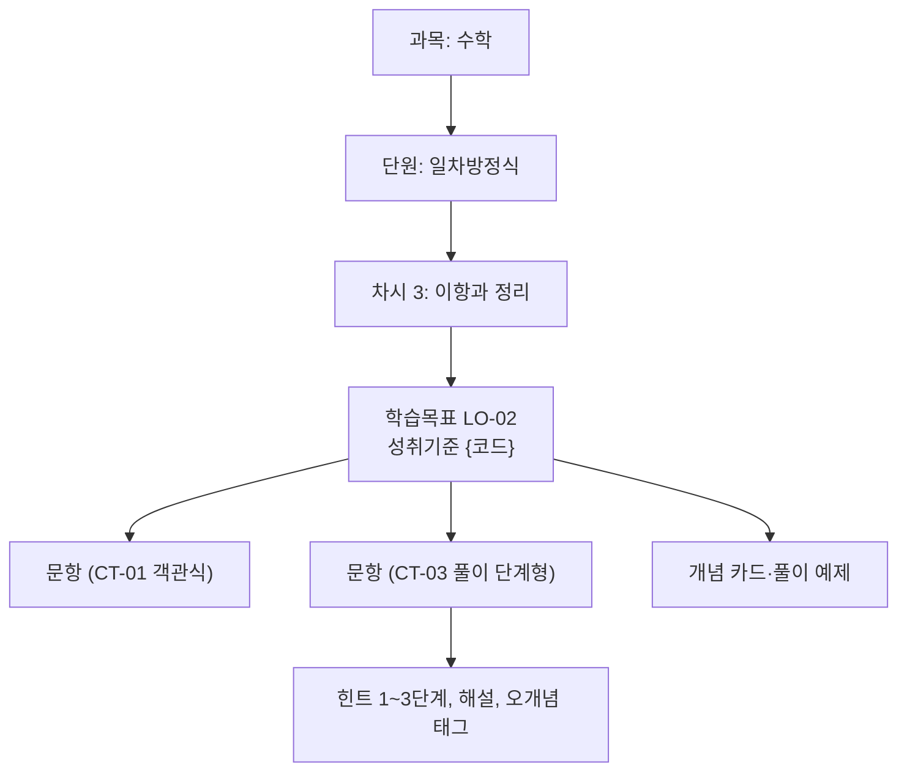
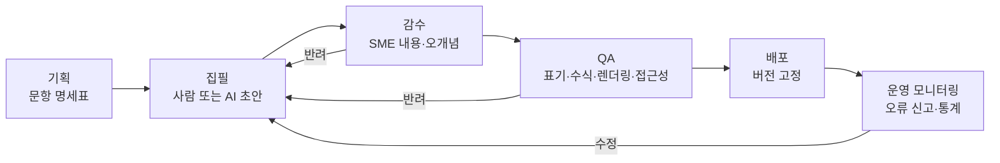

# E11 콘텐츠·문항설계서

> **작성 가이드**
> - **목적**: 학습 활동(E08)에 들어갈 콘텐츠와 문항의 구조, 메타데이터, 유형별 채점 규칙, 제작·검수 절차, 품질 기준을 정합니다.
> - **입력**: E05 LO(성취기준 연결), E08 LA, 교육과정 원문(`01.자료실/정책/`), [[domain/블룸분류체계]]
> - **게이트**: CONTENT 모듈. 콘텐츠를 직접 제공하지 않으면 `status: n/a`와 사유를 적습니다. AI 생성 콘텐츠가 있으면 E14와 함께 검토하고, 저작권 판정은 E13에 반영합니다.
> - **검토 패널 (권장)**: 교과 전문가(SME) 2명, 현직 교사, 저작권·법무, QA
> - 표의 첫 행은 예시 제품 **매스핏**(중학생 수학 오답 코칭, AI 오답 해설) 기준입니다.

---

## 1. 콘텐츠 구조

| 층 | 정의 | 식별자 | 예시 |
|----|------|--------|------|
| 과목 | {교과} | {코드} | 수학 (중학교) |
| 단원 | {교육과정 단원} | {코드} | 일차방정식 |
| 차시 | {1회 학습 단위} | {코드} | 3차시 이항과 정리 |
| 학습목표 | E05 LO | LO-ID | LO-02 오류 단계 찾아 고치기 |
| 문항·콘텐츠 | 개별 문항, 개념 카드, 풀이 예제 | ITEM-{번호} | ITEM-00231 |

규모 계획: {단원 수} × {차시당 문항 수} = {총 문항 수}. 예시: 1학기 7단원 × 차시당 25문항(기본 15 + 복습용 변형 10) × 4차시 ≈ 700문항 [가정].

## 2. 메타데이터 스키마

> 모든 문항은 아래 필드를 가집니다. 필수 필드가 비면 배포할 수 없습니다. 태그 값 목록은 `02.wiki/company/`의 태그 사전에 둡니다.

| 필드 | 필수 | 형식·값 | 용도 | 예시 (ITEM-00231) |
|------|:---:|---------|------|-------------------|
| item_id | 필수 | ITEM-00000 | 식별 | ITEM-00231 |
| 성취기준 코드 | 필수 | 교육과정 코드 [확인 필요: 개정 교육과정 표기] | 교육과정 정합, 학교 도입 | {성취기준 코드} |
| lo_id | 필수 | LO-ID | 추적 | LO-02 |
| ct_type | 필수 | CT-ID | 채점 방식 | CT-03 |
| 난이도 | 필수 | 1~5 (초기값: 출제자 추정, 이후 실측 보정) | 수준별 배정 | 2 → 실측 정답률 68% |
| Bloom 수준 | 필수 | 기억/이해/적용/분석/평가/창안 | 사고 수준 분포 점검 | 적용 |
| skill tag | 필수 | 기능 태그 사전 | 숙달 추적 (E12 mastery) | 이항, 부호처리 |
| 오개념 tag | 오답 선지·단계마다 | 오개념 사전 | 오답 코칭, 교사 리포트 | MC-07 이항 시 부호 미변경 |
| 예상 소요시간 | 필수 | 초 | 세션 구성 (E08) | 90초 |
| 출처·저작권 | 필수 | 자체 저작 / 라이선스 / 공공누리 유형 등 | 저작권 점검 | 자체 저작 |
| 저작자·감수자 | 필수 | 가명 ID | 책임 추적 | 집필 W03, 감수 R01 |
| AI 생성 여부 | 필수 | 없음 / AI 초안+사람 수정 / AI 생성+사람 검수 | 검수 규칙 적용, 표시 | 없음 |
| 버전·상태 | 필수 | 초안/감수/QA/배포/폐기 | 파이프라인 | 배포 v2 |
| {필드} | {필수/선택} | {형식} | {용도} | {예시} |

## 3. 문항·콘텐츠 유형 (CT)

| CT-ID | 유형 | 대상 LO 수준 | 채점 규칙 | 부분 점수 | 자동 채점 | 오개념 진단 방식 | 예시 |
|-------|------|--------------|-----------|-----------|-----------|------------------|------|
| CT-01 (예시) | 객관식 4지 | 이해·적용 | 정답 1개 일치 | 없음 | 가능 | 오답 선지마다 오개념 태그 | 일차방정식 해 고르기 |
| CT-02 (예시) | 단답 수식 입력 | 적용 | 수학적 동치 판정 (예: x=2, 2=x 동일) | 없음 | 가능 (수식 엔진) | 자주 나오는 오답값을 오개념에 매핑 | 해 입력 |
| CT-03 (예시) | 풀이 단계형 | 적용·분석 | 단계별 정오, 최종 답 일치 | 단계 비율 | 가능 (단계 규칙) + 애매하면 교사 검토 | 처음 틀린 단계의 오개념 태그 | 풀이 과정 줄 단위 입력 |
| CT-04 (예시) | 오류 찾기 | 분석 | 오류 줄 선택 일치 | 없음 | 가능 | 선택한 줄로 진단 | 남의 풀이에서 틀린 줄 고르기 (LA-02) |
| {CT-0N} | {유형} | {Bloom} | {규칙} | {규칙} | {가능/불가} | {방식} | {예시} |

서술형·사진 풀이처럼 자동 채점이 불확실한 유형은 "AI 보조 채점 + 교사 확정"으로 두고 E14에 AI 기능으로 올립니다.

## 4. 난이도 보정

| 단계 | 방법 | 기준 | 계산 위치 |
|------|------|------|-----------|
| 초기값 | 출제자 2인 독립 추정 후 합의 | 차이 2 이상이면 SME 판정 | 메타데이터 |
| 파일럿 보정 | 실측 정답률(p값)·변별도(상하위 27% 정답률 차) | 응답 30건 이상 문항만 [가정] | `automation/sql/item_stats.sql` {경로} |
| 운영 보정 | 학기마다 재계산, 필요 시 IRT 등 모델 검토 | 정답률 95% 이상 또는 20% 미만, 변별도 0.2 미만은 검토 대상 [가정] | 동일 |

수치 계산은 SQL·스크립트로만 하고 경로를 적습니다. LLM이 난이도를 추정한 값은 초기값으로만 씁니다.

## 5. 제작 파이프라인

| 단계 | 담당 | 산출 | 통과 기준 | 예시 |
|------|------|------|-----------|------|
| 기획 | {PM·SME} | 문항 명세표 (LO × CT × 난이도 × Bloom) | LO마다 문항 수 충족 | LO-02: CT-03 8문항, CT-04 4문항 |
| 집필 | {집필진/AI} | 문항, 정답, 해설, 힌트 3단계, 오개념 태그 | 메타 필수 필드 완비 | |
| 감수 | {SME} | 감수 의견 | 정답 오류 0, 교육과정 범위 이탈 0 | |
| QA | {QA} | QA 체크 결과 | 렌더링·수식·대체텍스트 확인 | |
| 배포 | {운영} | 배포 버전 | 버전 고정, 변경 이력 | |

## 6. 품질 기준

| 지표 | 목표 | 측정 | 비고 |
|------|------|------|------|
| 배포 후 내용 오류율 (정답·해설 오류) | {목표} — 예시: 0.5% 이하 [가정] | 오류 신고 확정 건 / 배포 문항 수 | 정답 오류는 신고 후 24시간 내 비노출 |
| 표기·오탈자 | {목표} | QA 샘플링 | |
| 교육과정 범위 이탈 | 0건 | 감수 | 선행 내용 금지 여부 확인 |
| 편향·고정관념 표현 | 0건 | 감수 체크리스트 | 인물 이름·성역할·지역·다문화 |
| 접근성 (대체텍스트, 수식 낭독) | 100% | QA | E13 (c) |

## 7. 저작권 점검

| 점검 항목 | 판정 | 메모 |
|-----------|------|------|
| 교과서 지문·그림·문항을 그대로 쓰지 않았다 (교과서 저작권은 발행사·저작자에 있음) | {적합/보완} | [확인 필요: 교육 목적 이용 예외 범위는 법무 검토] |
| 기출문제 사용 시 출처와 이용 허락 범위를 확인했다 | {적합/보완/해당없음} | 공개 기출도 이용 조건 확인 [확인 필요] |
| 외부 이미지·폰트 라이선스가 상업적 이용을 허용한다 | {적합/보완} | |
| 공공저작물은 공공누리 유형과 조건을 지켰다 | {적합/보완/해당없음} | |
| AI 생성물이 특정 저작물을 재현하지 않았는지 유사도 점검했다 | {적합/보완/해당없음} | |

판정 결과 중 "보완"이 남은 항목은 E13 위험 등록부(RK)에 올립니다.

## 8. AI 생성 콘텐츠 검수 규칙

| 규칙 | 내용 |
|------|------|
| 사람 검수 필수 | AI가 만든 문항·해설·힌트는 SME 검수를 거치기 전에 학습자에게 노출하지 않습니다. 실시간 생성 해설은 E14 가드레일과 평가 세트로 통제합니다. |
| 정답 검증 | AI 생성 문항의 정답은 수식 엔진 또는 사람이 독립 검증합니다. |
| 표시 | 메타데이터 `AI 생성 여부`를 반드시 채우고, 학습자·교사 화면 표시 방식은 E13 (d) 투명성 항목을 따릅니다. |
| 교사 승인 | 교사가 요청해 생성한 유사 문항은 교사 승인(SCR-013) 후 해당 반에만 배포합니다. |
| 샘플링 재검수 | 배포된 AI 생성 문항은 월 {N}% 표본 재검수 [가정] |

---

## 교육과정 지식그래프 연결

> 국가 교육과정(2022 개정) 기반 제품일 때 작성합니다. 도구: `/edpm-curriculum`, `automation/kg/kg_query.py`. KG는 공식 자료가 아니며, 공식 관계와 권장 순서(후보)를 구분해 씁니다. KG 릴리스: {`kg_query.py stats` 결과}

| 항목 | 내용 |
|------|------|
| 매핑 파일 | `03.docs/3.설계/E11_교육과정매핑.csv` (`/edpm-curriculum map`) |
| 메타데이터 필수 필드 | 성취기준 코드, KG standard_id, 정렬 관계, (선택) topic_id |
| 커버리지 | `kg_query.py coverage ...` 결과 경로: {05.outputs/coverage_…md} — 다룸 {n}/{N} |
| 빠진 공식 선수 성취기준 | {목록} → 진단·복습 콘텐츠 후보 |
| 문항 씨앗 사용 | `kg_query.py seed <코드>`의 평가 예시·오개념은 초안 — 집필·감수 단계에서 다시 쓰고 출처 코드 기록 |

예시 (매스핏): [9수02-04] 문항 120개 assesses, 커버리지 결과에서 [9수02-19] 인수분해가 이차방정식 단원의 빠진 선수로 나옴 → M2 범위 검토 [가정]

## 완료 체크리스트

- [ ] 콘텐츠 구조(과목 > 단원 > 차시 > 학습목표 > 문항)와 규모 계획이 있다
- [ ] 메타데이터 필수 필드와 태그 사전 위치가 정해졌다
- [ ] 모든 LO가 문항 명세표에서 문항을 가진다
- [ ] CT 유형마다 채점 규칙과 오개념 진단 방식이 있다
- [ ] 난이도 보정 계산 경로(SQL·스크립트)가 명시되었다
- [ ] 제작 파이프라인 단계별 담당과 통과 기준이 있다
- [ ] 품질 목표(내용 오류율 등)가 정해졌다
- [ ] 저작권 점검 전 항목에 판정이 있고, 보완 항목은 E13에 올렸다
- [ ] AI 생성 콘텐츠는 사람 검수 전 노출되지 않는 규칙이 있다
- [ ] (교육과정 기반이면) 매핑 CSV가 있고 coverage를 실행해 경로를 적었다
- [ ] KG의 평가 예시·오개념을 그대로 쓰지 않고 감수를 거쳤다
