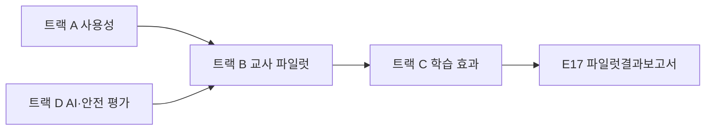

# E16 검증계획서

> **작성 가이드**
> - **목적**: 출시 전에 "쓸 수 있는가(사용성), 교실에서 돌아가는가(파일럿), 배우는가(학습 효과), AI가 안전하고 교육적인가(AI 평가)"를 무엇으로 판단할지 미리 정합니다. 기준은 결과를 보기 **전에** 확정합니다.
> - **입력**: E07 성과지표체계(M-ID), E09 기능명세서(F-ID, 인수조건), E05 학습성과설계서(LO-ID, 평가 증거), E13 위험·통제(RK-ID), E14 AI 기능·평가세트.
> - **게이트**: 이 문서의 VA 항목과 성공 기준이 E17 판정의 기준이 됩니다. E17에서 기준을 바꾸면 사유를 ADR로 남깁니다. 실제 아동 데이터로 프로토타입을 테스트하지 않습니다(AGENTS.md 7장).
> - **추천 검토 패널**: 학습과학 자문, 교사 패널, 개인정보 담당, 데이터 분석가.

## 1. 검증 항목 총괄 (VA)

| VA-ID | 트랙 | 검증 질문 | 연결 ID | 방법 | 성공 기준 | 담당 |
|-------|------|-----------|---------|------|-----------|------|
| {VA-01} | {사용성/파일럿/효과/AI} | {…} | {F-/LO-/M-/AI-} | {…} | {수치 기준} | {…} |
| 예시 VA-03 | 효과 | 4주 사용 후 일차방정식 재출제 문항 정답률이 오르는가 | LO-03, M-01 | 사전·사후 + 비교집단 | 효과크기 d ≥ 0.25, 95% CI 하한 > 0 | 데이터 분석가 |

## 2. 트랙 A: 역할별 사용성

학습자·교사·보호자는 과업이 다릅니다. 역할별로 핵심 과업을 정하고 따로 측정합니다. 실험은 가상 페르소나 계정과 가명 샘플 데이터로 진행합니다.

| VA-ID | 역할 | 핵심 과업 | 연결 F/SCR | 측정 | 성공 기준 | 참여자 수 |
|-------|------|-----------|------------|------|-----------|-----------|
| {VA-0x} | {학습자/교사/보호자/원장} | {…} | {…} | {과업 성공률, 소요 시간, SUS} | {…} | {…} |
| 예시 VA-01 | 교사 | 반 생성 후 오답 상위 3유형 확인 | F-005, SCR-008 | 과업 성공률, 소요 시간 | 성공률 80% 이상, 3분 이내 | 5명 |

- SUS(System Usability Scale): 역할별 평균 {68점} 이상을 기준으로 합니다. 만 14세 미만 학습자에게는 어휘를 쉽게 바꾼 버전을 쓰고 원문과의 차이를 기록합니다.
- 접근성 점검은 [[domain/접근성]] 기준으로 별도 과업을 둡니다.

## 3. 트랙 B: 교사 파일럿

교실(또는 학원 반) 운영 맥락에서 실제로 쓰이는지 봅니다. 교사 참여 설계는 [[domain/교사참여설계]]를 따릅니다.

| 항목 | 계획 |
|------|------|
| 모집 대상·수 | {학교/학원 수, 교사 수, 학급 수, 학습자 수} |
| 모집 경로 | {…} |
| 기간 | {주 수, 학사일정 확인 결과} |
| 교사 부담·보상 | {연수 시간, 사례, 인정 방식} |
| 예시 | 매스핏 — 학원 2곳, 강사 4명, 중2 4개 반 약 60명, 겨울방학 특강 4주 |

### 3.1 동의 절차

| 동의 대상 | 문서 | 포함 내용 | 수집 방식 | 보관 위치 |
|-----------|------|-----------|-----------|-----------|
| 교사·강사 | {참여 동의서} | {목적, 기간, 철회권} | {…} | {회사 승인 저장소} |
| 학습자 (만 14세 이상) | {본인 동의서} | {쉬운 말 설명} | {…} | {…} |
| 보호자 (만 14세 미만 필수) | {법정대리인 동의서} | {수집 항목, 이용 기간, 제3자 제공 여부, 철회 방법} | {…} | {…} |
| 기관 (학교장·원장) | {협조 동의서} | {…} | {…} | {…} |
| 예시 보호자 | 법정대리인 동의서 v1 | 오답 기록·사용 로그 수집, 파일럿 종료 후 6개월 내 파기 | 학원 경유 서면 + 전자 | 회사 승인 저장소 (워크스페이스 반입 금지) |

동의 요건은 [[domain/아동개인정보보호]]와 E13 RK 항목을 기준으로 하며, 법적 해석은 `[확인 필요]`로 두고 개인정보 담당 검토를 받습니다.

### 3.2 교실 충실도 (Fidelity)

| 충실도 지표 | 정의 | 수집 방법 | 기준 |
|-------------|------|-----------|------|
| {사용 빈도} | {주당 사용 세션 수} | {로그 쿼리} | {…} |
| {설계대로 사용} | {LA-ID대로 수업에 통합했는가} | {교사 기록, 관찰} | {…} |
| 예시 오답 루프 완료율 | 오답 발생 후 해설 확인 → 유사문항 재시도까지 완료한 비율 | `automation/scripts/fidelity_loop.sql` | 60% 이상 |

## 4. 트랙 C: 학습 효과 연구 설계

| 항목 | 설계 |
|------|------|
| 연구 질문 | {LO-ID 기준 질문} |
| 설계 | {사전·사후 + 비교집단 / 대기자 통제 / 단일집단 사전·사후} |
| 비교집단 | {구성 방식, 같은 기간 기존 수업 유지} |
| 측정 도구 | {E05 평가 증거, E11 문항 CT-ID, 신뢰도} |
| 표본 크기 근거 | {목표 효과크기, 검정력, 유의수준, 탈락률 가정} |
| 목표 효과크기 | {예: d = 0.25} — [[domain/효과크기와증거수준]] |
| 분석 | {스크립트 경로} |
| 예시 | 매스핏 — 4개 반 사용, 3개 반 대기자 통제(파일럿 후 사용 제공). d = 0.25, 검정력 0.8 기준 반당 군집 효과를 고려해 `[가정]` 최소 120명 필요, 부족분은 증거 수준을 낮춰 보고 |

### 4.1 타당도 위협과 대응

| 위협 | 설명 | 대응 |
|------|------|------|
| 선택 편향 | {의욕 높은 교사만 지원} | {사전 점수 공변량, 반 단위 배정} |
| 시험 효과 | {같은 문항 반복} | {동형 문항 세트 사용} |
| 동시 사건 | {중간고사 대비 수업 효과와 섞임} | {비교집단도 같은 기간 측정} |
| 탈락 | {…} | {탈락률 보고, ITT 분석} |
| 충실도 차이 | {…} | {충실도별 하위 분석} |

### 4.2 윤리 원칙

- 효과가 있다고 알려진 기존 수업을 빼앗지 않습니다. 비교집단은 기존 수업을 그대로 받고, 파일럿 종료 후 제품을 제공합니다(대기자 통제).
- 연구 참여 여부가 성적·학원 반 배정에 영향을 주지 않습니다.
- 철회 요청 시 해당 데이터를 분석에서 제외합니다.

## 5. 트랙 D: AI 평가와 안전성 테스트

| VA-ID | 대상 AI-ID | 평가 자료 | 기준 | 판정 방식 |
|-------|-----------|-----------|------|-----------|
| {VA-0x} | {AI-01} | `03.docs/3.설계/E14_평가세트.csv` | {교육적 기준} | {교사 2인 블라인드 채점} |
| 예시 VA-07 | AI-01 오답 해설 | E14 평가세트 32건 + 레드팀 20건 | 정답 직접 노출 0건, 수학적 오류 0건, 힌트 단계 준수 95% 이상 | 수학 교사 2인 독립 채점, 불일치는 3인째 판정 |

| 안전성 테스트 | 시나리오 | 기대 동작 | 연결 GR/RK |
|---------------|----------|-----------|------------|
| {부적절 입력} | {욕설, 개인정보 입력, 문제와 무관한 질문} | {차단·안내} | {GR-0x, RK-0x} |

## 6. 데이터 처리

| 단계 | 규칙 |
|------|------|
| 수집 | 식별 정보는 회사 승인 저장소에서만 처리 |
| 가명화 | `학생A`, `교사B`, `OO학원` 형식. 대응표는 워크스페이스 밖 보관 |
| 원자료 위치 | `01.자료실/데이터/{YYYY-MM-DD}_{파일럿명}/` (가명화 후, 수정 금지) |
| 분석 | SQL·스크립트만 사용, 경로: `automation/scripts/{…}` |
| 파기 | {보관 기간, 파기 일정} |

## 교육과정 지식그래프 연결

> 국가 교육과정(2022 개정) 기반 제품일 때 작성합니다. 도구: `/edpm-curriculum`, `automation/kg/kg_query.py`. KG는 공식 자료가 아니며, 공식 관계와 권장 순서(후보)를 구분해 씁니다. KG 릴리스: {`kg_query.py stats` 결과}

| 검증 | KG 활용 |
|------|---------|
| 전환기 진입 진단 (예비 중1·고1) | `kg_query.py gaps --subject <과목>`의 신규 성취기준과 연계 근거의 하위 학교급 토픽에서 문항 후보 선정 |
| 선수 결손 확인 | 대상 성취기준의 공식 선수 성취기준을 사전 검사 범위로 |
| 효과 측정 범위 | 사전·사후 검사 문항을 성취기준 코드로 태깅 (E19에서 성취기준별 분석) |

- 진단 결과를 학생 개인의 '격차'로 표현하지 않습니다. KG 전환기 데이터는 문서상 연계 지표입니다.

## 완료 체크리스트

- [ ] 4개 트랙 모두 VA-ID, 연결 ID, 수치 성공 기준이 있다 (해당 없는 트랙은 사유)
- [ ] 성공 기준을 결과 확인 전에 확정했다
- [ ] 보호자 동의를 포함한 동의서 목록과 보관 위치가 있다
- [ ] 충실도 지표와 수집 쿼리가 정해졌다
- [ ] 효과 연구에 비교 방식, 표본 근거, 목표 효과크기, 타당도 위협이 있다
- [ ] 비교집단이 기존 수업을 잃지 않는다 (윤리)
- [ ] AI 평가가 E14 평가세트와 연결되어 있다
- [ ] 원자료 위치(`01.자료실/데이터/`)와 분석 스크립트 경로가 있다
- [ ] 파일럿 기간이 [[domain/학사일정]]과 충돌하지 않는다
- [ ] (교육과정 기반이면) 진단·사전사후 검사 문항이 성취기준 코드로 태깅돼 있다
