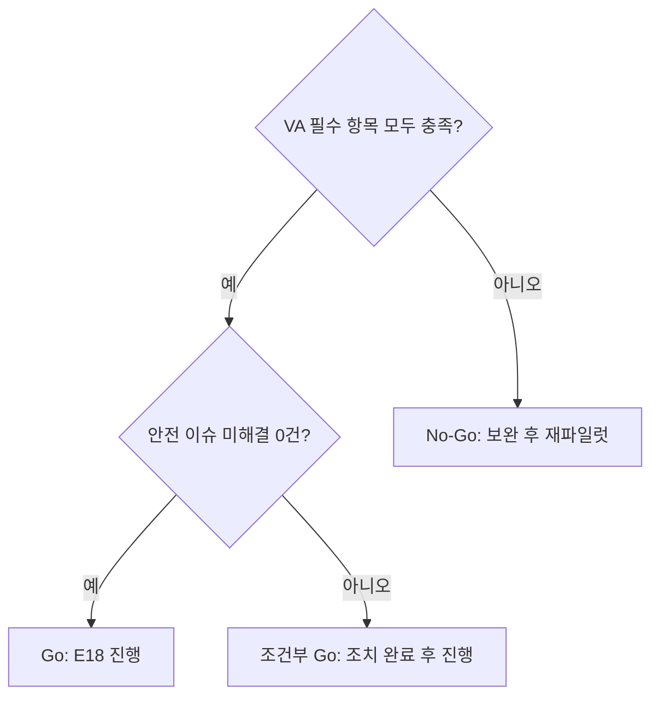

# E17 파일럿결과보고서

> **작성 가이드**
> - **목적**: E16에서 정한 VA 기준에 비추어 파일럿 결과를 판정하고, 출시(E18) 여부를 권고합니다.
> - **입력**: E16 검증계획서, `01.자료실/데이터/`의 가명화된 원자료, 분석 스크립트 출력, 인터뷰·관찰 원본(`01.자료실/현장/`), 위키 `research/` 인사이트.
> - **게이트**: G-EVIDENCE — 실제 교사·학습자가 참여한 결과여야 합니다. 가상 페르소나·합성 데이터만 있으면 이 문서는 `done`이 될 수 없고 E18도 완료할 수 없습니다. 실체 검증: 참여자 수, 기간, 원자료 위치가 명시되어야 합니다. 모든 수치는 스크립트로 계산하고 경로를 적습니다.
> - **추천 검토 패널**: 학습과학 자문, 파일럿 참여 교사, 데이터 분석가, 경영진.

## 1. 파일럿 개요

| 항목 | 내용 |
|------|------|
| 기간 | {YYYY-MM-DD ~ YYYY-MM-DD, 주 수} |
| 맥락 | {기관 유형, 학년, 과목, 사용 상황(정규 수업/숙제/특강)} |
| 참여 기관 | {가명, 수} |
| 참여 교사 | {수} |
| 참여 학습자 | {사용 집단 수 / 비교 집단 수 / 탈락 수} |
| 보호자 동의 | {대상 수, 동의 수, 동의율} |
| 원자료 위치 | `01.자료실/데이터/{…}/` |
| 예시 | 매스핏 — 2027-02-01~02-26(4주), OO학원·△△학원 겨울특강 중2 수학. 강사 4명, 사용 58명 / 비교 49명 / 탈락 6명. 보호자 동의 64/71 |

## 2. 실행 충실도

| 충실도 지표 | 계획 기준 (E16) | 실제 | 계산 경로 | 해석 |
|-------------|-----------------|------|-----------|------|
| {…} | {…} | {…} | `automation/scripts/{…}` | {…} |
| 예시 오답 루프 완료율 | 60% 이상 | 47% | `automation/scripts/fidelity_loop.sql` | 미달. 숙제 시간에만 사용한 반에서 낮음 |

충실도가 기준에 못 미치면 효과 결과 해석 시 반드시 함께 제시합니다.

## 3. VA 항목별 결과

| VA-ID | 트랙 | 성공 기준 (E16) | 결과 | 판정 | 계산 경로 / 근거 |
|-------|------|-----------------|------|------|------------------|
| {VA-01} | {…} | {…} | {…} | {충족/미달/판단 보류} | {…} |
| 예시 VA-01 | 사용성 (교사) | 성공률 80% 이상, 3분 이내 | 성공률 4/5, 평균 2분 40초 | 충족 | `01.자료실/현장/2027-01-20_교사사용성_정리.md` |

판정 기준을 사후에 바꾸지 않습니다. 바꿔야 한다면 `[[02.wiki/decisions/ADR-0xx]]`로 사유를 남기고 원래 기준의 판정도 함께 적습니다.

## 4. 학습 성과 결과

| LO-ID | 측정 | 사용 집단 사전→사후 | 비교 집단 사전→사후 | 효과크기 (95% CI) | 계산 스크립트 |
|-------|------|---------------------|---------------------|-------------------|---------------|
| {LO-01} | {…} | {…} | {…} | {…} | `automation/scripts/{…}` |
| 예시 LO-02 | 일차방정식 동형 문항 20개 정답률 | 48% → 66% | 50% → 57% | g = 0.31 (−0.07, 0.69) | `automation/scripts/effect_size_pilot.py` |

- 해석 수준은 [[domain/효과크기와증거수준]]을 따릅니다. 신뢰구간이 0을 포함하면 "효과 확인"이라고 쓰지 않습니다.
- 파일럿 결과는 E19 학습효과리포트의 사전 근거로만 씁니다. 외부 홍보 문구에 바로 쓰지 않습니다.

## 5. 질적 발견

인사이트는 위키 `research/`에 IN-ID로 먼저 정리하고, 여기서는 링크합니다.

| 대상 | IN-ID | 발견 | 근거 원본 | 시사점 |
|------|-------|------|-----------|--------|
| {교사/학습자/보호자} | [[research/IN-0xx]] | {…} | `01.자료실/현장/{…}` | {…} |
| 예시 교사 | [[research/IN-021]] | 강사들이 대시보드보다 "오늘 다시 풀 학생 목록"을 원함 | `01.자료실/현장/2027-02-24_강사인터뷰_B.md` | F-005에 일일 재시도 목록 추가 검토 |
| 예시 학습자 | [[research/IN-022]] | 힌트 3단계까지 가면 답을 거의 알려준다고 느낌 | `01.자료실/현장/2027-02-25_학생FGI.md` | GR-02 힌트 단계 재설계 |
| 예시 보호자 | [[research/IN-023]] | 주간 리포트의 "오답 유형" 용어를 이해하지 못함 | `01.자료실/현장/2027-02-26_학부모설문_정리.md` | 리포트 문구 쉬운 말로 수정 |

## 6. 이슈와 조치

| 이슈 ID | 내용 | 심각도 | 연결 ID | 조치 | 상태 |
|---------|------|--------|---------|------|------|
| {PI-01} | {…} | {상/중/하} | {F-/AI-/RK-} | {…} | {…} |
| 예시 PI-02 | AI 해설이 분수 계수 문항에서 계산 오류 2건 | 상 | AI-01, GR-03 | 평가세트에 분수 계수 10건 추가, 재평가 | 조치 중 |

## 7. 종합 판단과 권고

| 항목 | 내용 |
|------|------|
| 권고 | {Go / 조건부 Go / No-Go} |
| 근거 요약 | {VA 판정, 효과, 안전} |
| 조건 (조건부일 때) | {완료해야 할 조치와 기한} |
| 범위 조정 | {E15 롤아웃 변경 사항} |
| 의사결정 기록 | `[[02.wiki/decisions/ADR-0xx]]` |
| 예시 | 조건부 Go — 사용성·안전 충족, 효과 방향은 긍정이나 CI가 0 포함. AI 계산 오류 수정과 힌트 재설계 후 학원 15곳 확대 (ADR-007) |

## 8. G-EVIDENCE 확인

| 확인 항목 | 결과 |
|-----------|------|
| 실제 교사가 실제 수업·반에서 사용했다 | {예/아니오} |
| 실제 학습자 데이터이며 가상·합성 데이터가 아니다 | {예/아니오} |
| 참여자 수·기간·원자료 위치가 1장에 있다 | {예/아니오} |
| 모든 수치에 계산 스크립트 경로가 있다 | {예/아니오} |
| 원자료가 가명화되어 있다 (G-PII) | {예/아니오} |

## 완료 체크리스트

- [ ] G-EVIDENCE 확인 항목이 모두 "예"다
- [ ] 모든 VA 항목에 E16 기준 대비 판정이 있다
- [ ] 충실도 결과를 효과 해석과 함께 제시했다
- [ ] 효과크기에 신뢰구간과 계산 스크립트 경로가 있다
- [ ] 질적 발견이 위키 `research/` IN-ID로 연결되어 있다
- [ ] 이슈마다 조치와 상태가 있다
- [ ] Go/No-Go 권고와 ADR 링크가 있다
- [ ] 과장 표현("효과 입증" 등)이 없다
