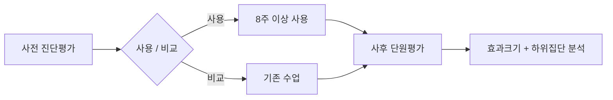

# E19 학습효과리포트

> **작성 가이드**
> - **목적**: 출시 후 실제 사용 환경에서 학습 성과가 나아졌는지, 누구에게 더 혹은 덜 효과적이었는지를 정직하게 보고합니다. 내부 의사결정용 본문과 학교·학부모용 요약을 함께 만듭니다.
> - **입력**: E07 성과지표체계(북극성 M-ID), E05 학습 목표(LO-ID), E12 학습데이터설계서(EV-ID), E16·E17 연구 설계와 파일럿 결과, `01.자료실/데이터/`의 가명화 데이터.
> - **게이트**: 실체 검증 — 효과 수치를 계산한 스크립트·쿼리 경로가 반드시 있어야 합니다. LLM이 추정한 수치는 쓸 수 없습니다. 증거 수준 주장은 [[domain/효과크기와증거수준]] 기준을 넘지 않습니다.
> - **추천 검토 패널**: 학습과학 자문, 데이터 분석가, 교사 패널, 외부 요약은 법무·마케팅 검토.

## 1. 연구 질문

| RQ-ID | 질문 | 연결 LO | 연결 M | 사전 가설 |
|-------|------|---------|--------|-----------|
| {RQ-01} | {…} | {LO-0x} | {M-0x} | {…} |
| 예시 RQ-01 | 매스핏을 8주 이상 사용한 중2 학습자는 비사용 학습자보다 일차방정식 단원평가 재오답률이 낮은가 | LO-02 | M-12 | 효과크기 g ≥ 0.2 |

## 2. 연구 설계

| 항목 | 내용 |
|------|------|
| 설계 유형 | {무선 통제 / 준실험(비교집단 + 사전 점수 보정) / 상관 / 단일집단 사전·사후} |
| 비교 방식 | {…} |
| 기간 | {…} |
| 사전 등록 | {분석 계획 고정일, 위치} |
| 예시 | 준실험 — 1학기 사용 학원 12곳 vs 미도입 학원 8곳, 사전 진단평가 점수와 학년 보정. 분석 계획 2027-03-10 고정 (`05.outputs/E19_분석계획_20270310.md`) |



## 3. 표본

| 구분 | 기관 수 | 학습자 수 | 탈락 | 분석 포함 | 주요 특성 |
|------|---------|-----------|------|-----------|-----------|
| 사용 집단 | {…} | {…} | {…} | {…} | {…} |
| 비교 집단 | {…} | {…} | {…} | {…} | {…} |
| 예시 사용 집단 | 12 | 412 | 37 | 375 | 중2, 사전 점수 평균 61.2 |

원자료 위치: `01.자료실/데이터/{…}/` · 표본 집계 스크립트: `automation/scripts/{…}`

## 4. 측정 도구

| 측정 | 도구 | 문항 수 | 신뢰도 | 연결 CT/EV | 비고 |
|------|------|---------|--------|------------|------|
| {사전·사후 성취} | {…} | {…} | {α 또는 KR-20} | {CT-0x} | {…} |
| {참여} | {사용 로그} | - | - | {EV-0x} | [[domain/학습분석지표]] |

## 5. 결과

| RQ-ID | 지표 | 사용 집단 | 비교 집단 | 효과크기 | 95% CI | p | 계산 스크립트 |
|-------|------|-----------|-----------|----------|--------|---|---------------|
| {RQ-01} | {…} | {평균(SD)} | {평균(SD)} | {g} | {…} | {…} | `automation/scripts/{…}` |
| 예시 RQ-01 | 단원평가 점수 (보정) | 72.4 (14.1) | 68.9 (15.0) | g = 0.24 | (0.08, 0.40) | 0.004 | `automation/scripts/effect_size_e19.py` |

- 수치는 스크립트 출력에서 그대로 옮깁니다. 출력 파일: `05.outputs/{…}`.
- 사전 등록한 분석과 탐색적 분석을 구분해 표시합니다.

## 6. 참여와 성과의 관계

| 참여 지표 (EV/M) | 구간 | 학습자 수 | 사후 점수 변화 | 해석 |
|------------------|------|-----------|----------------|------|
| {…} | {하/중/상} | {…} | {…} | {…} |
| 예시 오답 루프 완료 수 | 주 5회 이상 | 128 | +11.3 | 상관 관계일 뿐 인과 아님. 의욕 높은 학생일 가능성 |

참여량이 많은 학생의 성과가 높다는 결과는 자기 선택 편향을 포함하므로 인과 주장의 근거로 쓰지 않습니다.

## 7. 하위집단·형평성 분석

| 하위집단 | 학습자 수 | 효과크기 (95% CI) | 이전 대비 격차 변화 | 해석 |
|----------|-----------|-------------------|---------------------|------|
| {사전 하위 30%} | {…} | {…} | {…} | {…} |
| {지역·기관 유형} | {…} | {…} | {…} | {…} |
| {접근성 지원 필요 학습자} | {…} | {…} | {…} | [[domain/접근성]] |
| 예시 사전 하위 30% | 104 | g = 0.11 (−0.15, 0.37) | 격차 유지 | 하위권에 힌트 난이도가 높을 가능성, 다음 사이클 과제 |

표본이 작은 하위집단은 결과를 단정하지 않고 "추가 확인 필요"로 적습니다.

## 8. 증거 수준 주장

| 수준 | 기준 (요약) | 본 연구 해당 여부 |
|------|-------------|-------------------|
| 1 강함 | 잘 설계된 무선 통제 실험, 유의한 긍정 효과 | {예/아니오} |
| 2 보통 | 잘 설계된 준실험, 유의한 긍정 효과 | {…} |
| 3 유망 | 통제변수를 둔 상관 연구 | {…} |
| 4 논리 근거 | 학습과학 근거 기반 설계 논리 + 평가 계획 | {…} |

수준 정의는 [[domain/효과크기와증거수준]] (ESSA 단계 유사)을 따르며, 해외 기준과 국내 맥락의 차이는 `[확인 필요]`로 둡니다.

| 항목 | 내용 |
|------|------|
| 주장하는 수준 | {…} |
| 한계 | {배정 방식, 측정 도구, 충실도, 일반화 범위} |
| 예시 | 수준 2(보통) 주장. 한계: 학원 자율 선택으로 선택 편향 가능, 중2 일차방정식 단원에 한정, 하위권 효과 불확실 |

## 9. 권고

| 권고 ID | 내용 | 근거 | 대상 산출물 |
|---------|------|------|-------------|
| {RC-01} | {…} | {…} | {E20, E05, E14 등} |
| 예시 RC-01 | 하위권 대상 힌트 1단계를 개념 복습으로 바꾸는 실험 | 7장 하위집단 결과 | E20 → 다음 사이클 E01 |

## 10. 외부용 요약 (학교·학부모)

> **과장 금지 규칙**: "입증", "보장", "성적 향상 확정" 같은 표현을 쓰지 않습니다. 효과크기는 비교 대상, 기간, 대상 학년과 함께 씁니다. 하위집단 한계를 숨기지 않습니다. 법무·마케팅 검토 후 사용합니다.

```text
{제품명}을 {기간} 사용한 {대상} {N}명은 같은 기간 기존 방식으로 공부한 {N}명보다
{측정}에서 {차이 설명}을 보였습니다 (연구 방식: {설계 유형}).
다만 {주요 한계}로 인해 모든 학생에게 같은 효과를 기대하기는 어렵습니다.
```

예시: "매스핏을 8주 이상 사용한 중학교 2학년 375명은 같은 기간 기존 방식으로 공부한 학생들보다 일차방정식 단원평가에서 평균 3.5점 높았습니다(사전 점수를 맞춘 비교 연구). 다만 기초가 부족한 학생에게서는 뚜렷한 차이가 확인되지 않아 개선 중입니다."

## 교육과정 지식그래프 연결

> 국가 교육과정(2022 개정) 기반 제품일 때 작성합니다. 도구: `/edpm-curriculum`, `automation/kg/kg_query.py`. KG는 공식 자료가 아니며, 공식 관계와 권장 순서(후보)를 구분해 씁니다. KG 릴리스: {`kg_query.py stats` 결과}

| 분석 | 내용 |
|------|------|
| 성취기준별 효과 | 사전·사후 정답률 변화를 성취기준 코드별로 (SQL, 스크립트 경로) |
| 공식 선수 관계 따라 보기 | 선수 성취기준 숙달 여부와 후속 성취기준 성과의 관계 (상관, 인과 아님) |
| 외부 공개 문구 | "교육과정 연계" 표현은 매핑·커버리지 근거가 있을 때만, 공식 인증처럼 보이지 않게 |

## 완료 체크리스트

- [ ] 모든 효과 수치에 계산 스크립트·쿼리 경로가 있다 (LLM 추정치 없음)
- [ ] 효과크기에 95% 신뢰구간이 있다
- [ ] 사전 등록 분석과 탐색적 분석을 구분했다
- [ ] 참여-성과 관계를 인과로 주장하지 않았다
- [ ] 하위집단·형평성 분석이 있고 소표본 한계를 적었다
- [ ] 증거 수준 주장이 [[domain/효과크기와증거수준]] 기준 이내이며 한계를 적었다
- [ ] 외부용 요약이 과장 금지 규칙을 지키고 검토를 받았다
- [ ] 권고가 E20으로 넘어갈 수 있게 ID로 정리되었다
- [ ] (교육과정 기반이면) 교육과정 연계 주장이 매핑·커버리지 결과에 근거한다
