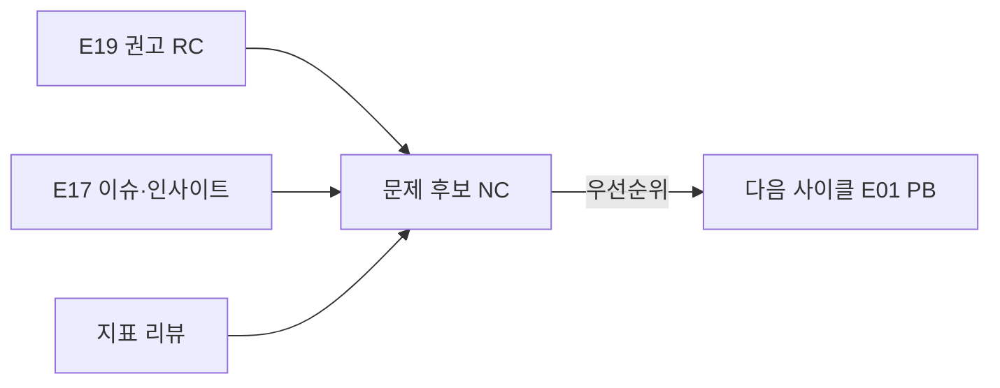

# E20 회고·다음사이클

> **작성 가이드**
> - **목적**: 이번 사이클에서 무엇을 배웠는지 가설·학습 목표 단위로 정리하고, 다음 사이클의 교육 문제 후보(E01 입력)를 만듭니다. 개인 EdTech Brain으로 가져갈 일반 지식도 고릅니다.
> - **입력**: E19 학습효과리포트(권고 RC-ID), E17 파일럿결과보고서, E07 지표, `02.wiki/decisions/` ADR, `02.wiki/log.md`, 위키 `research/`.
> - **게이트**: 다음 사이클 문제 후보는 E01 교육문제정의서의 PB-ID 후보가 됩니다. 승격 후보는 `/edpm-wiki promote` 전에 기밀·식별 정보를 제거합니다(AGENTS.md 7장).
> - **추천 검토 패널**: 제품팀 전체, 교사 패널, 경영진.

## 1. 사이클 개요

| 항목 | 내용 |
|------|------|
| 사이클 | {사이클 번호, 기간} |
| 범위 | {릴리즈, 세그먼트} |
| 핵심 결과 한 줄 | {E19 요약} |
| 예시 | 사이클 1 (2026-10 ~ 2027-07), 매스핏 MVP~M2, 학원 B2B2C. 중2 일차방정식에서 보통 수준 효과, 하위권 효과 불확실 |

## 2. 가설·학습 목표별 학습

| 가설/LO | 처음 가정 | 결과 | 판정 | 근거 | 배운 것 |
|---------|-----------|------|------|------|---------|
| {H-01 / LO-0x} | {…} | {…} | {지지/기각/불확실} | {E17/E19 섹션, IN-ID} | {…} |
| 예시 LO-02 | 단계별 힌트가 스스로 오류를 찾게 한다 | 전체 g = 0.24, 하위 30%는 불확실 | 부분 지지 | E19 5·7장, [[research/IN-022]] | 하위권은 힌트보다 선수 개념 복습이 먼저 필요할 수 있음 — [[domain/인지부하이론]] |

## 3. 지표 리뷰

| M-ID | 지표 | 목표 | 실제 | 판정 | 지표 자체의 문제 | 조치 |
|------|------|------|------|------|------------------|------|
| {M-0x} | {…} | {…} | {…} | {…} | {측정 오류, 대리 지표 한계} | {유지/수정/폐기} |
| 예시 M-22 | 주간 해설 조회 수 | 주 10회 | 주 14회 | 초과 | 정답을 보려는 조회도 포함되어 학습 지표로 부적합 | 폐기, "힌트 후 재시도 정답률"로 대체 |

학습 성과와 연결되지 않은 지표가 북극성에 섞이지 않았는지 다시 확인합니다 — [[domain/학습분석지표]].

## 4. 의사결정

| ADR | 결정 | 결과가 맞았는가 | 다시 볼 조건 충족 여부 | 후속 |
|-----|------|-----------------|------------------------|------|
| [[02.wiki/decisions/ADR-0xx]] | {…} | {예/아니오/아직} | {…} | {유지/재검토 ADR 작성} |
| 예시 [[02.wiki/decisions/ADR-007]] | 조건부 Go로 학원 15곳 확대 | 예 (활성 반 74%) | 아니오 | 유지 |

이번 회고에서 새로 내린 결정은 `02.wiki/decisions/`에 ADR로 만들고 여기에 링크합니다.

## 5. 잘된 것과 바꿀 것 (일하는 방식)

| 구분 | 내용 | 다음 사이클 행동 |
|------|------|------------------|
| 유지 | {…} | {…} |
| 바꿀 것 | {…} | {…} |
| 예시 바꿀 것 | 문항 검수가 늦어 릴리즈가 2주 밀림 | E15에 콘텐츠 트랙 리드타임을 먼저 확정 |

## 6. 개인 Brain 승격 후보 (`/edpm-wiki promote`)

회사·제품이 바뀌어도 쓸 수 있는 일반 지식만 고릅니다. 회사명, 제품명, 매출·계약 단가, 미공개 로드맵, 학생·교사 식별 정보는 제거합니다.

| 후보 ID | 원본 위키 페이지 | 일반화한 내용 | 제거한 기밀 | 대상 Brain 위치 | 승인 |
|---------|------------------|---------------|-------------|-----------------|------|
| {PC-01} | {[[…]]} | {…} | {…} | {domain/…} | [ ] |
| 예시 PC-01 | [[research/IN-022]] | 중등 수학 하위권은 다단계 힌트의 마지막 단계를 정답 노출로 인식하는 경향 | 학원명, 제품명, 학생 발화 원문 | domain/형성평가와피드백 | [ ] |

## 7. 다음 사이클 문제 후보 (→ E01)

| 후보 ID | 교육 문제 후보 | 대상 학습자 | 근거 | 영향 | 확신도 | 다음 행동 |
|---------|----------------|-------------|------|------|--------|-----------|
| {NC-01} | {…} | {…} | {RC-/IN-/M-} | {상/중/하} | {상/중/하} | {추가 리서치 / E01 작성} |
| 예시 NC-01 | 중2 하위권이 일차방정식 오답 해설을 이해하지 못하고 이탈함 | 사전 하위 30% | RC-01, IN-022 | 상 | 중 | 하위권 학생 5명 관찰 후 E01 PB-01로 작성 |

## 아직 모르는 것 (다음 사이클로)

이번 결과로도 답하지 못한 것, 새로 생긴 질문을 적고 **넘긴 곳**을 채웁니다. 넘긴 곳이 빈 행은 상황판이 계속 보여줍니다. 같은 가정을 확인하지 않은 채 다음 사이클에 다시 쓰지 않기 위한 칸입니다.

| # | 아직 모르는 것 | 왜 중요한가 | 다음에 확인할 방법 | 넘긴 곳 |
|---|----------------|-------------|--------------------|---------|
| U1 | {} | {} | {프로토타입 / 파일럿 / 데이터 / 인터뷰} | {PRD 12절 Q-n / 다음 HY / 백로그 FI-n / ADR} |
| 예시 | 교사가 반 단위로 정답 공개를 막으려는 이유가 시험 대비인지 수업 방식인지 | 기본값을 무엇으로 둘지 정함 | 교사 3명 인터뷰 | PRD 12절 Q4 |

## 완료 체크리스트
- [ ] 아직 모르는 것마다 넘긴 곳(PRD 열린 질문·다음 가설·백로그·ADR)이 있다

- [ ] 모든 가설·LO에 지지/기각/불확실 판정과 근거 링크가 있다
- [ ] 지표마다 유지·수정·폐기 결정이 있다
- [ ] 이번 사이클 ADR을 재검토했고 새 결정은 ADR로 남겼다
- [ ] 승격 후보에서 기밀·식별 정보를 제거했다
- [ ] 다음 사이클 문제 후보가 근거 ID와 함께 E01로 넘길 수 있게 정리되었다
- [ ] `02.wiki/log.md`에 회고 완료를 기록했다
