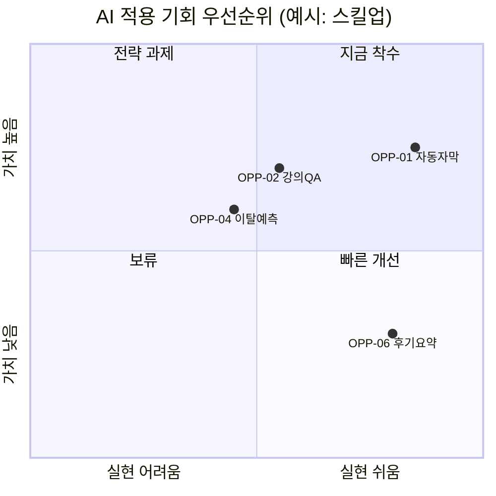

# A00 AI적용기회맵

> **작성 가이드**
> - **목적**: 가치사슬 전체(콘텐츠 제작, 학습, 평가, 운영, 영업·마케팅, 교사·강사 지원)에서 AI를 쓸 기회를 모으고, 가치·실현 가능성·데이터 준비도·위험으로 점수를 매겨 우선순위를 정합니다. 기회마다 LLM, 고전 ML, 규칙, 사람 중 맞는 방법을 고르고, 선정 항목을 E14·A07~A09로 넘깁니다. "AI를 쓰지 않는 결정"도 이 문서에 남깁니다.
> - **입력**: E06 요구사항(REQ)과 문제, E03 인사이트(IN), E02 이해관계자, E12 데이터 현황(있으면), L02 제작 공정(이러닝이면), 회사 비용 구조(`02.wiki/company/`)
> - **게이트**: 전제조건 E06. 이 문서는 E14 앞에서 "어디에 AI를 쓸지"를 고르는 단계입니다. 학생 평가(채점·성취 판정·진단)에 AI를 쓰는 기회는 AI 기본법상 고영향 AI 해당 가능성이 있어 위험 점수를 최고로 두고 E13 d8 검토를 선행 조건으로 적습니다.
> - **원칙**: 조회·계산은 SQL·코드, 설명·생성은 LLM. 예측·분류가 핵심이면 LLM이 아니라 고전 ML·규칙을 먼저 봅니다. 점수 합계와 정렬은 표 계산(스프레드시트·스크립트)으로 합니다.
> - **적용 서비스 유형**: 전체. 특히 AT01·AT03·AT09·AT10
> - **검토 패널 (권장)**: 사업 책임자, 콘텐츠 책임자, AI 엔지니어, 데이터 분석가, 법무·개인정보 담당, 교사·강사 대표
> - **관련 위키**: [[domain/AI적용기회맵]], [[domain/자동자막번역]], [[domain/문항자동생성]], [[domain/학습이탈예측]], [[domain/AI튜터설계]]
> - 표의 첫 행은 예시 제품 **스킬업**(온라인 직무교육 플랫폼, 성인 VOD + 라이브 강의 마켓플레이스) 기준입니다. 수치는 모두 [가정]입니다.

---

## 1. 기회 목록 (OPP)

> 가치사슬 영역마다 최소 1건을 검토합니다. 아이디어 단계여도 적고, 출처(REQ·IN·VOC)를 붙입니다.

| OPP-ID | 영역 | 기회 | 지금 방식과 문제 | 사용자 | 근거 (REQ·IN) |
|--------|------|------|------------------|--------|---------------|
| OPP-01 (예시) | 콘텐츠 제작 | VOD 자동 자막·영어 번역 | 외주 자막 영상 1시간당 {n}일·{원} 소요, 신규 강의 출시 지연 [가정] | 콘텐츠팀, 강사 | REQ-0NN, IN-0NN |
| {OPP-02} | 학습 | {예: 강의 내용 근거 AI 질의응답} | {} | {학습자} | {} |
| {OPP-03} | 평가 | {예: 퀴즈 문항 초안 생성} | {} | {강사} | {} |
| {OPP-04} | 운영 | {예: 수강 이탈 위험 예측과 개입} | {} | {운영팀} | {} |
| {OPP-05} | 영업·마케팅 | {예: 기업 고객 제안서 초안, 강의 소개문 생성} | {} | {영업팀} | {} |
| {OPP-06} | 교사·강사 지원 | {예: 질문 게시판 답변 초안, 수강 후기 요약} | {} | {강사} | {} |

## 2. 점수 매기기

| 기준 | 1점 | 3점 | 5점 |
|------|-----|-----|-----|
| 가치 (V) | 편의 개선 수준 | 비용·시간을 눈에 띄게 줄이거나 지표 1개 개선 | 북극성(E07) 또는 핵심 비용 구조를 바꿈 |
| 실현 가능성 (F) | 기술 미검증, 큰 개발 필요 | 사례 있음, 중간 규모 개발 | 기성 API·도구로 4주 안에 시험 가능 |
| 데이터 준비도 (D) | 데이터 없음 | 일부 있음, 정제·라벨 필요 | 필요한 데이터가 쌓여 있고 SQL로 조회 가능 |
| 위험 (R, 높을수록 위험) | 틀려도 사람이 바로 고침, 내부용 | 학습자 노출, 사람 검수로 통제 | 학생 평가·진급·자격 판정, 미성년, 음성·얼굴 등 민감 정보 |

위험 세부 항목: 교육적 위험(정답 조기 노출, 오개념 강화, 학습 회피), 법적 위험(개인정보, 저작권·초상권·음성권, 고영향 AI), 평판 위험. **K-12 학생 평가에 쓰는 AI는 AI 기본법상 고영향 AI에 해당할 수 있으므로 R=5로 두고 E13 d8 검토를 선행 조건으로 적습니다.**

```
우선순위 점수 = (V × 2 + F + D) − R      # 가중치는 회사 상황에 맞게 조정하고 이 줄에 기록
```

| OPP-ID | V | F | D | R | 점수 | 위험 메모 | 방법 | 방법 선택 이유 |
|--------|---|---|---|---|------|-----------|------|----------------|
| OPP-01 (예시) | 4 | 5 | 4 | 2 | 15 | 강사 음성 복제 시 동의 필요 (P02), 용어 오역 | LLM + STT (생성) | 음성 인식·번역은 생성 모델이 표준, 사람 검수로 통제 가능 |
| {OPP-02} | {} | {} | {} | {} | {} | {} | {LLM} | {} |
| {OPP-04} | {} | {} | {} | {} | {} | {} | {고전 ML} | {예: 이탈은 예측·분류 문제, LLM으로 예측하지 않음 (A09)} |
| {OPP-0N} | {} | {} | {} | {} | {} | {} | {LLM / 고전 ML / 규칙 / 사람} | {} |

**방법 선택 기준**

| 방법 | 맞는 문제 | 맞지 않는 문제 |
|------|-----------|----------------|
| LLM | 문장 생성·요약·번역·대화, 비정형 텍스트 분류 초안 | 수치 계산, 확률 예측, 정답 판정, 규정 적용 |
| 고전 ML | 이탈·합격 예측, 추천 순위, 이상 탐지 (라벨 있는 표 데이터) | 데이터가 적거나 설명 문장이 필요한 경우 |
| 규칙 | 진도·수료 판정, 환불 계산, 정답 판정, 명확한 조건 분기 | 예외가 많고 패턴이 데이터에 숨어 있는 경우 |
| 사람 | 고위험 판단, 관계·신뢰가 핵심인 일, 소량 고품질 작업 | 대량 반복 작업 |

## 3. 우선순위 2x2

> 가로축 = 실현 가능성 + 데이터 준비도 (정규화), 세로축 = 가치. 위험이 4 이상인 항목은 점 이름 뒤에 `*`를 붙입니다. 좌표는 2절 점수를 0~1로 정규화한 값입니다.



| 사분면 | 처리 |
|--------|------|
| 지금 착수 | 4절로 넘겨 설계 문서 작성 |
| 전략 과제 | 데이터 축적·기술 검증 계획을 세우고 다음 분기 재평가 |
| 빠른 개선 | 소규모로 바로 시험, 별도 설계 문서 없이 E09 기능에 반영 가능 |
| 보류 | 6절 "AI를 쓰지 않는 결정" 또는 재검토 일자 기록 |

## 4. 선정 항목과 다음 산출물

| OPP-ID | 결정 | 다음 산출물 | AI-ID (E14) | 착수 조건 | 담당 | 재평가 일자 |
|--------|------|-------------|-------------|-----------|------|-------------|
| OPP-01 (예시) | 착수 | A07 자동자막·번역설계서 | AI-0N | P02 강사 2차 이용(번역·음성) 조항 확인 | {콘텐츠 PM} | {YYYY-MM-DD} |
| {OPP-02} | {착수} | {E14 → A01~A03} | {} | {} | {} | {} |
| {OPP-03} | {착수} | {A08 문항자동생성설계서} | {} | {E11 문항 설계 done} | {} | {} |
| {OPP-04} | {착수} | {A09 학습이탈예측설계서} | {n/a (예측 모델)} | {E12 이벤트 3개월 이상 축적} | {} | {} |

학습자에게 노출되는 AI 기능은 E14에 AI-ID로 등록하고 교육적 가드레일을 정합니다. 내부 업무용(자막 초안, 영업 문서 초안)도 E13 (d) 위험 점검 대상인지 확인합니다.

## 5. 비용·효과 가설

| OPP-ID | 효과 지표 (E07 M) | 기준값 | 목표 | 월 비용 추정 | 측정 방법 |
|--------|-------------------|--------|------|--------------|-----------|
| OPP-01 (예시) | 영상 1시간당 자막 완성 소요 시간 | {3일} [가정] | {1일 이내} [가정] | A07 7절 공식 | 제작 관리 시트 집계 (스크립트) |
| {OPP-0N} | {} | {} | {} | {} | {} |

## 6. AI를 쓰지 않는 결정

> AI를 쓰지 않기로 한 기회와 이유를 남겨 같은 논의가 반복되지 않게 합니다.

| OPP-ID | 기회 | 쓰지 않는 이유 | 대신 쓰는 방법 | 재검토 조건 |
|--------|------|----------------|----------------|-------------|
| {OPP-0N} (예시) | 수료 여부 AI 판정 | 수료는 L03 규칙으로 정확히 계산 가능, 환급 과정은 판정 근거 설명 의무 | 규칙 (SQL) | 없음 |
| {OPP-0N} | {기회} | {데이터 없음 / 위험 과다 / 규칙으로 충분 / 사람 관계가 핵심 / 비용 대비 효과 낮음} | {} | {} |

## 서비스 유형별 메모

| 유형 | 먼저 볼 기회 | 주의 |
|------|--------------|------|
| AT01 이러닝 마켓플레이스 | 자막·번역(A07), 강의 소개문, 후기 요약 | 강사 저작물의 AI 2차 이용 권리 (P02) |
| AT02·AT03 기업교육·부트캠프 | 이탈 예측(A09), 과제 피드백 초안 | 환급 과정 평가에 AI 채점 사용 시 근거 설명 |
| AT05·AT06 K-12·학원 | AI 튜터(E14), 문항 생성(A08) | 학생 평가 AI는 고영향 AI 검토 (E13 d8), 보호자 동의 |
| AT07 소비자 학습앱 | 이탈 예측(A09), 개인화 복습 | 미성년 이용자 여부, 다크 패턴 금지 |
| AT09 자격증·시험대비 | 문항 생성(A08), 합격 예측(A09) | 기출 저작권, 합격 예측 문구 과장 금지 |

---

## 완료 체크리스트

- [ ] 가치사슬 6개 영역마다 기회를 1건 이상 검토했다
- [ ] 기회마다 근거(REQ·IN·VOC)가 있거나 [가정] 표시가 있다
- [ ] 가치·실현 가능성·데이터 준비도·위험 점수와 계산식(가중치)이 기록되었다
- [ ] 학생 평가에 쓰는 기회는 위험 최고점과 E13 d8 검토 조건이 붙었다
- [ ] 기회마다 방법(LLM / 고전 ML / 규칙 / 사람)과 선택 이유가 있다
- [ ] 예측·분류 문제를 LLM으로 풀겠다고 적은 항목이 없다
- [ ] 우선순위 2x2가 2절 점수와 일치한다
- [ ] 선정 항목마다 다음 산출물(E14, A07~A09)·착수 조건·담당이 있다
- [ ] "AI를 쓰지 않는 결정"에 이유와 대체 방법이 기록되었다
