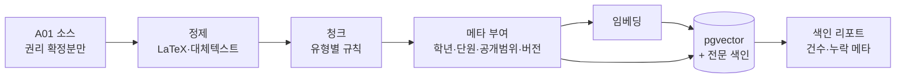
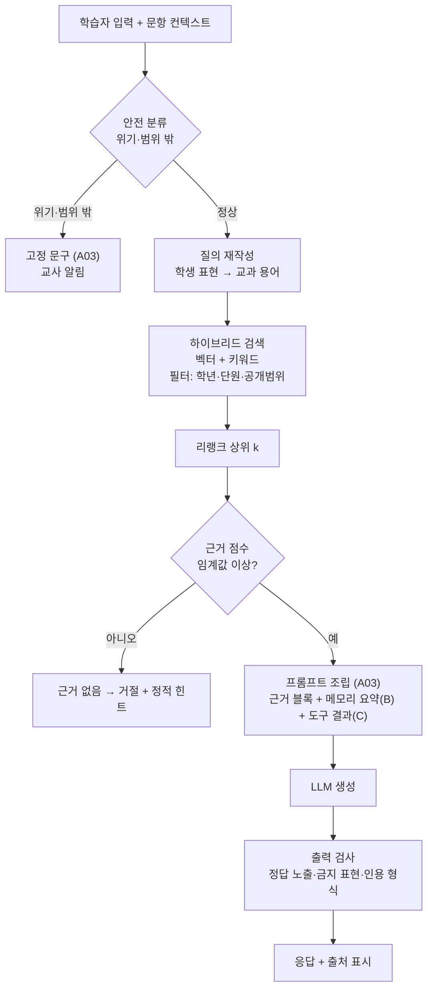

# A02 검색·RAG설계서

> **작성 가이드**
> - **목적**: 지식베이스(A01)를 어떻게 색인·검색해 LLM에 근거로 넘기는지, 학년·단원 필터, 인용 형식, 근거 없을 때의 거절, 지연·비용 예산, 로그·장애 대응을 정합니다. 학습자상태 저장소(A04)와 데이터조회 도구(A05)의 연결 지점도 여기서 정합니다.
> - **입력**: A01 KB·메타데이터, B01 시스템 구조, E14 가드레일(GR)·LLM 전송 데이터 최소화·비용 추정, E13 RK
> - **게이트**: AI-TECH 모듈. 이 문서의 구성 요소 선택은 "가설"이며, 모델·리랭커 최종 결정은 A06 평가 결과로 합니다.
> - **원칙**: 조회·계산은 SQL·코드, 설명·생성은 LLM. 학생 명단·점수·날짜는 벡터 검색 대상이 아닙니다. 그런 값은 A05의 SQL 도구로 정확히 조회합니다.
> - **스킬**: `/edpm-ai A02`
> - **검토 패널 (권장)**: AI 엔지니어, 교과 전문가, 교사, 개인정보 담당
> - 표의 첫 행은 예시 제품 **매스핏**(중학생 만 12~15세, 학원 B2B2C, AI-01 = 역할 T, 근거 + 학습자상태 + 대화) 기준입니다.

---

## 1. 구성 요소 선택

| 구성 요소 | 선택 (가설) | 대안 | 선택 이유 | 결정 근거 |
|-----------|-------------|------|-----------|-----------|
| 벡터 저장소 (예시) | PostgreSQL + pgvector | 전용 벡터 DB | 학습 데이터 DB와 같은 곳에서 메타 필터·권한 관리, 운영 부담 적음 | B01, ADR-0NN |
| 임베딩 모델 | {모델} — 한국어·수식 혼합 성능 확인 | {} | {} | A06 검색 지표 |
| 키워드 검색 | {PostgreSQL 전문 검색 / BM25} | {} | 수식·용어 정확 일치 보완 | {} |
| 리랭커 | {모델 또는 없음} | {} | {} | A06 |
| LLM | {예: Claude (기본 예시)} — 최종 모델은 A06 비교로 결정 | {} | {} | A06 모델 비교표 |
| 오케스트레이션 | {자체 코드 / 프레임워크} | {} | {} | {} |

## 2. 색인 파이프라인



| 단계 | 실패 시 | 점검 |
|------|---------|------|
| 메타 부여 (예시) | 학년·단원 누락 청크는 색인 거부 | 색인 리포트에 누락 0건 |
| {단계} | {} | {} |

## 3. 질의 파이프라인



## 4. 하이브리드 검색과 메타 필터

| 항목 | 규칙 | 예시 |
|------|------|------|
| 학년 필터 (예시) | 학습자 학년 이하 + 현재 단원 우선. 상위 학년 청크는 제외 | 중1 학습자는 `학년 ∈ {중1}`, 고등 내용 차단 (GR-05) |
| 단원 필터 | 현재 문항의 단원 = 1순위, 선수 단원 = 2순위 | {} |
| 공개범위 | 학습자 세션은 `학습자`만, 교사 세션은 `학습자+교사` | {} |
| 버전 | 최신 버전만 | {} |
| 결합 방식 | {RRF 등} 가중치 {벡터 0.6 / 키워드 0.4} [가정] | {} |
| top-k / 임계값 | {k=8 → 리랭크 후 3} / {점수} [가정] | A06에서 조정 |

필터는 검색 전에 SQL 조건으로 적용합니다. LLM에게 "고등 내용은 쓰지 마"라고만 지시하는 방식에 의존하지 않습니다.

## 5. 근거 제시와 인용 형식

| 항목 | 규칙 |
|------|------|
| 근거 블록 | 청크마다 `[근거 n] 출처 / 학년·단원 / 버전` 머리말을 붙여 프롬프트에 넣음 (A03 형식) |
| 학습자 화면 | 근거 출처는 짧게 표시: "매스핏 개념 해설: 이항" (예시). 문항 정답이 담긴 근거는 표시하지 않음 |
| 교사 화면 | KB-ID·버전까지 표시 |
| 인용률 측정 | 응답의 사실 문장에 근거 번호가 있는 비율 (A06 지표) |

## 6. 근거 없을 때의 거절

| 상황 | 판단 기준 | 응답 |
|------|-----------|------|
| 근거 점수 미달 (예시) | 리랭크 최고 점수 < 임계값 | A03 "범위 밖 질문" 고정 문구 + 정적 힌트 1단계 |
| 범위 밖 학년 | 필터 후 결과 0건 | "지금 배우는 단원에서 함께 볼 수 있는 방법" 안내 |
| 충돌 근거 | 버전 다른 해설 동시 검색 | 최신 버전만 사용, 로그 경고 |

## 7. 학습자상태 저장소 연결 (해당 시)

| 항목 | 설계 | 예시 |
|------|------|------|
| 저장 위치 | {학습 DB의 별도 테이블, 학습자별 행 단위 권한} | learner_memory (A04) |
| 조회 방식 | 학습자 키로 정확 조회(SQL). 일화 요약만 의미 검색 허용 | 예시: 프로필 사실은 SQL, 최근 일화 3개는 같은 학습자 범위 안에서만 검색 |
| 주입 | 요약 태그만 ("부호 오류 3회"), 원문 대화 미주입 | E14 5절 |
| 격리 | 다른 학습자 기억이 검색되지 않도록 learner_key 조건 필수 | 테스트: A04 시나리오 |

## 8. 데이터조회 도구 연결 (해당 시)

| 항목 | 설계 |
|------|------|
| 도구 호출 | LLM은 A05의 TL 도구를 이름·인자로만 호출, SQL 직접 작성 금지 |
| 권한 | 도구 실행 시 서버가 교사 세션의 담당 반 범위를 강제 (A05 TL 권한 범위) |
| 결과 주입 | 집계 결과 표(JSON)를 그대로 넣고, LLM은 수치를 바꾸지 않고 설명만 작성 |
| 예시 | 반별 오답 리포트 → TL-0N 결과를 근거 블록으로 → OUT-0N 템플릿 생성 |

## 9. 지연·비용 예산 (요청 1건)

```
요청당 비용 = (시스템 프롬프트 토큰 × 캐시 읽기 단가) + (근거·메모리·입력 토큰 × 입력 단가)
            + (출력 토큰 × 출력 단가) + 임베딩·리랭크 비용
요청당 지연 = 분류 + 검색 + 리랭크 + LLM 첫 토큰 + 출력 생성 + 출력 검사
```

| 항목 | 예산 | 근거 |
|------|------|------|
| 전체 지연 (예시) | 3초 이내, 초과 시 정적 힌트 (E10 SCR-004 로딩 상태) [가정] | E10 |
| 검색+리랭크 | {ms} | 측정 |
| 입력 토큰 / 출력 토큰 | {} / {} | 프롬프트 측정 |
| 요청당 비용 | {원} [가정] | 단가 [확인 필요: 계약 시점] |
| 학습자 1인당 월 비용 | {원} — E14 8절 공식과 일치 | E14 |

## 10. 캐싱

| 대상 | 방식 | 주의 |
|------|------|------|
| 시스템 프롬프트·고정 규칙 (예시) | LLM 업체의 프롬프트 캐싱 (앞부분 고정, 가변 부분은 뒤) | 프롬프트 버전(PR) 바뀌면 캐시 무효 |
| 검색 결과 | 문항 ID + 힌트 단계 기준 캐시 | 학습자별 기억이 섞인 결과는 캐시 금지 |
| 생성 응답 | {사용 안 함 / 정적 힌트화 후보로만 수집} | 개인 맞춤 응답 공유 금지 |

## 11. 로그와 개인정보 제거

| 로그 항목 | 저장 | 처리 |
|-----------|:---:|------|
| 질의 원문 (예시) | O | 저장 전 이름·전화번호·학교명 패턴 마스킹 (PII 스크러빙) |
| 검색된 KB-ID·점수 | O | A06 실패 분석용 |
| 프롬프트 버전·모델·KB 버전 | O | 회귀 추적 |
| 응답 원문 | O | 보존 기간 {일} (E12 8절) |
| learner_key | 가명 키만 | 실명 연결은 별도 DB |

## 12. LLM 장애 대응

| 상황 | 감지 | 대응 |
|------|------|------|
| LLM 응답 없음·타임아웃 (예시) | 3초 초과 또는 오류 코드 | 정적 힌트 사다리로 전환 (E14 대체 수단), 학습 흐름 유지 |
| 출력 검사 실패 반복 | 재생성 1회 후 실패 | 정적 힌트 + 로그 |
| 보조 모델 전환 | {조건} | {A06에서 합격한 모델만} |
| 검색 DB 장애 | {} | {} |

---

## 교육과정 지식그래프 연결

> 국가 교육과정(2022 개정) 기반 제품일 때 작성합니다. 도구: `/edpm-curriculum`, `automation/kg/kg_query.py`. KG는 공식 자료가 아니며, 공식 관계와 권장 순서(후보)를 구분해 씁니다. KG 릴리스: {`kg_query.py stats` 결과}

| 단계 | KG 사용 |
|------|---------|
| 질의 범위 제한 | 학습자 학년·과목 → `standard.level/grade_band/course_label` 필터 |
| 그래프 조회 | 막힌 성취기준 → `edge`(official 우선) → 선수 성취기준 |
| 근거 표시 | 답변에 성취기준 코드를 근거로 붙이고, 권장 순서는 '추천'으로 표현 |

## 완료 체크리스트

- [ ] 구성 요소 선택표가 있고, 모델·리랭커는 A06 평가로 확정한다고 적었다
- [ ] 색인·질의 파이프라인이 그려졌다
- [ ] 학년·단원·공개범위 필터가 검색 전 조건으로 적용된다
- [ ] 인용 형식과 근거 없을 때의 거절 규칙이 있다
- [ ] 학생 명단·점수·날짜는 벡터 검색이 아니라 SQL 도구로 조회한다
- [ ] (학습자상태) 기억 조회가 학습자 범위로 격리된다
- [ ] (데이터조회) 도구 권한을 서버가 강제하고 LLM이 수치를 바꾸지 않는다
- [ ] 요청당 지연·비용 예산과 공식이 있다
- [ ] 캐싱 규칙에 개인 맞춤 응답 공유 금지가 있다
- [ ] 로그에 PII 스크러빙과 보존 기간이 있다
- [ ] LLM 장애 시 정적 힌트로 전환된다
- [ ] (교육과정 기반이면) 그래프 조회가 공식 관계와 권장 순서를 구분한다
