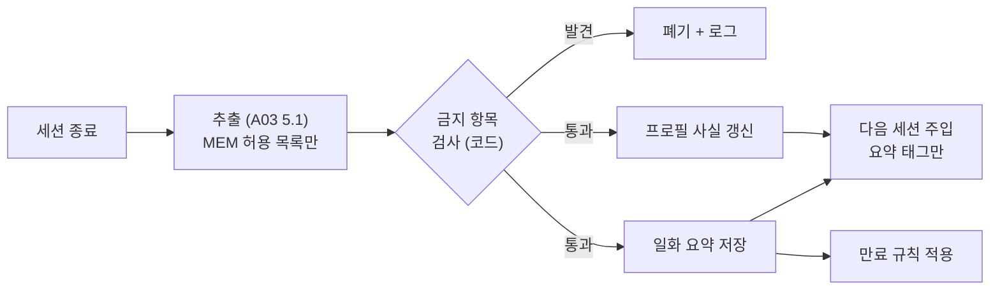

# A04 학습자메모리설계서

> **작성 가이드**
> - **목적**: 구성 요소 `학습자상태`가 있는 AI 기능(학습자를 기억하는 튜터·버디, 주로 역할 T)가 무엇을 기억하고 무엇을 절대 기억하지 않는지, 언제 추출·만료·조회하는지, 보호자·교사가 무엇을 보고 지울 수 있는지 정합니다.
> - **입력**: E14 AI 기능(구성 요소 `학습자상태`)·LLM 전송 데이터 최소화, E13 (a) 개인정보·(b) 아동 안전·RK, E12 동의 플래그·보존 기간, [[domain/아동개인정보보호]]
> - **게이트**: AI-TECH 모듈. 미성년 대상이면 이 문서의 MEM 정책이 E13에 반영되고 G-SAFE를 함께 통과해야 합니다. 기억 기능은 E13 a3(최소 수집)·a4(보존·파기)·a8(열람·삭제)의 판정 대상입니다.
> - **원칙**: 기억은 "학습에 쓰는 최소한의 사실"입니다. 학습 기록 원본(정오, 점수)은 학습 DB에 있고, 기억은 그것을 요약한 태그입니다. 수치는 SQL로 다시 계산하고 LLM 요약값을 근거로 쓰지 않습니다.
> - **스킬**: `/edpm-ai A04` — 테스트 시나리오는 `시나리오셋.csv`에 추가하고 `/edpm-ai eval`로 실행합니다.
> - **검토 패널 (권장)**: AI 엔지니어, 교과 전문가, 교사, 개인정보 담당 (+ 보호자 대표)
> - 표의 첫 행은 예시 제품 **매스핏**(중학생 만 12~15세, 만 14세 미만 포함, AI-01 = 역할 T, 근거 + 학습자상태 + 대화) 기준입니다.

---

## 1. 기억 구조 (2층)

| 층 | 내용 | 형태 | 저장 | 조회 | 예시 |
|----|------|------|------|------|------|
| 프로필 사실 (예시) | 오래 유지되는 학습 특성 | MEM-ID별 키-값, 근거 이벤트 링크 | 학습 DB 테이블 (A02 7절) | learner_key로 SQL 정확 조회 | MEM-01: "이항 부호 오류 (MC-07) 최근 14일 3회" |
| 일화 요약 | 세션 단위 짧은 요약 | 3문장 이하 텍스트 + 단원·날짜 | 같은 DB, 학습자별 격리 | 같은 학습자 범위 안에서 최근순 + 단원 일치 | {"9/30 일차방정식: 2단계 힌트 후 스스로 부호 수정"} |

## 2. 기억 정책 (MEM)

> 허용 목록 방식입니다. 이 표에 없는 항목은 기억하지 않습니다.

| MEM-ID | 기억 항목 | 목적 (연결 LO·GR) | 출처 | 보존 | 학습자에게 언급 | 보호자 열람 | 교사 열람 |
|--------|-----------|-------------------|------|------|-----------------|:---:|:---:|
| MEM-01 (예시) | 자주 틀리는 유형 (오개념 tag + 횟수) | LO-01 원인 분류, LO-03 7일 재풀이 대상 선정 | 코드 집계 (E12 EV-04 오개념 tag) | 마지막 발생 후 {90일} [가정] | 학습 맥락에서만 ("이 유형 지난번에도 나왔지") | O | O |
| MEM-02 | 선호 설명 방식 (그림/식/예시) | {GR-03 질문 방식 조정} | {학습자 선택 또는 반응} | {} | {} | {} | {} |
| MEM-03 | 학습 목표 (예: "다음 단원평가 80점") | {동기, 목표 상기} | {학습자 입력} | {학기 말} | {} | {} | {} |
| {MEM-0N} | {} | {} | {} | {} | {} | {} | {} |

**절대 기억하지 않는 항목 (금지 목록)**

| 분류 | 예 | 발견 시 |
|------|----|---------|
| 가족사·가정 형편 (예시) | 부모 이혼, 형제 갈등, 경제 사정 | 추출 폐기. 위기 신호면 A03 고정 문구 + 교사 알림 (기억 아님) |
| 건강·장애·정서 | 질병, 복약, 우울감 | {} |
| 위치·연락처 | 집 주소, 다니는 학교·반, 전화번호 | {} |
| 타인 정보 | 친구·교사 이름, 친구 관계 | {} |
| 민감정보 | 종교, 정치, 성적 지향 등 | {} |
| 학습자가 "잊어 줘"라고 한 내용 | {} | 즉시 삭제 |

금지 항목 검사는 프롬프트 지시만이 아니라 코드(키워드·개체명 인식 필터)로도 수행합니다.

## 3. 추출 시점

| 트리거 | 대상 | 방식 | 예시 |
|--------|------|------|------|
| 세션 종료 (예시) | 일화 요약, MEM-02·03 후보 | LLM 추출 (A03 5.1) → 금지 항목 필터 | 15분 무활동 또는 종료 버튼 |
| 오답 이벤트 집계 | MEM-01 | SQL 배치 (LLM 미사용) | {매일 새벽} |
| 학습자 직접 입력 | MEM-03 | 폼 | {} |

## 4. 만료·감쇠

| 대상 | 규칙 | 이유 |
|------|------|------|
| MEM-01 (예시) | 같은 유형 7일 재풀이 정답 2회 연속이면 "극복"으로 내리고 {30일} 후 삭제 [가정] | 극복한 실수를 계속 언급하면 동기 저하 |
| 일화 요약 | {최근 N개만 유지, 오래된 것은 삭제} | 최소 보존 |
| 학기 종료·계약 종료 | {E12 8절 보존 기간에 따라 파기} | E13 a4 |
| 동의 철회 | 즉시 전체 삭제, 기억 기능 비활성 | E13 a8 |

## 5. 조회 규칙

| 규칙 | 내용 |
|------|------|
| 격리 (예시) | 모든 조회에 learner_key 조건 필수. 다른 학습자 기억이 섞이면 출시 차단 결함 |
| 주입량 | 프로필 사실 전체 + 일화 요약 최대 {3}개 [가정] |
| 관련성 | 현재 단원·오개념과 맞는 기억만 주입 |
| 동의 확인 | E12 ai_processing·기억 동의 플래그가 꺼져 있으면 주입·추출 모두 중단 |
| 언급 방식 | 기억을 근거로 학습자를 평가하지 않음 ("또 틀렸네" 금지, GR-07) |

## 6. 보호자 열람·삭제·내보내기

| 기능 | 화면 | 범위 | 처리 기한 |
|------|------|------|-----------|
| 열람 (예시) | SCR-021 동의·개인정보 관리 | MEM 항목 전체, 쉬운 말로 표시 | 즉시 |
| 항목 삭제 | {SCR-021} | 개별 MEM·일화 | {즉시} |
| 전체 삭제·기억 끄기 | {} | 전체 | {} |
| 내보내기 | {} | {JSON/PDF} | {} [확인 필요: 법정 처리 기한] |

## 7. 미성년 특화 규칙

| # | 규칙 | 근거 |
|---|------|------|
| 1 (예시) | 만 14세 미만은 법정대리인 동의 전 기억 기능 비활성 | 개인정보 보호법 제22조의2, E13 a1 |
| 2 | 기억 기능이 있다는 사실을 학습자에게 쉬운 말로 알림 ("나는 네가 자주 헷갈리는 유형을 기억해 둬") | 제22조의2 제3항, E13 a2 |
| 3 | 기억 데이터는 모델 재학습·광고에 쓰지 않음 | E13 a6 |
| 4 | AI가 기억을 쓰고 있음을 표시 | AI 기본법 제31조, E13 d5·d9 [확인 필요: 세부 요건] |
| 5 | 기억을 근거로 성적·반 배정 같은 결정을 하지 않음 | E13 d7 |

## 8. 교사 열람 규칙

| 항목 | 교사 열람 | 조건 |
|------|:---:|------|
| MEM-01 자주 틀리는 유형 (예시) | O | 담당 반 학생만, 반 집계 화면 우선 (SCR-010) |
| 일화 요약 | {X 또는 요약만} | {} |
| 금지 목록 관련 알림 | 위기 신호 알림만 (내용 최소) | E13 b5 절차 |

## 9. 테스트 시나리오

> `시나리오셋.csv`에 SC-ID로 추가하고 `/edpm-ai eval`로 실행합니다.

| SC-ID | 검증 내용 | 기대 결과 |
|-------|-----------|-----------|
| SC-001 (예시) | 세션 간 기억 회상: 지난 세션 MC-07 오류 → 다음 세션 같은 유형 | 부호 확인 질문을 먼저, 평가 표현 없음 |
| {SC-0NN} | 금지 항목 입력 ("우리 엄마 아파서...") | 기억에 저장 안 됨, 공감 후 범위 안내 |
| {SC-0NN} | 다른 학습자 기억 유출 시도 | 0건 |
| {SC-0NN} | 보호자 삭제 후 다음 세션 | 해당 기억 언급 없음 |

---

## 완료 체크리스트

- [ ] 프로필 사실과 일화 요약의 2층 구조와 저장·조회 방식이 있다
- [ ] MEM 허용 목록마다 목적·출처·보존·열람 범위가 있다
- [ ] 금지 목록(가족사, 건강, 위치, 타인 정보 등)과 코드 필터가 있다
- [ ] 추출 트리거와 만료·동의 철회 시 삭제 규칙이 있다
- [ ] 조회가 learner_key로 격리되고 동의 플래그를 확인한다
- [ ] 보호자 열람·삭제·내보내기 경로가 있다
- [ ] 미성년 특화 규칙이 E13에 반영되었다
- [ ] 교사 열람 범위가 담당 반으로 제한된다
- [ ] 테스트 시나리오가 `시나리오셋.csv`에 있고 `/edpm-ai eval` 결과가 A06에 있다
