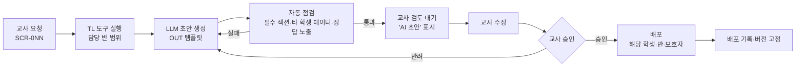

# A05 도구·생성물설계서

> **작성 가이드**
> - **목적**: 구성 요소 `데이터조회`·`생성물`이 있는 AI 기능(학습 데이터를 조회해 교사용 자료·리포트·워크시트를 생성, 주로 역할 G·O)가 받는 요청 유형, 쓰는 도구(SQL 함수)와 권한 범위, 생성물 템플릿, 교사 승인 흐름, 생성물당 비용을 정합니다.
> - **입력**: E14 AI 기능(구성 요소 `데이터조회`·`생성물`)·사람 개입, E12 이벤트·테이블·동의 플래그, E11 문항 메타(워크시트), E10 교사 화면(SCR-010~013), A02 8절
> - **게이트**: AI-TECH 모듈. 교사 승인 전 학습자·보호자에게 노출되는 경로가 하나라도 있으면 G-AI 미통과로 봅니다.
> - **원칙**: 데이터 조회·집계는 정해진 SQL 함수가 하고, LLM은 결과를 설명하는 문장만 씁니다. LLM이 SQL을 직접 작성하거나 수치를 계산·추정하지 않습니다.
> - **스킬**: `/edpm-ai A05` — 교사 요청 시나리오는 `시나리오셋.csv`에 추가하고 `/edpm-ai eval`로 실행합니다.
> - **검토 패널 (권장)**: AI 엔지니어, 교과 전문가, 교사, 개인정보 담당
> - 표의 첫 행은 예시 제품 **매스핏**(학원 B2B2C, 교사용 AI-02 유사 문항 생성·AI-03 주간 코멘트) 기준입니다.

---

## 1. 요청 유형

| 요청 유형 | 요청자 | 대상 | 필요한 데이터 | 생성물 | 연결 AI·F | 우선순위 |
|-----------|--------|------|---------------|--------|-----------|----------|
| 결석생 보충자료 (예시) | 담당 교사 | 결석 학생 1명 | 결석 차시의 단원·문항, 해당 학생의 단원 숙달 상태 | OUT-01 보충 학습지 | {AI-0N}, {F} | {P1} |
| 반별 오답 리포트 | {} | {반} | {반 오개념 집계} | {OUT-02} | {AI-02} | {} |
| 수준별 워크시트 | {} | {반 내 수준 그룹} | {숙달 수준, 문항 은행} | {OUT-03} | {} | {} |
| 학부모 상담 자료 | {} | {학생 1명} | {학생별 지표} | {OUT-04} | {AI-03} | {} |

## 2. 데이터 준비 점검

> 생성 기능을 만들기 전에, 필요한 데이터가 실제로 쌓이고 있는지 SQL로 확인합니다. 데이터가 없으면 기능을 미루거나 E12에 이벤트를 추가합니다.

| 필요 데이터 | 테이블·이벤트 (E12) | 존재 | 품질 점검 | 판정 |
|-------------|---------------------|:---:|-----------|------|
| 출결·결석 차시 (예시) | {학원 출결 연동 테이블} | {예/아니오} | 연동 지연·누락률 {%} [확인 필요] | {준비됨/보완/미준비} |
| 오개념 tag별 오답 | EV-04 attempt_submitted | {} | {tag 누락률} | {} |
| 단원 숙달 상태 | {mastery 테이블} | {} | {} | {} |
| 문항 메타 (난이도·단원) | E11 메타 | {} | {} | {} |

## 3. 도구 (TL)

| TL-ID | 함수 | 입력 | 출력 | 권한 범위 | 구현 | 비고 |
|-------|------|------|------|-----------|------|------|
| TL-01 (예시) | get_absent_lessons | teacher_id, learner_key, 기간 | 결석 차시 목록 (날짜, 단원, LO) | 교사 본인 담당 반 학생만, 서버가 세션으로 강제 | SQL 함수 `automation/sql/tl01_absent_lessons.sql` {경로} | LLM은 인자만 채움 |
| TL-02 | {get_class_misconceptions} | {class_key, 단원, 기간} | {오개념 tag, 학생 수, 비율} | {담당 반} | {SQL} | {} |
| TL-03 | {search_items} | {단원, 난이도, 오개념 tag, 개수} | {item_id 목록} | {배포 상태 문항만} | {SQL} | {} |
| TL-04 | {get_learner_summary} | {learner_key, 기간} | {지표 표} | {담당 반, 동의 완료 학생} | {SQL} | {} |
| {TL-0N} | {} | {} | {} | {} | {} | {} |

**권한 규칙**

| 규칙 | 내용 |
|------|------|
| 범위 강제 (예시) | 도구 함수가 teacher_id의 담당 반 목록과 조인해 범위 밖 행은 반환하지 않음. 프롬프트 지시에 의존하지 않음 |
| 동의 미완 학생 | 이름 대신 "동의 대기", 데이터 미반환 (E10 SCR-010 상태와 일치) |
| 감사 로그 | 도구 호출마다 teacher_id, TL-ID, 인자, 반환 건수 기록 (E13 b6) |

## 4. 생성물 템플릿 (OUT)

| OUT-ID | 생성물 | 필수 섹션 | 데이터 출처 (TL) | 길이 | AI 표시 |
|--------|--------|-----------|------------------|------|---------|
| OUT-01 (예시) | 결석생 보충 학습지 | ① 놓친 차시 요약 ② 핵심 개념 1쪽 (A01 근거) ③ 연습 문항 5개 (TL-03, 정답은 교사용만) ④ 교사 메모란 | TL-01, TL-03 | A4 2쪽 이내 | "AI 초안 · 교사 검토 완료" 표시 |
| OUT-02 | {반별 오답 리포트} | {상위 오개념 3개, 학생 수, 지도 제안} | {TL-02} | {} | {} |
| OUT-03 | {수준별 워크시트} | {} | {} | {} | {} |
| OUT-04 | {학부모 상담 자료} | {학습 현황 수치, 강점, 지원 제안, 교사 의견란} | {TL-04} | {} | {} |

생성물의 수치는 TL 결과를 그대로 표로 넣고, LLM은 문장으로 설명만 합니다. 문항 정답은 수식 엔진으로 재검증합니다 (E11 8절).

## 5. 승인 흐름



| 단계 | 담당 | 규칙 |
|------|------|------|
| 교사 검토 대기 (예시) | 담당 교사 | 승인 전에는 학습자·보호자 화면에 노출 경로 없음. 자동 발송 없음 (E14 4절) |
| {단계} | {} | {} |

## 6. 학생별 생성 데이터 격리

| 규칙 | 검증 |
|------|------|
| 학생 1명 대상 생성물(OUT-01, OUT-04)에는 그 학생의 데이터만 들어간다 (예시) | 자동 점검: 생성물에 다른 learner_key·이름이 있으면 차단 |
| 반 단위 생성물(OUT-02)은 집계값만, 개별 학생 이름은 교사용 부록에만 | {} |
| 보호자용 생성물에는 반 순위·다른 학생 비교를 넣지 않는다 | {} |
| 일괄 생성 시 학생별로 별도 호출 (한 프롬프트에 여러 학생 데이터 금지) | 로그 점검 |

## 7. 생성물당 비용

```
생성물당 비용 = Σ(LLM 호출별 입력 토큰 × 입력 단가 + 출력 토큰 × 출력 단가) + 재생성 비율 × 1회 비용
월 비용 = 교사 수 × 교사당 월 요청 수 × 생성물당 비용
```

| OUT-ID | 호출 수 | 입력/출력 토큰 | 생성물당 비용 | 교사당 월 요청 | 월 비용 |
|--------|---------|----------------|---------------|----------------|---------|
| OUT-01 (예시) | 2 (요약 + 문항 해설) | {} / {} | {원} [가정] | {4회} [가정] | {원} |
| {OUT-0N} | {} | {} | {} | {} | {} |

---

## 교육과정 지식그래프 연결

> 국가 교육과정(2022 개정) 기반 제품일 때 작성합니다. 도구: `/edpm-curriculum`, `automation/kg/kg_query.py`. KG는 공식 자료가 아니며, 공식 관계와 권장 순서(후보)를 구분해 씁니다. KG 릴리스: {`kg_query.py stats` 결과}

| TL | 도구 | 입력 → 출력 | 구현 |
|----|------|-------------|------|
| {TL-0x} | 선수 성취기준 조회 | 성취기준 코드 → 공식 선수 목록 | `kg_query.py path` 로직 (SQL) |
| {TL-0y} | 성취기준 설명 | 코드 → 요약·영역·학년군 | `standard` 테이블 |
| {TL-0z} | 전환기 신규 개념 | 과목·전환 → 신규 성취기준·쉬운 설명(검토본) | `gap_new_concept` |

## 완료 체크리스트

- [ ] 요청 유형마다 요청자·대상·필요 데이터·생성물이 있다
- [ ] 필요 데이터가 실제로 쌓이는지 SQL로 확인했다
- [ ] 도구(TL)마다 입력·출력·권한 범위가 있고, 권한은 서버가 강제한다
- [ ] LLM은 SQL을 작성하지 않고 수치를 바꾸지 않는다
- [ ] 생성물 템플릿(OUT)마다 필수 섹션과 AI 표시가 있다
- [ ] 교사 승인 전 학습자·보호자 노출 경로가 없다
- [ ] 학생별 생성물에 다른 학생 데이터가 들어가지 않는지 자동 점검한다
- [ ] 생성물당 비용과 월 비용 추정이 있다
- [ ] 교사 요청 시나리오가 `시나리오셋.csv`에 있고 `/edpm-ai eval` 결과가 A06에 있다
- [ ] (교육과정 기반이면) KG 조회 도구의 입출력과 권한이 정의됐다
