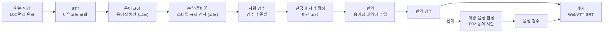

# A07 자동자막·번역설계서

> **작성 가이드**
> - **목적**: 강의 영상의 자막 생성(STT)부터 용어 교정, 분할, 사람 검수, 번역, (선택) 더빙·음성 합성까지의 파이프라인과 품질·비용 기준을 정합니다.
> - **입력**: L02 제작 공정(자막 단계, 일정, 외주), L01 콘텐츠 유형·메타데이터, P02 강사 계약(2차 이용·음성), P04 품질 기준, E13 (c) 접근성, A00 OPP-ID
> - **게이트**: 전제조건 L02. 강사 음성 복제·합성은 P02에 동의 조항이 없으면 진행하지 않습니다. 자막은 접근성 요구(E13 c4)이므로 "AI 초안만 있는 상태"로 출시하지 않습니다.
> - **원칙**: 인식·번역 문장 생성은 모델이, 용어 치환·줄 길이·읽기 속도 검사·비용 집계는 코드가 합니다. 품질 수치(WER, 검수 시간)는 스크립트로 계산합니다.
> - **적용 서비스 유형**: AT01 이러닝 마켓플레이스(핵심), AT02·AT03·AT08 (영상 강의가 있을 때)
> - **검토 패널 (권장)**: 콘텐츠 PM, 영상 편집자, 강사 대표, 번역 검수자, 접근성 점검자, 법무
> - **관련 위키**: [[domain/자동자막번역]], [[domain/AI적용기회맵]]
> - 표의 첫 행은 예시 제품 **스킬업**(성인 VOD + 라이브 강의 마켓플레이스) 기준입니다. 수치는 [가정], 업계 기준이 필요한 수치는 [확인 필요]입니다.

---

## 1. 파이프라인



| 단계 | 담당 | 도구·모델 | 입력 → 출력 | 실패 시 |
|------|------|-----------|-------------|---------|
| STT (예시) | 자동 | {STT 모델·버전} | 음성 → 타임코드 자막 초안 | 신뢰도 낮은 구간 표시, 검수 수준 상향 |
| 용어 교정 | 자동 (코드) | 용어집 치환 스크립트 {경로} | 초안 → 교정본 + 치환 로그 | 미등록 용어 후보 목록 출력 |
| 분할·줄바꿈 | 자동 (코드) | 스타일 검사 스크립트 | 교정본 → 규칙 위반 목록 | 위반 구간 검수자에게 표시 |
| 사람 검수 | {편집자 / 강사 / 외주} | 자막 편집 도구 {} | 교정본 → 확정본 | |
| 번역 | 자동 | {번역 모델} + 용어집 대역어 | 확정본 → 번역 초안 | |
| 번역 검수 | {번역 검수자} | | 초안 → 번역 확정본 | |
| 더빙 (선택) | 자동 + 사람 | {음성 합성 도구} | 번역 확정본 → 음성 트랙 | P02 동의 없으면 단계 생략 |

## 2. 도메인 용어집

> `01.자료실/콘텐츠/용어집.csv` {경로}로 관리하고, STT 교정과 번역 모두 같은 파일을 씁니다.

| 용어 | 흔한 오인식 | 표기 규칙 | 영어 대역어 | 번역 금지 | 분야 |
|------|-------------|-----------|-------------|:---:|------|
| 피벗 테이블 (예시) | 피봇 테이블, 피벗 테이블즈 | 피벗 테이블 | pivot table | 아니오 | 엑셀 실무 |
| {용어} | {} | {} | {} | {예: 제품명·고유명사} | {} |

## 3. 자막 스타일 규칙

| 규칙 | 한국어 | 번역 자막 | 검사 방식 |
|------|--------|-----------|-----------|
| 한 줄 최대 길이 | {16~20자} [확인 필요] | {42자} [확인 필요] | 코드 |
| 최대 줄 수 | 2줄 | 2줄 | 코드 |
| 읽기 속도 | 초당 {n}자 이하 [확인 필요] | 초당 {n}자 이하 [확인 필요] | 코드 |
| 최소·최대 표시 시간 | {1초 / 7초} [확인 필요] | 같음 | 코드 |
| 줄바꿈 위치 | 의미 단위(조사 뒤), 숫자·단위 분리 금지 | 구 단위 | 코드 + 검수 |
| 화면 코드·수식 | 화면에 보이는 코드는 자막에 옮기지 않고 "(화면 코드 참고)" | 같음 | 검수 |
| 비음성 정보 | 효과음·화자 전환 표기 [음악], [화자 2] | 같음 | 검수 |

## 4. 검수 수준

| 콘텐츠 유형 (L01) | 검수 수준 | 검수자 | 검수 범위 | 근거 |
|-------------------|-----------|--------|-----------|------|
| 유료 VOD 강의 (예시) | L2 전수 검수 | 편집자 1인 + 강사 확인 (용어) | 전체 재생 검수 | 판매 상품, 접근성 요구 |
| {무료 맛보기·홍보} | {L1 표본 검수} | {} | {신뢰도 낮은 구간 + 무작위 {n}%} | {} |
| {라이브 다시보기} | {} | {} | {} | {} |
| {환급·자격 과정} | {L3 이중 검수} | {} | {} | {심사 요건 [확인 필요]} |

## 5. 권리·동의 (음성 복제)

| 항목 | 규칙 | 근거 |
|------|------|------|
| 자막·번역 2차 이용 (예시) | 강사 계약에 번역·자막 2차 이용 조항이 있어야 번역본 게시 | P02 POL-0N |
| 음성 복제·합성 | 강사 개별 서면 동의, 용도·언어·기간 한정, 철회 시 음성 모델·트랙 삭제 | P02 POL-0N [확인 필요] |
| 음성 데이터 외부 전송 | 업체의 학습 미사용·보존 기간·국외 이전 확인 | E13 (a) |
| AI 생성 표시 | 합성 음성 트랙에 "AI 음성" 표시 | E13 d9 |

## 6. 접근성 요구

| 요구 | 기준 | 확인 |
|------|------|------|
| 모든 판매 영상에 확정 자막 (예시) | E13 c4 | 게시 전 자막 파일 존재 검사 (코드) |
| 자막 끄기·크기·배경 조절 | 플레이어 기능 (E10) | {} |
| 대본(텍스트) 제공 | 확정 자막에서 자동 생성 | {} |
| 화면 정보의 음성 설명 | 필요 시 강사 내레이션 보완 | {} |

## 7. 품질 지표와 비용

| 지표 | 정의 | 계산 | 목표 |
|------|------|------|------|
| WER (예시) | (치환 + 삭제 + 삽입) / 기준 단어 수 | 표본 확정본 대비 스크립트 계산 {경로} |  | 비교 기준 |

## 8. 평가 방법

| 평가 | 데이터 | 방법 | 합격 기준 |
|------|--------|------|-----------|
| STT 정확도 (예시) | 분야별 표본 영상 {n}편, 사람 확정 자막을 정답으로 | WER·용어 오류율 스크립트 | {} [가정] |
| 번역 품질 | 표본 문장 {n}개 | 번역 검수자 1~3점 루브릭 (정확성, 용어, 자연스러움) | 평균 {} |
| 검수 시간 절감 | 시범 운영 영상 | 기존 방식 대비 검수 분 비교 | {} |

결과 파일은 `05.outputs/a07_eval_{YYYYMMDD}.csv`에 두고, 모델·용어집 버전을 함께 적습니다.

## 서비스 유형별 메모

| 유형 | 메모 |
|------|------|
| AT01 이러닝 마켓플레이스 | 강사 입점형이면 강사가 검수하는 흐름과 정산(S07) 영향 확인 |
| AT02 기업교육 LMS | 고객사 사내 용어집 별도 관리, 사내 영상 외부 전송 허용 여부 |
| AT05 K-12 | 학생 음성·얼굴이 담긴 영상은 처리 대상에서 제외하거나 비식별 후 처리 |
| AT08 고등교육 | 장애 학생 지원 요구로 자막 의무 수준이 높음 [확인 필요] |

---

## 완료 체크리스트

- [ ] 파이프라인 단계마다 담당·도구·실패 처리가 있다
- [ ] 용어집이 파일로 관리되고 STT 교정과 번역에 같이 쓰인다
- [ ] 자막 스타일 규칙이 코드로 검사되고 [확인 필요] 수치가 확인되었다
- [ ] 콘텐츠 유형별 검수 수준과 검수자가 정해졌다
- [ ] 음성 복제·합성은 P02 동의 조항이 있을 때만 진행한다
- [ ] 판매 영상은 확정 자막 없이 게시되지 않는다 (E13 c4)
- [ ] WER·검수 시간·영상 1시간당 비용이 스크립트로 계산된다
- [ ] 평가 결과 파일과 모델·용어집 버전이 기록되었다
