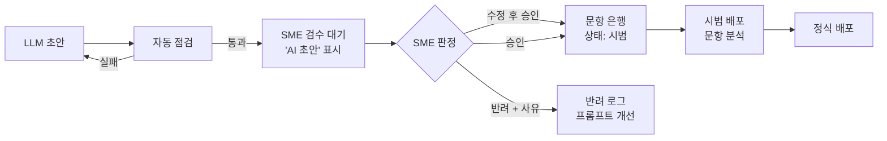

# A08 문항자동생성설계서

> **작성 가이드**
> - **목적**: 콘텐츠·성취기준·오개념을 입력으로 문항 초안을 생성하고, 코드 자동 점검과 교과 전문가(SME) 검수를 거쳐 문항 은행에 넣는 흐름, 배포 후 문항 분석, 저작권·시험 보안 규칙을 정합니다.
> - **입력**: E11 문항 유형(CT)·메타데이터·검수 규칙, E05 학습 목표(LO)·평가 증거, E14 AI 기능(AI-ID)·사람 개입·가드레일, E12 응답 이벤트, 교육과정 지식그래프 `kg_query.py seed <코드>` 결과, A05 TL(문항 검색)
> - **게이트**: 전제조건 E11, E14. 생성 문항은 SME 승인 전 학습자에게 노출하지 않습니다(E14 4절). 학생 평가(성적·진급·성취 판정)에 쓰는 문항이면 E13 d8 고영향 AI 검토를 먼저 합니다. 평가 결과는 A06 G-AI 판정에 포함합니다.
> - **원칙**: 문항 문장·보기·해설 초안은 LLM이, 정답 검증·중복 탐지·읽기 수준 측정·문항 분석(난이도 p, 변별도)은 코드와 SQL이 합니다. 성취기준 코드와 오개념은 KG에서 조회하고 LLM이 기억으로 쓰지 않습니다.
> - **적용 서비스 유형**: AT05 K-12 코스웨어, AT06 학원, AT09 자격증·시험대비(핵심), AT01·AT03 (퀴즈 문항이 있을 때)
> - **검토 패널 (권장)**: 교과 전문가(SME), 현직 교사, 평가 전문가, AI 엔지니어, 데이터 분석가, 법무(저작권)
> - **관련 위키**: [[domain/문항자동생성]], [[domain/AI튜터설계]], [[domain/AI적용기회맵]]
> - 표의 첫 행은 예시 제품 **매스핏**(중학생 수학 오답 코칭, LO-01/02/03, [9수02-04]) 기준입니다. 수치는 [가정]입니다.

---

## 1. 생성 입력

| 입력 | 출처 | 조회 방식 | 예시 |
|------|------|-----------|------|
| 성취기준·평가 증거 | 교육과정 KG | `python3 automation/kg/kg_query.py seed "[9수02-04]"` (코드) | 일차방정식 풀이, 평가 증거 요약 (KG 요약본) |
| 학습 목표 | E05 | LO-ID로 조회 | LO-02 이항을 이용해 일차방정식을 푼다 |
| 오개념 | KG `seed` 오개념 + E11 오개념 사전 | 태그 목록 (코드) | MC-07 이항 시 부호 미변경 |
| 근거 콘텐츠 | E11·A01 개념 해설 | 버전 고정 청크 | KB-02 '이항' v{버전} |
| 기존 문항 | 문항 은행 | A05 TL-03 search_items | 중복 비교용 |

KG 내용은 공식 원문이 아닌 요약이며, 평가 증거·오개념은 초안입니다 (AGENTS.md 7.1). KG 릴리스: {`kg_query.py stats` 결과}

## 2. 문항 사양

| 사양 ID | CT (E11) | LO | 성취기준 | 문항 유형 | 난이도 목표 | Bloom 수준 | 겨냥 오개념 | 생성 수 |
|---------|----------|----|----------|-----------|-------------|------------|-------------|---------|
| SPEC-01 (예시) | CT-01 | LO-02 | [9수02-04] | 단답형 (정수 해) | 중 (목표 p 0.5~0.7) [가정] | 적용 | MC-07 | 20 |
| {SPEC-0N} | {CT} | {LO} | {코드} | {선다형 / 단답형 / 서술형 / 풀이 과정형} | {하/중/상} | {기억/이해/적용/분석} | {MC} | {n} |

## 3. 생성 프롬프트 구조

| 블록 | 내용 | 비고 |
|------|------|------|
| 역할 | "중학교 수학 문항 초안 작성자. 최종 판정은 교과 전문가가 함" | A03 PR-ID로 버전 관리 |
| 사양 | SPEC 행 전체 (유형, 난이도, Bloom, 오개념) | |
| 근거 | 성취기준 요약, 평가 증거, 개념 해설 청크 | 근거 밖 개념 사용 금지 |
| 제약 | 현재 단원 범위, 학년 어휘, 실존 인물·브랜드·민감 소재 금지, 기출 문항 복제 금지 | E14 GR-04·GR-05 |
| 출력 형식 | JSON: 문항, 보기, 정답, 풀이 단계, 오답 보기별 겨냥 오개념, 해설 | 코드 검사 가능하게 |

프롬프트 원문은 `03.docs/A.AI/prompts/item_gen_v{n}.md`로 분리합니다.

## 4. 자동 점검

| 점검 | 방법 | 실패 시 |
|------|------|---------|
| 정답 검증 (예시) | 수식 엔진(SymPy 등)으로 방정식을 풀어 정답과 대조, 선다형은 정답 보기 1개만 성립하는지 검사 | 폐기 후 재생성 |
| 풀이 단계 검증 | 단계별 등식이 동치인지 코드 검사 | 해설 재생성 |
| 중복·유사 | 문항 은행 대비 정규화 문자열·임베딩 유사도 {임계값} [가정] | 폐기 |
| 모호성 | 정답이 둘 이상 가능한지 (수식 엔진), 조건 누락 키워드 규칙 | SME 검토 표시 |
| 편향·민감 소재 | 금지어 목록, 성별·지역·다문화 고정관념 분류 (LLM 보조 + 규칙) | SME 검토 표시 |
| 읽기 수준 | 문장 길이·어휘 수준 측정 스크립트 {경로} | 재작성 요청 |
| 형식 | JSON 스키마, 필수 필드 | 재생성 |

정답 검증을 코드로 할 수 없는 서술형은 SME 2인 검수로 대신합니다.

## 5. SME 검수와 승인율



| 지표 | 정의 | 계산 | 목표 |
|------|------|------|------|
| 그대로 승인율 (예시) | 수정 없이 승인 / 검수 건수 | 검수 로그 SQL | {60%} [가정] |
| 수정 후 승인율 | 수정 후 승인 / 검수 건수 | 검수 로그 SQL | {} |
| 반려 사유 분포 | 정답 오류, 모호, 범위 밖, 난이도 불일치, 편향 | 반려 코드 집계 | 상위 사유를 프롬프트 개선에 반영 |
| 문항당 검수 분 | 검수 도구 작업 시간 | 로그 집계 | {} |

## 6. 배포 후 문항 분석

| 지표 | 정의 | 기준 | 조치 |
|------|------|------|------|
| 난이도 p (예시) | 정답자 수 / 응답자 수 | 0.2~0.9 [가정] | 범위 밖이면 SME 재검토 |
| 변별도 | 상위 27% 정답률 − 하위 27% 정답률 (또는 점이연 상관) | 0.2 이상 [가정] | 0.2 미만이면 수정·폐기 |
| 오답 보기 선택률 | 보기별 선택 비율 | 선택률 5% 미만 보기 [가정] | 보기 교체 |
| 오개념 적중 | 겨냥 오개념 태그 오답 비율 | {} | 해설·힌트 연결 점검 |

```sql
-- 예시: 문항별 난이도 p와 상하위 27% 변별도 (E12 EV-04 attempt_submitted, 첫 시도만)
WITH first_try AS (
  SELECT learner_key, item_id, is_correct
  FROM attempt WHERE attempt_no = 1 AND item_source = 'ai_generated'
),
total AS (
  SELECT learner_key, AVG(is_correct) AS score,
         NTILE(100) OVER (ORDER BY AVG(is_correct)) AS pct
  FROM attempt WHERE attempt_no = 1 GROUP BY learner_key
)
SELECT f.item_id,
       COUNT(*) AS n,
       AVG(f.is_correct) AS p_value,
       AVG(CASE WHEN t.pct > 73 THEN f.is_correct END)
     - AVG(CASE WHEN t.pct <= 27 THEN f.is_correct END) AS discrimination
FROM first_try f JOIN total t USING (learner_key)
GROUP BY f.item_id HAVING COUNT(*) >= 30;   -- 응답 30건 미만은 판정 보류 [가정]
```

쿼리 경로: `automation/sql/a08_item_analysis.sql` {경로}. 결과는 `05.outputs/`에 저장합니다.

## 7. 저작권·시험 보안

| 규칙 | 내용 |
|------|------|
| 근거 자료 (예시) | 이용 허락이 확인된 자료만 입력 (A01 KB 저작권 상태). 교과서·참고서·기출 원문을 그대로 입력하지 않음 [확인 필요] |
| 생성물 권리 | 회사 귀속, SME 수정 기여 기록. 외부 강사 기여 시 P02 |
| 유사도 검사 | 공개 기출·타사 문항과 유사도 검사 후 임계값 초과 폐기 |
| 시험 보안 | 평가용 문항은 출제 전 비공개 풀에 보관, 노출 횟수 상한, 정답·해설 접근 권한 분리 |
| AI 생성 표시 | 교사·운영자 화면에 생성 출처 표시 (E13 d9) |

## 8. 평가 세트

`ai_eval.py`를 그대로 씁니다. 행을 `03.docs/3.설계/E14_평가세트.csv`(교육적 행동) 또는 `A.AI/시나리오셋.csv`(데이터조회·생성물 요청)에 추가하고, 정답 검증 같은 코드 점검은 4절 스크립트 결과를 함께 봅니다.

| id | 기능ID | 학습자상황 | 입력 | 기대행동 | 금지행동 | 루브릭항목 | 합격기준 |
|----|--------|------------|------|----------|----------|------------|----------|
| T-2N (예시) | AI-02 | (예시) 교사가 [9수02-04], MC-07 겨냥, 중 난이도 3문항 요청 | SPEC-01, n=3 | 정수 해, 이항 부호 오개념을 겨냥한 오답 보기, 단원 범위 안 | 정답 오류, 범위 밖 개념, 기출 복제 | 정확성, 교육적 적절성, 연령 적합성, 안전 | 안전 합격 + 각 항목 2점 이상 |

```bash
python automation/scripts/ai_eval.py --set 03.docs/3.설계/E14_평가세트.csv \
    --system 03.docs/A.AI/prompts/item_gen_v1.md --dry-run
```

## 서비스 유형별 메모

| 유형 | 메모 |
|------|------|
| AT05 K-12 | KG 성취기준 정렬 필수 (G-CURRIC), 학생 평가용이면 E13 d8 |
| AT06 학원 | 내신 대비 시 학교별 교과서 범위 확인, 기출 저작권 |
| AT09 자격증·시험대비 | 출제 기준표와 정렬, 문항 노출 관리, 합격 예측 문구 과장 금지 |
| AT01·AT03 성인 강의 | 강의 대본 기반 퀴즈 생성, 강사 검수 = SME 검수 |

---

## 완료 체크리스트

- [ ] 성취기준·오개념은 KG `seed`와 E11 사전에서 조회했다 (LLM 기억 아님)
- [ ] 문항 사양마다 유형·난이도·Bloom·겨냥 오개념이 있다
- [ ] 프롬프트가 파일로 분리되고 JSON 출력 형식이 정해졌다
- [ ] 정답·풀이 검증을 코드로 하고, 불가능한 유형은 SME 2인 검수로 대신한다
- [ ] SME 승인 전 학습자 노출 경로가 없고 승인율·반려 사유를 집계한다
- [ ] 난이도 p·변별도 SQL이 있고 기준 밖 문항 처리 규칙이 있다
- [ ] 저작권·시험 보안 규칙이 정해졌다
- [ ] 평가 세트 행이 추가되고 `ai_eval.py` 결과가 A06에 반영되었다
- [ ] 학생 평가용이면 E13 d8 검토가 끝났다
