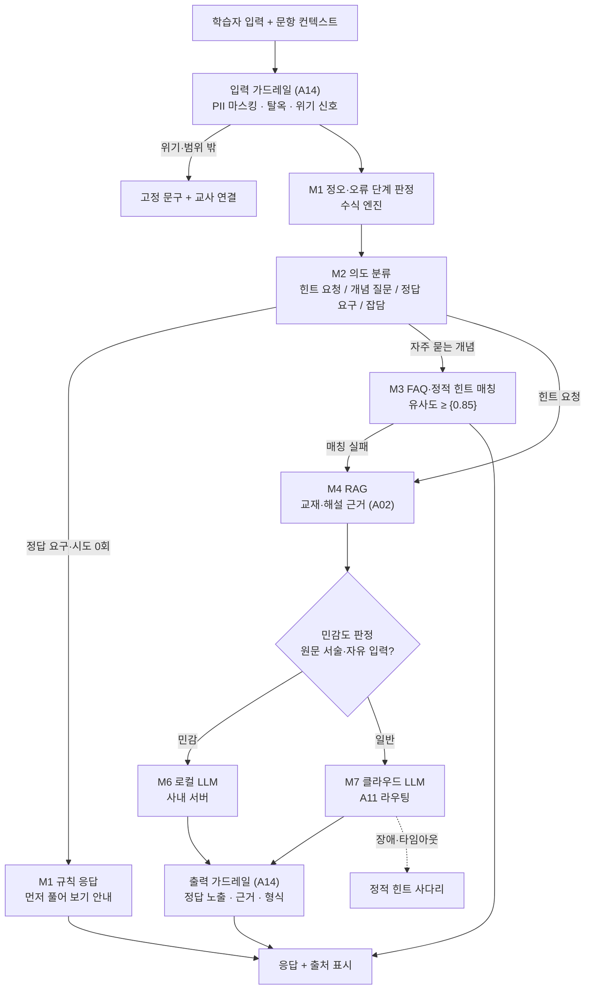

# A10 AI방식선택·아키텍처설계서

> **작성 가이드**
> - **목적**: E14의 AI 기능(AI-ID)과 A00의 선정 기회(OPP)마다 M1 규칙·템플릿 ~ M8 혼합 중 **가장 단순하면서 요구를 충족하는 방식**을 고르고, 그 근거와 버린 대안을 남깁니다. 전체 구성도(단계별 연결), 학생 데이터의 이동 경로, 구성 요소별 자체 개발·구매, 방식 비교 평가 계획을 정합니다.
> - **입력**: E14 AI 기능·가드레일(GR)·LLM 전송 데이터 최소화, A00 OPP·방법 선택, E13 RK·a6·a7·d8, E12 데이터, B01 시스템 구조(있으면), 프레임워크 `guide/10.AI방식선택.md`
> - **게이트**: **G-AI** — AI 기능이 있으면 E14와 함께 이 문서(A10)와 A14가 `done`이어야 E15를 완료할 수 있습니다. 유료·대량 사용이면 A12도 `done`. 이 문서의 선택은 "가설"이며, 4절 방식 비교 평가 결과로 확정합니다.
> - **원칙**: 정답 판정·점수·출결·계산은 M1(코드·SQL). 분류·추출·매칭으로 충분하면 M2·M3. LLM은 설명·생성이 꼭 필요한 곳에만 씁니다. 점수 합계는 표 계산(스프레드시트·스크립트)으로 합니다.
> - **스킬**: `/edpm-ai method`
> - **검토 패널 (권장)**: AI 엔지니어, 보안·개인정보 담당, 교과 전문가, 재무
> - **관련 위키**: [[domain/AI방식스펙트럼]], [[domain/고전NLP와정형응답]], [[domain/RAG설계]], [[domain/로컬LLM과온프레미스]], [[domain/모델선택과라우팅]], [[domain/AI평가메트릭과AB테스트]]
> - 표의 첫 행은 예시 제품 **매스핏**(중학생 만 12~15세 수학 오답 코칭, 학원 B2B2C, AI-01 오답 단계별 힌트 해설) 기준입니다. 수치는 모두 [가정]입니다.

---

## 1. 방식 결정 대상

| AI-ID / OPP | 기능 | 연결 F | 핵심 요구 | 학생 데이터 포함 | 평가 판정 여부 (고영향 검토) |
|-------------|------|--------|-----------|------------------|------------------------------|
| AI-01 (예시) | 오답 단계별 힌트 해설 | F-012 | 처음 틀린 단계를 짚는 한 단계 힌트, 3초 이내 | 풀이 수식 텍스트 (가명 세션) | 아니오 (학습 지원) [확인 필요: E13 d8] |
| {AI-0N / OPP-0N} | {기능} | {F} | {요구} | {예/아니오, 항목} | {예/아니오} |

## 2. 방식 결정표 (MD)

> 기능마다 하나의 MD-ID. 후보는 M1~M8 중 검토한 것만 적습니다. 점수는 1(불리)~5(유리)이며, 합계 대신 **결정 기준을 넘지 못한 항목**을 먼저 봅니다.

| MD-ID | AI-ID | 후보 방식 | 선택 방식 | 결정 이유 (한 줄) | 버린 대안과 이유 | 확정 근거 |
|-------|-------|-----------|-----------|-------------------|------------------|-----------|
| MD-01 (예시) | AI-01 | M1, M3, M4, M6, M7, M8 | M8 = M1(정오·오류 단계 판정) + M3(정적 힌트·해설 검색) + M7(힌트 문장 생성), 민감 입력은 M6 | 판정은 결정적이어야 하고, 문장은 오류 단계마다 달라 생성이 필요 | M1 단독: 오답 유형별 문구 수천 개 관리 불가 / M4 RAG 단독: 해설은 문항 ID로 정확 조회 가능해 벡터 검색 불필요 / M6 단독: 4절 비교에서 품질 격차 [가정] | `05.outputs/eval_cmp_{YYYYMMDD}.csv`, ADR-0NN |
| {MD-0N} | {AI-0N} | {} | {} | {} | {} | {} |

**판단 기준 점수 (MD-01 예시)** — 기준 정의는 `guide/10.AI방식선택.md` 3절

| 기준 | M1 규칙 | M3 검색 | M6 로컬 LLM | M7 클라우드 LLM | M8 혼합 (선택) | 메모 |
|------|:---:|:---:|:---:|:---:|:---:|------|
| 정확성·결정성 | 5 | 4 | 3 | 3 | 5 | 정오 판정은 M1이 맡아 LLM 오판 영향 없음 |
| 설명 가능성 | 5 | 5 | 2 | 2 | 4 | 판정 근거는 규칙 로그로 설명 |
| 데이터 민감도 | 5 | 5 | 5 | 2 | 4 | 클라우드에는 수식 텍스트만 (E14 5절) |
| 지연 | 5 | 5 | 3 | 3 | 4 | 정적 힌트 즉시, 생성은 스트리밍 |
| 비용 | 5 | 5 | 3 | 2 | 4 | FAQ·정적 힌트로 생성 호출 {40}% 절감 [가정] |
| 오프라인·망 | 5 | 4 | 4 | 1 | 3 | 학원 망 장애 시 M1·M3로 계속 |
| 품질 격차 | 2 | 2 | 3 | 5 | 5 | 4절 평가 합격 여부 |
| 운영 역량 | 5 | 4 | 1 | 4 | 3 | GPU 운영 인력 없음 [가정] |
| 라이선스 | 5 | 5 | {} [확인 필요] | 4 | 4 | 오픈 모델 상업 이용 조건 |
| **판정** | 단독 불가 (표현 다양성) | 보조 | 보류 (품질·운영) | 보조 | **채택** | |

### 2.1 모델·자산 라이선스와 자원 (필수)

"무료"와 "상업 이용 가능"은 다릅니다. 선택한 모델·음원·폰트·데이터마다 확인 일자와 함께 적고, 180일마다 다시 확인합니다. **배치 생성형**(콘텐츠·영상·문항을 미리 만들어 두는 파이프라인)이면 지연 시간 대신 처리 시간·디스크·메모리·현금 비용이 핵심 기준입니다.

| 대상 | 라이선스 | 상업 이용 | 확인일 | 자원 (디스크·메모리·처리 시간) | 비용 |
|------|----------|:---:|--------|--------------------------------|------|
| {모델·자산} | {Apache-2.0 / OpenRAIL-M / 비상업 …} | {가능/조건부/불가} | {YYYY-MM-DD} | {} | {} |

관련: [[domain/생성AI모델상업라이선스]]

## 3. 전체 구성도

> 요청이 가장 싼 단계에서 끝나도록 단계를 쌓습니다(캐스케이드). 다음 단계로 넘기는 조건을 화살표에 적습니다.

| 단계 | 방식 | 처리 비율 목표 | 다음 단계로 넘기는 조건 | 측정 |
|------|------|----------------|-------------------------|------|
| 의도 분류 (예시) | M2 | 100% | 분류 신뢰도 < {0.7}이면 RAG로 | 분류 정확도 (A13 OP) |
| FAQ·정적 힌트 | M3 | {40}% [가정] | 유사도 < 임계값 | 매칭률, 오매칭 신고 |
| RAG + 생성 | M4 + M7/M6 | {60}% [가정] | - | A06 지표 |

## 4. 데이터 흐름과 학생 데이터의 위치

| 데이터 | 생성 위치 | 거치는 단계 | 외부(국외) 전송 | 보존 | 근거 |
|--------|-----------|-------------|-----------------|------|------|
| 풀이 수식 텍스트 (예시) | 학습 앱 | M1 → M2 → M4 → M7 | 예, 가명 세션·식별자 제거 후 [확인 필요: 국외 이전 고지] | 로그 {90}일 | E13 a6·a7, E14 5절 |
| 풀이 사진 원본 | 기기 | 기기 내 수식 추출만 | 아니오 | 저장 안 함 | E13 RK-01 |
| 자유 서술 입력 (고민·잡담) | 채팅창 | 입력 가드레일 → M6 또는 고정 문구 | 아니오 | {30}일, 마스킹 | A14 GD |
| {데이터} | {} | {} | {} | {} | {} |

## 5. 구성 요소별 자체 개발·구매

| 구성 요소 | 방식 | 자체 개발 / 구매 / 오픈소스 | 후보 | 이유 | 전환 비용 |
|-----------|------|------------------------------|------|------|-----------|
| 수식 정오 판정 (예시) | M1 | 자체 개발 + 오픈소스 수식 라이브러리 | {CAS 라이브러리} | 교과 규칙 반영 필요 | 낮음 |
| 의도 분류기 | M2 | {자체 학습 / API} | {} | {} | {} |
| 임베딩·벡터 저장소 | M3·M4 | {} | A02 1절 | {} | {} |
| 생성 모델 | M7 | 구매 (API) | A11 MOD | 운영 부담 최소 | 중간 (프롬프트 이식) |
| 로컬 LLM 서빙 | M6 | {오픈 모델 + 서빙 엔진} | {} | {} | 높음 (GPU) |

## 6. 방식 비교 평가 계획

> 같은 평가 세트로 방식끼리 비교합니다. 결과 파일은 `05.outputs/`에 두고 2절 "확정 근거"에 적습니다. 실행은 비용이 들므로 `--dry-run`으로 호출 수를 먼저 확인합니다.

| 비교 | 대상 방식 | 평가 세트 | 명령 | 채점 | 보는 지표 |
|------|-----------|-----------|------|------|-----------|
| 클라우드 기준선 (예시) | M7 | `E14_평가세트.csv`, `골든셋.csv` | `python automation/scripts/ai_eval.py --set 03.docs/3.설계/E14_평가세트.csv --system 03.docs/A.AI/prompts/system_v1.md --model {모델}` | `--judge llm` + 사람 2인 | 합격률, 루브릭, p50·p95, 비용 |
| 로컬 LLM | M6 | 같음 | `... --target local --endpoint http://localhost:11434/v1 --model {로컬 모델}` | `--judge llm` | 품질 격차, 지연 |
| 규칙·분류기·FAQ | M1·M2·M3 | 의도·정답 요구 하위 세트 | `... --target cmd --cmd "python {분류기}.py"` | `--judge exact` | 정확도, 지연 |

**확정 규칙**: 단순한 방식이 E14 합격 기준(안전 100%, 항목 평균)을 넘으면 그 방식을 고릅니다. 품질 격차가 {0.2점} 이내면 비용·데이터 민감도가 유리한 쪽을 고릅니다 [가정].

## 7. 규제 메모

| 항목 | 해당 여부 | 대응 | 근거 |
|------|-----------|------|------|
| AI 기본법 고영향 AI (학생 평가: 채점·성취 판정·진단) | {예/아니오} — 예시: AI-01은 학습 지원, 정오 판정은 M1 규칙 [확인 필요] | 해당 시 위험관리·설명·사람 감독·기록 의무 검토, 판정 로직은 M1·M5로 두고 설명 가능하게 | E13 d8 |
| AI 기본법 제31조 (AI 고지·생성물 표시) | 예 | 화면 고지, 생성 문장 표시 | E13 d9, P07 |
| 개인정보 보호법 제37조의2 (자동화된 결정) | {} — 진급·반 배정·수료를 AI만으로 결정하면 해당 가능 | 설명 요구·거부권 절차, 사람 검토 단계 | P07 [확인 필요] |
| 국외 이전 (M7 해외 API) | {} | 고지·동의 또는 M6 | E13 a7 |

## 서비스 유형별 메모

| 유형 | 방식 선택 포인트 |
|------|------------------|
| AT07 소비자 학습앱 (Speak형 말하기 앱) | 발음 평가는 M5(음성 인식·발음 점수 소형 모델), 대화는 M7 스트리밍. 지연 목표가 1초 안팎이라 캐스케이드 단계를 줄임 |
| AT08 대학 LMS·평생교육 | 기관이 외부 전송을 막으면 M6 온프레미스, 강의 자료 질의는 M4. 기관 GPU·운영 주체를 계약에 명시 |
| AT01 이러닝 마켓플레이스 | 강의 FAQ는 M3, 강의 근거 Q&A는 M4 + M7, 무료·유료 등급별로 모델 차등 (A11·A12) |
| AT05·AT06 K-12·학원 | 채점·성취 판정은 M1·M5로 두고 LLM은 설명만. 고영향 AI 검토 선행 |
| AT02 기업교육 | 환급 과정 평가에 AI 채점 사용 시 근거 설명 의무, M1 규칙 우선 |

---

## 완료 체크리스트

- [ ] E14 AI-ID·A00 선정 OPP마다 MD-ID가 있다
- [ ] 기능마다 후보 방식, 9개 판단 기준 점수, 선택 이유, 버린 대안이 있다
- [ ] 정답 판정·점수·계산을 LLM에 맡긴 항목이 없다
- [ ] 캐스케이드 구성도와 단계별 전달 조건·처리 비율 목표가 있다
- [ ] 학생 데이터의 이동 경로, 국외 전송, 보존 기간이 표로 정리되었다
- [ ] 구성 요소별 자체 개발·구매와 전환 비용이 있다
- [ ] `ai_eval.py` target별 방식 비교 계획이 있고, 결과 파일로 선택을 확정했다
- [ ] 고영향 AI·제31조·제37조의2·국외 이전 검토가 E13·P07과 일치한다
- [ ] 결정이 `02.wiki/decisions/ADR-0NN`에 기록되었다 — G-AI (A10)
