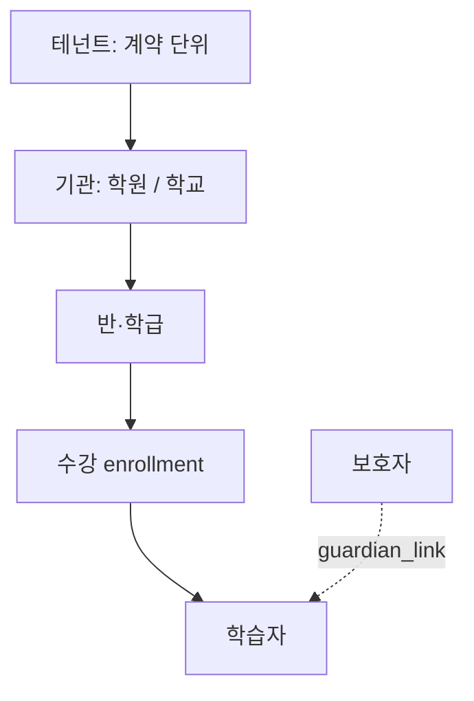
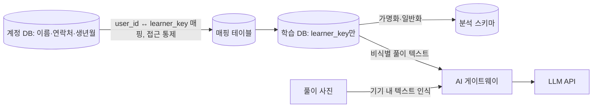

# B01 시스템구조서

> **작성 가이드**
> - **목적**: E09 기능과 E12 데이터 요구를 담을 시스템의 경계, 구성 요소(C), 기관·역할 구조, 비기능 요구, 학생 개인정보의 흐름을 한 장에 정합니다. B02~B04는 이 문서를 기준으로 씁니다.
> - **입력**: E09 기능·권한 매트릭스·교육 현장 예외, E12 이벤트·동의·보존, E13 위험(RK), E14 AI 기능(해당 시), E00·`AGENTS.md`의 회사 기술 스택, `02.wiki/decisions/` ADR
> - **게이트**: 전제는 E09, E12. 회사 개발팀 표준 문서가 있으면 `status: n/a`로 두고 `02.wiki/company/`에 링크만 남깁니다. 기술 선택을 바꾸면 ADR을 먼저 남기고 이 문서의 7절을 갱신합니다.
> - **작성 스킬**: `/edpm-doc B01`
> - **검토 패널 (권장)**: 개발 리드, 보안 담당, 데이터 엔지니어, 개인정보 보호책임자, 운영(CS) 담당
> - 표의 첫 행은 예시 제품 **매스핏**(중학생 만 12~15세, 학원 B2B2C + 학부모 결제, AI 오답 해설) 기준입니다. 스택은 특정 기술을 강제하지 않습니다.

---

## 1. 시스템 컨텍스트

```mermaid
graph LR
    L[학습자] --> APP
    T[교사] --> APP
    G[보호자] --> APP
    A[기관관리자] --> APP
    O[운영자] --> ADM[운영 콘솔]
    ADM --> APP
    subgraph APP[{제품명} 시스템]
        WEB[웹·앱 클라이언트] --> API[API 서버]
        API --> DB[(운영 DB)]
        API --> AN[(분석 스키마 가명)]
    end
    LMS[학교 LMS] <-->|LTI 1.3| API
    ROS[학생명부 OneRoster/CSV] -->|명단 동기화| API
    SSO[SSO 학교 계정/구글/카카오] -->|OIDC 로그인| API
    API <-->|결제·환불| PG[결제 PG]
    API -->|푸시·알림톡·메일| NT[알림 서비스]
    API -->|비식별 풀이 텍스트만| LLM[LLM API]
    AN -->|가명 집계 이벤트| ANA[분석 도구]
```

| 외부 시스템 | 연동 방식 | 주고받는 데이터 | 해당 여부 | 예시 (매스핏) |
|-------------|-----------|-----------------|:---:|---------------|
| LMS | LTI 1.3 Launch, AGS 성적 반환, NRPS 명단 | 실행 컨텍스트, 성적 | {예/아니오} | 아니오 (학원 대상). 학교 확장 시 재검토 |
| 학생명부 | OneRoster API 또는 CSV 업로드 | 학생·반·교사 명단 | {예/아니오} | 학원 관리 프로그램 CSV 가져오기 |
| SSO | OIDC / OAuth 2.0 | 로그인 식별자, 이메일(선택) | {예/아니오} | 보호자 카카오, 교사 구글 [가정] |
| 결제 PG | PG사 결제창, 웹훅 | 주문·결제 상태 (카드 정보는 PG 보관) | {예/아니오} | 학부모 월 구독 |
| 알림 | 푸시, 알림톡, 이메일 | 수신 토큰, 문구 | {예/아니오} | 보호자 주간 리포트 알림 |
| LLM API | HTTPS API | 비식별 풀이 텍스트, 문항 메타 | {예/아니오} | 힌트 생성 (F-012) |
| 분석 | 이벤트 수집 SDK 또는 DB 직접 | 가명 이벤트 | {예/아니오} | 자체 분석 스키마 + SQL |

## 2. 구성 요소 (C)

| C-ID | 구성 요소 | 책임 | 연결 F | 데이터 소유 | 비고 |
|------|-----------|------|--------|-------------|------|
| C-01 (예시) | 학습 엔진 | 문항 제공, 채점, 힌트 사다리 단계 결정, EV-03·EV-04 기록 | F-012 | attempts, mastery | 정답 검증은 수식 엔진 (E14 GR) |
| C-02 (예시) | AI 게이트웨이 | 입력 비식별 확인, LLM 호출, 가드레일, 3초 초과 시 정적 힌트 대체 | F-012 | ai_interactions | RK-01 통제 지점 |
| {C-0N} | {구성 요소} | {책임 한 문장} | {F-ID} | {테이블} | {비고} |

권장 분리: 계정·동의(식별 정보) / 학습 엔진 / AI 게이트웨이 / 리포트 / 결제 / 연동(LTI·명부) / 운영 콘솔. 작은 팀은 하나의 서비스 안에서 모듈로만 나눠도 됩니다 [가정].

## 3. 멀티테넌시 모델



| 계층 | 정의 | 격리 기준 | 예시 (매스핏) |
|------|------|-----------|---------------|
| 테넌트 | {계약·과금 단위} | 모든 테이블에 tenant_id, 행 수준 보안 (B03 5절) | 학원 법인 1곳 = 테넌트 1개 |
| 기관 | {학원 지점 / 학교} | org_id | 지점별 원장 |
| 반 | {반·학급, 과정 기간} | class_id, 시작·종료일 | 중2 심화반 (2027-03 ~ 2027-08) |
| 학습자 | 개인 계정, 기관을 옮겨도 계정 유지 | 기관 간 기록 이관은 보호자 동의 시만 | E09 4절 전학 규칙 |

## 4. 역할·권한 모델

E09 2절 권한 매트릭스를 코드로 옮기는 규칙입니다. 권한은 "역할 + 범위"로 판정합니다.

| 역할 | 범위(scope) | 판정 규칙 | 예시 (매스핏) |
|------|-------------|-----------|---------------|
| 학습자 | 본인 | user_id = 요청자 | 본인 풀이·힌트만 |
| 교사 | 담당 반 | 요청 class_id가 teacher_assignments에 있고 기간 내 | 반 변경 시 즉시 회수 |
| 보호자 | 연결 자녀 | guardian_links 활성 + 동의 유효 | 동의 철회 시 리포트 차단 |
| 기관관리자 | 소속 기관 집계 | org_id 일치, 학생 상세 대신 집계 | 원장 |
| 운영자 | 시스템 | 학생 상세는 승인된 장애 대응 건만, 접근 로그 필수 | 사내 CS |
| {역할} | {범위} | {규칙} | {예시} |

## 5. 비기능 요구

| 항목 | 기준 | 근거 | 예시 (매스핏) |
|------|------|------|---------------|
| 학기초 동시접속 피크 | {동시 사용자 수, p95 응답} | E15 학사일정, E06 REQ-1xx | 3월 첫 주 평일 21~23시 동시 {N}명, 힌트 p95 3초 [가정] |
| 시험 기간 트래픽 | {배수} | [[domain/학사일정]] | 중간고사 2주 전 평시 대비 {N}배 [가정] |
| 학교망 방화벽·필터링 | 허용 도메인 목록 문서화, 웹소켓 차단 시 폴링 대체 | 기관 IT 담당 확인 | 도메인 3개 이내로 묶음 [가정] |
| 저사양 기기 | {크롬북·구형 태블릿에서 첫 화면 로드 시간} | E13 e1 | 초기 JS 번들 {N}KB 이하 [가정] |
| 오프라인 허용 범위 | 허용: {풀이 임시 저장, 정적 힌트 1단계} / 불허: {AI 힌트, 결제, 동의 변경} | E10 3절 | 재접속 시 attempt 큐 동기화 (멱등 키) |
| 가용성 | {월 가동률} | | 학습 시간대 99.5% [가정] |
| 접근성 | WCAG 2.2 AA | E13 (c), B05 | |

## 6. 학생 개인정보 데이터 흐름



| 데이터 | 저장 위치 | 외부 전송 | 절대 나가지 않는 것 |
|--------|-----------|-----------|---------------------|
| 식별 정보 (이름, 연락처, 생년월) | 계정 DB (암호화 컬럼) | 알림 서비스에 수신 토큰만 | 이름·학교·반 조합은 LLM·분석 도구로 전송 금지 |
| 학습 기록 | 학습 DB (learner_key) | LMS 성적 반환 시 해당 학교만 | 원본 풀이 사진 (RK-01: 기기에서 수식만 추출) |
| 결제 정보 | PG사 | - | 카드 번호는 자사 DB에 저장하지 않음 |
| AI 입력·출력 | ai_interactions (보존 기간 E12 8절) | LLM API (학습 미사용 조건 [확인 필요]) | 자유 입력 속 이름·연락처 (정규식 마스킹 후 전송) |
| {데이터} | {위치} | {전송} | {금지} |

## 7. 기술 선택 기록

회사 스택이 E00·`AGENTS.md` 2절에 있으면 그것을 적습니다. 아래 기본값은 **소규모 팀이 MVP를 만들 때의 예시일 뿐 권장·강제가 아닙니다.**

| 영역 | 선택 | 대안 | 선택 이유 | ADR |
|------|------|------|-----------|-----|
| 프론트엔드 | {선택} — 예시: Next.js | {대안} | 예시: 웹 하나로 크롬북·태블릿·PC 대응 | {ADR-001} |
| 백엔드·API | {선택} — 예시: Next.js API 라우트 또는 별도 서버 | {대안} | | {ADR} |
| DB | {선택} — 예시: PostgreSQL (Supabase) | {대안} | 예시: 행 수준 보안(RLS)으로 테넌트·역할 격리 | {ADR} |
| 인증 | {선택} — 예시: Supabase Auth + OIDC | {대안} | | {ADR} |
| 호스팅 | {선택} — 예시: Vercel + 국내 리전 DB | {대안} | 리전은 B04 데이터 상주 검토 후 확정 [확인 필요] | {ADR} |
| LLM | {선택} | {대안} | E14·A 트랙 평가 결과 기준 | {ADR} |

## 8. 관련 의사결정 (ADR)

| ADR | 제목 | 상태 | 링크 |
|-----|------|------|------|
| ADR-001 (예시) | 풀이 사진 원본을 서버로 보내지 않고 기기에서 수식만 추출 | 승인 | `[[decisions/ADR-001]]` |
| {ADR-0NN} | {제목} | {제안/승인/폐기} | {링크} |

---

## 완료 체크리스트

- [ ] 컨텍스트 다이어그램에 5개 역할과 해당 외부 시스템이 모두 있고, 해당 없는 연동은 사유가 있다
- [ ] 모든 P0 F가 하나 이상의 C에 연결된다
- [ ] 테넌트·기관·반 격리 기준과 역할별 범위 판정 규칙이 E09 권한 매트릭스와 일치한다
- [ ] 학기초 피크, 학교망, 저사양 기기, 오프라인 범위에 수치 또는 `[가정]`이 있다
- [ ] 학생 식별 정보가 LLM·분석 도구로 나가지 않는 경로가 그림과 표로 확인된다 (E13 RK 연결)
- [ ] 기술 선택마다 이유가 있고, 주요 선택은 ADR로 남겼다
- [ ] E09, E12가 `done`이다
