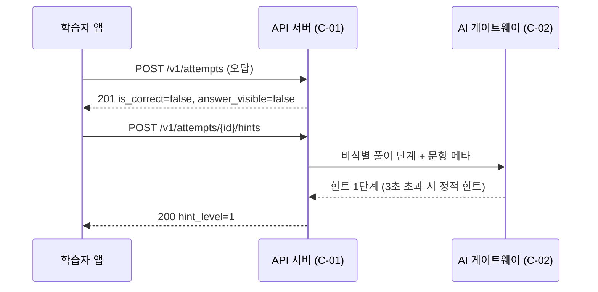

# B02 API명세서

> **작성 가이드**
> - **목적**: B01 구성 요소가 주고받는 API를 정의하고, 모든 API가 E09 기능(F)과 권한 매트릭스로 추적되게 합니다. 프론트엔드·QA·외주 개발사가 이 문서만 보고 구현·검증할 수 있어야 합니다.
> - **입력**: B01 구성 요소·역할 범위 모델, E09 기능·인수조건·권한 매트릭스, E12 이벤트(EV)·동의 플래그, E14 AI 기능·가드레일(해당 시)
> - **게이트**: 전제는 B01. 회사 개발팀 표준이 있으면 `n/a`. 상세 스키마는 OpenAPI 파일(`{경로, 예: api/openapi.yaml}`)이 원본이고, 이 문서는 규칙·추적·핵심 예시만 둡니다. 둘이 다르면 OpenAPI를 고치고 이 문서를 갱신합니다.
> - **작성 스킬**: `/edpm-doc B02`
> - **검토 패널 (권장)**: 개발 리드, 보안 담당, 프론트엔드 담당, QA, 개인정보 보호책임자
> - 표의 첫 행은 예시 제품 **매스핏**(중학생 만 12~15세, 학원 B2B2C + 학부모 결제, AI 오답 해설) 기준입니다.

---

## 1. 공통 규약

| 항목 | 규칙 | 예시 (매스핏) |
|------|------|---------------|
| 스타일 | {REST/JSON, 리소스 복수형, snake_case 필드} | `GET /v1/classes/{class_id}/assignments` |
| 인증 | {세션 쿠키 / Bearer 토큰(OIDC), 만료 시간} | 액세스 토큰 1시간, 공용 기기 모드는 10분 무조작 만료 (E09 4절) |
| 테넌트 판정 | 토큰의 tenant_id로만 판정. 요청 본문의 tenant_id는 무시 | |
| 오류 형식 | `{ "error": { "code", "message", "request_id" } }`, message는 사용자 노출용 쉬운 문장 | `CONSENT_REQUIRED`, `FORBIDDEN_SCOPE` |
| 페이지네이션 | {커서 기반, limit 최대값} | `?cursor=...&limit=50` (최대 100) |
| 버전 | {URL 경로 /v1, 하위 호환 깨질 때만 증가, 구버전 유지 기간} | 구버전 1학기 유지 [가정] (학기 중 앱 강제 업데이트 회피) |
| 멱등성 | 쓰기 요청에 `Idempotency-Key` 헤더, 24시간 보관 | 오프라인 큐 재전송 시 attempt 중복 방지 |
| 시간 | ISO 8601, 오프셋 포함 | `2027-03-12T21:05:11+09:00` |

**오류 코드**

| HTTP | code | 의미 | 클라이언트 처리 |
|------|------|------|-----------------|
| 401 | UNAUTHENTICATED | 로그인 필요·만료 | 로그인 화면 |
| 403 | CONSENT_REQUIRED | 보호자 동의 없음·철회 | E10 "동의 없음" 상태 |
| 403 | FORBIDDEN_SCOPE | 역할 범위 밖 (담당 반 아님 등) | E10 "권한 없음" 상태 |
| 409 | IDEMPOTENCY_CONFLICT | 같은 키로 다른 본문 | 새 키로 재시도하지 않고 오류 기록 |
| 429 | RATE_LIMITED | 호출 한도 초과 | `Retry-After` 후 재시도 |
| {코드} | {code} | {의미} | {처리} |

## 2. API 목록과 추적

| API-ID | 메서드·경로 | 설명 | F-ID | C-ID | 허용 역할 (범위) | EV | 비고 |
|--------|-------------|------|------|------|------------------|----|------|
| API-012 (예시) | POST /v1/attempts | 풀이 제출, 채점 | F-012 | C-01 | 학습자 (본인) | EV-04 | 멱등 키 필수 |
| API-013 (예시) | POST /v1/attempts/{attempt_id}/hints | 힌트 다음 단계 요청 | F-012 | C-01, C-02 | 학습자 (본인) | EV-03 | AI 실패 시 정적 힌트 |
| API-001 (예시) | POST /v1/classes/{class_id}/invites | 반 초대 코드 발급 | F-001 | {C} | 교사 (담당), 기관관리자 (소속) | - | |
| {API-0NN} | {메서드 경로} | {설명} | {F} | {C} | {역할 (범위)} | {EV} | {비고} |

## 3. 상세 예시: 오답 제출 → 힌트 요청 (F-012, SCR-004)



**요청 1: 풀이 제출** `POST /v1/attempts` (예시)

```json
{
  "item_id": "ITEM-2A-0137",
  "assignment_id": "asg_7d21",
  "attempt_no": 2,
  "answer": "x = 5",
  "steps": ["2x + 3 = 7", "2x = 10", "x = 5"],
  "steps_source": "ocr_on_device",
  "elapsed_sec": 94,
  "client_ts": "2027-03-12T21:05:11+09:00"
}
```

**응답 1** `201 Created`

```json
{
  "attempt_id": "att_91fc",
  "is_correct": false,
  "first_wrong_step": 2,
  "answer_visible": false,
  "next_action": "retry_or_hint",
  "hint_level_available": 1
}
```

**요청 2: 힌트 요청** `POST /v1/attempts/att_91fc/hints` 본문: `{ "requested_level": 1 }`

**응답 2** `200 OK`

```json
{
  "hint_level": 1,
  "hint_text": "두 번째 줄을 다시 볼까요? 양변에서 같은 수를 뺐는지 확인해 보세요.",
  "highlight_step": 2,
  "source": "ai",
  "ai_label": "AI가 만든 힌트예요",
  "fallback_used": false,
  "answer_visible": false
}
```

규칙: 응답에는 학습자 이름·반 이름을 넣지 않습니다. `answer_visible`은 서버가 E09 F-012 AC-3·AC-4(교사 설정 "정답 공개 금지")에 따라 결정하며, 클라이언트가 바꿀 수 없습니다. 이름·연락처가 `steps`에 섞여 들어오면 C-02가 마스킹 후 전송합니다 (RK-01).

## 4. 권한 규칙

| 규칙 | 서버 판정 방법 | 위반 시 | 테스트 (B06) |
|------|----------------|---------|--------------|
| 교사는 담당 반만 | 요청 class_id가 teacher_assignments(기간 내)에 있는가 | 403 FORBIDDEN_SCOPE, 접근 로그 | {TC-0NN} |
| 보호자는 자녀만 | guardian_links 활성 + consents.service_core 유효 | 403 | {TC} |
| 학습자는 본인만 | 리소스 user_id = 토큰 sub | 404 (존재 여부 비노출) | {TC} |
| 기관관리자는 집계만 | 학생 단위 필드 제거, 소집단 {N}명 미만 비공개 (E12 9절) | 집계만 반환 | {TC} |
| 운영자 학생 상세 | 승인 티켓 ID 헤더 필수, 감사 로그 | 403 | {TC} |
| {규칙} | {판정} | {처리} | {TC} |

## 5. 호출 한도

| 대상 | 한도 | 기준 | 예시 근거 |
|------|------|------|-----------|
| 힌트 요청 | {분당 N회 / 학습자} | 비용·남용 방지 | 분당 10회 [가정] |
| 로그인 | {분당 N회 / IP} | 무차별 대입 방지. 학교·학원은 IP 공유이므로 계정 단위 병행 | [가정] |
| 명단 가져오기 | {시간당 N회 / 기관} | | |
| {대상} | {한도} | {기준} | {근거} |

## 6. 웹훅·이벤트

| 이벤트 | 방향 | 트리거 | 페이로드 요약 | 재시도·서명 | 해당 여부 |
|--------|------|--------|---------------|-------------|:---:|
| LTI 성적 반환 (AGS) | 발신 → LMS | 과제 완료 | lineitem, score, 학습자 LTI sub | 실패 시 지수 백오프, 서명 토큰 | {예/아니오} |
| 명단 동기화 | 수신 ← OneRoster / CSV | 일 1회 또는 업로드 | 반·학생·교사 변경분 | 변경 이력 저장, 전학·반 변경 처리 (E09 4절) | {예/아니오} |
| 결제 상태 | 수신 ← PG | 결제·환불·실패 | 주문 ID, 상태 | PG 서명 검증, 멱등 처리 | {예/아니오} |
| 동의 철회 | 내부 이벤트 | 보호자 철회 | learner_key, 철회 플래그 | 즉시 세션 무효화 | 예 |
| {이벤트} | {방향} | {트리거} | {페이로드} | {규칙} | {해당} |

## 7. 페이로드 개인정보 최소화

| 원칙 | 적용 |
|------|------|
| 필요한 필드만 | 목록 API는 표시 이름(가명 가능)과 ID만. 생년월·연락처는 계정 API에서만 |
| 학습 이벤트는 가명 키 | 분석·로그 전송 페이로드는 learner_key만 (E12 2절) |
| 로그 마스킹 | 요청 로그에서 `answer`, `steps`, 연락처 필드는 마스킹 또는 미기록 |
| 외부 전송 | LLM·분석 도구로 가는 페이로드는 C-02·분석 수집기에서만 생성 (B01 6절) |
| 오류 메시지 | 존재 여부를 노출하지 않음 (다른 반 학생 ID 조회 시 404) |

---

## 완료 체크리스트

- [ ] 모든 API가 F-ID와 C-ID, 허용 역할(범위)로 추적된다
- [ ] 모든 P0 F에 대응하는 API가 있다
- [ ] 공통 규약(인증, 오류, 페이지네이션, 버전, 멱등성)이 정해졌다
- [ ] 교사 담당 반·보호자 자녀 한정 규칙이 서버 판정 방법과 테스트 ID로 연결되었다
- [ ] 동의 없음·철회 시 응답(CONSENT_REQUIRED)이 정의되었다
- [ ] 응답·로그·외부 전송 페이로드에 불필요한 식별 정보가 없다
- [ ] OpenAPI 파일 경로가 적혀 있고 이 문서와 일치한다
- [ ] B01이 `done`이다
