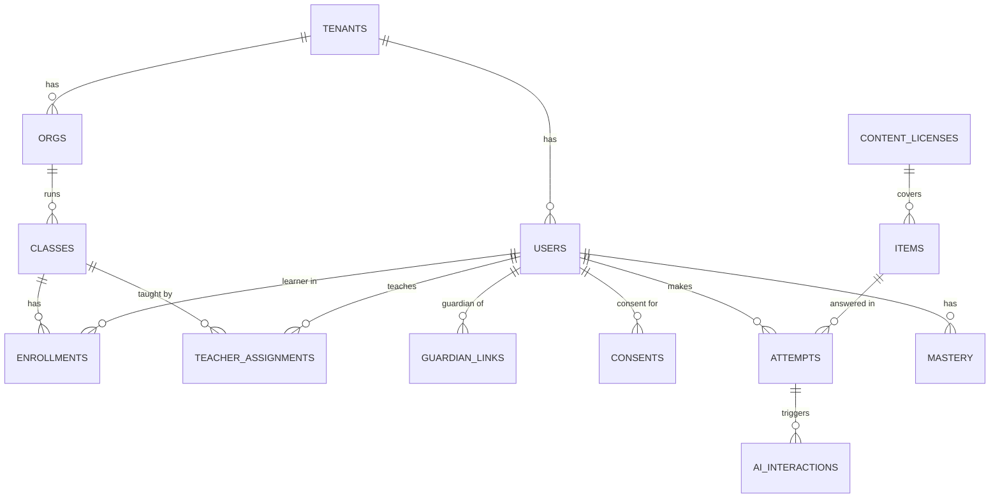

# B03 데이터베이스설계서

> **작성 가이드**
> - **목적**: E12의 논리 데이터 모델을 실제 테이블(TB)로 옮기고, 컬럼마다 개인정보 등급과 보존 규칙을 붙이며, 테넌트·역할 격리를 DB 수준에서 강제합니다.
> - **입력**: E12 엔티티·이벤트·동의 플래그·열람 권한·보존 정책·비식별화, B02 API와 권한 규칙, B01 멀티테넌시 모델, E13 RK
> - **게이트**: 전제는 E12, B02. 회사 개발팀 표준이 있으면 `n/a`. 지표(M) 계산 SQL은 `automation/sql/`에 두고 이 문서에는 경로만 적습니다 (LLM이 수치를 추정하지 않음).
> - **작성 스킬**: `/edpm-doc B03`
> - **검토 패널 (권장)**: 개발 리드, 데이터 엔지니어, 보안 담당, 개인정보 보호책임자
> - 표의 첫 행은 예시 제품 **매스핏**(중학생 만 12~15세, 학원 B2B2C + 학부모 결제, AI 오답 해설) 기준입니다. SQL 예시는 PostgreSQL 문법이며 회사 DB에 맞게 바꿉니다.

---

## 1. ERD



`ORGS`는 학원·학교를 함께 담고 `org_type`으로 구분합니다. 학습 테이블(ATTEMPTS, MASTERY, AI_INTERACTIONS)은 user_id 대신 learner_key를 쓰고, USERS와는 매핑 테이블(`learner_keys`)로만 연결합니다.

## 2. 테이블 목록

| TB-ID | 테이블 | 설명 | 관련 엔티티 (E12) | 주 사용 API (B02) | 개인정보 최고 등급 |
|-------|--------|------|-------------------|-------------------|--------------------|
| TB-01 (예시) | attempts | 문항 풀이 시도 (EV-04 정규화) | attempt | API-012, API-013 | 간접식별 |
| TB-02 (예시) | users | 모든 역할 계정 | learner, guardian | 계정 API | 직접식별 |
| {TB-0N} | {테이블} | {설명} | {엔티티} | {API} | {등급} |

권장 목록: tenants, orgs, classes, users, learner_keys, enrollments, teacher_assignments, guardian_links, consents, items, attempts, mastery, ai_interactions, content_licenses, audit_logs.

## 3. 테이블 정의

> 테이블마다 아래 표를 복사합니다. 개인정보 등급: **직접식별**(이름, 연락처, 이메일, 얼굴 사진) / **간접식별**(가명 키, 생년월, 다른 정보와 결합 시 식별 가능한 학습 기록) / **비식별**(문항, 집계). 보존 규칙은 E12 8절 행을 가리킵니다.

### TB-01. attempts (예시)

| 컬럼 | 타입 | 필수 | 설명 | 개인정보 등급 | 보존 규칙 (E12 8절) |
|------|------|:---:|------|---------------|---------------------|
| attempt_id | uuid PK | O | | 비식별 | 행 단위 |
| tenant_id | uuid FK | O | RLS 기준 | 비식별 | 테넌트 해지 시 파기 |
| learner_key | text FK | O | 가명 키 | 간접식별 | 탈퇴·동의 철회 시 삭제 또는 익명 집계 전환 |
| class_id | uuid FK | O | 제출 시점 반 | 비식별 | 반 종료 후 읽기 전용 6개월 [가정] |
| item_id | text FK | O | | 비식별 | 문항 라이선스 종료와 무관하게 유지 |
| attempt_no | int | O | 시도 번호 | 비식별 | |
| is_correct | bool | O | | 간접식별 | 위와 동일 |
| first_wrong_step | int | | 처음 틀린 단계 | 간접식별 | |
| hint_level_max | int | | 최대 힌트 단계 (EV-03 연계) | 간접식별 | |
| steps_text | text | | 풀이 단계 텍스트 (사진 원본 미저장, RK-01) | 간접식별 | 90일 후 NULL 처리 [가정] |
| consent_state | jsonb | O | 제출 시점 동의 플래그 | 비식별 | |
| idempotency_key | text unique | O | B02 1절 | 비식별 | 24시간 후 정리 |
| created_at | timestamptz | O | | 비식별 | |

**인덱스**: `(tenant_id, class_id, created_at)` 교사 반 대시보드, `(learner_key, item_id, attempt_no)` 재풀이 조회, `unique(idempotency_key)`.

### {TB-0N}. {테이블}

| 컬럼 | 타입 | 필수 | 설명 | 개인정보 등급 | 보존 규칙 |
|------|------|:---:|------|---------------|-----------|
| {컬럼} | {타입} | {O/ } | {설명} | {직접식별/간접식별/비식별} | {E12 8절 행} |

**인덱스**: {인덱스와 쓰는 쿼리}

## 4. 주요 테이블 메모

| 테이블 | 핵심 컬럼 | 주의 |
|--------|-----------|------|
| users | role, display_name, birth_ym, 암호화 연락처 | 생년월로 만 14세 도달일 계산 → 동의 주체 전환 작업 (E09 4절) |
| guardian_links | guardian_id, learner_id, status, verified_at | 해지 시 즉시 접근 차단 |
| consents | learner_id, flag, granted_by, granted_at, revoked_at | 이력은 덮어쓰지 않고 행 추가 (E12 6절) |
| enrollments / teacher_assignments | 시작일, 종료일 | 반 변경·전학 시 종료일만 기록, 행 삭제 금지 |
| ai_interactions | learner_key, attempt_id, model, prompt_version, masked_input, output, guardrail_result | 원문 입력 미저장, 보존 기간 E12 8절 |
| content_licenses | provider, scope, start_date, end_date, ai_use_allowed | 만료 시 items 노출 중지 (E11, [[domain/교육저작권]]) |

## 5. 행 수준 보안 (RLS) 예시

```sql
-- 모든 테이블: 테넌트 격리
ALTER TABLE attempts ENABLE ROW LEVEL SECURITY;
CREATE POLICY tenant_isolation ON attempts
  USING (tenant_id = current_setting('app.tenant_id')::uuid);

-- 교사: 담당 반 학생 기록만 (기간 내 배정)
CREATE POLICY teacher_own_class ON attempts FOR SELECT
  USING (EXISTS (
    SELECT 1 FROM teacher_assignments ta
    WHERE ta.class_id = attempts.class_id
      AND ta.teacher_id = current_setting('app.user_id')::uuid
      AND now() BETWEEN ta.start_date AND COALESCE(ta.end_date, 'infinity')));

-- 보호자: 연결되고 동의가 유효한 자녀만
CREATE POLICY guardian_own_child ON attempts FOR SELECT
  USING (learner_key IN (
    SELECT lk.learner_key FROM learner_keys lk
    JOIN guardian_links gl ON gl.learner_id = lk.user_id
    WHERE gl.guardian_id = current_setting('app.user_id')::uuid
      AND gl.status = 'active'));
```

RLS는 API 권한 판정(B02 4절)과 **중복 방어**입니다. 둘 중 하나만 믿지 않습니다. 정책마다 B06 역할 기반 테스트를 둡니다.

## 6. 분석용 가명 스키마

| 규칙 | 내용 | 예시 |
|------|------|------|
| 분리 | 분석은 `analytics` 스키마만 조회. 운영 스키마 직접 조회 금지 | 분석 계정은 `analytics` 읽기 권한만 |
| 가명화 | learner_key → 분석용 키로 한 번 더 해시 (솔트는 비밀 저장소) | |
| 일반화 | birth_ym → 학년, org → 지역 단위 | E12 9절 |
| 제외 | consent_state.analytics = false 행은 적재하지 않음 | |
| 소집단 억제 | 집계 셀 {N}명 미만 비공개 | 5명 미만 [가정] |
| 적재 | {배치 주기, 스크립트 경로} | `automation/sql/etl_analytics.sql` 일 1회 [가정] |

## 7. 마이그레이션과 시드

| 규칙 | 내용 |
|------|------|
| 마이그레이션 | 도구 {예: 프레임워크 기본 도구}, 파일은 `{경로}`에 순번으로, 운영 적용 전 스테이징에서 실행 |
| 파괴적 변경 | 컬럼 삭제·타입 변경은 2단계(추가 → 이전 → 삭제)로, 변경 동결 기간(E15 FZ)에는 적용하지 않음 |
| 시드 데이터 | **가상·가명 샘플만** (`학생A`, `교사B`, `OO학원`). 실제 학생 데이터 복사 금지 (`AGENTS.md` 7절) |
| 운영 데이터 복제 | 스테이징으로 복제 금지. 필요하면 가명화 스크립트를 거친 부분집합만, 보안 담당 승인 |

## 8. 지표 SQL 소유

| M-ID | 지표 | 쿼리 경로 | 사용 테이블 | 담당 | 검증 |
|------|------|-----------|-------------|------|------|
| M-01 (예시) | 7일 재풀이 정답률 | `automation/sql/m01_7day_retry.sql` | analytics.attempts | {데이터 담당} | 가명 샘플 10건 수기 계산과 일치 |
| M-13 (예시) | 힌트 후 재도전 정답률 | `automation/sql/m13_retry_after_hint.sql` | analytics.attempts | {담당} | 위와 동일 |
| {M-0N} | {지표} | {경로} | {테이블} | {담당} | {방법} |

---

## 완료 체크리스트

- [ ] ERD가 E12 엔티티와 일치하고, 학습 테이블은 learner_key로만 연결된다
- [ ] 모든 컬럼에 개인정보 등급과 보존 규칙(E12 8절 연결)이 있다
- [ ] 직접식별 컬럼은 계정 영역 테이블에만 있고 암호화 여부가 적혀 있다
- [ ] 테넌트·교사·보호자 RLS 정책이 있고 B06 테스트가 연결되었다
- [ ] 분석 스키마의 가명화·동의 필터·소집단 억제 규칙이 있다
- [ ] 시드·스테이징에 실제 학생 데이터가 없다
- [ ] E07 북극성·핵심 지표의 SQL 경로가 `automation/sql/`에 있다
- [ ] E12, B02가 `done`이다
